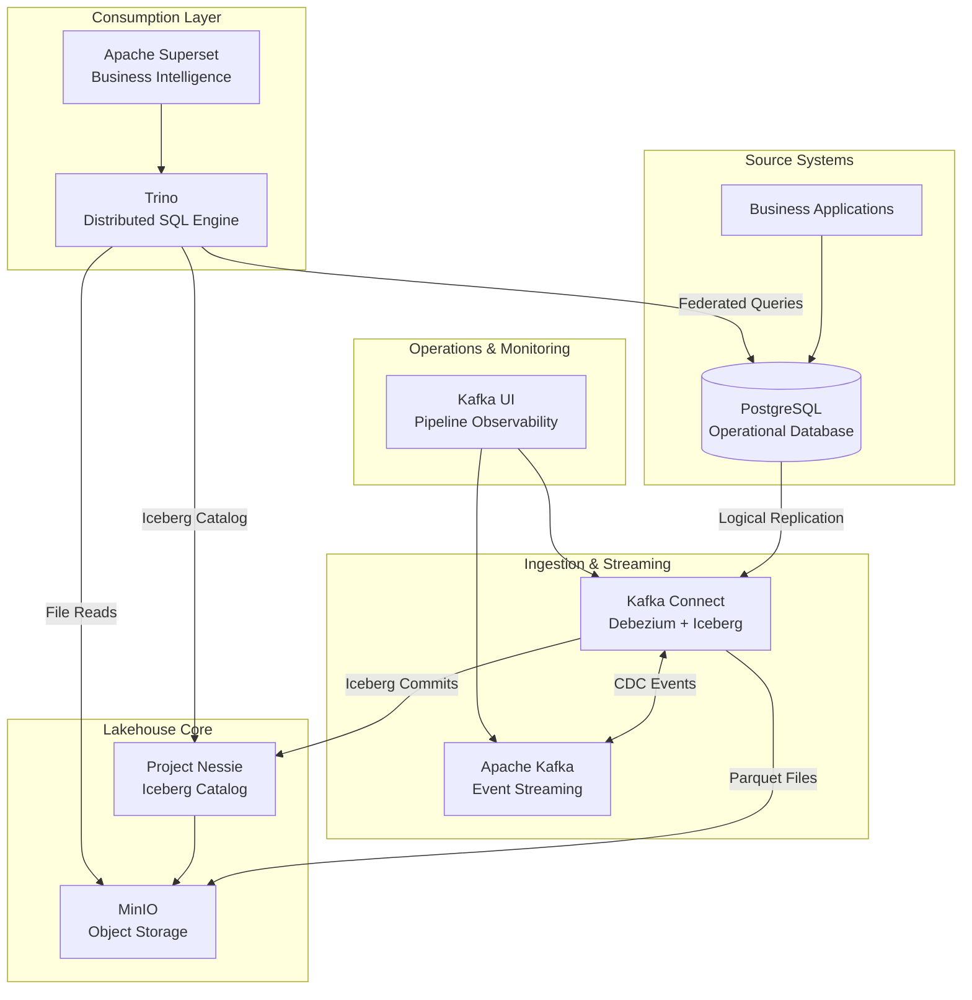
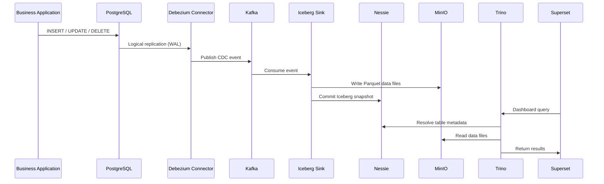
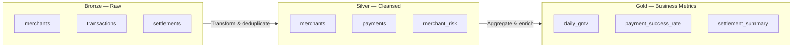
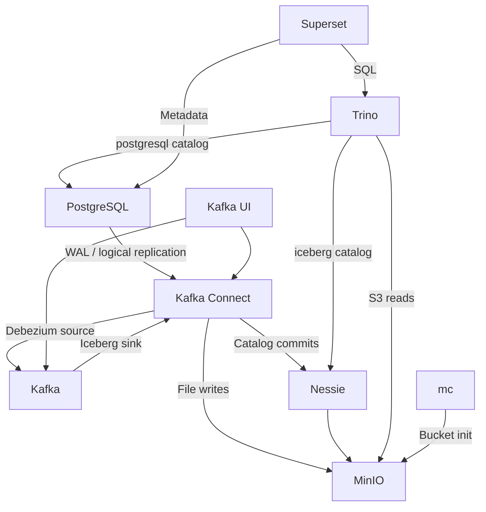

# Smart Data Platform
## Data Lakehouse Architecture

| | |
|---|---|
| **Document** | Architecture Overview |
| **Platform** | Smart Data Platform |
| **Version** | 1.0 |
| **Classification** | Client Presentation |
| **Stack Basis** | `docker-compose.yml` |

---

## 1. Executive Summary

The Smart Data Platform is a modern **data lakehouse** designed to unify operational and analytical data workloads. It captures changes from transactional systems in near real time, persists them as governed analytical tables on object storage, and exposes them through standard SQL and business intelligence tools.

The platform is built entirely on **open-source, industry-proven technologies** and follows established patterns used by leading data-driven organizations. It separates storage from compute, supports schema evolution and time travel, and provides a clear path from proof-of-concept to production-scale deployment.

**Primary business outcomes:**

- **Near-real-time analytics** — Operational data becomes queryable within minutes, not overnight batch windows.
- **Single source of analytical truth** — Iceberg tables on object storage provide consistent, versioned datasets for reporting and advanced analytics.
- **Reduced integration complexity** — Standard SQL (Trino) and self-service BI (Superset) lower the barrier for business and data teams.
- **Future-ready foundation** — The architecture supports additional domains (payments, settlements, KYC, risk) without redesign.

---

## 2. Business Context

### 2.1 Problem Statement

Traditional analytics pipelines often rely on periodic batch extracts from operational databases. This approach introduces:

- Data latency that limits operational decision-making
- Schema drift and reconciliation challenges between source and warehouse
- High cost and rigidity of proprietary warehouse solutions
- Difficulty serving both live operational queries and historical analytics from the same platform

### 2.2 Solution Approach

The Smart Data Platform addresses these challenges through **Change Data Capture (CDC)** and an **open table format (Apache Iceberg)** backed by **S3-compatible object storage**. Data moves through a streaming layer (Kafka) that decouples source systems from downstream consumers, ensuring resilience and replay capability.

---

## 3. Architecture Principles

| Principle | Description |
|-----------|-------------|
| **Separation of storage and compute** | Data files reside in object storage (MinIO); query engines (Trino) access them independently. |
| **Open standards** | Apache Kafka, Apache Iceberg, and SQL-based access avoid vendor lock-in. |
| **Event-driven ingestion** | CDC captures every insert, update, and delete as a durable event. |
| **Governed metadata** | Nessie provides a versioned catalog with branch and snapshot semantics. |
| **Medallion layering** | Bronze (raw), Silver (cleansed), and Gold (business-ready) schemas organize data by maturity. |
| **Modular services** | Each component is containerized and independently scalable. |

---

## 4. Reference Architecture

### 4.1 High-Level View



### 4.2 Logical Layers

```
┌─────────────────────────────────────────────────────────────────┐
│                    CONSUMPTION LAYER                            │
│         Apache Superset  ·  Trino SQL  ·  API Clients           │
├─────────────────────────────────────────────────────────────────┤
│                    COMPUTE LAYER                                │
│              Trino (interactive & batch SQL)                    │
├─────────────────────────────────────────────────────────────────┤
│                    CATALOG & GOVERNANCE                         │
│         Project Nessie (metadata, versions, branches)           │
├─────────────────────────────────────────────────────────────────┤
│                    TABLE FORMAT LAYER                           │
│    Apache Iceberg (ACID, snapshots, schema evolution, partitions) │
├─────────────────────────────────────────────────────────────────┤
│                    STORAGE LAYER                                │
│         MinIO — S3-compatible object storage (warehouse/)       │
├─────────────────────────────────────────────────────────────────┤
│                    STREAMING LAYER                              │
│    Apache Kafka  ·  Kafka Connect (Debezium + Iceberg Sink)     │
├─────────────────────────────────────────────────────────────────┤
│                    SOURCE LAYER                                 │
│         PostgreSQL (transactional / operational data)           │
└─────────────────────────────────────────────────────────────────┘
```

---

## 5. End-to-End Data Flow

The following sequence describes how a single business event (e.g., a new merchant record) propagates through the platform.

| Step | Layer | Action |
|------|-------|--------|
| 1 | Source | A business application writes a record to PostgreSQL. |
| 2 | CDC | PostgreSQL logical replication captures the row-level change in the Write-Ahead Log (WAL). |
| 3 | Ingestion | Debezium (via Kafka Connect) reads the WAL and publishes a change event to Kafka. |
| 4 | Streaming | Kafka persists the event on topic `analytics.public.<table>`, enabling replay and decoupling. |
| 5 | Lakehouse Write | The Iceberg Sink Connector consumes the event, writes Parquet files to MinIO, and commits a new table snapshot via Nessie. |
| 6 | Query | Trino resolves the table through the Nessie catalog and executes SQL over Iceberg files. |
| 7 | Visualization | Superset queries Trino and renders dashboards for business stakeholders. |



---

## 6. Component Catalog

The platform comprises nine core services orchestrated via Docker Compose, plus an initialization helper.

### 6.1 Source Layer

#### PostgreSQL 16

| Attribute | Detail |
|-----------|--------|
| **Role** | Operational database and CDC source |
| **Port** | 5432 |
| **Database** | `analytics` |

PostgreSQL serves as the system of record for transactional data. It is configured for **logical replication** (`wal_level=logical`), which is a prerequisite for non-invasive, real-time change capture. Replication slots and WAL senders are provisioned to support continuous CDC without impacting application write performance.

**Capabilities enabled:**
- Live operational queries via Trino's PostgreSQL catalog
- Metadata storage for Superset (dashboards, users, permissions)
- Low-latency CDC via Debezium

---

### 6.2 Streaming & Ingestion Layer

#### Apache Kafka 4.1

| Attribute | Detail |
|-----------|--------|
| **Role** | Durable event streaming backbone |
| **Port** | 9092 |
| **Mode** | KRaft (combined broker and controller) |

Kafka acts as the central nervous system of the pipeline. It buffers change events between the source database and lakehouse writers, providing:

- **Fault tolerance** — Events are retained if downstream consumers are temporarily unavailable
- **Replay capability** — Consumers can reprocess historical events from a known offset
- **Decoupling** — Source systems are isolated from ingestion latency in the analytics path

#### Kafka Connect (Custom Image)

| Attribute | Detail |
|-----------|--------|
| **Role** | Managed connector runtime for CDC and lakehouse writes |
| **Port** | 8083 |
| **Base Image** | Debezium Connect 2.7.3 |
| **Extensions** | Apache Iceberg Kafka Connect Sink |

Kafka Connect hosts two categories of connectors that together form the ingestion pipeline:

**Source Connector — Debezium PostgreSQL**

| Setting | Value |
|---------|-------|
| Connector class | `PostgresConnector` |
| Capture method | PostgreSQL logical replication (`pgoutput`) |
| Topic naming | `analytics.public.<table_name>` |
| Snapshot mode | Initial (full load, then continuous streaming) |
| Event transform | ExtractNewRecordState (flattened row payloads) |

**Sink Connector — Apache Iceberg**

| Setting | Value |
|---------|-------|
| Connector class | `IcebergSinkConnector` |
| Catalog | Project Nessie (`main` branch) |
| Warehouse | `s3://warehouse/` |
| Target layer | `bronze.<table_name>` |

Two deployment modes are supported:

| Mode | Configuration | Use Case |
|------|---------------|----------|
| **Explicit mapping** | One topic mapped to one Iceberg table | Controlled rollout per domain entity |
| **Dynamic provisioning** | Topic regex `analytics.public.*` with auto-create | Rapid onboarding of new source tables |

#### Kafka UI

| Attribute | Detail |
|-----------|--------|
| **Role** | Operational monitoring and pipeline management |
| **Port** | 8080 |

Provides visibility into Kafka topics, consumer groups, message payloads, and Kafka Connect connector health — essential for pipeline operations and troubleshooting.

---

### 6.3 Lakehouse Storage Layer

#### MinIO

| Attribute | Detail |
|-----------|--------|
| **Role** | S3-compatible object storage |
| **API Port** | 9000 |
| **Console Port** | 9001 |
| **Bucket** | `warehouse` |

MinIO stores all lakehouse data files in open, columnar **Apache Parquet** format, along with Iceberg metadata files. In production, this layer maps directly to AWS S3, Azure Blob Storage, or Google Cloud Storage with no application changes — only endpoint configuration.

**Stored artifacts:**
- Iceberg data files (`data/*.parquet`)
- Iceberg metadata (`metadata/*.json`, manifests, snapshots)

#### Project Nessie 0.108

| Attribute | Detail |
|-----------|--------|
| **Role** | Versioned Iceberg REST catalog |
| **Port** | 19120 |
| **Reference branch** | `main` |

Nessie is the metadata authority for all Iceberg tables. It provides:

- **Table registry** — Schemas, partitions, and file locations
- **Snapshot versioning** — Point-in-time queries and auditability
- **Branch semantics** — Isolated development and promotion workflows (analogous to Git branches)
- **Multi-engine access** — Both Kafka Connect and Trino use the same catalog endpoint

---

### 6.4 Consumption Layer

#### Trino 480

| Attribute | Detail |
|-----------|--------|
| **Role** | Distributed SQL query engine |
| **Port** | 8081 |
| **Catalogs** | `iceberg` (lakehouse), `postgresql` (operational) |

Trino provides a unified SQL interface across the lakehouse and source database. Analysts and applications query Iceberg tables through the Nessie-backed catalog, while federated queries against PostgreSQL support live lookups and cross-source joins.

**Example access patterns:**

```sql
-- Analytical query over lakehouse (Bronze layer)
SELECT merchant_id, merchant_name, city, created_at
FROM iceberg.bronze.merchants
ORDER BY created_at DESC;

-- Federated query (lakehouse + operational source)
SELECT m.merchant_name, COUNT(*) AS txn_count
FROM iceberg.bronze.merchants m
JOIN postgresql.public.transactions t ON m.merchant_id = t.merchant_id
GROUP BY m.merchant_name;
```

#### Apache Superset

| Attribute | Detail |
|-----------|--------|
| **Role** | Self-service business intelligence |
| **Port** | 8088 |
| **Query engine** | Trino (via SQLAlchemy driver) |

Superset empowers business users to build dashboards, charts, and ad-hoc reports without writing SQL. It connects to Trino as the query layer, ensuring all visualizations reflect governed lakehouse data.

---

## 7. Medallion Architecture

Data is organized into three maturity layers within the Iceberg catalog, following the **Medallion Architecture** pattern:



| Layer | Schema | Description | Data Characteristics |
|-------|--------|-------------|---------------------|
| **Bronze** | `iceberg.bronze` | Raw CDC landing zone | As-is replication from source; full history of changes |
| **Silver** | `iceberg.silver` | Cleansed and conformed | Deduplicated, typed, validated; business entities |
| **Gold** | `iceberg.gold` | Business metrics and aggregates | KPIs, dashboards, regulatory reporting |

Bronze tables are populated automatically by the Iceberg Sink Connector. Silver and Gold layers are produced through scheduled or on-demand SQL transformations in Trino.

---

## 8. Technology Stack

| Category | Technology | Version | License |
|----------|-----------|---------|---------|
| Operational Database | PostgreSQL | 16 | PostgreSQL License |
| Event Streaming | Apache Kafka | 4.1.0 | Apache 2.0 |
| CDC | Debezium | 2.7.3 | Apache 2.0 |
| Connect Framework | Kafka Connect | 2.7.3 | Apache 2.0 |
| Table Format | Apache Iceberg | (via Connect plugin) | Apache 2.0 |
| Data Catalog | Project Nessie | 0.108.0 | Apache 2.0 |
| Object Storage | MinIO | Latest | AGPL v3 |
| Query Engine | Trino | 480 | Apache 2.0 |
| Business Intelligence | Apache Superset | Latest | Apache 2.0 |
| Pipeline Monitoring | Kafka UI | 0.7.2 | Apache 2.0 |
| Container Runtime | Docker Compose | — | — |

All components are **open source** with active community support and enterprise adoption worldwide.

---

## 9. Service Inventory

| Service | Container | Port(s) | Purpose |
|---------|-----------|---------|---------|
| PostgreSQL | `postgres` | 5432 | Operational database, CDC source |
| Apache Kafka | `kafka` | 9092 | Event streaming |
| Kafka Connect | `connect` | 8083 | CDC and Iceberg ingestion |
| Kafka UI | `kafka-ui` | 8080 | Pipeline monitoring |
| MinIO | `minio` | 9000, 9001 | Object storage |
| MinIO Client | `mc` | — | Storage initialization (one-shot) |
| Project Nessie | `nessie` | 19120 | Iceberg catalog |
| Trino | `trino` | 8081 | SQL query engine |
| Apache Superset | `superset` | 8088 | Business intelligence |

---

## 10. Integration Topology



### Dependency Summary

| Service | Depends On | Provides To |
|---------|-----------|-------------|
| PostgreSQL | — | Debezium, Trino, Superset |
| Kafka | — | Kafka Connect, Kafka UI |
| Kafka Connect | Kafka, PostgreSQL, Nessie, MinIO | Kafka (topics), Nessie, MinIO |
| Nessie | MinIO | Kafka Connect, Trino |
| MinIO | — | Nessie, Kafka Connect, Trino |
| Trino | PostgreSQL, Nessie, MinIO | Superset |
| Superset | PostgreSQL, Trino | End users |
| Kafka UI | Kafka, Kafka Connect | Operations team |

---

## 11. Operational Characteristics

| Characteristic | Current Capability | Notes |
|----------------|-------------------|-------|
| **Ingestion latency** | Near real-time (seconds to low minutes) | Depends on Kafka consumer lag and Iceberg commit interval |
| **Data durability** | Kafka retention + MinIO persistence | Events replayable; files durably stored |
| **Schema evolution** | Supported via Iceberg | Additive schema changes without full table rewrites |
| **Time travel** | Supported via Iceberg snapshots | Query historical table states by snapshot or timestamp |
| **Fault tolerance** | Kafka offset tracking + Connect health checks | Failed connectors can be restarted without data loss |
| **Query concurrency** | Trino coordinator with configurable workers | Scales horizontally in production |

---

## 12. Security Considerations

The current deployment is optimized for **development and demonstration**. The following table outlines the security posture and recommended production enhancements.

| Area | Current State | Production Recommendation |
|------|--------------|--------------------------|
| Transport encryption | Plaintext (internal network) | Enable TLS for Kafka, Connect, Trino, and Nessie |
| Authentication | Default / none on most services | Integrate LDAP, OAuth2, or SSO for Trino and Superset |
| Object storage access | Static credentials | IAM roles, vault-managed secrets, bucket policies |
| Catalog security | OIDC disabled on Nessie | Enable OIDC and role-based access control |
| Network isolation | Single Docker network | Segment networks; restrict inter-service communication |
| Secrets management | Environment variables (`.env`) | HashiCorp Vault, AWS Secrets Manager, or equivalent |
| Audit logging | Service-level logs | Centralized log aggregation and audit trails |

---

## 13. Scalability & Production Evolution

The containerized architecture provides a clear migration path from local development to enterprise production:

| Dimension | Current (POC) | Production Target |
|-----------|--------------|-------------------|
| **Kafka** | Single KRaft node | Multi-broker cluster with replication factor ≥ 3 |
| **Object storage** | MinIO (single node) | AWS S3, Azure Data Lake, or GCS |
| **Catalog** | Nessie (in-memory) | Nessie with persistent JDBC or object-store backend |
| **Query engine** | Single Trino coordinator | Trino cluster with dedicated workers |
| **Connect** | Single worker | Horizontally scaled Connect cluster |
| **High availability** | Single instance per service | Kubernetes orchestration with auto-scaling |
| **Monitoring** | Kafka UI | Prometheus, Grafana, and alerting (PagerDuty / OpsGenie) |

No application-level changes are required for this migration — only infrastructure configuration and horizontal scaling.

---

## 14. Domain Extension — Payment Platform

The architecture is designed to onboard additional business domains incrementally. Each new PostgreSQL table automatically flows through the pipeline when the dynamic Iceberg sink connector is enabled.

| Domain Entity | Kafka Topic | Bronze Table | Gold Metrics (examples) |
|---------------|-------------|--------------|--------------------------|
| Merchants | `analytics.public.merchants` | `bronze.merchants` | Merchant onboarding funnel |
| Transactions | `analytics.public.transactions` | `bronze.transactions` | Daily GMV, success rate |
| Settlements | `analytics.public.settlements` | `bronze.settlements` | Settlement summary, T+1 reconciliation |
| Chargebacks | `analytics.public.chargebacks` | `bronze.chargebacks` | Chargeback ratio by merchant |
| KYC Documents | `analytics.public.kyc_documents` | `bronze.kyc_documents` | KYC completion rate, compliance SLA |

---

## 15. Key Benefits Summary

| Stakeholder | Benefit |
|-------------|---------|
| **Business leadership** | Faster access to metrics; data-driven decision-making with reduced latency |
| **Data engineering** | Open, modular stack; no vendor lock-in; standard CDC and lakehouse patterns |
| **Analytics teams** | SQL access via Trino; self-service dashboards in Superset |
| **Operations** | Observable pipelines via Kafka UI; replayable events for recovery |
| **Compliance / audit** | Immutable event log in Kafka; versioned snapshots in Iceberg |

---

## 16. Glossary

| Term | Definition |
|------|-----------|
| **CDC** | Change Data Capture — technique for detecting and capturing row-level database changes |
| **Lakehouse** | Architecture combining data lake flexibility with data warehouse governance and performance |
| **Iceberg** | Open table format providing ACID transactions, schema evolution, and time travel on object storage |
| **Nessie** | Git-like catalog for Iceberg tables with branch, tag, and merge semantics |
| **Medallion Architecture** | Data organization pattern with Bronze (raw), Silver (cleansed), and Gold (aggregated) layers |
| **WAL** | Write-Ahead Log — PostgreSQL transaction log used for logical replication |
| **Parquet** | Columnar storage format optimized for analytical queries |

---

## 17. Document Control

| Version | Date | Author | Changes |
|---------|------|--------|---------|
| 1.0 | June 2026 | Smart Data Platform Team | Initial architecture document |

---

*This document describes the architecture as defined in the Smart Data Platform `docker-compose.yml` and associated connector configurations. For operational setup and verification procedures, refer to `lakehouse-setup.md`.*
