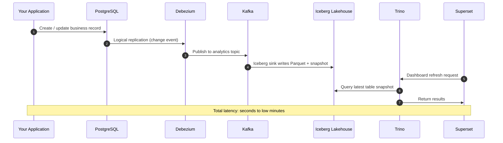
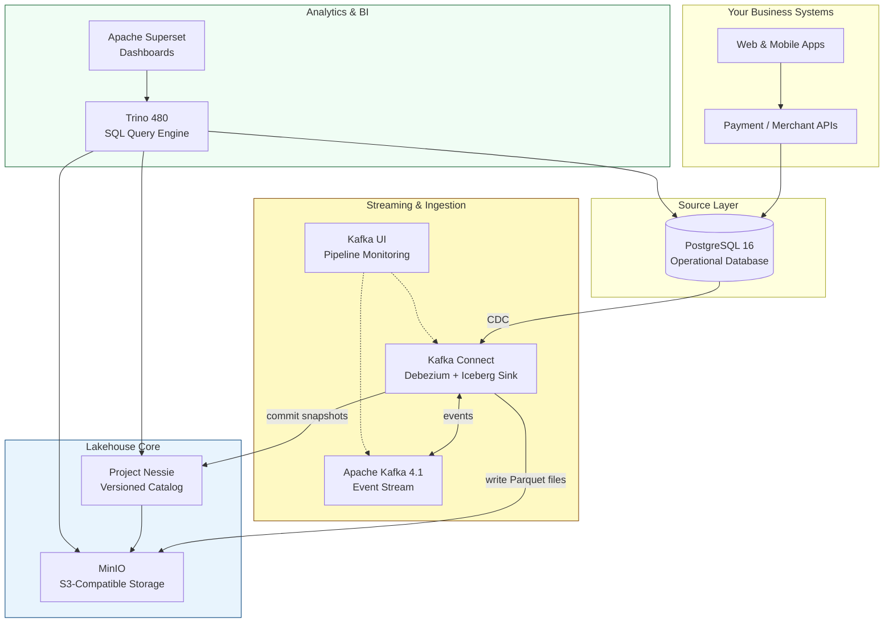
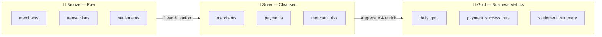
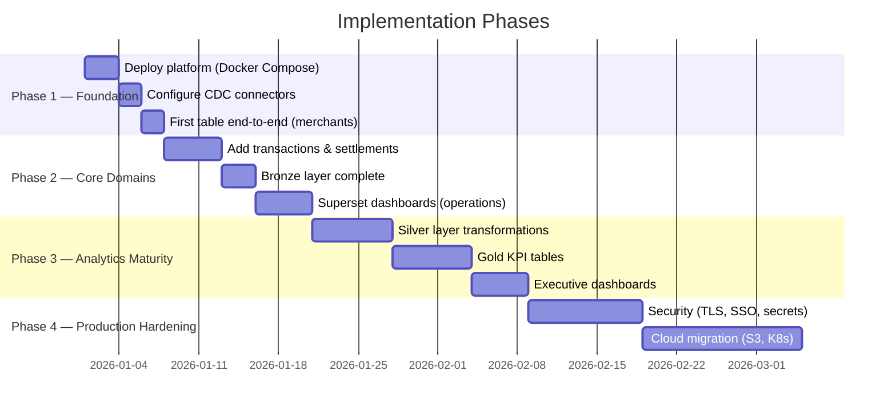

# Smart Data Platform
## Client Presentation — Data Lakehouse Solution

| | |
|---|---|
| **Document** | Client Presentation |
| **Platform** | Smart Data Platform |
| **Version** | 1.0 |
| **Date** | June 2026 |
| **Audience** | Business & Technical Stakeholders |

---

> **In one line:** A modern analytics platform that turns your live business data into real-time dashboards and reports — without expensive proprietary warehouses or overnight batch delays.

---

## Table of Contents

1. [What Is This?](#1-what-is-this)
2. [The Challenge Today](#2-the-challenge-today)
3. [How Does It Work?](#3-how-does-it-work)
4. [Architecture Diagram](#4-architecture-diagram)
5. [Advantages You Will Get](#5-advantages-you-will-get)
6. [What Will Be Set Up](#6-what-will-be-set-up)
7. [Live Example — End to End](#7-live-example--end-to-end)
8. [Data Organization — Medallion Layers](#8-data-organization--medallion-layers)
9. [Use Cases for Your Business](#9-use-cases-for-your-business)
10. [Before vs After](#10-before-vs-after)
11. [Implementation Roadmap](#11-implementation-roadmap)
12. [Technology Stack](#12-technology-stack)
13. [Security & Governance](#13-security--governance)
14. [Scalability & Future Growth](#14-scalability--future-growth)
15. [Deliverables Summary](#15-deliverables-summary)
16. [Next Steps](#16-next-steps)

---

## 1. What Is This?

The **Smart Data Platform** is an enterprise-grade **data lakehouse** — a unified system that combines:

- The **flexibility of a data lake** (store all your data cheaply at scale)
- The **reliability of a data warehouse** (consistent, governed, SQL-queryable tables)
- The **speed of streaming** (near-real-time updates, not next-day batches)

It is purpose-built for organizations that run transactional systems (such as payment platforms, merchant onboarding, or financial operations) and need **timely, trustworthy analytics** on top of that data.

### What it replaces

| Traditional approach | Smart Data Platform |
|---------------------|---------------------|
| Nightly batch exports from databases | Continuous Change Data Capture (CDC) |
| Siloed reports per team | Central governed lakehouse |
| Expensive proprietary data warehouse | Open-source, cloud-portable stack |
| Weeks to add a new data source | Hours — add a table, pipeline auto-follows |

### Who benefits

| Role | How they benefit |
|------|------------------|
| **Executives** | Live KPIs — GMV, success rates, settlement status |
| **Operations** | Real-time monitoring of merchants, transactions, chargebacks |
| **Compliance** | Auditable change history and point-in-time data snapshots |
| **Data teams** | Standard SQL, no custom ETL scripts per report |
| **Business analysts** | Self-service dashboards without waiting on engineering |

---

## 2. The Challenge Today

Most organizations face the same analytics bottlenecks:

```
Business event happens  →  Waits hours or overnight  →  Report is stale  →  Decision delayed
```

**Common pain points:**

- Reports reflect yesterday's data, not today's reality
- Engineering spends more time building pipelines than delivering insights
- Data lives in multiple places with no single source of truth
- Adding a new table or metric requires a full ETL project
- Proprietary warehouse costs grow faster than data volume
- No audit trail when data changes or discrepancies appear

**The Smart Data Platform solves this** by streaming every database change into a governed analytical layer that is queryable within minutes.

---

## 3. How Does It Work?

The platform follows a proven five-stage pipeline. No batch jobs. No manual exports.

### Step-by-step flow

| Step | What happens | Component |
|------|----------------|-----------|
| **1. Business action** | Your application inserts, updates, or deletes a record | PostgreSQL |
| **2. Change captured** | The database logs the row-level change | PostgreSQL WAL + Debezium |
| **3. Event streamed** | Change is published as a durable message | Apache Kafka |
| **4. Lakehouse write** | Event is written as a versioned table file | Iceberg Sink → MinIO + Nessie |
| **5. Query & visualize** | Analysts run SQL or open dashboards | Trino + Superset |

### Sequence diagram



### In plain language

Think of it as a **live copy of your database** that is optimized for analytics:

- Your operational database keeps running normally — no performance impact
- Every change is copied automatically in the background
- The copy is stored in an open, industry-standard format (Apache Iceberg)
- Anyone with SQL access or a dashboard login can query it immediately

---

## 4. Architecture Diagram

### High-level architecture



### Layered view

```
┌──────────────────────────────────────────────────────────────┐
│  PRESENTATION     Apache Superset — dashboards & reports       │
├──────────────────────────────────────────────────────────────┤
│  COMPUTE          Trino — standard SQL over all data sources   │
├──────────────────────────────────────────────────────────────┤
│  GOVERNANCE       Project Nessie — catalog, versions, branches │
├──────────────────────────────────────────────────────────────┤
│  TABLE FORMAT     Apache Iceberg — ACID, snapshots, evolution│
├──────────────────────────────────────────────────────────────┤
│  STORAGE          MinIO — scalable object storage (Parquet)    │
├──────────────────────────────────────────────────────────────┤
│  STREAMING        Kafka + Connect — reliable event pipeline    │
├──────────────────────────────────────────────────────────────┤
│  SOURCE           PostgreSQL — your live operational data      │
└──────────────────────────────────────────────────────────────┘
```

### Service map

| Service | Port | Role |
|---------|------|------|
| PostgreSQL | 5432 | Operational database & CDC source |
| Apache Kafka | 9092 | Event streaming backbone |
| Kafka Connect | 8083 | CDC ingestion & Iceberg writes |
| Kafka UI | 8080 | Pipeline monitoring & operations |
| MinIO | 9000 / 9001 | Object storage (data lake) |
| Project Nessie | 19120 | Iceberg table catalog |
| Trino | 8081 | SQL query engine |
| Apache Superset | 8088 | Business intelligence dashboards |

---

## 5. Advantages You Will Get

### Business advantages

| Advantage | Impact |
|-----------|--------|
| **Near-real-time insights** | Decisions based on minutes-old data, not yesterday's batch |
| **Single source of truth** | One governed dataset for all teams and reports |
| **Faster time-to-market** | New tables and metrics without rebuilding pipelines |
| **Lower total cost** | Open-source stack; no per-query or per-seat warehouse fees |
| **Audit & compliance ready** | Full change history; query any past snapshot |
| **Self-service analytics** | Business users build dashboards without engineering tickets |
| **Future-proof** | Add merchants, payments, settlements, KYC — same architecture |

### Technical advantages

| Advantage | Impact |
|-----------|--------|
| **No vendor lock-in** | 100% open-source; deploy on-prem, AWS, Azure, or GCP |
| **Schema evolution** | Add columns without breaking existing reports |
| **Time travel** | Query data as it existed at any point in time |
| **Fault tolerance** | Kafka retains events; pipelines recover without data loss |
| **Separation of storage & compute** | Scale query power and storage independently |
| **Industry-standard patterns** | Same architecture used by Netflix, Uber, Airbnb, Stripe |

### Competitive edge

```
Without platform:  "Can we get yesterday's settlement report?"
With platform:     "What's our GMV in the last 15 minutes by merchant?"
```

---

## 6. What Will Be Set Up

We deliver a **fully containerized, ready-to-run platform** defined in a single `docker-compose.yml`. Here is exactly what gets deployed:

### Infrastructure components (9 services)

| # | Component | What it does for you |
|---|-----------|----------------------|
| 1 | **PostgreSQL 16** | Hosts operational data; configured for real-time CDC |
| 2 | **Apache Kafka 4.1** | Streams every data change reliably |
| 3 | **Kafka Connect** | Runs Debezium (capture) + Iceberg (lakehouse write) connectors |
| 4 | **Kafka UI** | Visual console to monitor topics and pipeline health |
| 5 | **MinIO** | S3-compatible storage for all analytical data files |
| 6 | **Project Nessie** | Central catalog — knows where every table and file lives |
| 7 | **Trino 480** | SQL engine — query lakehouse and source DB together |
| 8 | **Apache Superset** | Dashboard platform for business users |
| 9 | **MinIO Client** | Auto-creates the `warehouse` storage bucket on startup |

### Connectors configured

| Connector | Direction | Purpose |
|-----------|-----------|---------|
| **Debezium CDC** | PostgreSQL → Kafka | Captures every insert, update, delete |
| **Iceberg Sink** | Kafka → Lakehouse | Writes versioned tables to MinIO via Nessie |

Two modes available:

- **Explicit mode** — map specific tables (e.g. `merchants` → `bronze.merchants`)
- **Dynamic mode** — auto-create lakehouse tables for all new source tables

### Trino catalogs

| Catalog | Connects to | Use for |
|---------|-------------|---------|
| `iceberg` | Nessie + MinIO | Analytical queries on lakehouse |
| `postgresql` | PostgreSQL | Live operational lookups & federated joins |

### Access URLs (after deployment)

| Tool | URL | Users |
|------|-----|-------|
| Superset (Dashboards) | http://localhost:8088 | Business & leadership |
| Trino (SQL) | http://localhost:8081 | Data analysts & engineers |
| Kafka UI (Monitoring) | http://localhost:8080 | Operations & engineering |
| MinIO Console (Storage) | http://localhost:9001 | Engineering |

### What you need to provide

| Requirement | Details |
|-------------|---------|
| Server / VM | Docker-capable host (8 GB+ RAM recommended for POC) |
| Docker & Docker Compose | Standard container runtime |
| Network access | Ports 5432, 8080–8088, 9000–9001, 9092, 19120 |
| Source tables | PostgreSQL tables in the `public` schema |

---

## 7. Live Example — End to End

**Scenario:** A new merchant registers on your platform.

```
Step 1   Application inserts merchant into PostgreSQL
           ↓
Step 2   Debezium captures the INSERT within seconds
           ↓
Step 3   Kafka topic analytics.public.merchants receives the event
           ↓
Step 4   Iceberg sink writes Parquet file to MinIO, commits snapshot to Nessie
           ↓
Step 5   Trino query returns the new merchant immediately
           ↓
Step 6   Superset dashboard reflects updated merchant count
```

**Verification SQL:**

```sql
SELECT merchant_id, merchant_name, city, created_at
FROM iceberg.bronze.merchants
ORDER BY created_at DESC;
```

No manual ETL. No scheduled job. The pipeline runs continuously.

---

## 8. Data Organization — Medallion Layers

Data is organized in three maturity layers — a proven industry pattern:



| Layer | What it contains | Who uses it |
|-------|------------------|-------------|
| **Bronze** | Raw CDC data, as-is from source | Engineering, audit |
| **Silver** | Cleaned, deduplicated business entities | Analytics, operations |
| **Gold** | KPIs, aggregates, executive metrics | Leadership, BI dashboards |

Bronze is populated **automatically**. Silver and Gold are built with SQL transformations in Trino.

---

## 9. Use Cases for Your Business

| Use case | Data involved | Outcome |
|----------|---------------|---------|
| **Merchant onboarding funnel** | merchants, kyc_documents | Track onboarding completion rates live |
| **Payment success monitoring** | transactions | Real-time success/failure rates by gateway |
| **Settlement reconciliation** | settlements, transactions | T+1 settlement accuracy dashboards |
| **Chargeback analysis** | chargebacks, merchants | Chargeback ratio alerts by merchant |
| **Regulatory reporting** | All domains | Point-in-time snapshots for audit |
| **Executive dashboard** | Gold layer metrics | Daily GMV, active merchants, revenue |
| **Fraud & risk scoring** | transactions, merchant_risk | Feed ML models from governed datasets |

### Recommended first tables

```
analytics.public.merchants
analytics.public.transactions
analytics.public.settlements
analytics.public.chargebacks
analytics.public.kyc_documents
```

Each table automatically flows: **PostgreSQL → Kafka → Iceberg → Trino → Superset**.

---

## 10. Before vs After

| Dimension | Before (traditional) | After (Smart Data Platform) |
|-----------|---------------------|----------------------------|
| Data freshness | Hours to 24+ hours | Minutes |
| Add new table | Days to weeks (ETL project) | Hours (add table + connector) |
| Cost model | License + storage + compute bundled | Open-source; pay only for infrastructure |
| Vendor dependency | High (proprietary warehouse) | None (portable to any cloud) |
| Audit trail | Limited or manual | Full CDC history + Iceberg snapshots |
| Self-service BI | Rare; engineering bottleneck | Native via Superset |
| Schema changes | Break pipelines, require migrations | Iceberg schema evolution |
| Disaster recovery | Complex backup/restore | Kafka replay + immutable storage |

---

## 11. Implementation Roadmap



| Phase | Duration | Deliverable |
|-------|----------|-------------|
| **Phase 1 — Foundation** | ~1 week | Platform running; first table flowing end-to-end |
| **Phase 2 — Core Domains** | ~2 weeks | Payments, settlements, merchants in Bronze; ops dashboards |
| **Phase 3 — Analytics Maturity** | ~3 weeks | Silver/Gold layers; executive KPI dashboards |
| **Phase 4 — Production** | ~4 weeks | Security hardening; cloud deployment; HA |

---

## 12. Technology Stack

All components are **open-source** with global enterprise adoption:

| Category | Technology | Version | Used by |
|----------|-----------|---------|---------|
| Database | PostgreSQL | 16 | Apple, Instagram, Spotify |
| Streaming | Apache Kafka | 4.1 | LinkedIn, Netflix, Uber |
| CDC | Debezium | 2.7 | Red Hat, Zalando |
| Table format | Apache Iceberg | 1.x | Apple, Netflix, Adobe |
| Catalog | Project Nessie | 0.108 | Apache Iceberg ecosystem |
| Storage | MinIO | Latest | Siemens, Adobe (S3-compatible) |
| SQL engine | Trino | 480 | Meta, Twitter, Comcast |
| BI | Apache Superset | Latest | Airbnb, Lyft |

**No proprietary licenses. No vendor lock-in. Production-ready on any cloud.**

---

## 13. Security & Governance

### Current POC posture

The initial deployment is optimized for **rapid demonstration and development**. Security controls are in place for internal use.

### Production security roadmap

| Area | Production enhancement |
|------|------------------------|
| Encryption in transit | TLS on Kafka, Trino, Nessie, Connect |
| Authentication | SSO / LDAP for Trino and Superset |
| Secrets management | Vault or cloud secrets manager (no plain-text credentials) |
| Network isolation | Private subnets; restrict inter-service traffic |
| Access control | Role-based access on catalogs, tables, and dashboards |
| Audit logging | Centralized logs for all data access and pipeline events |
| Catalog security | OIDC on Nessie with principal-based permissions |

### Governance capabilities (built-in)

- **Immutable event log** — every change recorded in Kafka
- **Table versioning** — Iceberg snapshots for point-in-time queries
- **Catalog branches** — isolate dev/test/prod data environments
- **Schema evolution** — track and audit schema changes over time

---

## 14. Scalability & Future Growth

The platform starts as a **single-server Docker deployment** and scales to enterprise production without architectural changes:

| Component | POC (Day 1) | Production |
|-----------|-------------|------------|
| Kafka | 1 node | Multi-broker cluster |
| Storage | MinIO | AWS S3 / Azure / GCS |
| Catalog | Nessie (in-memory) | Nessie (persistent) |
| SQL engine | 1 Trino node | Trino cluster |
| Orchestration | Docker Compose | Kubernetes |
| Monitoring | Kafka UI | Prometheus + Grafana |

**Adding a new business domain requires no platform changes** — only a new source table in PostgreSQL. The dynamic connector automatically creates the corresponding lakehouse table.

---

## 15. Deliverables Summary

When you engage on this platform, you receive:

| # | Deliverable | Description |
|---|-------------|-------------|
| 1 | **Running platform** | All 9 services deployed via Docker Compose |
| 2 | **CDC pipeline** | Debezium connector capturing PostgreSQL changes |
| 3 | **Lakehouse pipeline** | Iceberg sink writing to MinIO via Nessie |
| 4 | **SQL access** | Trino with iceberg + postgresql catalogs |
| 5 | **BI platform** | Superset with Trino integration |
| 6 | **Monitoring** | Kafka UI for pipeline observability |
| 7 | **Documentation** | Architecture, setup guide, and this presentation |
| 8 | **Connector configs** | Ready-to-register JSON connector definitions |
| 9 | **Medallion schemas** | Bronze / Silver / Gold structure in Trino |

---

## 16. Next Steps

| Step | Action | Owner |
|------|--------|-------|
| 1 | Review this document with stakeholders | Client + delivery team |
| 2 | Confirm source tables and priority domains | Client business team |
| 3 | Provision Docker host (8 GB+ RAM) | Client infrastructure |
| 4 | Deploy platform (`docker compose up`) | Delivery team |
| 5 | Register CDC + Iceberg connectors | Delivery team |
| 6 | Verify end-to-end with first table | Joint session |
| 7 | Build Phase 2 dashboards in Superset | Delivery + client analysts |
| 8 | Plan production hardening (Phase 4) | Joint planning |

---

## Appendix — Glossary

| Term | Definition |
|------|-----------|
| **CDC** | Change Data Capture — detects row-level database changes in real time |
| **Lakehouse** | Architecture combining data lake storage with warehouse governance |
| **Iceberg** | Open table format with ACID transactions and time travel |
| **Nessie** | Git-like catalog for versioning Iceberg tables |
| **Medallion** | Data layering pattern: Bronze (raw) → Silver (clean) → Gold (metrics) |
| **Parquet** | Columnar file format optimized for analytical queries |
| **Trino** | High-performance distributed SQL query engine |

---

*Smart Data Platform · Data Lakehouse Solution · Version 1.0 · June 2026*

*Technical reference: `ARCHITECTURE.md` · Operations guide: `lakehouse-setup.md`*
