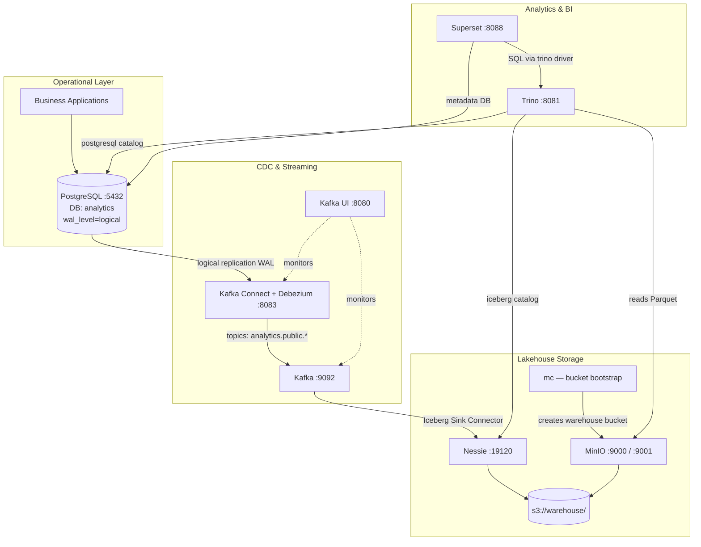

# Smart Data Platform — Lakehouse Architecture & Setup

This document describes the **Smart Data Platform** at `D:\payabbhi\smart-data-platform`: what each component does, how they work together, and how to run and verify the stack end-to-end.

---

## What this platform achieves

> **Capture operational PostgreSQL changes in near real time, land them as Iceberg tables on object storage, and query/visualize them with SQL and dashboards.**

The platform implements a **CDC-driven lakehouse**:

| Phase | Component(s) | Outcome |
|-------|--------------|---------|
| Capture | PostgreSQL + Debezium | Row-level insert/update/delete events |
| Stream | Kafka | Durable, replayable event log |
| Land | Iceberg Sink Connector | ACID tables on MinIO |
| Govern | Nessie | Versioned catalog (branches, snapshots) |
| Query | Trino | Federated SQL over lake + source DB |
| Visualize | Superset | BI dashboards |

---

## Architecture



### End-to-end data flow (example: `merchants` table)

```
PostgreSQL INSERT
    ↓  (logical WAL)
Debezium Postgres Connector  →  topic: analytics.public.merchants
    ↓
Iceberg Sink Connector       →  table: iceberg.bronze.merchants
    ↓  (Nessie catalog + MinIO files)
Trino SELECT                 →  Superset dashboard
```

---

## Project structure

```
smart-data-platform/
├── docker-compose.yml              # All services
├── .env                            # Postgres + MinIO credentials
├── lakehouse-setup.md              # This document
│
├── connector-debezium-cdc.json     # CDC source connector (root)
├── connector-iceberg-sink-merchant.json  # Single-table Iceberg sink
│
├── dynamic-tables/
│   ├── connector-debezium-cdc.json     # CDC variant (no converter overrides)
│   └── connector-iceberg-sink.json       # Auto-create tables from topic regex
│
├── connect/
│   └── Dockerfile                  # Debezium + Iceberg Connect plugins
│   └── plugins/                    # (required at build time — Iceberg connector JARs)
│
├── trino/
│   ├── catalog/
│   │   ├── iceberg.properties      # Nessie + MinIO catalog
│   │   └── postgres.properties   # Live OLTP queries
│   └── config/
│       ├── config.properties
│       ├── jvm.config
│       └── node.properties
│
├── data/                           # Persistent volumes (created at runtime)
│   ├── postgres/
│   ├── kafka/
│   └── minio/
│
└── unused/
    └── docker-compose-debezium,yml # Older compose without Nessie / custom Connect
```

---

## Services (`docker-compose.yml`)

### 1. PostgreSQL — operational database & CDC source

| Setting | Value |
|---------|-------|
| Image | `postgres:16` |
| Port | `5432` |
| Database | `analytics` (from `.env`) |
| User | `analytics` / `analytics123` |

**CDC tuning** (required for Debezium):

```yaml
wal_level=logical
max_replication_slots=10
max_wal_senders=10
```

PostgreSQL is both the **source of truth** for live data and the **metadata store** for Superset. A separate `debezium` replication user is created during setup.

---

### 2. Kafka — event streaming backbone

| Setting | Value |
|---------|-------|
| Image | `apache/kafka:4.1.0` (KRaft, single node) |
| Port | `9092` |
| Internal address | `kafka:9092` |
| Data | `./data/kafka` |

Kafka decouples Postgres write throughput from downstream Iceberg ingestion. Topics follow Debezium naming: `analytics.public.<table_name>`.

---

### 3. Kafka Connect + Debezium + Iceberg — ingestion engine

| Setting | Value |
|---------|-------|
| Build | `./connect/Dockerfile` (extends `debezium/connect:2.7.3.Final`) |
| Port | `8083` |
| Plugins | Debezium (built-in) + Iceberg Sink (`/kafka/connect/iceberg/`) |

The custom image adds the **Apache Iceberg Kafka Connect sink** on top of the standard Debezium Connect distribution:

```dockerfile
FROM debezium/connect:2.7.3.Final
COPY plugins/ /kafka/connect/iceberg/
```

Two connectors are registered via REST API (see [Connectors](#connectors)):

1. **Source** — Debezium reads Postgres WAL → Kafka
2. **Sink** — Iceberg connector reads Kafka → Nessie + MinIO

---

### 4. Kafka UI — operations console

| Setting | Value |
|---------|-------|
| Port | `8080` |
| URL | http://localhost:8080 |

Browse topics, inspect messages, and manage Connect connectors.

---

### 5. MinIO — S3-compatible object storage

| Setting | Value |
|---------|-------|
| API | `9000` |
| Console | `9001` → http://localhost:9001 |
| Credentials | `admin` / `admin123` (from `.env`) |
| Data | `./data/minio` |

Stores Iceberg **Parquet data files** and **metadata files** under `s3://warehouse/`.

---

### 6. `mc` — MinIO bootstrap

One-shot init container that creates the `warehouse` bucket:

```sh
mc alias set local http://minio:9000 ...
mc mb -p local/warehouse
```

---

### 7. Nessie — versioned Iceberg catalog

| Setting | Value |
|---------|-------|
| Image | `ghcr.io/projectnessie/nessie:0.108.0` |
| Port | `19120` |
| Store | `IN_MEMORY` (resets on restart — dev only) |
| Branch | `main` |

Nessie is the **metadata registry**: schemas, snapshots, and table locations. Both the Iceberg sink connector and Trino use the same Nessie endpoint and warehouse path.

---

### 8. Trino — SQL query engine

| Setting | Value |
|---------|-------|
| Image | `trinodb/trino:480` |
| Port | `8081` (mapped from container `8080`) |

**Two catalogs** are configured:

#### `iceberg` — lakehouse tables (Nessie + MinIO)

```properties
iceberg.catalog.type=nessie
iceberg.nessie-catalog.uri=http://nessie:19120/api/v2
iceberg.nessie-catalog.ref=main
iceberg.nessie-catalog.default-warehouse-dir=s3://warehouse/
s3.endpoint=http://minio:9000
```

#### `postgresql` — live source database

```properties
connection-url=jdbc:postgresql://postgres:5432/analytics
connection-user=analytics
```

Use `iceberg` for analytical/historical queries; use `postgresql` for current OLTP state or federated joins.

---

### 9. Superset — BI dashboards

| Setting | Value |
|---------|-------|
| Port | `8088` |
| Admin | `admin` / `admin` |
| Trino driver | Installed at startup (`pip install trino sqlalchemy-trino`) |

Superset connects to Trino for lakehouse queries. Its own metadata (dashboards, users) is stored in PostgreSQL.

---

## Connectors

### Debezium CDC source (`connector-debezium-cdc.json`)

| Config | Value |
|--------|-------|
| Connector | `io.debezium.connector.postgresql.PostgresConnector` |
| Database | `postgres:5432/analytics` |
| User | `debezium` / `debezium` |
| Topic prefix | `analytics` |
| Plugin | `pgoutput` |
| Snapshot | `initial` (full snapshot, then streaming) |
| Transform | `ExtractNewRecordState` (unwraps Debezium envelope) |

**Produces topics like:** `analytics.public.merchants`

### Iceberg sink — single table (`connector-iceberg-sink-merchant.json`)

| Config | Value |
|--------|-------|
| Connector | `org.apache.iceberg.connect.IcebergSinkConnector` |
| Topic | `analytics.public.merchants` |
| Iceberg table | `bronze.merchants` |
| Catalog | Nessie @ `http://nessie:19120/api/v2` |
| Warehouse | `s3://warehouse/` |
| S3 | MinIO @ `http://minio:9000` |

Use this when you want **explicit control** over which Kafka topic maps to which Iceberg table.

### Iceberg sink — dynamic tables (`dynamic-tables/connector-iceberg-sink.json`)

| Config | Value |
|--------|-------|
| Topics regex | `analytics.public.*` |
| Auto-create | `iceberg.tables.auto-create-enabled=true` |
| Dynamic | `iceberg.tables.dynamic-enabled=true` |

Use this to **automatically create Iceberg tables** for every Debezium topic under `analytics.public.*` — ideal when adding many payment-platform tables without registering a new sink per table.

---

## Medallion architecture (planned layers)

Trino schemas are organized in a medallion pattern:

| Layer | Schema | Purpose | Example tables |
|-------|--------|---------|----------------|
| Bronze | `iceberg.bronze` | Raw CDC landing | `merchants`, `transactions` |
| Silver | `iceberg.silver` | Cleaned, deduplicated | `merchants`, `payments` |
| Gold | `iceberg.gold` | Business metrics | `daily_gmv`, `payment_success_rate` |

Recommended next tables for a payment platform:

```
analytics.public.merchants
analytics.public.transactions
analytics.public.settlements
analytics.public.chargebacks
analytics.public.kyc_documents
```

---

## Service URLs

| Service | URL | Credentials |
|---------|-----|-------------|
| Kafka UI | http://localhost:8080 | — |
| Trino UI | http://localhost:8081 | — |
| Superset | http://localhost:8088 | `admin` / `admin` |
| MinIO Console | http://localhost:9001 | `admin` / `admin123` |
| PostgreSQL | `localhost:5432` | `analytics` / `analytics123` |
| Kafka | `localhost:9092` | — |
| Kafka Connect | http://localhost:8083 | — |
| Nessie | http://localhost:19120 | — |

---

## Fresh setup

### 1. Reset data volumes

```sh
docker compose down
docker compose down --remove-orphans

# Linux / WSL
sudo rm -rf data/postgres data/kafka data/minio
mkdir -p data/postgres data/kafka data/minio
sudo chown -R 1000:1000 data/kafka data/minio
sudo chown -R 999:999 data/postgres
```

### 2. Start the stack

```sh
docker compose up -d
```

Ensure `./connect/plugins/` contains the Iceberg Connect connector JARs before building.

### 3. Prepare PostgreSQL for CDC

```sh
docker exec -it postgres psql -U analytics
```

```sql
CREATE USER debezium WITH REPLICATION PASSWORD 'debezium';
GRANT ALL PRIVILEGES ON DATABASE analytics TO debezium;
ALTER USER debezium WITH SUPERUSER;

CREATE TABLE merchants (
    merchant_id   VARCHAR,
    merchant_name VARCHAR,
    city          VARCHAR,
    created_at    TIMESTAMP(6)
);
```

### 4. Create Trino schemas

```sh
docker exec -it trino trino
```

```sql
SHOW SCHEMAS FROM iceberg;

CREATE SCHEMA iceberg.bronze;
CREATE SCHEMA iceberg.silver;
CREATE SCHEMA iceberg.gold;
```

### 5. Register connectors

**Debezium CDC source:**

```sh
curl -X POST http://localhost:8083/connectors \
  -H "Content-Type: application/json" \
  -d @connector-debezium-cdc.json
```

**Iceberg sink (single table):**

```sh
curl -X POST http://localhost:8083/connectors \
  -H "Content-Type: application/json" \
  -d @connector-iceberg-sink-merchant.json
```

**Or — dynamic sink (all `analytics.public.*` topics):**

```sh
curl -X POST http://localhost:8083/connectors \
  -H "Content-Type: application/json" \
  -d @dynamic-tables/connector-iceberg-sink.json
```

### 6. Verify connector status

```sh
curl http://localhost:8083/connectors/connector-debezium-cdc/status
curl http://localhost:8083/connectors/connector-iceberg-sink-merchant/status
```

Restart a connector if needed:

```sh
curl -X POST http://localhost:8083/connectors/connector-iceberg-sink-merchant/restart
```

---

## End-to-end verification

### Step 1 — Insert into PostgreSQL

```sh
docker exec -it postgres psql -U analytics
```

```sql
INSERT INTO merchants (merchant_id, merchant_name, city, created_at)
VALUES ('M001', 'ABC STORE', 'Kolkata', CURRENT_TIMESTAMP);
```

### Step 2 — Check Kafka topic

Open http://localhost:8080 and inspect topic `analytics.public.merchants`. A message should appear.

Or via CLI:

```sh
docker exec -it kafka \
  /opt/kafka/bin/kafka-console-consumer.sh \
  --bootstrap-server kafka:9092 \
  --topic analytics.public.merchants \
  --from-beginning
```

### Step 3 — Check Connect logs

```sh
docker logs -f connect
```

Look for lines like:

```
Commit complete
Writing data files
Snapshot committed
```

### Step 4 — Check MinIO

Open http://localhost:9001 → bucket `warehouse` → `bronze/merchants/`.

You should see `metadata/` and `data/` directories with Parquet files.

### Step 5 — Query via Trino

```sql
SELECT * FROM iceberg.bronze.merchants ORDER BY created_at DESC;
```

### Step 6 — Prove continuous CDC

```sql
SELECT COUNT(*) FROM iceberg.bronze.merchants;
```

Insert another merchant in PostgreSQL, wait a few seconds, and run the count again. If it increases, the full pipeline is operational:

```
PostgreSQL → Debezium → Kafka → Iceberg Sink → Nessie → MinIO → Trino
```

---

## Layer reference (lakehouse expert view)

| Layer | Services | Responsibility |
|-------|----------|----------------|
| Source | PostgreSQL | OLTP data, CDC origin |
| Ingestion | Debezium + Kafka Connect | Change capture |
| Transport | Kafka | Buffering, replay, decoupling |
| Storage | MinIO | Scalable file storage (Parquet + metadata) |
| Table format | Apache Iceberg | ACID, schema evolution, time travel |
| Catalog | Nessie | Metadata registry, branching |
| Compute | Trino | Federated SQL |
| Presentation | Superset | Dashboards and exploration |
| Operations | Kafka UI | Topic and connector monitoring |

---

## Dependency graph

```
minio
  └── mc (creates warehouse bucket)

postgres
  ├── trino (postgresql catalog)
  └── superset (metadata DB)

kafka
  └── connect (Debezium source + Iceberg sink)
        ├── depends on: postgres (CDC), kafka (topics)
        └── writes to: nessie + minio

nessie
  ├── connect (Iceberg catalog)
  └── trino (iceberg catalog)

kafka-ui → kafka, connect
```

---

## Notes & caveats

1. **Nessie `IN_MEMORY`** — catalog state is lost when the Nessie container restarts. Use a persistent backend for production.
2. **`connect/plugins/`** — must contain Iceberg Connect JARs; the Dockerfile copies them at build time.
3. **Two connector strategies** — use `connector-iceberg-sink-merchant.json` for explicit mapping, or `dynamic-tables/connector-iceberg-sink.json` for auto-provisioning.
4. **Debezium unwrap transform** — `ExtractNewRecordState` flattens the Debezium envelope so the Iceberg sink receives plain row JSON.
5. **Superset secret** — `SUPERSET_SECRET_KEY: change-me` in compose should be changed for any non-local deployment.
