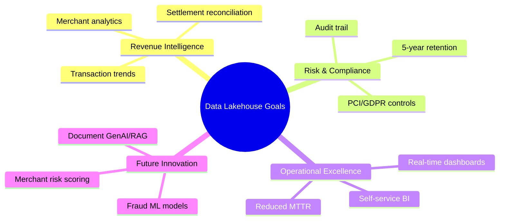
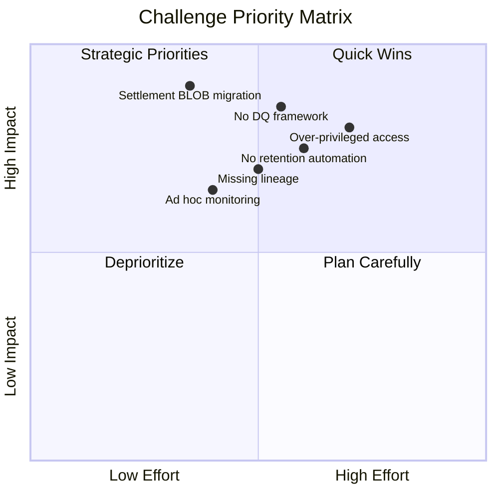
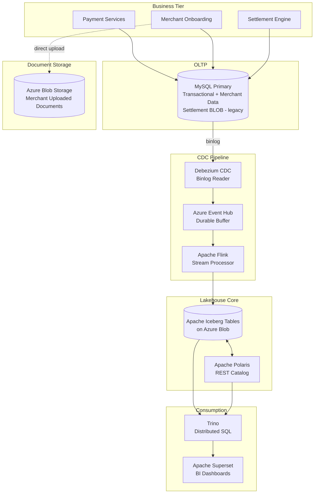
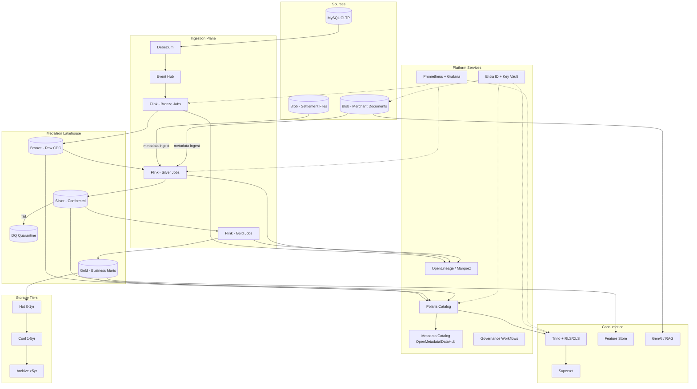
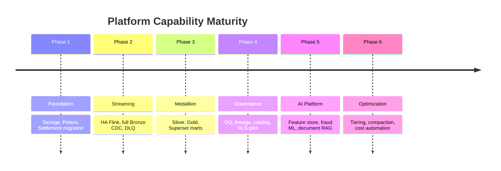
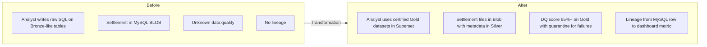
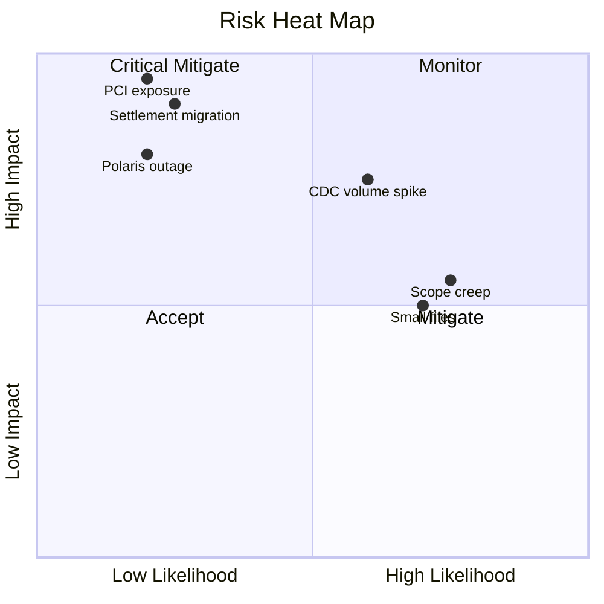

# Part 1 — Executive Summary

**Document ID:** DLH-ARB-2026-001-01  
**Version:** 1.0.0  
**Classification:** Internal — Confidential

---

## Table of Contents

1. [Purpose](#1-purpose)
2. [Business Goals](#2-business-goals)
3. [Current Challenges](#3-current-challenges)
4. [Existing Architecture](#4-existing-architecture)
5. [Proposed Target Architecture](#5-proposed-target-architecture)
6. [Strategic Benefits](#6-strategic-benefits)
7. [Tradeoffs and Design Decisions](#7-tradeoffs-and-design-decisions)
8. [Investment Summary](#8-investment-summary)
9. [Risks and Mitigations](#9-risks-and-mitigations)
10. [Success Criteria](#10-success-criteria)
11. [ARB Decision Requested](#11-arb-decision-requested)

---

## 1. Purpose

This executive summary presents the business case, architectural direction, and approval request for the enterprise **Data Lakehouse Platform**. The platform unifies operational data from MySQL, merchant documents, and settlement artifacts into a governed, analytics-ready environment that supports business intelligence, regulatory retention, and future machine learning and generative AI workloads.

This is not a conceptual overview. It frames a **production implementation** that Solution Architects, Principal Engineers, and operational teams will execute over six phases (~18 months).

---

## 2. Business Goals

### 2.1 Strategic Objectives

### 2.2 Goal Definition Table

| ID    | Business Goal                | Description                                                                         | KPI Target                                   | Timeline |
| ----- | ---------------------------- | ----------------------------------------------------------------------------------- | -------------------------------------------- | -------- |
| BG-01 | **Unified analytics**        | Single governed source for merchant, transaction, settlement, and document metadata | 95% of executive KPIs served from Gold layer | Phase 3  |
| BG-02 | **Near-real-time insight**   | Dashboards reflect operational state within minutes, not batch windows              | Gold freshness p99 ≤ 15 min                  | Phase 3  |
| BG-03 | **Regulatory retention**     | Analytics data online 5 years; archive beyond with discoverability                  | 100% datasets in retention registry          | Phase 4  |
| BG-04 | **Settlement modernization** | Migrate settlement BLOB from MySQL to object storage                                | Zero settlement files in MySQL BLOB          | Phase 1  |
| BG-05 | **Self-service BI**          | Analysts query without engineering tickets for standard datasets                    | 80% ad-hoc queries self-served               | Phase 3  |
| BG-06 | **Data trust**               | Measurable quality scores on all published Gold marts                               | DQ score ≥ 95% on Gold                       | Phase 4  |
| BG-07 | **AI readiness**             | Feature store and document intelligence foundation                                  | Feature store MVP live                       | Phase 5  |
| BG-08 | **Cost predictability**      | Tiered storage controls TCO as volume grows 2× annually                             | Storage cost ≤ 15% YoY at 2× volume          | Phase 6  |

### 2.3 Stakeholder Value Map

| Stakeholder | Primary Value | Key Deliverable |
|-------------|---------------|-----------------|
| **Executive Leadership** | Revenue, risk, and growth KPIs in one dashboard | Executive Gold marts + Superset |
| **Finance** | Settlement reconciliation, revenue reporting | `gold.settlement.*`, `gold.revenue.*` |
| **Fraud / Risk** | Transaction patterns, merchant risk signals | `gold.risk.*`, future ML models |
| **Merchant Operations** | Onboarding status, document completeness | `gold.merchant.*`, document metadata |
| **Compliance / Legal** | Retention, lineage, access audit | Governance layer, 5-year policy |
| **Data Engineering** | Repeatable patterns, replay, observability | Medallion standards, runbooks |
| **Security** | RBAC, masking, encryption, PCI isolation | Security architecture (Part 10) |

---

## 3. Current Challenges

### 3.1 Challenge Assessment

### 3.2 Detailed Challenge Register

| ID | Challenge | Business Impact | Technical Root Cause | Severity | Phase to Resolve |
|----|-----------|-----------------|----------------------|----------|------------------|
| CH-01 | **Settlement files in MySQL BLOB** | DB growth, slow backups, restore risk, no direct analytics on files | Legacy pattern pre-dating object storage adoption | **Critical** | Phase 1 |
| CH-02 | **No formal data quality layer** | Incorrect KPIs, silent data corruption, loss of stakeholder trust | DQ not embedded in Silver promotion path | **High** | Phase 4 |
| CH-03 | **Incomplete metadata & lineage** | Slow incident RCA (hours → days), audit gaps | No OpenLineage; catalog not unified | **High** | Phase 4 |
| CH-04 | **Retention not automated** | Cost overruns; policy compliance risk after year 5 | No Iceberg + Blob lifecycle integration | **High** | Phase 6 |
| CH-05 | **Immature access control** | Over-broad analyst access to PII/PCI columns | RBAC without RLS/CLS on Trino | **High** | Phase 4 |
| CH-06 | **Operational runbooks ad hoc** | Extended MTTR on pipeline failures (4+ hours) | No SRE playbook, inconsistent alerting | **Medium** | Phase 2 |
| CH-07 | **Small file proliferation** | Query slowdown, storage inefficiency | Default Flink file sizes not tuned | **Medium** | Phase 6 |
| CH-08 | **Document ↔ analytics gap** | Merchant doc metadata not fully linked to analytics entities | Separate upload path vs CDC path | **Medium** | Phase 3 |
| CH-09 | **No ML feature foundation** | Fraud/risk models rebuilt ad hoc per project | No feature store or standardized Gold features | **Medium** | Phase 5 |
| CH-10 | **Single-region DR gap** | Regional outage = analytics unavailable | No tested failover for Event Hub + ADLS | **Medium** | Phase 2 |

### 3.3 Cost of Inaction (Qualitative)

| Scenario | Estimated Annual Impact |
|----------|---------------------------|
| Continued MySQL BLOB growth | 20–40% increase in DB infra + backup costs |
| Data quality incident in Gold KPI | Executive misreporting; regulatory exposure |
| Failed audit on data lineage | Remediation project; delayed certifications |
| Uncontrolled storage growth | 30–50% overspend vs tiered architecture |

---

## 4. Existing Architecture

### 4.1 Current State — Logical View

### 4.2 Current State — Data Domains

| Domain | MySQL (CDC) | Blob Storage | In Iceberg Today | Medallion Layer |
|--------|-------------|--------------|------------------|-----------------|
| Merchant | ✅ | Documents only | Partial | Bronze (informal) |
| Transaction | ✅ | — | Partial | Bronze (informal) |
| Settlement | ✅ metadata | ❌ BLOB in MySQL | Partial | Bronze (informal) |
| Document metadata | Partial | ✅ files | Minimal | Not formalized |

### 4.3 Current State — Strengths

| Strength | Description |
|----------|-------------|
| **Proven CDC path** | Debezium → Event Hub → Flink is operational for core domains |
| **Open table format** | Iceberg avoids vendor lock-in; supports schema evolution and time travel |
| **Decoupled query** | Trino scales query independently of ingest (Flink) |
| **Cloud-native storage** | Azure Blob/ADLS provides durable, cost-tiered foundation |
| **Document upload modernized** | Merchant documents already land in Blob, not MySQL BLOB |
| **REST catalog** | Polaris provides open catalog interoperability |

### 4.4 Current State — Gaps

| Gap | Risk |
|-----|------|
| Medallion layers not enforced by standards | Same table serves raw and curated purposes |
| No Silver conformed entities | Analysts query inconsistent shapes |
| No Gold KPI marts | Dashboards built on ad-hoc SQL |
| No DQ quarantine | Bad records propagate silently |
| No OpenLineage | Cannot trace Superset metric → MySQL row |
| Settlement BLOB in MySQL | Operational and compliance risk |
| No 5-year lifecycle automation | Manual tiering or indefinite hot storage |
| Security: RBAC only | PII/PCI exposure risk |

---

## 5. Proposed Target Architecture

### 5.1 Target State — High-Level

### 5.2 What Changes from Current to Target

| Dimension | Current | Target |
|-----------|---------|--------|
| **Layering** | Informal / mixed | Strict Bronze → Silver → Gold with contracts |
| **Settlement storage** | MySQL BLOB | Blob + `silver.settlement.file_metadata` |
| **Data quality** | Ad hoc checks | GE + Flink inline; quarantine zone |
| **Governance** | Polaris technical only | + business glossary, PII tags, approvals |
| **Lineage** | None | OpenLineage end-to-end to Superset |
| **Security** | RBAC | RBAC + ABAC + RLS + column masking |
| **Retention** | Undefined | Automated 0–1–5–5+ year tiers |
| **Operations** | Tribal knowledge | Runbooks, SLOs, on-call playbooks |
| **AI** | None | Feature store, embeddings, RAG (Phase 5) |

### 5.3 Target Capability Map

---

## 6. Strategic Benefits

### 6.1 Benefit Realization Table

| Benefit Category | Specific Benefit | Measurable Outcome |
|------------------|------------------|--------------------|
| **Agility** | Self-service BI on governed Gold marts | 50% reduction in ad-hoc engineering requests |
| **Trust** | DQ scores published per mart | Stakeholder confidence; fewer KPI disputes |
| **Compliance** | 5-year retention with discoverable archive | Pass regulatory audits on data lifecycle |
| **Resilience** | Event Hub buffer + Iceberg snapshots + checkpoints | Replay any day in last 30 days within 4 hours |
| **Cost** | Hot/Cool/Archive tiering | 40–60% storage savings on data aged 1+ years |
| **Security** | RLS/CLS on Trino | PCI/PII exposure reduced to least privilege |
| **Innovation** | Feature store + document RAG | Fraud model deployment in weeks, not months |
| **Operations** | Unified monitoring dashboards | MTTR reduced from 4h → 1h target |

### 6.2 Before / After Comparison

---

## 7. Tradeoffs and Design Decisions

### 7.1 Architecture Decision Records (Summary)

| ADR | Decision | Alternatives Considered | Rationale | Tradeoff Accepted |
|-----|----------|-------------------------|-----------|-------------------|
| ADR-001 | **Apache Iceberg** as table format | Delta Lake, Hudi | Open governance, Trino native, snapshot model | Self-managed compaction ops |
| ADR-002 | **Apache Polaris** as catalog | Unity Catalog, Hive Metastore | Open REST, multi-engine | Newer; requires backup discipline |
| ADR-003 | **Flink** for streaming ETL | Spark Structured Streaming, Databricks | Already deployed; exactly-once CDC | Higher operational complexity than managed Spark |
| ADR-004 | **Trino** for query | Databricks SQL, Snowflake | Decoupled compute; already deployed | Heavy ETL stays in Flink, not Trino |
| ADR-005 | **Event Hub** as buffer | Kafka on AKS, Service Bus | Azure-native; existing investment | Additional latency hop (~ms) |
| ADR-006 | **Medallion** architecture | Data Vault, Kimball direct | Industry standard; clear ownership per layer | Silver maintenance overhead |
| ADR-007 | **5-year online query** | Archive at year 3 | Business policy requirement | Higher Cool tier costs years 1–5 |
| ADR-008 | **OpenLineage** for lineage | Custom logging, Atlas | Open standard; Flink/Trino integrations | Additional Marquez infrastructure |

### 7.2 Tradeoff Matrix

| Decision | ✅ Benefit | ⚠️ Tradeoff | 🛡️ Mitigation |
|----------|-----------|-------------|---------------|
| Iceberg open format | Portability, no vendor lock-in | Self-operate compaction, snapshots | Automated daily compaction jobs |
| Flink exactly-once | Data correctness under failure | State management complexity | RocksDB + incremental checkpoints |
| 5yr queryable Cool storage | Analyst productivity on historical data | Higher $/TB than Archive | Compression (ZSTD), file sizing 512MB+ |
| Strict Medallion | Quality, ownership clarity | Longer time-to-dashboard | Phase 3 prioritizes top 10 Gold marts |
| PCI namespace isolation | Compliance | Duplicate pipeline patterns | Shared Silver; restricted Gold views |
| Document RAG (Phase 5) | Merchant onboarding automation | GPU/LLM cost, ACL complexity | Inherit merchant_id ACL from catalog |

### 7.3 Non-Goals (Explicit Scope Boundaries)

| Non-Goal | Reason |
|----------|--------|
| Replace MySQL as OLTP | MySQL remains system of record |
| Real-time sub-second analytics | Target is minutes-level freshness |
| Full Data Vault modeling | Medallion chosen for simplicity |
| Multi-cloud deployment | Azure-only for Phase 1–6 |
| Customer-facing analytics API | Internal BI and ML only |

---

## 8. Investment Summary

### 8.1 Phase Overview

| Phase | Duration | FTE (avg) | Primary Investment |
|-------|----------|-----------|-------------------|
| Phase 1 — Foundation | 3 months | 3–4 | Networking, ADLS, Polaris, settlement migration |
| Phase 2 — Streaming | 3 months | 4 | Flink HA, Bronze CDC all domains, DLQ |
| Phase 3 — Medallion | 4 months | 5 | Silver/Gold, Superset dashboards |
| Phase 4 — Governance | 3 months | 3 | DQ, lineage, catalog, security hardening |
| Phase 5 — AI Platform | 4 months | 4 | Feature store, ML, RAG |
| Phase 6 — Optimization | 2 months | 2 | Tiering, compaction, cost automation |
| **Total** | **~19 months** | **3–5** | **Platform + people** |

### 8.2 Infrastructure Cost Drivers (Ongoing)

| Component | Cost Driver | Optimization Lever |
|-----------|-------------|-------------------|
| ADLS Hot | Recent partitions, uncompacted files | Compaction, ZSTD, right-size partitions |
| ADLS Cool | Years 1–5 historical data | Lifecycle policies, drop unused columns |
| ADLS Archive | >5 year compliance archive | Archive tier; metadata-only discovery |
| Event Hub | Throughput units, retention days | Right-size TUs; 7d default retention |
| AKS (Flink/Trino) | Node pool size | Autoscaling; spot for Trino workers |
| Egress | Cross-region queries | Co-locate compute and storage |

---

## 9. Risks and Mitigations

### 9.1 Top Risks

| ID | Risk | Likelihood | Impact | Mitigation | Owner |
|----|------|------------|--------|------------|-------|
| R-01 | Settlement BLOB migration data loss | Low | Critical | Checksum validation, parallel run, rollback plan | Data Eng |
| R-02 | CDC volume spike overwhelms Flink | Medium | High | Autoscaling, backpressure alerts, Event Hub scaling | Platform |
| R-03 | Gold mart scope creep delays Phase 3 | High | Medium | Prioritize top 10 marts; defer long-tail | Analytics Lead |
| R-04 | Polaris outage blocks all queries | Low | High | Catalog DB backup; read-only cache; DR runbook | Platform |
| R-05 | PCI data exposure via Trino | Low | Critical | PCI namespace isolation; CLS; access audits | Security |
| R-06 | Small files degrade query perf | High | Medium | Daily compaction; Flink target file size 128MB | Data Eng |
| R-07 | Org resistance to governance workflows | Medium | Medium | Executive sponsor; phased enforcement | Governance |
| R-08 | Iceberg/Polaris version incompatibility | Low | Medium | Pin versions; staging validation before prod | Platform |

### 9.2 Risk Heat Map

---

## 10. Success Criteria

### 10.1 Platform SLOs (Production)

| SLO | Target | Measurement |
|-----|--------|-------------|
| Bronze freshness | p99 ≤ 5 min from MySQL commit | `flink_ingest_ts - source_ts_ms` |
| Silver freshness | p99 ≤ 15 min from Bronze | Pipeline watermark lag |
| Gold freshness (operational) | p99 ≤ 15 min | Mart `last_updated_ts` |
| Gold freshness (executive) | Daily by 06:00 UTC | Job completion metric |
| Query availability (Trino) | 99.5% monthly | Uptime checks |
| DQ score (Gold) | ≥ 95% daily | GE suite results |
| CDC data loss | Zero | Reconciliation counts MySQL vs Silver |
| RPO | ≤ 15 min | Checkpoint + Event Hub retention |
| RTO (query plane) | ≤ 4 hours | DR drill results |

### 10.2 Phase Exit Criteria

| Phase | Exit Criteria |
|-------|---------------|
| **Phase 1** | ADLS accounts live; Polaris prod catalog; zero settlement BLOB in MySQL |
| **Phase 2** | All domains in Bronze; Flink HA; DLQ operational; lag SLO met 7 days |
| **Phase 3** | 10+ Gold marts published; 5+ Superset dashboards on Gold only |
| **Phase 4** | DQ quarantine live; OpenLineage to Superset; RLS pilot on merchant mart |
| **Phase 5** | Feature store MVP; one ML model in prod; document RAG pilot |
| **Phase 6** | Lifecycle automation live; storage cost within 15% YoY target |

---

## 11. ARB Decision Requested

### 11.1 Approvals Sought

The Architecture Review Board is requested to approve:

1. **Adoption** of the Medallion Lakehouse architecture (Bronze / Silver / Gold) as the enterprise analytics standard.
2. **Technology confirmation:** Iceberg + Polaris + Flink + Trino + Superset on Azure.
3. **Policy alignment:** 5-year online queryable retention with automated tiering to Archive beyond year 5.
4. **Phase 1 funding and staffing** as defined in `14-roadmap.md`.
5. **Security model direction:** RBAC + RLS/CLS on Trino; PCI namespace isolation.
6. **Settlement BLOB migration** execution in Phase 1.

### 11.2 Conditions for Approval (Recommended)

| Condition | Description |
|-----------|-------------|
| CON-01 | Security architecture review (Part 10) completed before Phase 4 RLS go-live |
| CON-02 | DR drill executed successfully before Phase 2 production cutover |
| CON-03 | Data contracts repository established before Silver promotion automation |
| CON-04 | Executive sponsor assigned for governance workflow adoption |

### 11.3 Document Dependencies

| This Document | Depends On | Informs |
|---------------|------------|---------|
| 01-executive-summary | Current state assessment | All subsequent parts |
| 02-production-architecture | ADR approvals | Implementation teams |
| 14-roadmap | Budget confirmation | Program planning |

---

## Appendix A — Glossary

| Term | Definition |
|------|------------|
| **CDC** | Change Data Capture — streaming replication of database changes |
| **Lakehouse** | Data lake storage + warehouse ACID/performance characteristics |
| **Medallion** | Bronze (raw) → Silver (cleaned) → Gold (business) layering |
| **Iceberg** | Open table format with snapshots, schema evolution, hidden partitioning |
| **Polaris** | Apache REST catalog for Iceberg tables |
| **RLS** | Row-Level Security — filter rows by user attribute |
| **CLS** | Column-Level Security — mask or hide sensitive columns |
| **RPO** | Recovery Point Objective — max acceptable data loss window |
| **RTO** | Recovery Time Objective — max acceptable downtime |

---

## Appendix B — Reference Architecture Alignment

| TOGAF View | Covered In |
|------------|------------|
| Business Architecture | This document §2 |
| Data Architecture | 03-medallion, 04–06 layers |
| Application Architecture | 02-production-architecture |
| Technology Architecture | 02, 09, 10, 11 |
| Opportunities & Solutions | 14-roadmap |
| Migration Planning | 14-roadmap Phase 1–6 |
| Implementation Governance | 08-governance, 13-runbook |
