# Part 2 — Complete Production Architecture

**Document ID:** DLH-ARB-2026-001-02  
**Version:** 1.0.0  
**Classification:** Internal — Confidential  
**Status:** Draft — For ARB Review

---

## Table of Contents

1. [Architecture Overview](#1-architecture-overview)
2. [Reference Architecture Views](#2-reference-architecture-views)
3. [Source and Ingestion Plane](#3-source-and-ingestion-plane)
4. [Lakehouse Storage and Catalog Plane](#4-lakehouse-storage-and-catalog-plane)
5. [Medallion Processing Plane](#5-medallion-processing-plane)
6. [Query and Consumption Plane](#6-query-and-consumption-plane)
7. [Platform Services Layer](#7-platform-services-layer)
8. [Document Storage Architecture](#8-document-storage-architecture)
9. [Storage Tier Hierarchy](#9-storage-tier-hierarchy)
10. [ML, Feature Store, and GenAI Platform](#10-ml-feature-store-and-genai-platform)
11. [Network and Infrastructure Topology](#11-network-and-infrastructure-topology)
12. [High Availability and Disaster Recovery](#12-high-availability-and-disaster-recovery)
13. [Component Inventory](#13-component-inventory)
14. [Design Decisions and Trade-offs](#14-design-decisions-and-trade-offs)
15. [Production Recommendations](#15-production-recommendations)
16. [Risks and Mitigations](#16-risks-and-mitigations)

---

## 1. Architecture Overview

### 1.1 Purpose

This document defines the **complete production architecture** for the enterprise Data Lakehouse platform. It specifies every component, integration point, network boundary, and platform service required to operate the system at enterprise scale on Microsoft Azure.

The architecture supports:

- Continuous CDC replication from MySQL to Iceberg (Bronze → Silver → Gold)
- Merchant document storage and metadata linkage
- Settlement file migration from MySQL BLOB to Azure Blob Storage
- Governed SQL analytics via Trino and BI via Apache Superset
- Five-year online retention with automated tiering to archive
- Future ML feature store and GenAI document intelligence

### 1.2 Architecture Principles

| ID | Principle | Implementation |
|----|-----------|----------------|
| AP-01 | **Separation of concerns** | Ingest (Flink), storage (Iceberg/Blob), query (Trino) are independently scalable |
| AP-02 | **Open standards** | Iceberg, Polaris REST catalog, OpenLineage — no proprietary table lock-in |
| AP-03 | **Medallion layering** | Bronze (raw), Silver (conformed), Gold (business) with strict promotion rules |
| AP-04 | **Defense in depth** | Network isolation, encryption, RBAC + RLS/CLS, audit logging |
| AP-05 | **Exactly-once semantics** | Flink checkpointing + Iceberg idempotent writes for financial data |
| AP-06 | **Observability by default** | Metrics, logs, traces, lineage emitted from every pipeline stage |
| AP-07 | **Policy-driven lifecycle** | Retention, tiering, and compaction governed by metadata registry |
| AP-08 | **Fail operational** | Event Hub buffer, DLQ, replay branches, DR runbooks |

### 1.3 Production Architecture — Single Diagram

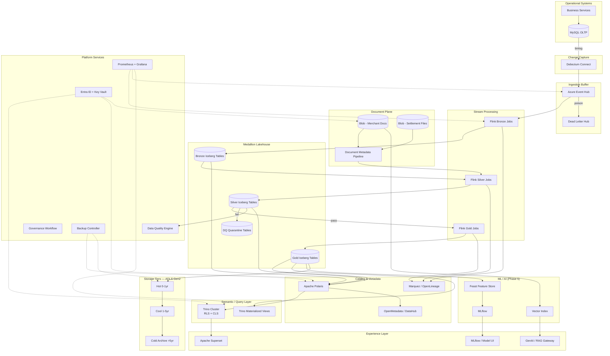

---

## 2. Reference Architecture Views

### 2.1 C4 Context Diagram

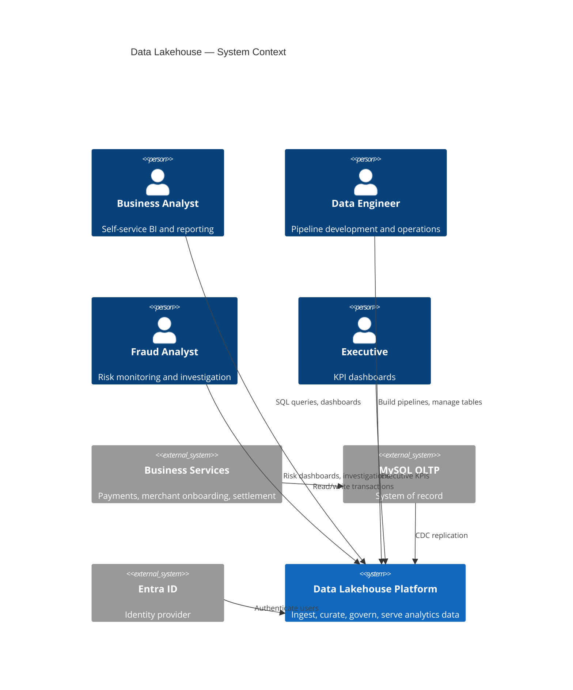

### 2.2 C4 Container Diagram

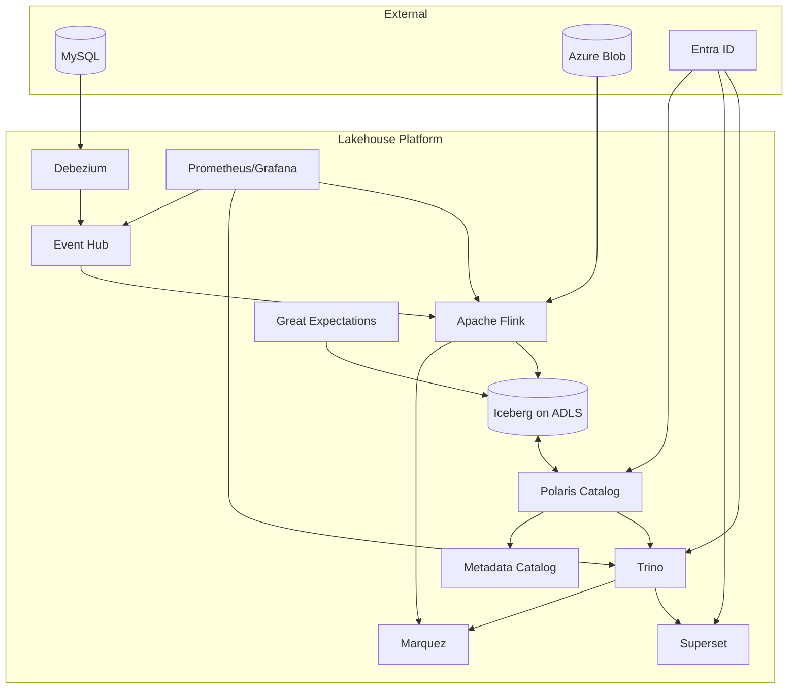

### 2.3 TOGAF View Mapping

| TOGAF View | Components | Document Section |
|------------|------------|------------------|
| Business | Stakeholders, KPIs, domains | §1, §6 |
| Data | Medallion layers, domains, retention | §4, §5, §9 |
| Application | Flink jobs, Trino, Superset, ML | §3, §5, §6, §10 |
| Technology | AKS, ADLS, Event Hub, Polaris | §11, §13 |
| Security | Entra ID, Key Vault, RLS/CLS | §7.6, §11 |
| Migration | Settlement BLOB migration | §8 |

---

## 3. Source and Ingestion Plane

### 3.1 Business Services

Business Services comprise the operational application tier that generates all transactional and merchant data.

| Service | Data Dominated | CDC Tables | Notes |
|---------|----------------|------------|-------|
| Payment Services | Transactions, authorizations | `transactions`, `authorizations` | Highest volume; partition by date |
| Merchant Onboarding | Merchant profiles, KYC status | `merchants`, `merchant_addresses` | Document metadata linked via `merchant_id` |
| Settlement Engine | Settlement batches, file refs | `settlements`, `settlement_files` | BLOB migration in Phase 1 |
| Reference Services | Currency, country, MCC codes | `ref_*` tables | Snapshot + CDC for changes |

**Integration contract:** Application teams MUST NOT alter primary key structures or delete columns without a data contract review. All schema changes flow through the CDC pipeline and trigger schema evolution handling in Bronze (see `04-bronze-layer.md`).

### 3.2 MySQL OLTP

| Attribute | Production Specification |
|-----------|-------------------------|
| Role | System of record (SoR) for all transactional data |
| Topology | Primary + synchronous replica (minimum); binlog on primary |
| Binlog format | `ROW` with `full` row image |
| Debezium user | Dedicated `debezium_cdc` account; `REPLICATION SLAVE`, `SELECT` only |
| Retention | Binlog retention ≥ 7 days (supports CDC recovery) |
| Tables in scope | All `merchant`, `transaction`, `settlement` domain tables |
| Excluded | Session tables, temp tables, audit logs > 90 days (configurable) |

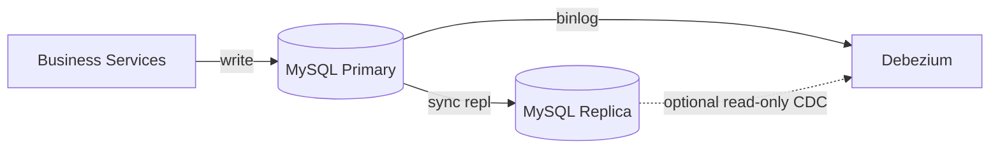

**Design decision:** CDC reads from primary binlog (not replica) to minimize replication lag inconsistency. Replica available for Debezium failover.

### 3.3 Debezium CDC

| Attribute | Specification |
|-----------|---------------|
| Deployment | Debezium Connect on AKS (2+ replicas) or dedicated VMSS |
| Connector type | MySQL connector (`io.debezium.connector.mysql.MySqlConnector`) |
| Snapshot mode | `initial` for new tables; `schema_only` for large backfills |
| Topic routing | Event Hub via Kafka Connect Azure Event Hubs sink |
| Message format | CloudEvents-wrapped JSON or Avro (recommended: Avro + Schema Registry) |
| Heartbeat | Enabled; interval 10s — detects stale connections |
| Tombstones | Emitted on DELETE; preserved through pipeline |

**Debezium envelope fields preserved in Bronze:**

| Field | Purpose |
|-------|---------|
| `before` | Pre-image for UPDATE/DELETE |
| `after` | Post-image for INSERT/UPDATE |
| `source.table` | Origin table |
| `source.lsn` | Binlog position for ordering |
| `op` | `c`, `u`, `d`, `r` (snapshot read) |
| `ts_ms` | Source commit timestamp |

### 3.4 Azure Event Hub

| Attribute | Production Specification |
|-----------|-------------------------|
| Namespace | `ehn-data-platform-prod` (one per environment) |
| SKU | Premium (recommended for production; dedicated throughput) |
| Partitions | 32 partitions per domain topic (merchant, transaction, settlement) |
| Retention | 7 days default; 30 days for `transaction` domain |
| Capture | Optional ADLS capture for audit archive |
| Consumer groups | One per Flink job: `cg-flink-bronze-{domain}-prod` |
| DLQ | Separate hub: `ehn-dlq-cdc-prod` |

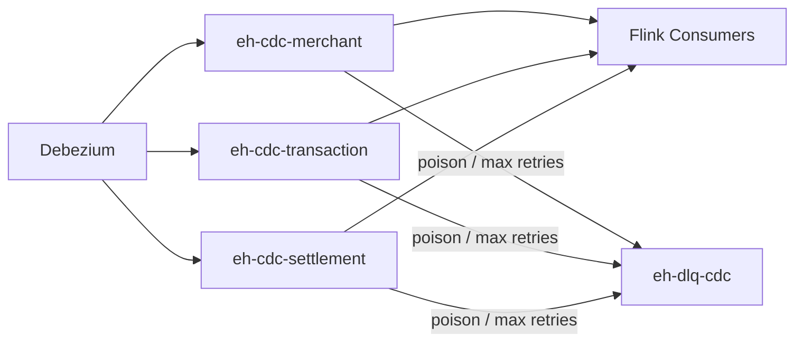

**Partition key strategy:** `{source_table}:{primary_key_hash}` — ensures ordering per entity.

### 3.5 Apache Flink — Ingestion Jobs

Flink is the sole stream processing engine for Bronze, Silver, and Gold transformations.

| Job Category | Naming Pattern | Parallelism | Checkpoint |
|--------------|----------------|-------------|------------|
| Bronze ingest | `flink-bronze-{domain}-{env}` | 32 (match EH partitions) | 5 min, EXACTLY_ONCE |
| Silver conform | `flink-silver-{domain}-{env}` | 16–64 | 5 min, EXACTLY_ONCE |
| Gold aggregate | `flink-gold-{mart}-{env}` | 8–32 | 5 min, EXACTLY_ONCE |

| Component | Specification |
|-----------|---------------|
| Runtime | Flink 1.18+ on AKS via Flink Kubernetes Operator |
| State backend | RocksDB with incremental checkpoints |
| Checkpoint storage | `abfss://flink-checkpoints@stlakeopsprod/` |
| Savepoint storage | `abfss://flink-savepoints@stlakeopsprod/` |
| Iceberg sink | Flink Iceberg connector; format version 2 |
| Watermark strategy | Bounded out-of-orderness 30s–10m per domain |

See `04-bronze-layer.md`, `05-silver-layer.md`, `06-gold-layer.md` for layer-specific job design.

---

## 4. Lakehouse Storage and Catalog Plane

### 4.1 Apache Iceberg

Iceberg is the sole table format for all Medallion layers and DQ quarantine tables.

| Attribute | Specification |
|-----------|---------------|
| Format version | 2 (row-level deletes, improved MV support) |
| File format | Parquet |
| Compression | ZSTD (level 3 default) |
| Target file size | 128 MB write; 512 MB post-compaction |
| Catalog integration | Apache Polaris REST catalog |
| Warehouse path | `abfss://lakehouse@stlakehotprod/` (hot tier) |
| Branching | `main` (prod writes); `audit`, `replay_*` (read/replay) |
| Tagging | `month_end_YYYYMM`, `regulatory_export_YYYYMMDD` |

**Iceberg table property defaults:**

```properties
write.format.default=parquet
write.parquet.compression-codec=zstd
write.target-file-size-bytes=134217728
commit.retry.num-retries=4
history.expire.max-snapshot-age-ms=604800000
```

### 4.2 Apache Polaris Catalog

| Attribute | Specification |
|-----------|---------------|
| Deployment | AKS (2 replicas) + PostgreSQL Flexible Server backend |
| Catalog name | `lakehouse` |
| Authentication | OAuth2 via Entra ID |
| Authorization | Polaris RBAC: catalog → namespace → table → view |
| Namespaces | `bronze_{domain}`, `silver_{domain}`, `gold_{domain}`, `dq`, `audit` |
| REST endpoint | `https://polaris.internal.company.com/api/catalog` |
| Backup | PostgreSQL daily backup; 35-day retention |

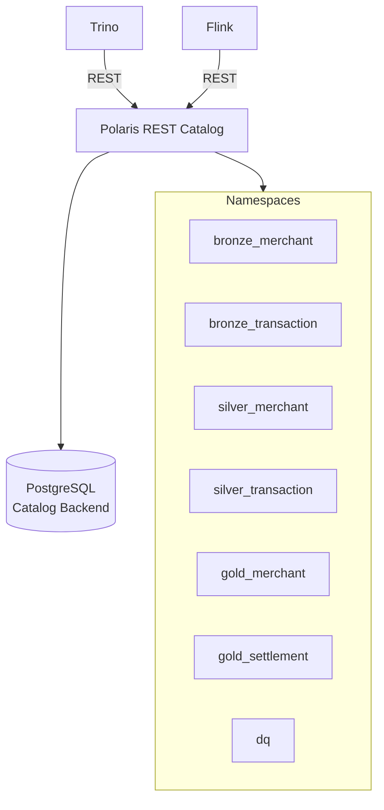

### 4.3 Azure Blob Storage / ADLS Gen2

| Storage Account | Purpose | Tier | Replication |
|-----------------|---------|------|-------------|
| `stlakehotprod` | Active Iceberg data (0–1 yr) | Hot | LRS (same region) |
| `stlakecoolprod` | Historical Iceberg data (1–5 yr) | Cool | LRS |
| `stlakearchiveprod` | Compliance archive (>5 yr) | Archive | RA-GRS |
| `stlakeopsprod` | Flink checkpoints, savepoints, temp | Hot | LRS |
| `stdocumentsprod` | Merchant + settlement documents | Hot | RA-GRS |
| `stauditprod` | Audit logs, lineage exports | Cool | GRS |

**Container layout (lakehouse account):**

```
abfss://lakehouse@stlakehotprod/
  bronze/
    merchant/merchants_cdc/
    transaction/transactions_cdc/
    settlement/settlements_cdc/
  silver/
    merchant/merchants/
    transaction/transactions/
  gold/
    merchant/merchant_daily_summary/
    settlement/settlement_summary/
  dq/
    quarantine_transaction/
    quarantine_merchant/
  audit/
    retention_registry/
```

---

## 5. Medallion Processing Plane

### 5.1 Layer Responsibilities

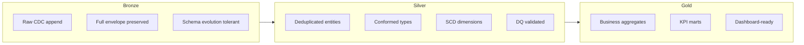

| Layer | Flink Jobs | Iceberg Write Mode | Consumers |
|-------|-----------|-------------------|-----------|
| Bronze | `flink-bronze-*` | Append-only | Data Engineers, replay jobs |
| Silver | `flink-silver-*` | Upsert / MERGE | Data Engineers, ML features |
| Gold | `flink-gold-*` | MERGE / overwrite partition | Trino, Superset, Feast |
| DQ Quarantine | `flink-silver-*` (side output) | Append | Data Engineers, DQ team |

Detailed layer designs: `03-medallion-architecture.md`, `04-bronze-layer.md`, `05-silver-layer.md`, `06-gold-layer.md`.

---

## 6. Query and Consumption Plane

### 6.1 Trino

| Attribute | Production Specification |
|-----------|-------------------------|
| Deployment | AKS: 1 coordinator (HA pair) + 4–16 workers (autoscale) |
| Catalog config | Polaris REST connector per environment |
| Authentication | OAuth2 / Entra ID |
| Authorization | File-based or Apache Ranger integration; row/column filters |
| Resource groups | `interactive`, `batch`, `superset`, `ml` — with CPU/memory quotas |
| Spill | Enabled to `abfss://trino-spill@stlakeopsprod/` |
| Query logging | OpenLineage listener for lineage capture |

**Trino access pattern:**

| User Group | Catalog Access | RLS Policy |
|------------|---------------|------------|
| `grp-analyst-merchant` | `gold_merchant`, `gold_ops` | Filter by assigned merchant portfolio |
| `grp-analyst-finance` | `gold_settlement`, `gold_revenue` | No row filter (full finance) |
| `grp-engineer-data` | All namespaces (read); bronze/silver (write via pipelines only) | None |
| `grp-fraud` | `gold_risk`, `silver_transaction` | Region-based filter |
| `grp-executive` | `gold_exec` views only | Pre-aggregated; no PII |

### 6.2 Apache Superset

| Attribute | Production Specification |
|-----------|-------------------------|
| Deployment | AKS, 2+ web replicas behind Application Gateway |
| Database connection | Trino via SQLAlchemy; one connection per catalog group |
| Authentication | Entra ID SSO (OAuth2) |
| Authorization | Superset RBAC synced from Entra groups |
| Dataset policy | **Gold layer only** for published dashboards |
| Cache | Redis for dashboard cache; TTL 5 min (operational), 24 hr (executive) |
| Lineage | Superset → OpenLineage plugin → Marquez |

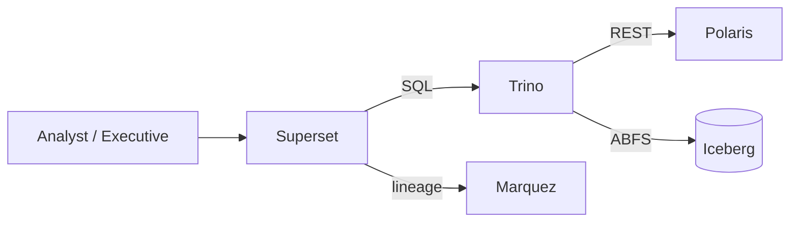

---

## 7. Platform Services Layer

### 7.1 Data Quality Layer

```mermaid
flowchart TB
    subgraph Inline DQ — Flink
        IV1[Schema validation]
        IV2[Required field check]
        IV3[Referential key check]
    end

    subgraph Batch DQ — Great Expectations
        BV1[Completeness suites]
        BV2[Uniqueness suites]
        BV3[Custom SQL rules]
    end

    subgraph Outcomes
        PASS[Silver promotion]
        QUAR[Quarantine table]
        ALERT[PagerDuty / Slack alert]
    end

    STREAM[Silver Stream] --> Inline DQ
    Inline DQ -->|pass| PASS
    Inline DQ -->|fail| QUAR
    PASS --> Batch DQ
    Batch DQ -->|score < threshold| ALERT
```

| Component | Tool | Responsibility |
|-----------|------|----------------|
| Inline validation | Flink async functions | Real-time reject to quarantine |
| Batch validation | Great Expectations on Trino | Daily/hourly suite execution |
| Metrics library | Deequ (optional, if Spark introduced) | Anomaly detection profiles |
| SQL monitoring | Soda Core | CI/CD contract validation |
| Quarantine storage | Iceberg `dq.quarantine_*` | Failed records with reason codes |
| DQ score | Custom metric exporter → Prometheus | Per-table daily score |

See `07-data-quality.md` for full framework.

### 7.2 Metadata Layer

| Metadata Type | Examples | System of Record |
|---------------|----------|------------------|
| **Technical** | Schema, partitions, snapshots, file counts | Polaris + Iceberg metadata |
| **Business** | Glossary terms, KPI definitions | OpenMetadata / DataHub |
| **Operational** | Owner, SLA, freshness, cost center | OpenMetadata |
| **Quality** | DQ score, last validation, quarantine count | GE + Prometheus |
| **Security** | Classification, PII tags, access policies | OpenMetadata + Polaris ACL |

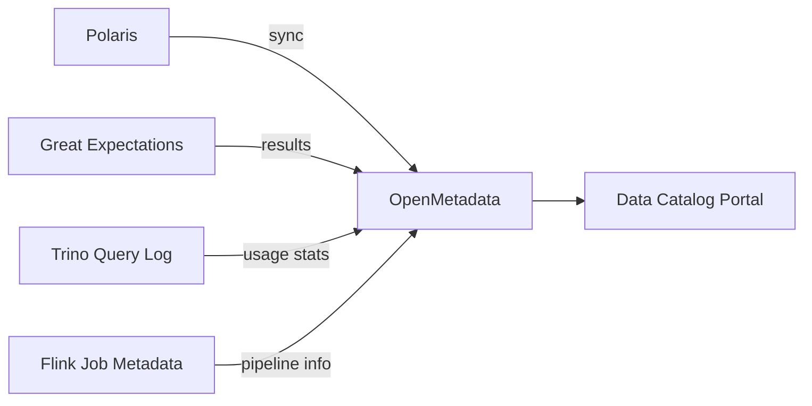

### 7.3 Governance Layer

| Capability | Implementation |
|------------|----------------|
| Dataset registration | Git-based data contracts (`data-contracts` repo) |
| Schema approval | PR review + CI schema diff + steward sign-off |
| Classification | Tags: `PUBLIC`, `INTERNAL`, `CONFIDENTIAL`, `PII`, `PCI` |
| Access requests | ServiceNow / Jira workflow → Entra group membership |
| Retention policy | `audit.retention_registry` Iceberg table |
| Audit trail | All catalog changes logged to `stauditprod` |
| ARB gate | New PCI/PII Gold marts require ARB approval |

**Approval workflow:**

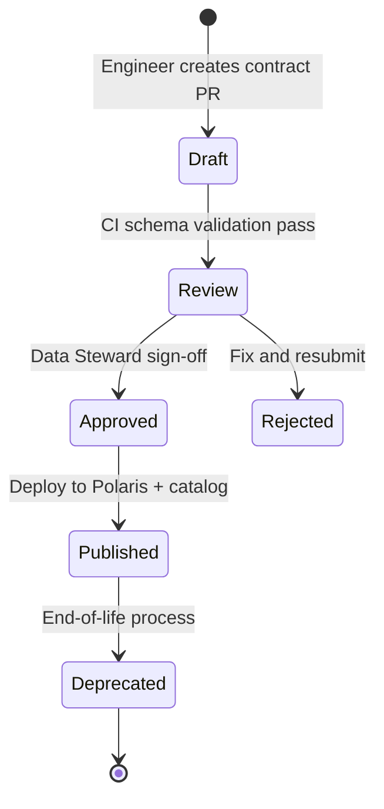

### 7.4 Lineage Layer

| Source | Lineage Emitter | Target |
|--------|-----------------|--------|
| Flink jobs | OpenLineage Flink integration | Marquez |
| Trino queries | OpenLineage Trino listener | Marquez |
| Superset datasets | OpenLineage Superset plugin | Marquez |
| dbt (future) | OpenLineage dbt adapter | Marquez |

**End-to-end lineage chain:**

```
Business Service → MySQL → Debezium → Event Hub → Flink → Bronze → Silver → Gold → Trino → Superset
```

See `08-governance.md` for OpenLineage facet specifications.

### 7.5 Monitoring Layer

| Signal | Source | Dashboard | Alert |
|--------|--------|-----------|-------|
| CDC lag | Debezium JMX + Flink metrics | Ingest Health | > 10 min p99 |
| Event Hub lag | Azure Monitor | Ingest Health | > 5 min |
| Flink checkpoint | Flink REST API | Pipeline Health | Duration > 3 min or failure |
| Data freshness | Gold `last_updated_ts` | Gold Freshness | SLA miss |
| DQ score | GE exporter | Data Quality | < 95% Gold |
| Trino query latency | Trino JMX | Query Performance | p99 > 30s interactive |
| Storage cost | Azure Cost Management | Cost & Storage | > 110% 7-day avg |
| Compaction backlog | Iceberg snapshot stats | Storage Ops | Small file ratio > 30% |

**Stack:** Prometheus (metrics) + Grafana (dashboards) + Azure Monitor (PaaS) + PagerDuty (alerts).

See `11-monitoring.md` for full observability design.

### 7.6 Security Layer

| Control | Implementation | Detail Doc |
|---------|----------------|------------|
| Identity | Entra ID (Azure AD) | `09-security.md` |
| RBAC | Entra groups → Polaris namespaces → Trino rules | `09-security.md` |
| ABAC | Attributes: `merchant_region`, `data_classification` | `09-security.md` |
| RLS | Trino row filters on `merchant_id`, `region` | `09-security.md` |
| CLS | Dynamic masking UDF for PII/PCI columns | `09-security.md` |
| Encryption at rest | SSE-KMS on all storage accounts | `09-security.md` |
| Encryption in transit | TLS 1.2+; Private Link for all Azure services | §11 |
| Secrets | Azure Key Vault + AKS CSI driver | `09-security.md` |
| Network | Private endpoints; no public Blob access | §11 |
| Audit | Azure Activity Log + Trino audit log → SIEM | `09-security.md` |

### 7.7 Backup Layer

| Asset | Backup Method | Frequency | Retention |
|-------|---------------|-----------|-----------|
| Polaris catalog DB | PostgreSQL automated backup | Daily | 35 days |
| Iceberg metadata | Versioned Blob snapshots + monthly tags | Daily | 90 days metadata |
| Flink savepoints | Pre-deploy savepoint to ADLS | On demand | 30 days |
| Event Hub capture | Optional ADLS capture files | Continuous | 90 days |
| Entra group memberships | Export to audit storage | Weekly | 1 year |
| Data contracts repo | Git (GitHub/Azure DevOps) | Every commit | Indefinite |
| Key Vault | Azure Backup | Daily | 90 days |

### 7.8 Disaster Recovery Layer

| Tier | Scope | RPO | RTO | Mechanism |
|------|-------|-----|-----|-----------|
| Tier 1 | Flink job failure | 5 min | 30 min | Checkpoint restore |
| Tier 2 | Trino coordinator failure | 0 | 5 min | HA coordinator failover |
| Tier 3 | Region outage | 15 min | 4 hr | RA-GRS ADLS; secondary Event Hub; DR runbook |
| Tier 4 | Catalog corruption | 24 hr | 2 hr | PostgreSQL point-in-time restore |
| Tier 5 | Accidental table drop | 0 | 1 hr | Iceberg snapshot rollback |

See `11-monitoring.md` §DR and `13-runbook.md` for recovery procedures.

---

## 8. Document Storage Architecture

### 8.1 Overview

Merchant documents are already stored in Azure Blob. Settlement files migrate from MySQL BLOB in Phase 1. Document metadata flows/ingested into Silver for analytics linkage.

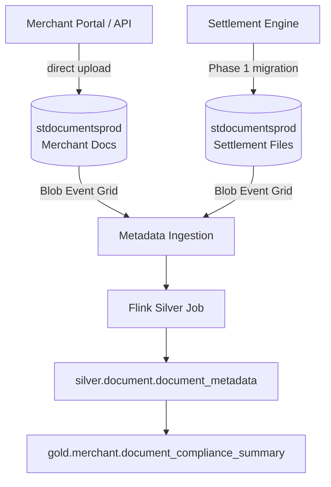

### 8.2 Folder Hierarchy

```
abfss://documents@stdocumentsprod/
  merchant/
    {merchant_id}/
      kyc/
        {yyyy}/{mm}/{document_uuid}_v{version}.{ext}
      contracts/
        {yyyy}/{mm}/{document_uuid}_v{version}.{ext}
      correspondence/
        {yyyy}/{mm}/{document_uuid}_v{version}.{ext}
  settlement/
    {yyyy}/{mm}/{dd}/
      {settlement_batch_id}/
        {file_uuid}_v{version}.csv
  _system/
    virus-scan-results/
    ocr-output/
    legal-hold/
```

### 8.3 Document Metadata Schema (Silver)

| Column | Type | Description |
|--------|------|-------------|
| `document_id` | STRING | UUID |
| `merchant_id` | STRING | FK to silver merchant |
| `document_type` | STRING | `KYC`, `CONTRACT`, `SETTLEMENT`, etc. |
| `blob_path` | STRING | Full ABFS path |
| `version_id` | STRING | Blob version ID |
| `checksum_sha256` | STRING | Integrity hash |
| `file_size_bytes` | BIGINT | Size |
| `mime_type` | STRING | Content type |
| `scan_status` | STRING | `PENDING`, `CLEAN`, `INFECTED` |
| `ocr_status` | STRING | `PENDING`, `COMPLETE`, `FAILED` |
| `ocr_text_path` | STRING | Path to extracted text (for RAG) |
| `upload_ts` | TIMESTAMP | Upload time |
| `retention_until` | DATE | Policy-driven expiry |
| `is_immutable` | BOOLEAN | Legal hold flag |

### 8.4 Document Security Controls

| Control | Implementation |
|---------|----------------|
| Virus scanning | Microsoft Defender for Storage |
| Encryption | SSE-KMS with dedicated CMK |
| Access | SAS tokens with 15-min TTL for app uploads; RBAC for analytics |
| Immutability | Blob immutability policy for dispute/legal hold docs |
| Versioning | Blob versioning enabled on `stdocumentsprod` |
| Audit | All read/write logged to `stauditprod` |

See `10-storage-retention.md` for document retention policies.

---

## 9. Storage Tier Hierarchy

### 9.1 Tier Definitions

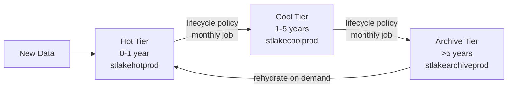

| Tier | Age | Azure Class | Queryability | Restore Time | Cost Index |
|------|-----|-------------|--------------|--------------|------------|
| **Hot** | 0–1 year | Hot | Full Trino, low latency | Immediate | 1.0× |
| **Cool** | 1–5 years | Cool | Full Trino, higher latency | Seconds–minutes | 0.5× |
| **Cold** | >5 years (transitional) | Cold | Metadata online; data rehydrate | 1–5 hours | 0.2× |
| **Archive** | >5 years (compliance) | Archive | Discoverable; on-demand rehydrate | Up to 15 hours | 0.1× |

### 9.2 Iceberg and Blob Tier Coordination

| Component | Hot | Cool | Archive |
|-----------|-----|------|---------|
| Iceberg metadata files | ✅ Always Hot | ✅ Hot or Cool | ✅ Cool (never Archive) |
| Manifest files | ✅ Hot | ✅ Cool | ✅ Cool |
| Data files (Parquet) | ✅ Hot | ✅ Cool after migration | ✅ Archive after migration |
| Delete vectors | ✅ Hot | Follow data files | Follow data files |

**Rule:** Iceberg metadata and manifest files MUST remain queryable without rehydration. Only Parquet data files tier to Archive.

### 9.3 Lifecycle Automation

| Job | Frequency | Action |
|-----|-----------|--------|
| `job-tier-migration-daily` | Daily 01:00 UTC | Move data files older than policy threshold |
| `job-compaction-daily` | Daily 02:00 UTC | Rewrite small files before tier migration |
| `job-snapshot-expire` | Daily 03:00 UTC | Expire snapshots per layer policy |
| `job-retention-audit` | Weekly | Validate `audit.retention_registry` compliance |

See `10-storage-retention.md` for the complete five-year retention strategy.

---

## 10. ML, Feature Store, and GenAI Platform

> **Phase 5 deliverable.** Architecture defined now for ARB approval; implementation deferred.

### 10.1 Feature Store (Feast)

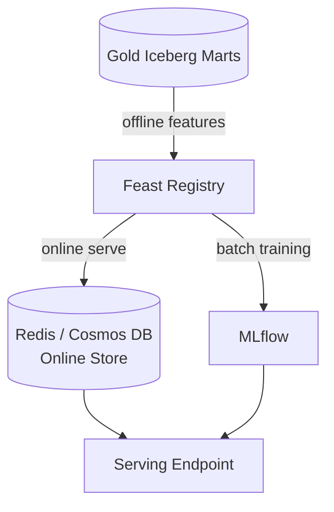

| Feature Domain | Source Mart | Key Features | Freshness |
|----------------|-------------|--------------|-----------|
| Fraud | `gold.risk.fraud_features` | txn_velocity_1h, avg_amount_7d, chargeback_rate_30d | 15 min |
| Merchant Risk | `gold.merchant.merchant_risk_features` | onboarding_age_days, doc_completeness, txn_growth | Daily |
| Underwriting | `gold.merchant.underwriting_features` | kyc_status, industry_mcc, settlement_history | Daily |

### 10.2 ML Platform (MLflow)

| Component | Specification |
|-----------|---------------|
| Tracking server | MLflow on AKS |
| Artifact store | `abfss://ml-artifacts@stlakeopsprod/` |
| Model registry | MLflow Model Registry |
| Training compute | Azure ML compute cluster (batch) |
| Serving | Azure ML managed endpoint or AKS inference |

**Use cases (priority order):**
1. Fraud detection (transaction scoring)
2. Merchant risk scoring
3. Underwriting decision support

### 10.3 GenAI Platform

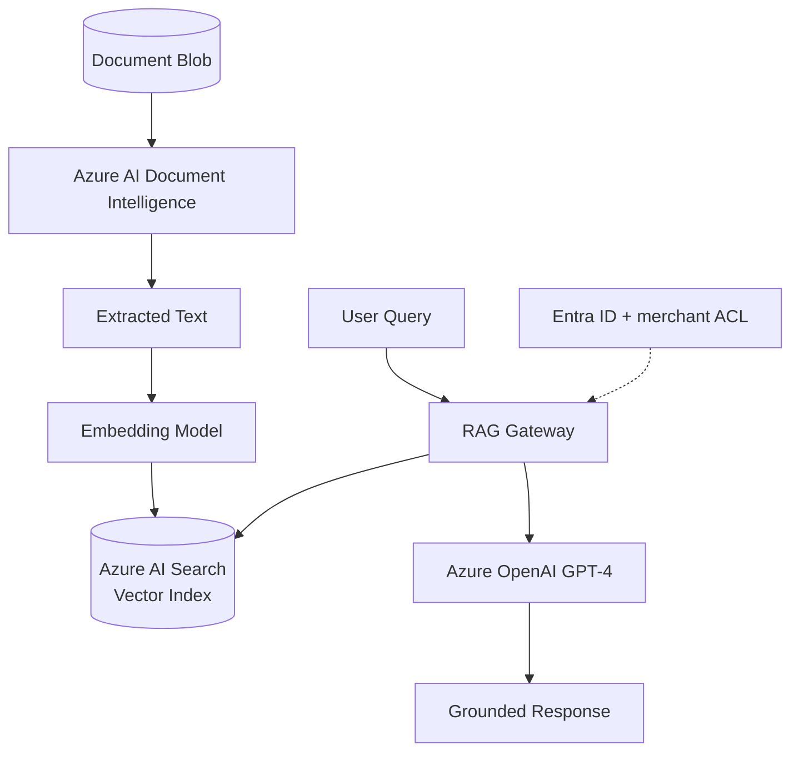

| Component | Specification |
|-----------|---------------|
| LLM | Azure OpenAI (GPT-4o); private endpoint |
| Embeddings | `text-embedding-3-large` |
| Vector store | Azure AI Search with vector field |
| RAG gateway | Custom API on AKS; inherits `merchant_id` ACL |
| Document scope | KYC docs, contracts, settlement reports |
| Guardrails | Content filtering; no cross-merchant retrieval |

See `12-ml-ai-roadmap.md` for detailed ML/AI roadmap.

---

## 11. Network and Infrastructure Topology

### 11.1 Azure Resource Topology

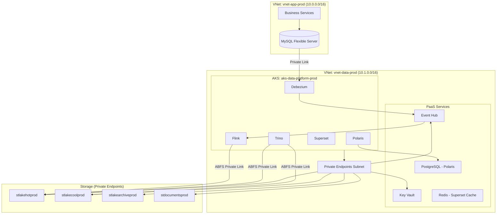

### 11.2 Network Security Rules

| Rule | Source | Destination | Port | Purpose |
|------|--------|-------------|------|---------|
| NSG-01 | AKS subnet | Storage private endpoints | 443 | ABFS data access |
| NSG-02 | AKS subnet | Event Hub private endpoint | 443 | CDC consume/produce |
| NSG-03 | AKS subnet | Key Vault private endpoint | 443 | Secrets retrieval |
| NSG-04 | App subnet | MySQL | 3306 | Application DB access |
| NSG-05 | Debezium pod | MySQL | 3306 | Binlog read |
| NSG-06 | Corporate network | App Gateway (Superset) | 443 | Analyst access |
| DENY-01 | Internet | All data plane resources | * | No public endpoints |

### 11.3 AKS Node Pool Design

| Pool | VM Size | Min | Max | Workloads |
|------|---------|-----|-----|-----------|
| `sys` | Standard_D4s_v5 | 2 | 3 | System pods, Polaris, Debezium |
| `flink` | Standard_E8s_v5 | 4 | 32 | Flink TaskManagers |
| `trino` | Standard_E16s_v5 | 2 | 16 | Trino workers (autoscale) |
| `general` | Standard_D4s_v5 | 2 | 8 | Superset, GE runners, MLflow |

### 11.4 DNS and Private Link

| Service | Private DNS Zone | Endpoint |
|---------|------------------|----------|
| Blob / ADLS | `privatelink.blob.core.windows.net` | Per storage account |
| Event Hub | `privatelink.servicebus.windows.net` | Namespace |
| Key Vault | `privatelink.vaultcore.azure.net` | Vault |
| PostgreSQL | `privatelink.postgres.database.azure.com` | Flexible Server |

---

## 12. High Availability and Disaster Recovery

### 12.1 HA Architecture

```mermaid
flowchart TB
    subgraph Primary Region — East US
        FLINK1[Flink Cluster]
        TRINO1[Trino Cluster]
        POL1[Polaris Primary]
        ADLS1[ADLS Primary]
        EH1[Event Hub Primary]
    end

    subgraph DR Region — West US
        TRINO_DR[Trino Standby]
        ADLS_DR[ADLS RA-GRS Replica]
        EH_DR[Event Hub GRS]
    end

    FLINK1 --> ADLS1
    ADLS1 -->|async replication| ADLS_DR
    EH1 -->|geo-disaster recovery| EH_DR
    POL1 -->|catalog backup| ADLS1
```

### 12.2 DR Targets

| Scenario | RPO | RTO | Procedure |
|----------|-----|-----|-----------|
| Single Flink TaskManager failure | 0 | Auto | K8s pod restart |
| Flink Job Manager failure | 5 min | 15 min | HA JobManager failover + checkpoint |
| Trino coordinator failure | 0 | 5 min | Standby coordinator promotion |
| Event Hub throttling | 0 | 30 min | Scale TUs; backpressure |
| ADLS primary region outage | 15 min | 4 hr | Failover read to RA-GRS; replay from Event Hub |
| Full region outage | 15 min | 8 hr | Activate DR runbook; secondary region |
| Polaris DB corruption | 24 hr | 2 hr | Point-in-time restore |

### 12.3 DR Testing Schedule

| Test | Frequency | Success Criteria |
|------|-----------|------------------|
| Flink checkpoint restore | Monthly | Job resumes; data reconciles |
| Trino coordinator failover | Quarterly | < 5 min downtime |
| ADLS failover read | Semi-annual | Trino queries succeed on secondary |
| Full DR drill | Annual | RTO met; all SLOs documented |

---

## 13. Component Inventory

### 13.1 Complete Component Register

| # | Component | Type | Version | Env | HA | Owner | SLA |
|---|-----------|------|---------|-----|----|-------|-----|
| 1 | Business Services | Application | — | prod | App team | App Eng | 99.9% |
| 2 | MySQL OLTP | Database | 8.0+ | prod | Primary+Replica | App DBA | 99.95% |
| 3 | Debezium Connect | CDC | 2.5+ | prod | 2 replicas | Data Eng | 99.5% |
| 4 | Azure Event Hub | Messaging | Premium | prod | GRS optional | Platform | 99.95% |
| 5 | Apache Flink | Stream processing | 1.18+ | prod | Checkpoint recovery | Data Eng | 99.5% |
| 6 | Apache Iceberg | Table format | 1.5+ | prod | Snapshot isolation | Data Eng | — |
| 7 | Apache Polaris | Catalog | 0.9+ | prod | 2 replicas + PG backup | Platform | 99.5% |
| 8 | ADLS Gen2 (Hot) | Storage | — | prod | LRS | Platform | 99.9% |
| 9 | ADLS Gen2 (Cool) | Storage | — | prod | LRS | Platform | 99.9% |
| 10 | ADLS Gen2 (Archive) | Storage | — | prod | RA-GRS | Platform | 99.9% |
| 11 | Trino | Query engine | 435+ | prod | Coordinator HA | Platform | 99.5% |
| 12 | Apache Superset | BI | 3.1+ | prod | 2+ replicas | Analytics | 99.5% |
| 13 | Great Expectations | Data quality | 0.18+ | prod | Batch scheduler | Data Eng | — |
| 14 | OpenMetadata / DataHub | Metadata catalog | Latest | prod | 2 replicas | Governance | 99.0% |
| 15 | Marquez | Lineage | 0.50+ | prod | 2 replicas | Data Eng | 99.0% |
| 16 | Prometheus | Metrics | 2.50+ | prod | Azure Managed | SRE | 99.5% |
| 17 | Grafana | Dashboards | 10+ | prod | Azure Managed | SRE | 99.5% |
| 18 | Entra ID | Identity | — | prod | Microsoft SLA | Security | 99.9% |
| 19 | Azure Key Vault | Secrets | — | prod | Zone redundant | Security | 99.99% |
| 20 | Microsoft Defender | AV scanning | — | prod | Microsoft SLA | Security | — |
| 21 | Azure AI Document Intelligence | OCR | — | prod | Microsoft SLA | AI Platform | 99.9% |
| 22 | Azure OpenAI | LLM | — | prod | Microsoft SLA | AI Platform | 99.9% |
| 23 | Azure AI Search | Vector DB | — | prod | 2+ replicas | AI Platform | 99.9% |
| 24 | Feast | Feature store | 0.38+ | prod (Ph5) | Registry HA | ML Eng | 99.5% |
| 25 | MLflow | ML lifecycle | 2.10+ | prod (Ph5) | 2 replicas | ML Eng | 99.0% |
| 26 | Redis | Cache | 7+ | prod | Azure Cache HA | Platform | 99.9% |
| 27 | PostgreSQL Flexible | Catalog DB | 15+ | prod | Zone redundant | Platform | 99.95% |

### 13.2 Integration Matrix

| From → To | Protocol | Auth | Data Format |
|-----------|----------|------|-------------|
| MySQL → Debezium | Binlog (3306) | DB credentials (KV) | Row events |
| Debezium → Event Hub | Kafka protocol (9093) | SAS / Managed Identity | Avro/JSON |
| Event Hub → Flink | Kafka consumer | Managed Identity | Avro/JSON |
| Flink → Iceberg | ABFS + REST catalog | Managed Identity | Parquet |
| Trino → Polaris | HTTPS REST | OAuth2 | — |
| Trino → Iceberg | ABFS + REST | Managed Identity | Parquet |
| Superset → Trino | HTTPS JDBC | OAuth2 pass-through | SQL |
| Flink → Marquez | HTTP | API key (KV) | OpenLineage JSON |
| GE → Trino | HTTPS JDBC | Service principal | SQL |
| Apps → Blob (docs) | HTTPS | SAS / Managed Identity | Binary |

---

## 14. Design Decisions and Trade-offs

### 14.1 Key Architecture Decisions

| ADR | Decision | Rationale | Trade-off | Mitigation |
|-----|----------|-----------|-----------|------------|
| ADR-P02-001 | Separate storage accounts per tier | Independent lifecycle policies and cost tracking | More accounts to manage | Infrastructure-as-Code (Terraform) |
| ADR-P02-002 | Flink for all layer processing | Exactly-once, already deployed, team expertise | Not ideal for large batch backfills | Spark on-demand for backfills only |
| ADR-P02-003 | Polaris over Hive Metastore | REST API, RBAC, multi-engine | Newer project | Pin version; backup catalog DB |
| ADR-P02-004 | Premium Event Hub | Dedicated throughput, predictable latency | Higher cost than Standard | Right-size TUs; monitor utilization |
| ADR-P02-005 | Gold-only Superset datasets | Prevents analysts querying raw PII in Bronze | Less flexibility for ad-hoc | Trino access for engineers on Silver |
| ADR-P02-006 | Private Link only (no public endpoints) | Security compliance | VPN/ExpressRoute required for access | Azure App Gateway for Superset |
| ADR-P02-007 | Separate document storage account | Different retention, immutability, and ACL model | Cross-account metadata sync | Event Grid triggers |
| ADR-P02-008 | OpenMetadata over custom catalog | Community support, Superset/Trino integrations | Additional infrastructure | Managed deployment on AKS |

### 14.2 Scalability Projections

| Component | Current (est.) | Year 2 | Scaling Action |
|-----------|---------------|--------|----------------|
| CDC events/day | 50M | 200M | Increase EH TUs; Flink parallelism |
| Iceberg storage | 5 TB | 25 TB | Compaction; tier migration |
| Trino concurrent queries | 20 | 80 | Worker autoscale pool |
| Superset users | 50 | 200 | Redis cache; pre-aggregated Gold |
| Document storage | 2 TB | 10 TB | Lifecycle; Archive tier for aged docs |

---

## 15. Production Recommendations

### 15.1 Phase 1 — Must-Have Before Production

| # | Recommendation | Priority |
|---|----------------|----------|
| 1 | Deploy Private Link for all storage and PaaS services | P0 |
| 2 | Enable Debezium heartbeat and binlog retention ≥ 7 days | P0 |
| 3 | Configure Flink EXACTLY_ONCE with 5-min checkpoints | P0 |
| 4 | Migrate settlement BLOB out of MySQL | P0 |
| 5 | Establish separate ADLS accounts (hot, cool, archive, ops, docs) | P0 |
| 6 | Deploy Polaris with PostgreSQL HA and daily backup | P0 |
| 7 | Enable Blob versioning and SSE-KMS on all accounts | P0 |
| 8 | Configure Event Hub DLQ for poison messages | P0 |

### 15.2 Operational Must-Haves

| # | Recommendation | Priority |
|---|----------------|----------|
| 9 | Daily Iceberg compaction job for Silver and Gold | P1 |
| 10 | Daily snapshot expiration per layer policy | P1 |
| 11 | Prometheus metrics from Flink, Trino, Event Hub | P1 |
| 12 | Reconciliation job: MySQL row counts vs Silver counts | P1 |
| 13 | Trino resource groups with query limits | P1 |
| 14 | Superset restricted to Gold published datasets | P1 |
| 15 | Infrastructure-as-Code for all Azure resources | P1 |

### 15.3 Governance Must-Haves (Phase 4)

| # | Recommendation | Priority |
|---|----------------|----------|
| 16 | Data contracts repo with CI schema validation | P2 |
| 17 | OpenLineage from Flink and Trino | P2 |
| 18 | Great Expectations suites on all Silver/Gold tables | P2 |
| 19 | RLS pilot on merchant-facing marts | P2 |
| 20 | Retention registry in `audit.retention_registry` | P2 |

---

## 16. Risks and Mitigations

| ID | Risk | Likelihood | Impact | Mitigation |
|----|------|------------|--------|------------|
| RA-01 | Event Hub becomes throughput bottleneck | Medium | High | Premium SKU; partition scaling; monitor TUs |
| RA-02 | Iceberg small file problem degrades Trino | High | Medium | Daily compaction; Flink target file size tuning |
| RA-03 | Polaris SPOF blocks all queries | Low | Critical | HA deployment; catalog DB backup; DR tested quarterly |
| RA-04 | Network misconfiguration exposes Blob publicly | Low | Critical | IaC with policy; Azure Policy deny public access |
| RA-05 | CDC schema change breaks Silver pipeline | Medium | High | Schema evolution in Bronze; contract CI gate |
| RA-06 | Document OCR/RAG ACL leak cross-merchant | Low | Critical | merchant_id filter mandatory; penetration test |
| RA-07 | Archive rehydrate latency blocks compliance query | Medium | Medium | Keep metadata in Cool; pre-warm for known audits |
| RA-08 | Cost overrun from un-tiered historical data | High | Medium | Automated lifecycle; monthly cost review dashboard |

---

## Appendix A — Environment Specifications

| Resource | Dev | Staging | Production |
|----------|-----|---------|------------|
| AKS cluster | `aks-data-dev` | `aks-data-stg` | `aks-data-prod` |
| Event Hub | `ehn-data-dev` (Standard) | `ehn-data-stg` (Standard) | `ehn-data-prod` (Premium) |
| ADLS Hot | `stlakehotdev` | `stlakehotstg` | `stlakehotprod` |
| Polaris catalog | `lakehouse_dev` | `lakehouse_stg` | `lakehouse` |
| Flink parallelism | 4 | 8 | 32+ |
| Trino workers | 2 | 4 | 4–16 (autoscale) |
| Data retention | 30 days | 90 days | Policy-driven (5 yr) |

---

## Appendix B — Related Documents

| Document | Relationship |
|----------|-------------|
| `01-executive-summary.md` | Business case and ARB approval |
| `03-medallion-architecture.md` | Layer definitions and data model |
| `04-bronze-layer.md` | Bronze ingest detail |
| `05-silver-layer.md` | Silver transformation detail |
| `06-gold-layer.md` | Gold mart detail |
| `07-data-quality.md` | DQ framework |
| `08-governance.md` | Metadata, governance, lineage |
| `09-security.md` | Security controls detail |
| `10-storage-retention.md` | Storage tier and retention |
| `11-monitoring.md` | Observability and DR runbooks |
| `12-ml-ai-roadmap.md` | ML/AI platform detail |
| `13-runbook.md` | Operational procedures |
| `14-roadmap.md` | Implementation phases |

---

## Appendix C — Revision History

| Version | Date | Author | Changes |
|---------|------|--------|---------|
| 1.0.0 | 2026-07-02 | Data Platform Architecture | Initial production architecture |
