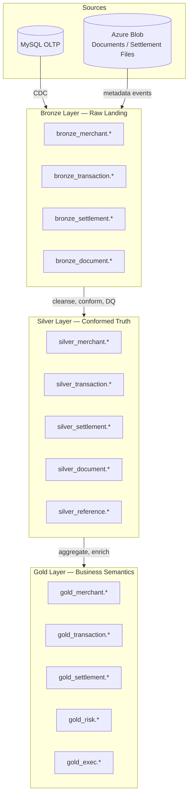
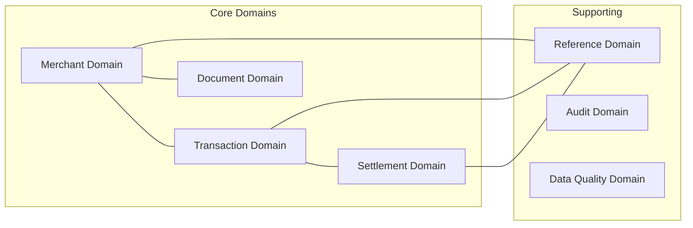
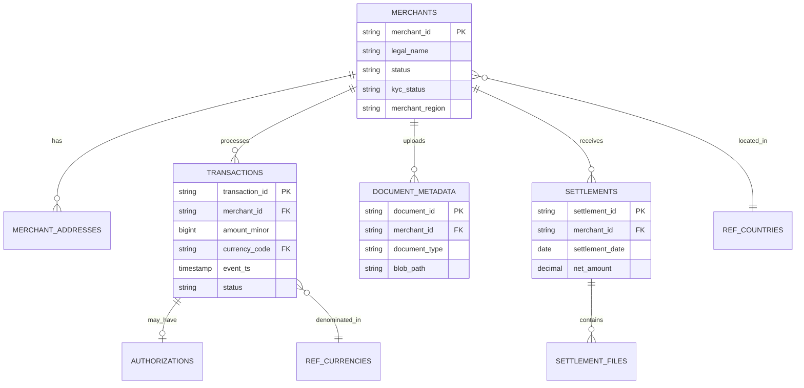
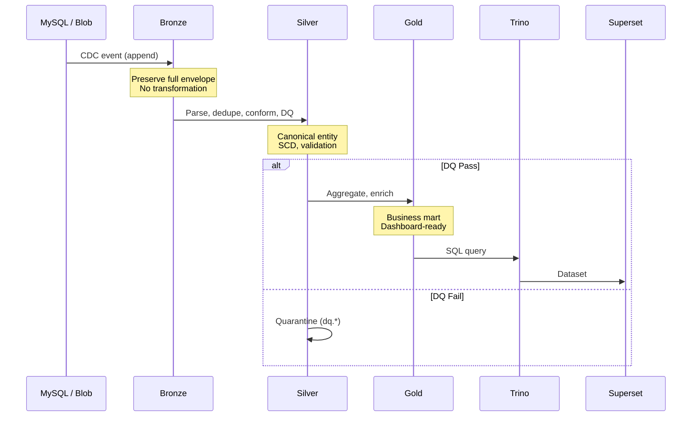
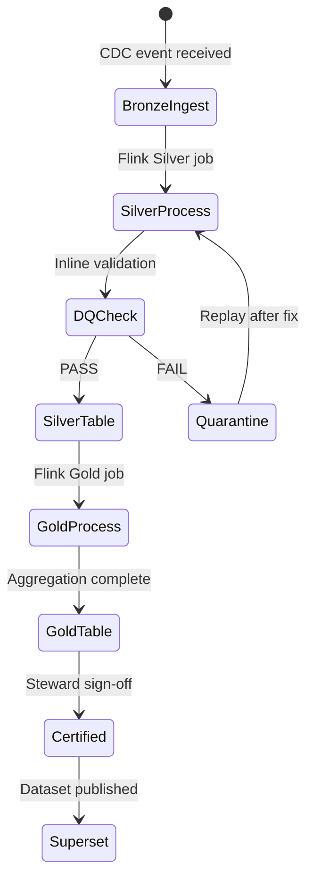
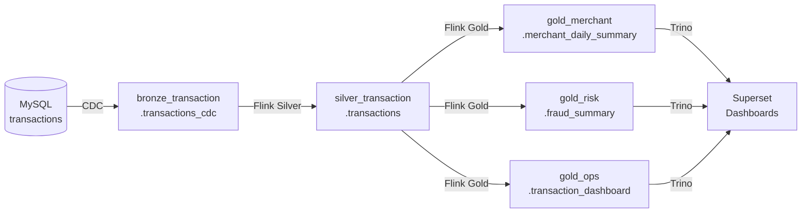

# Part 3 — Lakehouse Data Model (Medallion Architecture)

**Document ID:** DLH-ARB-2026-001-03  
**Version:** 1.0.0  
**Classification:** Internal — Confidential  
**Status:** Draft — For ARB Review

---

## Table of Contents

1. [Overview](#1-overview)
2. [Domain Model](#2-domain-model)
3. [Namespace and Naming Conventions](#3-namespace-and-naming-conventions)
4. [Medallion Layer Summary](#4-medallion-layer-summary)
5. [Bronze Layer](#5-bronze-layer)
6. [Silver Layer](#6-silver-layer)
7. [Gold Layer](#7-gold-layer)
8. [Supporting Schemas (DQ and Audit)](#8-supporting-schemas-dq-and-audit)
9. [Layer Promotion Rules](#9-layer-promotion-rules)
10. [Cross-Layer Data Lineage](#10-cross-layer-data-lineage)
11. [Design Decisions and Trade-offs](#11-design-decisions-and-trade-offs)
12. [Production Recommendations](#12-production-recommendations)

---

## 1. Overview

### 1.1 Purpose

This document defines the **Medallion Architecture data model** for the enterprise Data Lakehouse. It specifies how data is organized across **Bronze**, **Silver**, and **Gold** layers, including ownership, schema standards, partitioning, retention, access policies, and example table designs for each domain.

The Medallion model is the **authoritative layering standard** for all analytics data. No production dataset may bypass Silver conformation before reaching Gold or Superset.

### 1.2 Medallion Architecture — Conceptual Model



### 1.3 Layer Philosophy

| Layer | Analogy | Question It Answers |
|-------|---------|---------------------|
| **Bronze** | Raw security camera footage | "What exactly did the source system emit?" |
| **Silver** | Verified, labeled evidence | "What is the current truth about this entity?" |
| **Gold** | Executive briefing | "What are the business KPIs and trends?" |

### 1.4 Architecture Principles

| ID | Principle | Rule |
|----|-----------|------|
| ML-01 | **Immutability in Bronze** | Bronze tables are append-only; no UPDATE/DELETE on historical rows |
| ML-02 | **Single Silver truth** | One conformed entity table per business object (no duplicate Silver tables) |
| ML-03 | **Gold is read-optimized** | Gold tables are denormalized, pre-aggregated, dashboard-ready |
| ML-04 | **Promotion is gated** | Bronze → Silver requires DQ pass; Silver → Gold requires steward approval |
| ML-05 | **PII minimization in Gold** | Gold marts exclude raw PII unless explicitly approved and masked |
| ML-06 | **Domain isolation** | Each domain has separate namespaces; cross-domain joins via Silver/Gold keys |
| ML-07 | **Time travel available** | Iceberg snapshots enabled on all layers (varying retention per layer) |

---

## 2. Domain Model

### 2.1 Business Domains



### 2.2 Domain Register

| Domain | Description | Source Systems | Primary Silver Entity | Primary Gold Marts |
|--------|-------------|----------------|------------------------|-------------------|
| **merchant** | Merchant profiles, addresses, KYC status | MySQL CDC | `merchants`, `merchant_addresses` | `merchant_daily_summary`, `merchant_risk_features` |
| **transaction** | Payments, authorizations, refunds | MySQL CDC | `transactions`, `authorizations` | `transaction_dashboard`, `fraud_summary` |
| **settlement** | Settlement batches, file metadata | MySQL CDC + Blob events | `settlements`, `settlement_files` | `settlement_summary`, `revenue_analytics` |
| **document** | Merchant docs, settlement files | Blob Event Grid + metadata | `document_metadata` | `document_compliance_summary` |
| **reference** | Currency, country, MCC codes | MySQL CDC + seed files | `ref_currencies`, `ref_countries` | Used as enrichment (no direct Gold) |
| **risk** | Derived fraud/risk signals | Silver + Gold inputs | — | `fraud_summary`, `merchant_risk_score` |
| **exec** | Executive KPIs | Gold aggregations | — | `kpi_daily`, `executive_dashboard` |

### 2.3 Entity Relationship — Silver Layer



---

## 3. Namespace and Naming Conventions

### 3.1 Polaris Catalog Structure

```
Catalog: lakehouse
│
├── bronze_merchant/
├── bronze_transaction/
├── bronze_settlement/
├── bronze_document/
│
├── silver_merchant/
├── silver_transaction/
├── silver_settlement/
├── silver_document/
├── silver_reference/
│
├── gold_merchant/
├── gold_transaction/
├── gold_settlement/
├── gold_risk/
├── gold_revenue/
├── gold_exec/
├── gold_ops/
│
├── dq/
└── audit/
```

### 3.2 Naming Standards

| Artifact | Pattern | Example |
|----------|---------|---------|
| Logical name (documentation) | `{layer}.{domain}.{entity}` | `silver.transaction.transactions` |
| Polaris namespace | `{layer}_{domain}` | `silver_transaction` |
| Table name | `{entity}` snake_case, plural for entity tables | `transactions` |
| Bronze CDC table | `{entity}_cdc` | `transactions_cdc` |
| Gold mart | `{entity}_{grain}` or `{purpose}_summary` | `merchant_daily_summary` |
| Partition column | `{time_column}` or `days({ts})` transform | `days(event_ts)` |
| Surrogate audit columns | `_ingest_ts`, `_source_op`, `_record_hash` | — |
| SCD effective columns | `_valid_from`, `_valid_to`, `_is_current` | — |

### 3.3 Column Naming Rules

| Rule | Convention | Example |
|------|------------|---------|
| Primary keys | `{entity}_id` | `merchant_id`, `transaction_id` |
| Foreign keys | Same name as referenced PK | `merchant_id` |
| Timestamps | `{event}_ts` suffix, UTC | `event_ts`, `settlement_ts` |
| Dates | `{event}_date` suffix | `settlement_date`, `summary_date` |
| Amounts | `{name}_minor` (integer cents) or `{name}_usd` (decimal) | `amount_minor`, `amount_usd` |
| Boolean flags | `is_{condition}` | `is_deleted`, `is_current` |
| Status fields | `{domain}_status` or `status` | `kyc_status`, `status` |
| CDC metadata | Prefix `source_` or `_cdc_` | `source_lsn`, `source_op` |

### 3.4 Physical Storage Path

```
abfss://lakehouse@stlakehotprod/{layer}/{domain}/{table}/
  data/
    {partition_col}={value}/
      {file_uuid}.parquet
  metadata/
    {metadata files}
```

**Example:**
```
abfss://lakehouse@stlakehotprod/silver/transaction/transactions/
  data/event_ts_day=2026-07-01/merchant_region=US-EAST/part-00001.parquet
```

---

## 4. Medallion Layer Summary

### 4.1 Comparative Overview

| Attribute | Bronze | Silver | Gold |
|-----------|--------|--------|------|
| **Purpose** | Immutable raw CDC landing | Enterprise conformed entities | Business KPI marts |
| **Data fidelity** | Exact source + CDC envelope | Cleaned, typed, deduplicated | Aggregated, denormalized |
| **Mutability** | Append-only | Upsert / SCD Type 2 | MERGE / partition overwrite |
| **Schema** | Source-aligned + CDC metadata | Canonical enterprise model | Star/snapshot schemas |
| **Ownership** | Data Engineering | Domain Data Owner + Data Eng | Analytics / Product Owner |
| **Freshness SLA** | p99 ≤ 5 min from MySQL commit | p99 ≤ 15 min from Bronze | 5 min – daily (mart-dependent) |
| **Retention (hot)** | 90 days | 5 years (tiered) | 5 years (tiered) |
| **Snapshot retention** | 7 days | 30 days | 90 days + monthly tags |
| **Access — Engineers** | Read/write (pipelines) | Read/write (pipelines) | Read/write (pipelines) |
| **Access — Analysts** | No access (prod) | Read (restricted, masked) | Read (primary interface) |
| **Access — Executives** | No access | No access | Read (Gold exec views only) |
| **Superset published** | ❌ Never | ❌ Rare (exploration only) | ✅ Always |
| **PII handling** | Raw (restricted) | Masked views available | Aggregated; PII excluded by default |
| **Typical consumers** | Data Engineers, replay jobs | Data Engineers, ML feature builders | BI, Superset, executives, ML |

### 4.2 Layer Flow Diagram



---

## 5. Bronze Layer

### 5.1 Purpose

The Bronze layer is the **immutable landing zone** for all raw data entering the lakehouse. It preserves the exact payload emitted by Debezium CDC (or Blob metadata events) with full audit metadata, enabling replay, forensic investigation, and schema evolution tolerance.

**Bronze answers:** *"What did the source system emit, exactly, and when?"*

### 5.2 Characteristics

| Characteristic | Specification |
|----------------|---------------|
| Write pattern | Append-only (no in-place updates) |
| Schema | Source columns + CDC envelope fields + ingest metadata |
| Deduplication | None at Bronze (dedup deferred to Silver) |
| Data types | Minimal casting; JSON payloads preserved as STRING where needed |
| DELETE handling | Tombstone events appended with `op=d` |
| Schema evolution | New columns added as nullable; never drop columns |
| File format | Parquet, ZSTD compression |
| Table format | Iceberg v2, format-version=2 |
| Compaction | Weekly (lower priority than Silver/Gold) |

### 5.3 Data Ownership

| Role | Responsibility |
|------|----------------|
| **Accountable** | Head of Data Engineering |
| **Responsible** | Data Engineering team (ingest pipelines) |
| **Consulted** | Application DBA (source schema changes) |
| **Informed** | Domain Data Stewards, Security |

### 5.4 Schema Standard — CDC Envelope

All Bronze CDC tables MUST include these metadata columns in addition to source payload fields:

| Column | Type | Required | Description |
|--------|------|----------|-------------|
| `payload_after` | STRING | Yes | JSON snapshot of row after change |
| `payload_before` | STRING | No | JSON snapshot before change (UPDATE/DELETE) |
| `op` | STRING | Yes | CDC operation: `c`, `u`, `d`, `r` |
| `source_db` | STRING | Yes | Source database name |
| `source_table` | STRING | Yes | Source table name |
| `source_ts_ms` | BIGINT | Yes | Binlog event timestamp (ms) |
| `source_lsn` | STRING | Yes | Binlog position for ordering |
| `debezium_ts_ms` | BIGINT | Yes | Debezium processing timestamp |
| `event_hub_enqueued_ts` | TIMESTAMP(6) | Yes | Event Hub enqueue time |
| `flink_ingest_ts` | TIMESTAMP(6) | Yes | Flink write timestamp |
| `raw_file_path` | STRING | No | Debug path for raw capture (optional) |

### 5.5 Example Datasets

| Table | Domain | Source | Volume (est.) | Description |
|-------|--------|--------|---------------|-------------|
| `merchants_cdc` | merchant | MySQL `merchants` | 500K rows; low churn | Merchant profile CDC stream |
| `transactions_cdc` | transaction | MySQL `transactions` | 50M rows/day | Payment transaction CDC stream |
| `settlements_cdc` | settlement | MySQL `settlements` | 200K rows/day | Settlement batch CDC stream |
| `settlement_files_cdc` | settlement | MySQL `settlement_files` | 50K rows/day | Settlement file reference CDC |
| `document_events` | document | Blob Event Grid | 100K events/day | Document upload/update events |

### 5.6 Partition Strategy

| Table | Partition Spec | Rationale |
|-------|---------------|-----------|
| `merchants_cdc` | `days(flink_ingest_ts)`, `source_table` | Time-based pruning; low volume |
| `transactions_cdc` | `days(flink_ingest_ts)`, `bucket(32, source_lsn)` | High volume; avoid partition skew |
| `settlements_cdc` | `days(flink_ingest_ts)` | Moderate volume |
| `document_events` | `days(flink_ingest_ts)`, `document_type` | Filter by doc type for replay |

**Rule:** Bronze partitions on **ingest time**, not business event time, to prevent late-arriving data from creating orphan partitions during replay.

### 5.7 Retention

| Policy | Value |
|--------|-------|
| Hot storage | 90 days |
| Cool storage | Not applicable (Bronze expires) |
| Snapshot retention | 7 days |
| Expire snapshots | Daily job at 03:00 UTC |
| Archive before delete | Optional: export to `stauditprod` for compliance |

### 5.8 Access Policy

| Group | Access Level | Notes |
|-------|-------------|-------|
| `grp-engineer-data` | READ + WRITE (via Flink SA only) | Pipeline service account writes |
| `grp-engineer-platform` | READ | Debugging, replay planning |
| `grp-analyst-*` | **DENY** | Analysts must not query Bronze in production |
| `grp-admin-security` | READ (audit) | Forensic investigation with approval |
| Superset | **Not connected** | No Bronze datasets in BI tools |

### 5.9 Example Table Design — `bronze_transaction.transactions_cdc`

```sql
CREATE TABLE IF NOT EXISTS lakehouse.bronze_transaction.transactions_cdc (
    -- CDC payload (denormalized key fields for partition pruning)
    transaction_id          STRING,
    merchant_id             STRING,

    -- Full CDC envelope
    payload_after           STRING NOT NULL,
    payload_before          STRING,
    op                      STRING NOT NULL,
    source_db               STRING NOT NULL,
    source_table            STRING NOT NULL,
    source_ts_ms            BIGINT NOT NULL,
    source_lsn              STRING NOT NULL,
    debezium_ts_ms          BIGINT NOT NULL,

    -- Pipeline metadata
    event_hub_enqueued_ts   TIMESTAMP(6) NOT NULL,
    flink_ingest_ts         TIMESTAMP(6) NOT NULL,
    raw_file_path           STRING
)
USING iceberg
PARTITIONED BY (
    days(flink_ingest_ts)
)
TBLPROPERTIES (
    'format-version'                    = '2',
    'write.format.default'              = 'parquet',
    'write.parquet.compression-codec'   = 'zstd',
    'write.target-file-size-bytes'      = '134217728',
    'commit.retry.num-retries'          = '4',
    'history.expire.min-snapshots-to-keep' = '10',
    'history.expire.max-snapshot-age-ms'   = '604800000'
);
```

### 5.10 Naming Convention

| Element | Pattern | Example |
|---------|---------|---------|
| Namespace | `bronze_{domain}` | `bronze_transaction` |
| Table | `{source_table}_cdc` | `transactions_cdc` |
| Flink job | `flink-bronze-{domain}-{table}-prod` | `flink-bronze-transaction-transactions-prod` |
| Event Hub topic | `eh-cdc-{domain}-prod` | `eh-cdc-transaction-prod` |

### 5.11 Data Freshness

| Metric | SLA Target | Measurement |
|--------|------------|-------------|
| Ingest latency | p99 ≤ 5 min | `flink_ingest_ts - from_unixtime(source_ts_ms/1000)` |
| Event Hub lag | p99 ≤ 2 min | Azure Monitor consumer lag |
| Completeness | 100% of MySQL changes | Reconciliation vs binlog position |

### 5.12 Typical Consumers

| Consumer | Use Case |
|----------|----------|
| Flink Silver jobs | Read Bronze stream for conformation |
| Replay jobs | Re-process historical Bronze for backfill |
| Data Engineers | Debug CDC issues, schema evolution |
| Audit (exceptional) | Forensic investigation with approval |

---

## 6. Silver Layer

### 6.1 Purpose

The Silver layer contains **cleansed, conformed, deduplicated enterprise entities** that represent the current truth about business objects. Silver is the authoritative analytics representation of operational data.

**Silver answers:** *"What is the verified, current state of this merchant, transaction, or settlement?"*

### 6.2 Characteristics

| Characteristic | Specification |
|----------------|---------------|
| Write pattern | Upsert (MERGE INTO) or SCD Type 2 for dimensions |
| Schema | Canonical enterprise model (typed, named, documented) |
| Deduplication | By primary key + `source_lsn` ordering (latest wins) |
| Data types | Strict typing; ISO codes for currency/country |
| NULL handling | Required fields enforced; optional fields nullable |
| DELETE handling | Soft delete via `is_deleted = true` |
| Referential integrity | Validated against Silver reference tables |
| DQ gate | Inline Flink validation; failures routed to quarantine |
| SCD | Type 2 for `merchants`, `merchant_addresses`; Type 1 for transactions |

### 6.3 Data Ownership

| Role | Responsibility |
|------|----------------|
| **Accountable** | Domain Data Steward (per domain) |
| **Responsible** | Data Engineering (pipeline); Steward (business rules) |
| **Consulted** | Application teams, MDM team |
| **Informed** | Analytics, Security, Compliance |

| Domain | Data Steward | Backup Steward |
|--------|-------------|----------------|
| merchant | Merchant Operations Lead | Data Engineering Lead |
| transaction | Payments Product Owner | Fraud Team Lead |
| settlement | Finance Controller | Data Engineering Lead |
| document | Compliance Officer | Merchant Operations Lead |

### 6.4 Schema Standard — Entity Tables

All Silver entity tables MUST include these audit and governance columns:

| Column | Type | Required | Description |
|--------|------|----------|-------------|
| `{entity}_id` | STRING | Yes | Primary key (business key from source) |
| `ingest_ts` | TIMESTAMP(6) | Yes | Last pipeline write timestamp |
| `source_ts_ms` | BIGINT | Yes | Source commit timestamp |
| `source_op` | STRING | Yes | Last operation: `c`, `u`, `d` |
| `source_lsn` | STRING | Yes | Last binlog position applied |
| `is_deleted` | BOOLEAN | Yes | Soft delete flag |
| `record_hash` | STRING | Yes | SHA-256 of business columns (change detection) |
| `dq_status` | STRING | Yes | `PASS`, `WARN`, `FAIL` |
| `data_classification` | STRING | Yes | `INTERNAL`, `CONFIDENTIAL`, `PII`, `PCI` |

**SCD Type 2 columns (dimension tables only):**

| Column | Type | Description |
|--------|------|-------------|
| `valid_from` | TIMESTAMP(6) | Row effective start |
| `valid_to` | TIMESTAMP(6) | Row effective end (`9999-12-31` if current) |
| `is_current` | BOOLEAN | Current version flag |

### 6.5 Example Datasets

| Table | Domain | Grain | Type | Description |
|-------|--------|-------|------|-------------|
| `merchants` | merchant | One row per merchant (SCD2) | Dimension | Merchant master with KYC status |
| `merchant_addresses` | merchant | One row per address version (SCD2) | Dimension | Merchant address history |
| `transactions` | transaction | One row per transaction | Fact | Conformed payment transactions |
| `authorizations` | transaction | One row per authorization | Fact | Auth events linked to transactions |
| `settlements` | settlement | One row per settlement batch | Fact | Settlement batch records |
| `settlement_files` | settlement | One row per file | Fact | Settlement file metadata (post-BLOB migration) |
| `document_metadata` | document | One row per document version | Fact | Blob document metadata |
| `ref_currencies` | reference | One row per currency | Reference | ISO 4217 currency codes |
| `ref_countries` | reference | One row per country | Reference | ISO 3166 country codes |
| `ref_mcc_codes` | reference | One row per MCC | Reference | Merchant category codes |

### 6.6 Partition Strategy

| Table | Partition Spec | Rationale |
|-------|---------------|-----------|
| `merchants` | None (or `merchant_region` if > 10M rows) | Dimension; low volume |
| `transactions` | `days(event_ts)`, `merchant_region` | High volume; query by date + region |
| `authorizations` | `days(event_ts)`, `merchant_region` | Same as transactions |
| `settlements` | `months(settlement_date)` | Moderate volume; finance queries by month |
| `settlement_files` | `months(created_date)` | File metadata by month |
| `document_metadata` | `days(upload_ts)`, `document_type` | Filter by upload date and type |
| `ref_*` | None | Small reference tables |

**Partition evolution:** Start with `days(event_ts)`. If any partition exceeds 10,000 files, evolve to `days(event_ts), merchant_region` using Iceberg partition evolution API.

### 6.7 Retention

| Policy | Value |
|--------|-------|
| Hot storage (0–1 yr) | `stlakehotprod` |
| Cool storage (1–5 yr) | `stlakecoolprod` (automated lifecycle) |
| Snapshot retention | 30 days |
| Monthly snapshot tags | `month_end_YYYYMM` (retained 5 years) |
| Soft-deleted records | Retained full 5 years (never hard delete) |

### 6.8 Access Policy

| Group | Namespace Access | RLS / Masking |
|-------|-----------------|---------------|
| `grp-engineer-data` | All Silver (READ/WRITE via pipelines) | None |
| `grp-analyst-merchant` | `silver_merchant`, `silver_document` | Filter `merchant_id` |
| `grp-analyst-finance` | `silver_settlement`, `silver_transaction` | None (finance) |
| `grp-fraud` | `silver_transaction`, `silver_merchant` | Filter `merchant_region` |
| `grp-ml-engineer` | All Silver (READ) | Masked views for PII columns |
| Superset | **Not published** (exception: exploration workspace) | — |

**Masked view example:** `silver_merchant.merchants_masked` — masks `tax_id`, `contact_email`.

### 6.9 Example Table Design — `silver_transaction.transactions`

```sql
CREATE TABLE IF NOT EXISTS lakehouse.silver_transaction.transactions (
    -- Business keys
    transaction_id          STRING NOT NULL,
    merchant_id             STRING NOT NULL,
    authorization_id        STRING,

    -- Business attributes
    amount_minor            BIGINT NOT NULL,
    currency_code           STRING NOT NULL,
    amount_usd              DECIMAL(18,4),
    transaction_type        STRING NOT NULL,
    status                  STRING NOT NULL,
    response_code           STRING,
    merchant_region         STRING NOT NULL,
    card_type               STRING,
    payment_method          STRING NOT NULL,

    -- Timestamps
    event_ts                TIMESTAMP(6) NOT NULL,
    authorized_ts           TIMESTAMP(6),
    settled_ts              TIMESTAMP(6),

    -- Audit / governance
    ingest_ts               TIMESTAMP(6) NOT NULL,
    source_ts_ms            BIGINT NOT NULL,
    source_op               STRING NOT NULL,
    source_lsn              STRING NOT NULL,
    is_deleted              BOOLEAN NOT NULL,
    record_hash             STRING NOT NULL,
    dq_status               STRING NOT NULL,
    data_classification     STRING NOT NULL DEFAULT 'CONFIDENTIAL'
)
USING iceberg
PARTITIONED BY (
    days(event_ts),
    merchant_region
)
TBLPROPERTIES (
    'format-version'                    = '2',
    'write.format.default'              = 'parquet',
    'write.parquet.compression-codec'   = 'zstd',
    'write.target-file-size-bytes'      = '134217728',
    'write.merge.mode'                  = 'merge-on-read'
);
```

### 6.10 Example Table Design — `silver_merchant.merchants` (SCD Type 2)

```sql
CREATE TABLE IF NOT EXISTS lakehouse.silver_merchant.merchants (
    -- Business key
    merchant_id             STRING NOT NULL,

    -- Business attributes
    legal_name              STRING NOT NULL,
    dba_name                STRING,
    tax_id                  STRING,
    status                  STRING NOT NULL,
    kyc_status              STRING NOT NULL,
    industry_mcc            STRING,
    merchant_region         STRING NOT NULL,
    country_code            STRING NOT NULL,
    onboarding_date         DATE,
    contact_email           STRING,
    contact_phone           STRING,

    -- SCD Type 2
    valid_from              TIMESTAMP(6) NOT NULL,
    valid_to                TIMESTAMP(6) NOT NULL,
    is_current              BOOLEAN NOT NULL,

    -- Audit / governance
    ingest_ts               TIMESTAMP(6) NOT NULL,
    source_ts_ms            BIGINT NOT NULL,
    source_op               STRING NOT NULL,
    source_lsn              STRING NOT NULL,
    is_deleted              BOOLEAN NOT NULL,
    record_hash             STRING NOT NULL,
    dq_status               STRING NOT NULL,
    data_classification     STRING NOT NULL DEFAULT 'PII'
)
USING iceberg
PARTITIONED BY (
    merchant_region
)
TBLPROPERTIES (
    'format-version'                    = '2',
    'write.format.default'              = 'parquet',
    'write.parquet.compression-codec'   = 'zstd'
);
```

### 6.11 Naming Convention

| Element | Pattern | Example |
|---------|---------|---------|
| Namespace | `silver_{domain}` | `silver_merchant` |
| Entity table | `{entity}` plural | `merchants`, `transactions` |
| Reference table | `ref_{entity}` | `ref_currencies` |
| Masked view | `{entity}_masked` | `merchants_masked` |
| Flink job | `flink-silver-{domain}-{entity}-prod` | `flink-silver-transaction-transactions-prod` |

### 6.12 Data Freshness

| Metric | SLA Target | Measurement |
|--------|------------|-------------|
| Silver latency from Bronze | p99 ≤ 10 min | `ingest_ts` delta across layers |
| Silver latency from MySQL | p99 ≤ 15 min | End-to-end freshness metric |
| DQ pass rate | ≥ 98% | Records passing inline validation |
| Reconciliation | 100% PK match | MySQL count vs Silver `is_deleted=false` |

### 6.13 Typical Consumers

| Consumer | Use Case |
|----------|----------|
| Flink Gold jobs | Source for aggregations and marts |
| ML Engineers | Feature engineering from conformed entities |
| Data Engineers | Debug, backfill, schema migration |
| Fraud Analysts | Direct investigation (via masked views) |
| Trino (ad hoc) | Engineer/analyst exploration (not Superset) |

---

## 7. Gold Layer

### 7.1 Purpose

The Gold layer delivers **business-oriented, dashboard-ready datasets** optimized for analytics consumption. Gold tables are denormalized, pre-aggregated, and certified by domain owners for use in Superset dashboards, executive reporting, and ML feature stores.

**Gold answers:** *"What are the KPIs, trends, and summaries the business needs to decide?"*

### 7.2 Characteristics

| Characteristic | Specification |
|----------------|---------------|
| Write pattern | MERGE (upsert) or partition overwrite (daily snapshots) |
| Schema | Star schema / wide denormalized marts |
| Grain | Explicitly documented per table (e.g., merchant + day) |
| Denormalization | Dimension attributes flattened into fact summaries |
| PII | Excluded by default; aggregated/anonymized only |
| Certification | Requires Data Steward sign-off before Superset publish |
| Refresh | Continuous (Flink windows) or scheduled (daily/hourly) |
| Versioning | Monthly tags; `last_updated_ts` on every row |
| Documentation | KPI definitions linked in OpenMetadata glossary |

### 7.3 Data Ownership

| Role | Responsibility |
|------|----------------|
| **Accountable** | Analytics / Product Owner (per mart) |
| **Responsible** | Data Engineering (pipeline); Analytics (definition) |
| **Consulted** | Business stakeholders, Finance, Fraud |
| **Informed** | Executives, Compliance |

| Mart | Product Owner | Certified By |
|------|--------------|--------------|
| `merchant_daily_summary` | Merchant Analytics Lead | Merchant Operations |
| `settlement_summary` | Finance Controller | CFO office |
| `fraud_summary` | Fraud Team Lead | Risk Committee |
| `kpi_daily` | Chief of Staff | Executive team |
| `transaction_dashboard` | Operations Lead | NOC manager |

### 7.4 Schema Standard — Mart Tables

All Gold marts MUST include:

| Column | Type | Required | Description |
|--------|------|----------|-------------|
| `{grain_columns}` | Various | Yes | Primary grain (e.g., `merchant_id`, `summary_date`) |
| `last_updated_ts` | TIMESTAMP(6) | Yes | Last refresh timestamp |
| `record_count` | BIGINT | No | Source row count (audit) |
| `_gold_version` | STRING | Yes | Mart schema version (SemVer) |

**Gold marts MUST NOT contain:**
- Raw PII columns (email, phone, tax_id) unless ARB-approved and masked
- Bronze CDC metadata (`source_lsn`, `payload_after`)
- Unaggregated transaction-level detail (belongs in Silver)

### 7.5 Example Datasets

| Table | Domain | Grain | Refresh | Description |
|-------|--------|-------|---------|-------------|
| `merchant_daily_summary` | merchant | merchant_id + date | Hourly | Daily merchant transaction rollup |
| `merchant_analytics` | merchant | merchant_id | Daily | Lifetime merchant metrics |
| `settlement_summary` | settlement | settlement_batch + date | Hourly | Settlement batch aggregates |
| `revenue_analytics` | revenue | date + region | Daily | Revenue and fee analysis |
| `fraud_summary` | risk | merchant_id + date | 15 min | Fraud signal aggregates |
| `transaction_dashboard` | ops | hour + region | 5 min | Operational transaction metrics |
| `customer_analytics` | merchant | merchant_segment + month | Daily | Customer segmentation metrics |
| `kpi_daily` | exec | date | Daily 06:00 UTC | Executive KPI snapshot |
| `executive_dashboard` | exec | date + metric_name | Daily 06:00 UTC | Key metrics for leadership |
| `document_compliance_summary` | merchant | merchant_id | Daily | Document completeness for KYC |

### 7.6 Partition Strategy

| Table | Partition Spec | Rationale |
|-------|---------------|-----------|
| `merchant_daily_summary` | `months(summary_date)` | Query by month range |
| `settlement_summary` | `months(settlement_date)` | Finance monthly close |
| `fraud_summary` | `days(summary_date)` | Recent fraud monitoring |
| `transaction_dashboard` | `days(summary_hour)` | Ops dashboard (recent days) |
| `kpi_daily` | `years(summary_date)` | Long-term KPI trend |
| `executive_dashboard` | None | Small; full scan acceptable |
| `document_compliance_summary` | None | Dimension-like; one row per merchant |

### 7.7 Retention

| Policy | Value |
|--------|-------|
| Hot storage (0–1 yr) | `stlakehotprod` |
| Cool storage (1–5 yr) | `stlakecoolprod` |
| Archive (>5 yr) | Summary grain only to `stlakearchiveprod` |
| Snapshot retention | 90 days |
| Monthly tags | `month_end_YYYYMM` (5 years) |
| Detail marts (5-min refresh) | Hot only; 90-day rolling window |

### 7.8 Access Policy

| Group | Gold Namespaces | Notes |
|-------|----------------|-------|
| `grp-analyst-merchant` | `gold_merchant` | RLS on `merchant_id` |
| `grp-analyst-finance` | `gold_settlement`, `gold_revenue` | Full access |
| `grp-fraud` | `gold_risk`, `gold_transaction` | Region RLS |
| `grp-executive` | `gold_exec` | Pre-aggregated only |
| `grp-ops` | `gold_ops` | Operational dashboards |
| `grp-engineer-data` | All Gold (READ) | Pipeline debugging |
| Superset | **Published datasets from Gold only** | Certified marts |

### 7.9 Example Table Design — `gold_merchant.merchant_daily_summary`

```sql
CREATE TABLE IF NOT EXISTS lakehouse.gold_merchant.merchant_daily_summary (
    -- Grain
    summary_date            DATE NOT NULL,
    merchant_id             STRING NOT NULL,
    merchant_region         STRING NOT NULL,

    -- Denormalized dimension attributes (point-in-time)
    merchant_status         STRING NOT NULL,
    kyc_status              STRING NOT NULL,
    industry_mcc            STRING,

    -- Metrics
    txn_count               BIGINT NOT NULL DEFAULT 0,
    txn_amount_usd          DECIMAL(18,2) NOT NULL DEFAULT 0,
    auth_count              BIGINT NOT NULL DEFAULT 0,
    decline_count           BIGINT NOT NULL DEFAULT 0,
    decline_rate            DECIMAL(5,4),
    refund_count            BIGINT NOT NULL DEFAULT 0,
    refund_amount_usd       DECIMAL(18,2) NOT NULL DEFAULT 0,
    chargeback_count        BIGINT NOT NULL DEFAULT 0,
    avg_txn_amount_usd      DECIMAL(18,2),

    -- Audit
    last_updated_ts         TIMESTAMP(6) NOT NULL,
    record_count            BIGINT,
    _gold_version           STRING NOT NULL DEFAULT '1.0.0'
)
USING iceberg
PARTITIONED BY (
    months(summary_date)
)
TBLPROPERTIES (
    'format-version'                    = '2',
    'write.format.default'              = 'parquet',
    'write.parquet.compression-codec'   = 'zstd',
    'write.target-file-size-bytes'      = '536870912'
);
```

### 7.10 Example Table Design — `gold_exec.kpi_daily`

```sql
CREATE TABLE IF NOT EXISTS lakehouse.gold_exec.kpi_daily (
    -- Grain
    summary_date            DATE NOT NULL,
    metric_name             STRING NOT NULL,
    metric_category         STRING NOT NULL,

    -- Metric value
    metric_value            DECIMAL(18,4) NOT NULL,
    metric_unit             STRING NOT NULL,
    prior_day_value         DECIMAL(18,4),
    prior_week_value        DECIMAL(18,4),
    change_pct_dod          DECIMAL(8,4),
    change_pct_wow          DECIMAL(8,4),

    -- Targets
    target_value            DECIMAL(18,4),
    is_on_target            BOOLEAN,

    -- Audit
    last_updated_ts         TIMESTAMP(6) NOT NULL,
    _gold_version           STRING NOT NULL DEFAULT '1.0.0'
)
USING iceberg
PARTITIONED BY (
    years(summary_date)
)
TBLPROPERTIES (
    'format-version'                    = '2',
    'write.format.default'              = 'parquet',
    'write.parquet.compression-codec'   = 'zstd'
);
```

**Example KPI rows:**

| metric_name | metric_category | metric_unit |
|-------------|-----------------|-------------|
| `total_transaction_volume_usd` | revenue | USD |
| `active_merchant_count` | merchant | count |
| `avg_fraud_rate` | risk | percentage |
| `settlement_success_rate` | settlement | percentage |
| `new_merchant_onboarding_count` | merchant | count |

### 7.11 Naming Convention

| Element | Pattern | Example |
|---------|---------|---------|
| Namespace | `gold_{domain}` | `gold_merchant` |
| Summary mart | `{entity}_{grain}_summary` | `merchant_daily_summary` |
| Dashboard mart | `{purpose}_dashboard` | `transaction_dashboard` |
| Analytics mart | `{domain}_analytics` | `revenue_analytics` |
| Executive mart | `kpi_{grain}` or `executive_{purpose}` | `kpi_daily` |
| Flink job | `flink-gold-{mart}-prod` | `flink-gold-merchant-daily-summary-prod` |
| Superset dataset | `{namespace}.{table}` (same as table) | `gold_merchant.merchant_daily_summary` |

### 7.12 Data Freshness

| Mart Category | SLA Target | Refresh Mechanism |
|---------------|------------|-------------------|
| Operational (`transaction_dashboard`) | p99 ≤ 5 min | Flink tumbling window |
| Risk (`fraud_summary`) | p99 ≤ 15 min | Flink sliding window |
| Merchant (`merchant_daily_summary`) | p99 ≤ 1 hour | Flink + hourly trigger |
| Finance (`settlement_summary`) | p99 ≤ 1 hour | Flink + hourly trigger |
| Executive (`kpi_daily`) | Daily by 06:00 UTC | Scheduled batch MERGE |
| Compliance (`document_compliance_summary`) | Daily by 08:00 UTC | Scheduled batch MERGE |

### 7.13 Typical Consumers

| Consumer | Mart Examples | Interface |
|----------|--------------|-----------|
| Business Analysts | `merchant_daily_summary`, `settlement_summary` | Superset |
| Executives | `kpi_daily`, `executive_dashboard` | Superset |
| Fraud Team | `fraud_summary` | Superset + alert hooks |
| Operations (NOC) | `transaction_dashboard` | Superset (live dashboard) |
| Finance | `revenue_analytics`, `settlement_summary` | Superset + export |
| ML Platform | `merchant_risk_features` (Phase 5) | Feast feature store |
| External reporting | `kpi_daily` (filtered) | Scheduled CSV export |

---

## 8. Supporting Schemas (DQ and Audit)

### 8.1 Data Quality Quarantine — `dq` Namespace

| Table | Source Layer | Description |
|-------|-------------|-------------|
| `quarantine_transaction` | Silver transaction pipeline | Failed transaction records |
| `quarantine_merchant` | Silver merchant pipeline | Failed merchant records |
| `quarantine_settlement` | Silver settlement pipeline | Failed settlement records |

**Quarantine row schema (standard):**

| Column | Type | Description |
|--------|------|-------------|
| `quarantine_id` | STRING | UUID |
| `source_table` | STRING | Target Silver table |
| `reject_reason` | STRING | Rule that failed |
| `reject_rule_id` | STRING | DQ rule identifier |
| `raw_payload` | STRING | Original record JSON |
| `quarantine_ts` | TIMESTAMP(6) | Time of rejection |
| `resolved_ts` | TIMESTAMP(6) | Time of resolution (nullable) |
| `resolution_action` | STRING | `REPLAYED`, `DISCARDED`, `MANUAL_FIX` |

### 8.2 Audit — `audit` Namespace

| Table | Description |
|-------|-------------|
| `retention_registry` | Retention policy per table (drives lifecycle jobs) |
| `schema_change_log` | All schema evolution events |
| `reconciliation_log` | Daily MySQL vs Silver count reconciliation |

**`audit.retention_registry` schema:**

| Column | Type | Description |
|--------|------|-------------|
| `table_fqn` | STRING | Fully qualified table name |
| `layer` | STRING | bronze, silver, gold |
| `hot_days` | INT | Days in hot tier |
| `cool_days` | INT | Days in cool tier |
| `archive_after_days` | INT | Move to archive after N days |
| `snapshot_retention_days` | INT | Iceberg snapshot retention |
| `policy_owner` | STRING | Governance owner |
| `last_reviewed` | DATE | Last policy review date |

---

## 9. Layer Promotion Rules

### 9.1 Promotion Flow



### 9.2 Promotion Criteria

| Promotion | Criteria | Gate |
|-----------|----------|------|
| **Source → Bronze** | Valid CDC envelope; schema registered | Automatic (Flink) |
| **Bronze → Silver** | Schema parseable; PK present; DQ rules pass | Automatic (Flink) + batch GE |
| **Silver → Gold** | Silver table certified; mart spec approved | Steward approval + CI |
| **Gold → Superset** | Gold mart certified; DQ score ≥ 95%; glossary linked | Steward + Analytics lead |

### 9.3 Prohibited Patterns

| Pattern | Reason | Alternative |
|---------|--------|-------------|
| Analyst queries Bronze directly | Raw PII/PCI exposure | Query Silver masked views or Gold |
| Superset on Silver tables | Uncertified data in dashboards | Publish Gold mart |
| Skip Silver for "simple" aggregations | No conformed truth layer | Always conform in Silver first |
| Duplicate entity tables in Silver | Conflicting truth | One canonical table per entity |
| PII in Gold marts | Compliance risk | Aggregate/anonymize; ARB approval if needed |

---

## 10. Cross-Layer Data Lineage

### 10.1 Entity Lineage Example — Transaction



### 10.2 Layer Mapping Table

| MySQL Source | Bronze | Silver | Gold |
|--------------|--------|--------|------|
| `merchants` | `merchants_cdc` | `merchants` | `merchant_daily_summary`, `merchant_analytics` |
| `transactions` | `transactions_cdc` | `transactions` | `merchant_daily_summary`, `fraud_summary`, `transaction_dashboard` |
| `settlements` | `settlements_cdc` | `settlements` | `settlement_summary`, `revenue_analytics` |
| `settlement_files` | `settlement_files_cdc` | `settlement_files` | `settlement_summary` |
| Blob documents | `document_events` | `document_metadata` | `document_compliance_summary` |

---

## 11. Design Decisions and Trade-offs

| ADR | Decision | Benefit | Trade-off | Mitigation |
|-----|----------|---------|-----------|------------|
| ADR-M03-001 | Bronze expires at 90 days | Cost control | Limited replay window | Archive to audit storage before expire |
| ADR-M03-002 | SCD Type 2 for merchants only | History tracking where needed | Storage growth | Compaction; `is_current` query pattern |
| ADR-M03-003 | Partition Silver by business time | Query performance | Late data in wrong partition | Allowed lateness + reconciliation job |
| ADR-M03-004 | Gold excludes transaction detail | Fast dashboards; no PII | Drill-through requires Silver | Superset drill-to-Silver (engineers only) |
| ADR-M03-005 | Separate `gold_exec` namespace | Executive access isolation | Duplicate aggregation logic | `kpi_daily` sourced from other Gold marts |
| ADR-M03-006 | Reference data in Silver (not Gold) | Single enrichment source | Extra join in Gold jobs | Pre-join in Flink Gold aggregation |
| ADR-M03-007 | Quarantine instead of silent drop | Auditability of failures | Quarantine table growth | 90-day quarantine retention + replay workflow |

---

## 12. Production Recommendations

### 12.1 Implementation Checklist

| # | Action | Layer | Priority |
|---|--------|-------|----------|
| 1 | Create all Polaris namespaces per §3.1 | All | P0 |
| 2 | Deploy Bronze CDC tables for all domains | Bronze | P0 |
| 3 | Implement Silver entity tables with audit columns | Silver | P0 |
| 4 | Configure partition specs per §5.6, §6.6, §7.6 | All | P0 |
| 5 | Enable Iceberg snapshot expiration jobs | All | P1 |
| 6 | Create masked Silver views for PII tables | Silver | P1 |
| 7 | Publish first 5 certified Gold marts | Gold | P1 |
| 8 | Populate `audit.retention_registry` | Audit | P1 |
| 9 | Register all tables in OpenMetadata with glossary | All | P2 |
| 10 | Enforce Superset Gold-only policy | Gold | P2 |

### 12.2 Layer Maturity Criteria

| Layer | "Production Ready" Criteria |
|-------|----------------------------|
| **Bronze** | All domains ingesting; lag SLO met 7 days; reconciliation passing |
| **Silver** | All entity tables deployed; DQ pass rate ≥ 98%; stewards assigned |
| **Gold** | Top 10 marts certified; Superset dashboards live; DQ score ≥ 95% |

---

## Appendix A — Complete Table Catalog (Production)

| Layer | Namespace | Table | Status |
|-------|-----------|-------|--------|
| Bronze | `bronze_merchant` | `merchants_cdc` | Phase 2 |
| Bronze | `bronze_transaction` | `transactions_cdc` | Phase 2 |
| Bronze | `bronze_transaction` | `authorizations_cdc` | Phase 2 |
| Bronze | `bronze_settlement` | `settlements_cdc` | Phase 2 |
| Bronze | `bronze_settlement` | `settlement_files_cdc` | Phase 2 |
| Bronze | `bronze_document` | `document_events` | Phase 2 |
| Silver | `silver_merchant` | `merchants` | Phase 3 |
| Silver | `silver_merchant` | `merchant_addresses` | Phase 3 |
| Silver | `silver_transaction` | `transactions` | Phase 3 |
| Silver | `silver_transaction` | `authorizations` | Phase 3 |
| Silver | `silver_settlement` | `settlements` | Phase 3 |
| Silver | `silver_settlement` | `settlement_files` | Phase 3 |
| Silver | `silver_document` | `document_metadata` | Phase 3 |
| Silver | `silver_reference` | `ref_currencies` | Phase 3 |
| Silver | `silver_reference` | `ref_countries` | Phase 3 |
| Silver | `silver_reference` | `ref_mcc_codes` | Phase 3 |
| Gold | `gold_merchant` | `merchant_daily_summary` | Phase 3 |
| Gold | `gold_merchant` | `merchant_analytics` | Phase 3 |
| Gold | `gold_merchant` | `document_compliance_summary` | Phase 3 |
| Gold | `gold_settlement` | `settlement_summary` | Phase 3 |
| Gold | `gold_revenue` | `revenue_analytics` | Phase 3 |
| Gold | `gold_risk` | `fraud_summary` | Phase 3 |
| Gold | `gold_ops` | `transaction_dashboard` | Phase 3 |
| Gold | `gold_exec` | `kpi_daily` | Phase 3 |
| Gold | `gold_exec` | `executive_dashboard` | Phase 3 |

---

## Appendix B — Related Documents

| Document | Relationship |
|----------|-------------|
| `02-production-architecture.md` | Platform components hosting these layers |
| `04-bronze-layer.md` | Bronze ingest implementation detail |
| `05-silver-layer.md` | Silver transformation rules |
| `06-gold-layer.md` | Gold mart specifications |
| `07-data-quality.md` | DQ rules referenced in promotion gates |
| `08-governance.md` | Stewardship and certification workflow |
| `10-storage-retention.md` | Retention tier execution |
| `13-runbook.md` | Compaction and snapshot jobs |

---

## Appendix C — Revision History

| Version | Date | Author | Changes |
|---------|------|--------|---------|
| 1.0.0 | 2026-07-02 | Data Platform Architecture | Initial medallion data model |
