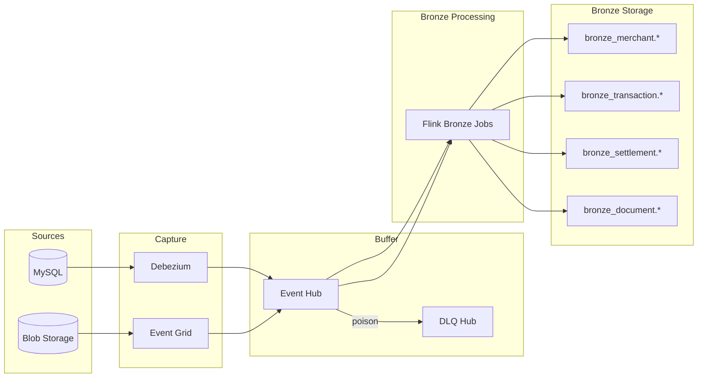
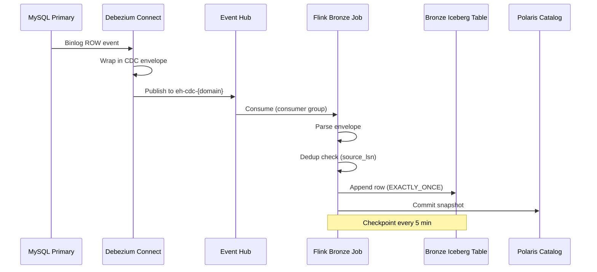
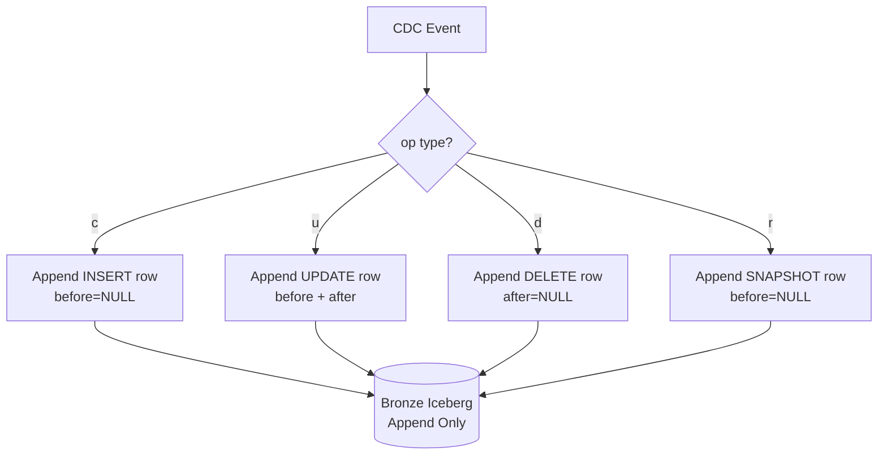
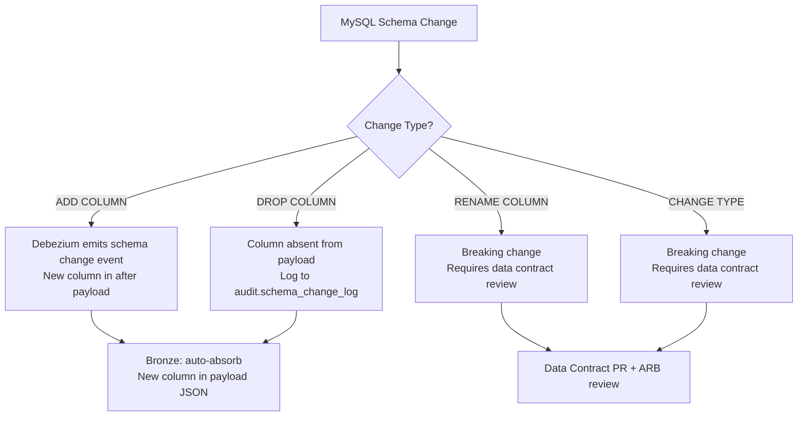
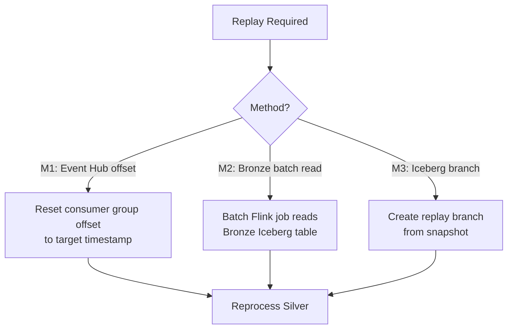
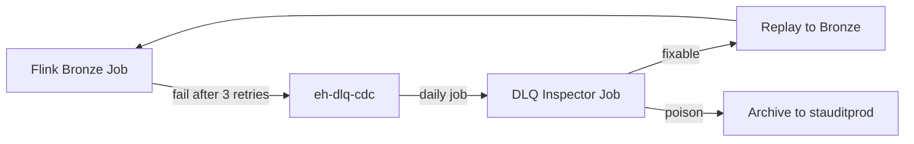
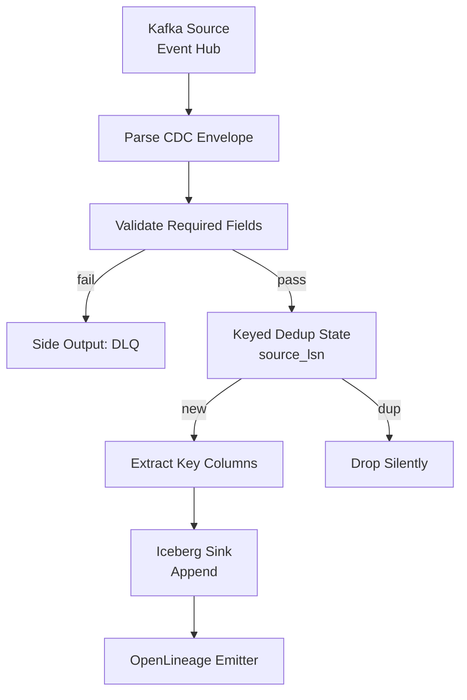

# Part 4 — Bronze Layer Design

**Document ID:** DLH-ARB-2026-001-04  
**Version:** 1.0.0  
**Classification:** Internal — Confidential  
**Status:** Draft — For ARB Review

---

## Table of Contents

1. [Overview](#1-overview)
2. [Raw Ingestion Pipeline](#2-raw-ingestion-pipeline)
3. [CDC Metadata Envelope](#3-cdc-metadata-envelope)
4. [Change Event Handling](#4-change-event-handling)
5. [Schema Evolution](#5-schema-evolution)
6. [Snapshot Handling](#6-snapshot-handling)
7. [Replay Strategy](#7-replay-strategy)
8. [Failure Recovery](#8-failure-recovery)
9. [Flink Bronze Job Design](#9-flink-bronze-job-design)
10. [Example Bronze Schemas](#10-example-bronze-schemas)
11. [Operational Controls](#11-operational-controls)
12. [Design Decisions and Trade-offs](#12-design-decisions-and-trade-offs)
13. [Production Recommendations](#13-production-recommendations)

---

## 1. Overview

### 1.1 Purpose

This document specifies the **production implementation** of the Bronze layer — the immutable raw landing zone for all Change Data Capture (CDC) events and document metadata events entering the Data Lakehouse.

Bronze is the **system of record for raw change history**. It preserves every insert, update, and delete emitted by MySQL (via Debezium) and every document lifecycle event from Azure Blob Storage, without transformation or business rule application.

### 1.2 Scope

| In Scope | Out of Scope |
|----------|--------------|
| MySQL CDC via Debezium → Event Hub → Flink → Iceberg | Silver conformation (see `05-silver-layer.md`) |
| Blob Event Grid document metadata ingestion | Document binary content (stored in Blob only) |
| CDC envelope preservation | Deduplication (deferred to Silver) |
| Schema evolution handling | Business validation (deferred to Silver) |
| Replay and failure recovery | Gold aggregations |

### 1.3 Bronze Layer in Context



### 1.4 Design Principles

| ID | Principle | Implementation |
|----|-----------|----------------|
| BR-01 | **Append-only** | No UPDATE or DELETE on Bronze Iceberg rows |
| BR-02 | **Lossless capture** | Full `before`/`after` JSON preserved |
| BR-03 | **Ordered by source** | `source_lsn` recorded for downstream ordering |
| BR-04 | **Idempotent writes** | Flink dedup state prevents duplicate append on retry |
| BR-05 | **Schema tolerant** | New source columns absorbed without pipeline failure |
| BR-06 | **Partition on ingest time** | `flink_ingest_ts` drives partitions, not business time |
| BR-07 | **Finite retention** | 90-day hot retention; archive optional before expire |

---

## 2. Raw Ingestion Pipeline

### 2.1 End-to-End Flow



### 2.2 Ingestion Path Register

| Path ID | Source | Capture | Topic | Flink Job | Bronze Table |
|---------|--------|---------|-------|-----------|--------------|
| ING-01 | MySQL `merchants` | Debezium | `eh-cdc-merchant` | `flink-bronze-merchant-merchants` | `merchants_cdc` |
| ING-02 | MySQL `merchant_addresses` | Debezium | `eh-cdc-merchant` | `flink-bronze-merchant-addresses` | `merchant_addresses_cdc` |
| ING-03 | MySQL `transactions` | Debezium | `eh-cdc-transaction` | `flink-bronze-transaction-transactions` | `transactions_cdc` |
| ING-04 | MySQL `authorizations` | Debezium | `eh-cdc-transaction` | `flink-bronze-transaction-authorizations` | `authorizations_cdc` |
| ING-05 | MySQL `settlements` | Debezium | `eh-cdc-settlement` | `flink-bronze-settlement-settlements` | `settlements_cdc` |
| ING-06 | MySQL `settlement_files` | Debezium | `eh-cdc-settlement` | `flink-bronze-settlement-files` | `settlement_files_cdc` |
| ING-07 | Blob document events | Event Grid | `eh-cdc-document` | `flink-bronze-document-events` | `document_events` |

### 2.3 Debezium Connector Configuration

**Connector name:** `mysql-cdc-prod`

| Property | Value | Notes |
|----------|-------|-------|
| `connector.class` | `io.debezium.connector.mysql.MySqlConnector` | — |
| `database.hostname` | MySQL primary private endpoint | Failover to replica via config update |
| `database.port` | `3306` | — |
| `database.user` | `debezium_cdc` | Credentials in Key Vault |
| `database.server.id` | `184054` | Unique across all connectors |
| `topic.prefix` | `mysql.prod` | Prefix for internal routing |
| `table.include.list` | `prod.merchants,prod.transactions,...` | Explicit allow-list |
| `snapshot.mode` | `initial` | Full snapshot on first start |
| `snapshot.locking.mode` | `minimal` | Reduce lock duration |
| `binlog.buffer.size` | `32768` | Tune for high volume |
| `heartbeat.interval.ms` | `10000` | Detect stale connections |
| `heartbeat.topics.prefix` | `__debezium-heartbeat` | — |
| `tombstones.on.delete` | `true` | Required for DELETE propagation |
| `include.schema.changes` | `true` | Schema evolution events |
| `key.converter` | `AvroConverter` | With Schema Registry |
| `value.converter` | `AvroConverter` | With Schema Registry |

### 2.4 Event Hub Sink Configuration

| Property | Value |
|----------|-------|
| Connector class | `com.azure.eventhubs.connectors.kafka.EventHubsSinkConnector` |
| Topics | Routed per domain: `eh-cdc-merchant`, `eh-cdc-transaction`, etc. |
| `errors.tolerance` | `none` (fail on error; no silent drop) |
| `errors.deadletterqueue.topic.name` | `eh-dlq-cdc` |
| Retries | 3 with exponential backoff |

### 2.5 Throughput and Sizing

| Domain | Peak Events/sec | Event Hub Partitions | Flink Parallelism | Target Batch Size |
|--------|----------------|---------------------|-------------------|-------------------|
| merchant | 50 | 8 | 8 | 10,000 records |
| transaction | 5,000 | 32 | 32 | 50,000 records |
| settlement | 200 | 8 | 8 | 10,000 records |
| document | 100 | 4 | 4 | 5,000 records |

---

## 3. CDC Metadata Envelope

### 3.1 Debezium Envelope Structure

Every CDC message from Debezium follows this JSON structure. Bronze preserves the full envelope in `payload_after` / `payload_before` and extracts key fields for partitioning and ordering.

```json
{
  "before": {
    "transaction_id": "txn_abc123",
    "merchant_id": "mer_xyz789",
    "amount_minor": 10000,
    "status": "PENDING"
  },
  "after": {
    "transaction_id": "txn_abc123",
    "merchant_id": "mer_xyz789",
    "amount_minor": 10000,
    "status": "COMPLETED"
  },
  "source": {
    "version": "2.5.0.Final",
    "connector": "mysql",
    "name": "mysql.prod",
    "ts_ms": 1719907200000,
    "snapshot": "false",
    "db": "prod",
    "table": "transactions",
    "server_id": 1,
    "file": "mysql-bin.00042",
    "pos": 1543287,
    "row": 0,
    "thread": 42,
    "query": null
  },
  "op": "u",
  "ts_ms": 1719907200045,
  "transaction": null
}
```

### 3.2 Bronze Column Mapping

| Debezium Field | Bronze Column | Extraction Logic |
|----------------|---------------|------------------|
| `after` (full JSON) | `payload_after` | `JSON_STRING(after)` or raw Avro decode |
| `before` (full JSON) | `payload_before` | `JSON_STRING(before)`; NULL for INSERT |
| `op` | `op` | Direct map |
| `source.db` | `source_db` | Direct map |
| `source.table` | `source_table` | Direct map |
| `source.ts_ms` | `source_ts_ms` | Direct map |
| `source.file` + `source.pos` | `source_lsn` | `{file}:{pos}` composite |
| `ts_ms` | `debezium_ts_ms` | Debezium processing time |
| Event Hub metadata | `event_hub_enqueued_ts` | `EnqueuedTimeUtc` from message |
| Flink wall clock | `flink_ingest_ts` | `CURRENT_TIMESTAMP` at write |

### 3.3 Denormalized Key Columns

For high-volume tables, key business columns are **extracted** from `payload_after` and stored as top-level columns to enable partition pruning without JSON parsing at query time.

| Table | Extracted Columns | Purpose |
|-------|-------------------|---------|
| `transactions_cdc` | `transaction_id`, `merchant_id` | Debug queries, reconciliation |
| `merchants_cdc` | `merchant_id` | Debug queries |
| `settlements_cdc` | `settlement_id`, `merchant_id` | Debug queries |
| `document_events` | `document_id`, `merchant_id` | Event routing |

**Rule:** Extracted columns are for **operational convenience only**. `payload_after` remains the authoritative source for Silver parsing.

### 3.4 Document Event Envelope (Non-CDC)

Blob Event Grid events follow a different structure. Bronze `document_events` table normalizes these:

```json
{
  "topic": "/subscriptions/.../storageAccounts/stdocumentsprod",
  "subject": "/blobServices/default/containers/documents/blobs/merchant/mer_xyz/kyc/2026/07/doc_uuid_v1.pdf",
  "eventType": "Microsoft.Storage.BlobCreated",
  "eventTime": "2026-07-02T10:30:00Z",
  "data": {
    "api": "PutBlob",
    "contentType": "application/pdf",
    "contentLength": 245760,
    "blobType": "BlockBlob",
    "url": "https://stdocumentsprod.blob.core.windows.net/documents/merchant/mer_xyz/..."
  }
}
```

| Event Grid Field | Bronze Column |
|------------------|---------------|
| Full event JSON | `payload_after` |
| `eventType` | `op` (mapped: `BlobCreated`→`c`, `BlobDeleted`→`d`) |
| `subject` | Parsed to `blob_path`, `merchant_id`, `document_type` |
| `eventTime` | `source_ts_ms` (converted to epoch ms) |
| `id` | `source_lsn` (event ID for dedup) |

---

## 4. Change Event Handling

### 4.1 Operation Matrix

| Debezium `op` | MySQL Operation | Bronze Behavior | `payload_before` | `payload_after` |
|---------------|-----------------|-----------------|------------------|-----------------|
| `c` | INSERT | Append new row | NULL | New row JSON |
| `u` | UPDATE | Append new row | Old row JSON | New row JSON |
| `d` | DELETE | Append tombstone row | Deleted row JSON | NULL |
| `r` | Snapshot READ | Append snapshot row | NULL | Existing row JSON |



### 4.2 INSERT Handling (`op = c`)

| Step | Action |
|------|--------|
| 1 | Parse `after` payload |
| 2 | Validate `after` is not NULL |
| 3 | Extract key columns (`transaction_id`, etc.) |
| 4 | Compute `source_lsn` from binlog position |
| 5 | Check Flink dedup state: skip if `source_lsn` already processed |
| 6 | Append row to Bronze Iceberg table |
| 7 | Emit OpenLineage event |

**Validation failures (malformed INSERT):**

| Condition | Action |
|-----------|--------|
| `after` is NULL | Route to DLQ with reason `NULL_AFTER_ON_INSERT` |
| Missing primary key in `after` | Route to DLQ with reason `MISSING_PK` |
| Unparseable JSON | Route to DLQ with reason `PARSE_ERROR` |

### 4.3 UPDATE Handling (`op = u`)

| Step | Action |
|------|--------|
| 1 | Parse `before` and `after` payloads |
| 2 | Validate `after` is not NULL (Bronze always requires `after` except DELETE) |
| 3 | Store both `before` and `after` for audit trail |
| 4 | Extract key columns from `after` |
| 5 | Dedup check on `source_lsn` |
| 6 | Append row (never mutate previous Bronze rows) |

**Important:** Bronze does NOT apply the update to a previous row. Each UPDATE creates a **new append row** preserving the full change history. Silver applies the latest state via upsert.

### 4.4 DELETE Handling (`op = d`)

| Step | Action |
|------|--------|
| 1 | Parse `before` payload (deleted row image) |
| 2 | Set `payload_after` = NULL |
| 3 | Extract key columns from `before` |
| 4 | Dedup check on `source_lsn` |
| 5 | Append tombstone row with `op = d` |

**Tombstone preservation:** DELETE events are never filtered or dropped. They are required for Silver to set `is_deleted = true`.

```sql
-- Example: Bronze history for a single transaction (3 events)
-- Row 1: op=c  (INSERT)
-- Row 2: op=u  (UPDATE status PENDING → COMPLETED)
-- Row 3: op=u  (UPDATE status COMPLETED → REFUNDED)
-- All 3 rows exist permanently in Bronze until retention expiry
```

### 4.5 Snapshot READ Handling (`op = r`)

Debezium emits `op = r` during initial snapshot for existing rows.

| Scenario | Handling |
|----------|----------|
| Initial connector deployment | All existing rows appended with `op = r` |
| New table added to connector | Snapshot only new table; `op = r` for existing rows |
| Re-snapshot (manual) | Use Iceberg branch `replay_YYYYMMDD`; do not mix with live stream |

**Snapshot vs. streaming ordering:** During initial snapshot, Debezium may emit `op = r` events followed by `op = c/u/d` streaming events. Silver deduplication uses `source_lsn` ordering to resolve conflicts.

### 4.6 Idempotent Write Strategy

Flink maintains keyed state to prevent duplicate Bronze rows on checkpoint replay:

```
State key:   (source_table, primary_key, source_lsn)
State value: processed_timestamp
TTL:         48 hours (configurable)
```

| Scenario | Behavior |
|----------|----------|
| First delivery of event | Append to Iceberg |
| Duplicate delivery (same LSN) | Skip (logged at DEBUG) |
| Replay from earlier offset | Re-process; dedup state may have expired → rely on Silver dedup |

**Design decision:** 48-hour dedup TTL balances state size vs. replay safety. Events older than 48 hours replayed from Event Hub rely on Silver-layer deduplication.

---

## 5. Schema Evolution

### 5.1 Schema Change Types



### 5.2 Bronze Schema Evolution Policy

| Change Type | Bronze Action | Silver Action | Approval |
|-------------|---------------|---------------|----------|
| **Add column (nullable)** | Auto-absorb in `payload_after` JSON | Add column to Silver table via `ALTER TABLE` | Data Steward |
| **Add column (NOT NULL)** | Auto-absorb; may be NULL in old events | Add with default value | Data Steward |
| **Drop column** | Column absent from new events; old events retain it in JSON | Deprecate column; stop writing | Data Steward + 30-day notice |
| **Rename column** | Old and new names may coexist during transition | Coordinated migration | ARB review |
| **Change data type** | Store as-is in JSON | Cast with validation | ARB review |
| **Change primary key** | Log; do not block ingest | Pipeline redesign | ARB review |

### 5.3 Schema Change Event Handling

Debezium emits schema change events to `eh-cdc-schema-changes` when `include.schema.changes = true`.

| Step | Action |
|------|--------|
| 1 | Flink schema-change job consumes event |
| 2 | Log to `audit.schema_change_log` Iceberg table |
| 3 | Notify Data Steward via Slack/PagerDuty |
| 4 | If ADD COLUMN: trigger Silver `ALTER TABLE` job (after approval) |
| 5 | If BREAKING: halt Silver promotion; open data contract PR |

**`audit.schema_change_log` entry:**

| Column | Example |
|--------|---------|
| `change_id` | `uuid` |
| `source_table` | `prod.transactions` |
| `change_type` | `ADD_COLUMN` |
| `column_name` | `payment_token` |
| `detected_ts` | `2026-07-02T10:30:00Z` |
| `ddl_statement` | `ALTER TABLE transactions ADD COLUMN payment_token VARCHAR(64)` |
| `status` | `PENDING_REVIEW` |

### 5.4 Iceberg Schema Evolution

Bronze Iceberg tables use schema evolution for extracted key columns only (not payload JSON):

```sql
-- Example: Add extracted column after source table gains a field
ALTER TABLE lakehouse.bronze_transaction.transactions_cdc
    ADD COLUMN payment_method STRING AFTER merchant_id;
```

**Rule:** `payload_after` JSON schema is **self-describing** and does not require Iceberg column changes for new source fields.

---

## 6. Snapshot Handling

### 6.1 Debezium Initial Snapshot

| Phase | Behavior | Duration (est.) |
|-------|----------|-----------------|
| **Phase 1: Schema snapshot** | Capture table schemas | Seconds |
| **Phase 2: Data snapshot** | `op = r` for each existing row | Hours (depends on table size) |
| **Phase 3: Streaming** | Switch to binlog; `op = c/u/d` | Continuous |

```mermaid
gantt
    title Debezium Connector Lifecycle
    dateFormat HH:mm
    section Snapshot
    Schema capture           :s1, 00:00, 5min
  Data snapshot (merchants)  :s2, after s1, 30min
    Data snapshot (transactions) :s3, after s1, 4hr
    section Streaming
    Binlog streaming         :s4, after s3, 24hr
```



### 6.2 Snapshot Configuration

| Property | Value | Rationale |
|----------|-------|-----------|
| `snapshot.mode` | `initial` | Full load on first connector start |
| `snapshot.max.threads` | `4` | Parallel table snapshots |
| `snapshot.fetch.size` | `10240` | Rows per fetch batch |
| `snapshot.locking.mode` | `minimal` | Brief global read lock only |
| `incremental.snapshot.chunk.size` | `8192` | For large tables (if incremental enabled) |

### 6.3 Iceberg Snapshot Management (Bronze)

| Policy | Value |
|--------|-------|
| Snapshot interval | Every Flink checkpoint (5 min) |
| Minimum snapshots to keep | 10 |
| Maximum snapshot age | 7 days |
| Expire snapshots job | Daily 03:00 UTC |
| Tagging | `daily_YYYYMMDD` on expire job |

**Bronze snapshot expiration SQL (run via Trino maintenance job):**

```sql
-- Expire snapshots older than 7 days
CALL lakehouse.system.expire_snapshots(
    table => 'bronze_transaction.transactions_cdc',
    older_than => TIMESTAMP '2026-06-25 00:00:00 UTC',
    retain_last => 10
);
```

### 6.4 Snapshot vs. Streaming Reconciliation

After initial snapshot completes, a reconciliation job validates row counts:

| Check | Query | Pass Criteria |
|-------|-------|---------------|
| Row count | `COUNT(*) FROM bronze WHERE op = 'r'` vs MySQL `COUNT(*)` | Within 0.01% |
| PK coverage | Distinct PKs in Bronze snapshot vs MySQL | 100% match |
| Streaming continuity | No gap in `source_lsn` sequence | Zero gaps > 1000 positions |

---

## 7. Replay Strategy

### 7.1 Replay Scenarios

| Scenario | Trigger | Strategy |
|----------|---------|----------|
| **RS-01: Silver bug fix** | Bad Silver logic deployed | Replay Bronze → Silver from timestamp |
| **RS-02: New Silver table** | New entity added | Full Bronze history replay |
| **RS-03: Event Hub offset reset** | Data loss in Silver | Reset consumer offset to timestamp |
| **RS-04: Disaster recovery** | Region failover | Replay from Event Hub retention or Bronze |
| **RS-05: Schema migration** | Breaking Silver change | Branch-based replay |

### 7.2 Replay Methods



#### Method 1: Event Hub Offset Reset

| Step | Action |
|------|--------|
| 1 | Stop Flink Silver job |
| 2 | Stop Flink Bronze job (if replaying capture too) |
| 3 | Reset consumer group offset: `kafka-consumer-groups --reset-offsets --to-datetime 2026-07-01T00:00:00Z` |
| 4 | Truncate or branch affected Silver tables |
| 5 | Restart Bronze → Silver jobs |
| 6 | Monitor lag and reconciliation |

**Limitation:** Bounded by Event Hub retention (7–30 days).

#### Method 2: Bronze Batch Replay

| Step | Action |
|------|--------|
| 1 | Deploy batch Flink job: `flink-bronze-replay-{domain}-{date}` |
| 2 | Read Bronze Iceberg: `SELECT * FROM bronze_transaction.transactions_cdc WHERE flink_ingest_ts >= '2026-07-01'` |
| 3 | Write to Silver with `--replay-run-id` metadata tag |
| 4 | Validate reconciliation |
| 5 | Swap Silver snapshot or merge results |

**Use when:** Event Hub retention expired but Bronze data available (up to 90 days).

#### Method 3: Iceberg Branch Replay

| Step | Action |
|------|--------|
| 1 | Create branch: `CALL system.create_branch('silver_transaction.transactions', 'replay_20260702')` |
| 2 | Run Silver job targeting branch |
| 3 | Validate branch data |
| 4 | Fast-forward main: `CALL system.fast_forward('silver_transaction.transactions', 'main', 'replay_20260702')` |

### 7.3 Replay Runbook Checklist

| # | Step | Owner | Done |
|---|------|-------|------|
| 1 | Document replay reason and target timestamp | Data Eng Lead | ☐ |
| 2 | Notify downstream consumers (Slack #data-platform) | Data Eng | ☐ |
| 3 | Pause Superset cache refresh for affected datasets | Analytics | ☐ |
| 4 | Create Iceberg branch or backup Silver snapshot | Data Eng | ☐ |
| 5 | Execute replay method (M1/M2/M3) | Data Eng | ☐ |
| 6 | Run reconciliation queries | Data Eng | ☐ |
| 7 | Validate Silver row counts and sample data | Data Steward | ☐ |
| 8 | Resume Gold jobs and Superset | Data Eng | ☐ |
| 9 | Post-incident review if production impact | Data Eng Lead | ☐ |

---

## 8. Failure Recovery

### 8.1 Failure Mode Matrix

| Failure | Detection | Impact | Recovery | RTO |
|---------|-----------|--------|----------|-----|
| Debezium connector crash | Heartbeat timeout; K8s liveness | CDC pause; lag grows | Auto-restart; resume from last offset | 5 min |
| Event Hub throttling | Azure Monitor `ServerBusy` metric | Flink backpressure | Scale TUs; increase retries | 15 min |
| Flink TaskManager OOM | K8s OOMKilled event | Checkpoint failure | Increase memory; restore checkpoint | 15 min |
| Flink checkpoint timeout | Checkpoint duration alert | At-risk exactly-once | Scale TaskManagers; tune state | 30 min |
| Iceberg commit conflict | `CommitFailedException` | Transient write failure | Retry (4 attempts configured) | 1 min |
| Poison message | Max retries exceeded | Single record blocked | Route to DLQ; continue processing | 1 min |
| MySQL binlog rotation gap | Debezium offset error | CDC gap | Restore from snapshot + binlog position | 1–4 hr |
| ADLS outage | ABFS write failure | Pipeline halt | Wait for Azure recovery; restore checkpoint | Azure SLA |
| Schema parse failure | Flink exception | Single table blocked | Fix schema; replay from DLQ | 30 min |

### 8.2 Dead Letter Queue (DLQ) Processing



| DLQ Message Field | Description |
|-------------------|-------------|
| `original_topic` | Source Event Hub topic |
| `original_partition` | Partition number |
| `original_offset` | Offset in partition |
| `failure_reason` | Error code (e.g., `PARSE_ERROR`, `NULL_AFTER_ON_INSERT`) |
| `failure_ts` | Timestamp of failure |
| `raw_payload` | Original message bytes (base64) |
| `retry_count` | Number of retries attempted |

**DLQ replay job:** Runs daily at 05:00 UTC. Fixable messages re-published to original topic. Poison messages archived after 7 days.

### 8.3 Checkpoint and Savepoint Recovery

| Configuration | Value |
|---------------|-------|
| Checkpoint interval | 5 minutes |
| Checkpoint mode | `EXACTLY_ONCE` |
| Checkpoint timeout | 10 minutes |
| Min pause between checkpoints | 2 minutes |
| Max concurrent checkpoints | 1 |
| State backend | RocksDB |
| Incremental checkpoints | Enabled |
| Checkpoint storage | `abfss://flink-checkpoints@stlakeopsprod/{job-name}/` |

**Recovery procedure:**

```
1. Identify last successful checkpoint (Flink UI or REST API)
2. Stop failed job
3. Restore: flink run -s abfss://flink-checkpoints@.../chk-12345 -c com.company.bronze.TransactionBronzeJob
4. Verify consumer lag decreasing
5. Verify Bronze row count increasing
6. Run reconciliation after 15 min stable operation
```

### 8.4 Pre-Deployment Savepoint Protocol

| Step | Action |
|------|--------|
| 1 | Trigger savepoint: `flink savepoint <jobId> abfss://flink-savepoints@.../pre-deploy-{date}` |
| 2 | Wait for savepoint completion |
| 3 | Stop job gracefully |
| 4 | Deploy new JAR |
| 5 | Restore from savepoint |
| 6 | Validate processing for 15 min before declaring success |

---

## 9. Flink Bronze Job Design

### 9.1 Job Architecture



### 9.2 Job Configuration Template

```yaml
# flink-bronze-transaction-transactions-prod.yaml
job:
  name: flink-bronze-transaction-transactions-prod
  parallelism: 32
  checkpointing:
    mode: EXACTLY_ONCE
    interval: 5m
    timeout: 10m
  stateBackend: rocksdb

source:
  connector: kafka
  topic: eh-cdc-transaction
  consumer-group: cg-flink-bronze-transaction-transactions-prod
  starting-offsets: committed
  properties:
    security.protocol: SASL_SSL

sink:
  connector: iceberg
  catalog: lakehouse
  database: bronze_transaction
  table: transactions_cdc
  write-format: parquet
  upsert: false  # append only

side-outputs:
  dlq:
    connector: kafka
    topic: eh-dlq-cdc
```

### 9.3 Monitoring Metrics (Per Job)

| Metric | Alert Threshold |
|--------|-----------------|
| `records-consumed-rate` | < 50% of 1-hour avg for 10 min |
| `checkpoint-duration` | > 3 min |
| `numberOfFailedCheckpoints` | > 0 in 15 min |
| `currentInputWatermark` lag | > 10 min behind wall clock |
| `dlq-records-rate` | > 10/min |
| `iceberg-commit-duration` | > 30 sec |

---

## 10. Example Bronze Schemas

### 10.1 Merchant — `bronze_merchant.merchants_cdc`

**Source:** MySQL `prod.merchants`  
**Volume:** ~500K rows; low churn (~1K changes/day)

```sql
CREATE TABLE IF NOT EXISTS lakehouse.bronze_merchant.merchants_cdc (
    -- Extracted keys (operational convenience)
    merchant_id             STRING,

    -- CDC envelope
    payload_after           STRING NOT NULL,
    payload_before          STRING,
    op                      STRING NOT NULL,
    source_db               STRING NOT NULL,
    source_table            STRING NOT NULL,
    source_ts_ms            BIGINT NOT NULL,
    source_lsn              STRING NOT NULL,
    debezium_ts_ms          BIGINT NOT NULL,

    -- Pipeline metadata
    event_hub_enqueued_ts   TIMESTAMP(6) NOT NULL,
    flink_ingest_ts         TIMESTAMP(6) NOT NULL,
    raw_file_path           STRING
)
USING iceberg
PARTITIONED BY (
    days(flink_ingest_ts)
)
TBLPROPERTIES (
    'format-version'                       = '2',
    'write.format.default'                 = 'parquet',
    'write.parquet.compression-codec'      = 'zstd',
    'write.target-file-size-bytes'         = '134217728',
    'history.expire.max-snapshot-age-ms'   = '604800000',
    'history.expire.min-snapshots-to-keep' = '10'
);
```

**Sample `payload_after` (INSERT):**

```json
{
  "merchant_id": "mer_abc123",
  "legal_name": "Acme Payments LLC",
  "dba_name": "Acme Pay",
  "tax_id": "12-3456789",
  "status": "ACTIVE",
  "kyc_status": "PENDING",
  "industry_mcc": "5411",
  "country_code": "US",
  "onboarding_date": "18944",
  "created_at": "1719907200000",
  "updated_at": "1719907200000"
}
```

---

### 10.2 Transaction — `bronze_transaction.transactions_cdc`

**Source:** MySQL `prod.transactions`  
**Volume:** ~50M rows/day; highest throughput Bronze table

```sql
CREATE TABLE IF NOT EXISTS lakehouse.bronze_transaction.transactions_cdc (
    -- Extracted keys
    transaction_id          STRING,
    merchant_id             STRING,

    -- CDC envelope
    payload_after           STRING NOT NULL,
    payload_before          STRING,
    op                      STRING NOT NULL,
    source_db               STRING NOT NULL,
    source_table            STRING NOT NULL,
    source_ts_ms            BIGINT NOT NULL,
    source_lsn              STRING NOT NULL,
    debezium_ts_ms          BIGINT NOT NULL,

    -- Pipeline metadata
    event_hub_enqueued_ts   TIMESTAMP(6) NOT NULL,
    flink_ingest_ts         TIMESTAMP(6) NOT NULL,
    raw_file_path           STRING
)
USING iceberg
PARTITIONED BY (
    days(flink_ingest_ts)
)
TBLPROPERTIES (
    'format-version'                       = '2',
    'write.format.default'                 = 'parquet',
    'write.parquet.compression-codec'      = 'zstd',
    'write.target-file-size-bytes'         = '134217728',
    'history.expire.max-snapshot-age-ms'   = '604800000',
    'history.expire.min-snapshots-to-keep' = '10'
);
```

**Sample `payload_after` (UPDATE):**

```json
{
  "transaction_id": "txn_xyz789",
  "merchant_id": "mer_abc123",
  "amount_minor": 25000,
  "currency_code": "USD",
  "transaction_type": "SALE",
  "status": "COMPLETED",
  "response_code": "00",
  "card_type": "VISA",
  "payment_method": "CARD",
  "event_ts": "1719907200000",
  "authorized_ts": "1719907201000",
  "settled_ts": "1719907500000"
}
```

**Operational query — recent changes for a transaction:**

```sql
SELECT
    op,
    from_unixtime(source_ts_ms / 1000) AS source_ts,
    flink_ingest_ts,
    json_extract_scalar(payload_after, '$.status') AS status_after,
    json_extract_scalar(payload_before, '$.status') AS status_before
FROM lakehouse.bronze_transaction.transactions_cdc
WHERE transaction_id = 'txn_xyz789'
ORDER BY source_ts_ms;
```

---

### 10.3 Settlement — `bronze_settlement.settlements_cdc` and `settlement_files_cdc`

**Source:** MySQL `prod.settlements`, `prod.settlement_files`  
**Volume:** ~200K settlement rows/day; ~50K file reference rows/day

#### `settlements_cdc`

```sql
CREATE TABLE IF NOT EXISTS lakehouse.bronze_settlement.settlements_cdc (
    -- Extracted keys
    settlement_id           STRING,
    merchant_id             STRING,

    -- CDC envelope
    payload_after           STRING NOT NULL,
    payload_before          STRING,
    op                      STRING NOT NULL,
    source_db               STRING NOT NULL,
    source_table            STRING NOT NULL,
    source_ts_ms            BIGINT NOT NULL,
    source_lsn              STRING NOT NULL,
    debezium_ts_ms          BIGINT NOT NULL,

    -- Pipeline metadata
    event_hub_enqueued_ts   TIMESTAMP(6) NOT NULL,
    flink_ingest_ts         TIMESTAMP(6) NOT NULL,
    raw_file_path           STRING
)
USING iceberg
PARTITIONED BY (
    days(flink_ingest_ts)
)
TBLPROPERTIES (
    'format-version'                  = '2',
    'write.format.default'            = 'parquet',
    'write.parquet.compression-codec' = 'zstd'
);
```

#### `settlement_files_cdc`

**Note:** After Phase 1 BLOB migration, `settlement_files` table stores Blob path references instead of BLOB content.

```sql
CREATE TABLE IF NOT EXISTS lakehouse.bronze_settlement.settlement_files_cdc (
    -- Extracted keys
    file_id                 STRING,
    settlement_id           STRING,

    -- CDC envelope
    payload_after           STRING NOT NULL,
    payload_before          STRING,
    op                      STRING NOT NULL,
    source_db               STRING NOT NULL,
    source_table            STRING NOT NULL,
    source_ts_ms            BIGINT NOT NULL,
    source_lsn              STRING NOT NULL,
    debezium_ts_ms          BIGINT NOT NULL,

    -- Pipeline metadata
    event_hub_enqueued_ts   TIMESTAMP(6) NOT NULL,
    flink_ingest_ts         TIMESTAMP(6) NOT NULL,
    raw_file_path           STRING
)
USING iceberg
PARTITIONED BY (
    days(flink_ingest_ts)
)
TBLPROPERTIES (
    'format-version'                  = '2',
    'write.format.default'            = 'parquet',
    'write.parquet.compression-codec' = 'zstd'
);
```

**Sample `payload_after` (settlement_files after BLOB migration):**

```json
{
  "file_id": "sf_def456",
  "settlement_id": "stl_ghi789",
  "merchant_id": "mer_abc123",
  "file_name": "settlement_20260702.csv",
  "blob_path": "abfss://documents@stdocumentsprod/settlement/2026/07/02/stl_ghi789/sf_def456_v1.csv",
  "blob_version_id": "version_abc",
  "checksum_sha256": "a1b2c3d4...",
  "file_size_bytes": 1048576,
  "status": "AVAILABLE",
  "created_at": "1719907200000"
}
```

---

### 10.4 Document Metadata — `bronze_document.document_events`

**Source:** Azure Blob Event Grid (not Debezium CDC)  
**Volume:** ~100K events/day

```sql
CREATE TABLE IF NOT EXISTS lakehouse.bronze_document.document_events (
    -- Extracted keys (parsed from Event Grid subject)
    document_id             STRING,
    merchant_id             STRING,
    document_type           STRING,
    blob_path               STRING,

    -- Event envelope
    payload_after           STRING NOT NULL,
    payload_before          STRING,
    op                      STRING NOT NULL,
    source_db               STRING NOT NULL DEFAULT 'blob_storage',
    source_table            STRING NOT NULL DEFAULT 'documents',
    source_ts_ms            BIGINT NOT NULL,
    source_lsn              STRING NOT NULL,
    debezium_ts_ms          BIGINT,

    -- Pipeline metadata
    event_hub_enqueued_ts   TIMESTAMP(6) NOT NULL,
    flink_ingest_ts         TIMESTAMP(6) NOT NULL,
    raw_file_path           STRING
)
USING iceberg
PARTITIONED BY (
    days(flink_ingest_ts),
    document_type
)
TBLPROPERTIES (
    'format-version'                  = '2',
    'write.format.default'            = 'parquet',
    'write.parquet.compression-codec' = 'zstd'
);
```

**Event type mapping:**

| Event Grid `eventType` | Bronze `op` | `payload_before` |
|------------------------|-------------|------------------|
| `Microsoft.Storage.BlobCreated` | `c` | NULL |
| `Microsoft.Storage.BlobDeleted` | `d` | Prior metadata JSON |
| `Microsoft.Storage.BlobRenamed` | `u` | Old path JSON |
| `Microsoft.Storage.BlobTierChanged` | `u` | Prior tier JSON |

**Sample `payload_after` (BlobCreated):**

```json
{
  "topic": "/subscriptions/.../storageAccounts/stdocumentsprod",
  "subject": "/blobServices/default/containers/documents/blobs/merchant/mer_abc123/kyc/2026/07/doc_uuid_v1.pdf",
  "eventType": "Microsoft.Storage.BlobCreated",
  "eventTime": "2026-07-02T10:30:00.000Z",
  "id": "event-grid-uuid-12345",
  "data": {
    "api": "PutBlob",
    "contentType": "application/pdf",
    "contentLength": 245760,
    "blobType": "BlockBlob",
    "url": "https://stdocumentsprod.blob.core.windows.net/documents/merchant/mer_abc123/kyc/2026/07/doc_uuid_v1.pdf"
  }
}
```

---

## 11. Operational Controls

### 11.1 Reconciliation Jobs

| Job | Schedule | Query | Pass Criteria |
|-----|----------|-------|---------------|
| `recon-bronze-mysql-daily` | Daily 04:00 UTC | Compare MySQL `COUNT(*)` vs Bronze distinct PKs (last 24h) | Delta < 0.01% |
| `recon-bronze-lag` | Every 5 min | `now() - max(flink_ingest_ts)` per table | < 5 min p99 |
| `recon-bronze-dlq` | Hourly | DLQ message count | < 100/hr |
| `recon-binlog-position` | Every 15 min | Debezium offset vs MySQL `SHOW MASTER STATUS` | Lag < 60 sec |

### 11.2 Retention and Cleanup

| Job | Schedule | Action |
|-----|----------|--------|
| `bronze-snapshot-expire` | Daily 03:00 UTC | Expire Iceberg snapshots > 7 days |
| `bronze-data-archive` | Daily 03:30 UTC | Export Bronze partitions > 60 days to `stauditprod` (optional) |
| `bronze-partition-drop` | Daily 04:00 UTC | Drop Bronze partitions > 90 days |
| `dlq-archive` | Daily 05:00 UTC | Archive DLQ messages > 7 days |

### 11.3 Access Audit

All Bronze table reads are logged to `stauditprod` via Trino audit plugin:

| Field | Example |
|-------|---------|
| `user` | `data-eng@company.com` |
| `table` | `bronze_transaction.transactions_cdc` |
| `query_id` | `trino-query-uuid` |
| `timestamp` | `2026-07-02T10:30:00Z` |
| `rows_returned` | `1500` |

---

## 12. Design Decisions and Trade-offs

| ADR | Decision | Benefit | Trade-off | Mitigation |
|-----|----------|---------|-----------|------------|
| ADR-B04-001 | Append-only Bronze (no upsert) | Complete change history; simple writes | Storage growth; query requires filtering | 90-day retention; compaction |
| ADR-B04-002 | JSON payload preservation | Schema evolution tolerance | Larger row size vs typed columns | ZSTD compression; extracted keys for pruning |
| ADR-B04-003 | Partition on ingest time | Predictable partition sizes | Business-time queries scan more data | Silver partitions on business time |
| ADR-B04-004 | 48-hour dedup state TTL | Bounded state size | Replay > 48h may create Bronze dupes | Silver dedup is authoritative |
| ADR-B04-005 | DLQ instead of skip-on-error | No silent data loss | DLQ management overhead | Daily DLQ inspector job |
| ADR-B04-006 | Avro on Event Hub | Schema enforcement, smaller messages | Schema Registry dependency | Azure Schema Registry HA deployment |
| ADR-B04-007 | No analyst access to Bronze | PII/PCI protection | Engineers needed for debugging | Masked Silver views for analysts |
| ADR-B04-008 | Separate document event path | Clean separation from CDC | Two ingestion patterns | Unified Bronze envelope schema |

---

## 13. Production Recommendations

### 13.1 Pre-Production Checklist

| # | Item | Priority |
|---|------|----------|
| 1 | Debezium connector deployed with heartbeat and `tombstones.on.delete=true` | P0 |
| 2 | Event Hub topics created with correct partition counts | P0 |
| 3 | DLQ hub configured and monitored | P0 |
| 4 | All Bronze Iceberg tables created in Polaris | P0 |
| 5 | Flink jobs deployed with EXACTLY_ONCE and 5-min checkpoints | P0 |
| 6 | Reconciliation jobs scheduled | P1 |
| 7 | Snapshot expiration job scheduled | P1 |
| 8 | OpenLineage emitter configured on all Bronze jobs | P1 |
| 9 | Bronze access restricted to engineer groups only | P1 |
| 10 | Replay runbook tested in staging | P2 |

### 13.2 Performance Tuning

| Parameter | Default | High-Volume Tuning |
|-----------|---------|-------------------|
| Flink parallelism | 32 | Match Event Hub partition count |
| `write.target-file-size-bytes` | 128 MB | 128 MB (do not reduce) |
| Checkpoint interval | 5 min | 3 min if lag critical |
| RocksDB block cache | 256 MB | 512 MB per TaskManager |
| Event Hub prefetch | 500 | 1000 for transaction topic |
| Iceberg commit retry | 4 | 6 for high-contention tables |

---

## Appendix A — Bronze Table Catalog

| Namespace | Table | Source | Flink Job | Status |
|-----------|-------|--------|-----------|--------|
| `bronze_merchant` | `merchants_cdc` | MySQL `merchants` | `flink-bronze-merchant-merchants` | Phase 2 |
| `bronze_merchant` | `merchant_addresses_cdc` | MySQL `merchant_addresses` | `flink-bronze-merchant-addresses` | Phase 2 |
| `bronze_transaction` | `transactions_cdc` | MySQL `transactions` | `flink-bronze-transaction-transactions` | Phase 2 |
| `bronze_transaction` | `authorizations_cdc` | MySQL `authorizations` | `flink-bronze-transaction-authorizations` | Phase 2 |
| `bronze_settlement` | `settlements_cdc` | MySQL `settlements` | `flink-bronze-settlement-settlements` | Phase 2 |
| `bronze_settlement` | `settlement_files_cdc` | MySQL `settlement_files` | `flink-bronze-settlement-files` | Phase 2 |
| `bronze_document` | `document_events` | Blob Event Grid | `flink-bronze-document-events` | Phase 2 |

---

## Appendix B — Error Code Reference

| Code | Description | Action |
|------|-------------|--------|
| `NULL_AFTER_ON_INSERT` | INSERT event with null `after` | DLQ; investigate Debezium config |
| `NULL_BEFORE_ON_DELETE` | DELETE event with null `before` | DLQ; check `tombstones.on.delete` |
| `MISSING_PK` | Primary key not found in payload | DLQ; check source schema |
| `PARSE_ERROR` | JSON/Avro deserialization failure | DLQ; check schema registry |
| `DUPLICATE_LSN` | Duplicate `source_lsn` (post-TTL replay) | Skip; log at DEBUG |
| `ICEBERG_COMMIT_FAIL` | Iceberg commit conflict after retries | DLQ; investigate concurrent writers |
| `CHECKPOINT_TIMEOUT` | Checkpoint exceeded timeout | Alert; scale TaskManagers |

---

## Appendix C — Related Documents

| Document | Relationship |
|----------|-------------|
| `03-medallion-architecture.md` | Bronze layer definition and conventions |
| `05-silver-layer.md` | Downstream consumer of Bronze data |
| `02-production-architecture.md` | Platform infrastructure hosting Bronze |
| `07-data-quality.md` | DQ rules applied after Bronze |
| `08-governance.md` | Schema change approval workflow |
| `11-monitoring.md` | Bronze lag and checkpoint dashboards |
| `13-runbook.md` | Daily snapshot expire and reconciliation jobs |

---

## Appendix D — Revision History

| Version | Date | Author | Changes |
|---------|------|--------|---------|
| 1.0.0 | 2026-07-02 | Data Platform Architecture | Initial Bronze layer design |
