# Part 5 — Silver Layer Design

**Document ID:** DLH-ARB-2026-001-05  
**Version:** 1.0.0  
**Classification:** Internal — Confidential  
**Status:** Draft — For ARB Review

---

## Table of Contents

1. [Overview](#1-overview)
2. [Silver Processing Pipeline](#2-silver-processing-pipeline)
3. [Data Cleansing](#3-data-cleansing)
4. [Deduplication](#4-deduplication)
5. [Data Standardization](#5-data-standardization)
6. [Reference Data Enrichment](#6-reference-data-enrichment)
7. [Business Validation](#7-business-validation)
8. [Master Data Management](#8-master-data-management)
9. [Slowly Changing Dimensions](#9-slowly-changing-dimensions)
10. [Data Quality Rules](#10-data-quality-rules)
11. [Null Handling and Invalid Data](#11-null-handling-and-invalid-data)
12. [Rejected Record Handling](#12-rejected-record-handling)
13. [Late Arriving Events](#13-late-arriving-events)
14. [Example Transformations](#14-example-transformations)
15. [Flink Silver Job Design](#15-flink-silver-job-design)
16. [Design Decisions and Trade-offs](#16-design-decisions-and-trade-offs)
17. [Production Recommendations](#17-production-recommendations)

---

## 1. Overview

### 1.1 Purpose

This document specifies the **production implementation** of the Silver layer — the conformed enterprise truth layer of the Data Lakehouse. Silver transforms raw Bronze CDC events into cleansed, deduplicated, validated entity tables that represent the authoritative analytics view of business objects.

**Silver answers:** *"What is the verified, current state of this merchant, transaction, or settlement?"*

### 1.2 Scope

| In Scope | Out of Scope |
|----------|--------------|
| Bronze → Silver streaming transformations | Gold aggregations (see `06-gold-layer.md`) |
| Deduplication, cleansing, standardization | Bronze CDC capture (see `04-bronze-layer.md`) |
| SCD Type 2 for dimensions | Full MDM platform (uses MDM principles) |
| Reference data enrichment | Real-time sub-second serving |
| Inline DQ validation and quarantine | Batch GE suites (see `07-data-quality.md`) |
| Late-arriving event handling | |

### 1.3 Silver Layer in Context

```mermaid
flowchart TB
    subgraph Bronze
        B_M[bronze_merchant.*]
        B_T[bronze_transaction.*]
        B_S[bronze_settlement.*]
        B_D[bronze_document.*]
    end

    subgraph Silver Processing
        PARSE[Parse & Type]
        DEDUP[Deduplicate]
        CLEANSE[Cleanse]
        STD[Standardize]
        ENRICH[Enrich]
        VALIDATE[Validate]
        SCD[SCD Logic]
    end

    subgraph Silver Storage
        S_M[silver_merchant.*]
        S_T[silver_transaction.*]
        S_S[silver_settlement.*]
        S_D[silver_document.*]
        S_R[silver_reference.*]
    end

    subgraph Outcomes
        GOLD[Gold Layer]
        QUAR[dq.quarantine_*]
    end

    Bronze --> PARSE --> DEDUP --> CLEANSE --> STD --> ENRICH --> VALIDATE
    VALIDATE -->|pass| SCD --> Silver Storage
    VALIDATE -->|fail| QUAR
    Silver Storage --> GOLD
```

### 1.4 Design Principles

| ID | Principle | Implementation |
|----|-----------|----------------|
| SL-01 | **Single source of truth** | One Silver table per business entity |
| SL-02 | **Latest event wins** | Dedup by PK + highest `source_lsn` |
| SL-03 | **Soft deletes only** | `is_deleted = true`; never physical delete |
| SL-04 | **Fail invalid, pass valid** | Invalid records quarantined, not silently dropped |
| SL-05 | **Typed and conformed** | Strict types; ISO codes; normalized strings |
| SL-06 | **Auditable** | Every row carries source lineage metadata |
| SL-07 | **SCD where history matters** | Type 2 for merchants; Type 1 for transactions |

---

## 2. Silver Processing Pipeline

### 2.1 End-to-End Flow

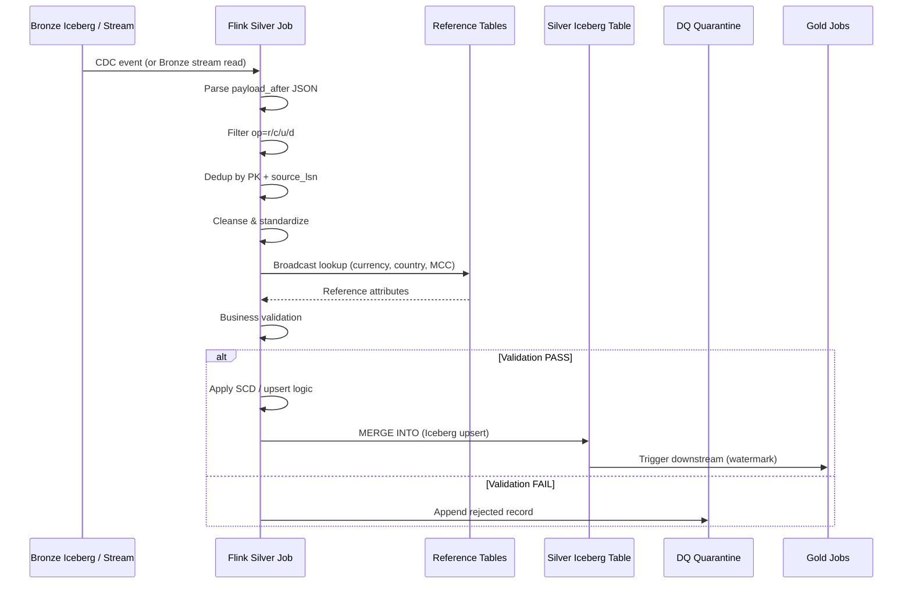

### 2.2 Job Register

| Job ID | Flink Job | Source | Target Silver Table |
|--------|-----------|--------|---------------------|
| SLV-01 | `flink-silver-merchant-merchants` | `bronze_merchant.merchants_cdc` | `silver_merchant.merchants` |
| SLV-02 | `flink-silver-merchant-addresses` | `bronze_merchant.merchant_addresses_cdc` | `silver_merchant.merchant_addresses` |
| SLV-03 | `flink-silver-transaction-transactions` | `bronze_transaction.transactions_cdc` | `silver_transaction.transactions` |
| SLV-04 | `flink-silver-transaction-authorizations` | `bronze_transaction.authorizations_cdc` | `silver_transaction.authorizations` |
| SLV-05 | `flink-silver-settlement-settlements` | `bronze_settlement.settlements_cdc` | `silver_settlement.settlements` |
| SLV-06 | `flink-silver-settlement-files` | `bronze_settlement.settlement_files_cdc` | `silver_settlement.settlement_files` |
| SLV-07 | `flink-silver-document-metadata` | `bronze_document.document_events` | `silver_document.document_metadata` |
| SLV-08 | `flink-silver-reference-sync` | Multiple Bronze ref tables | `silver_reference.*` |

### 2.3 Processing Modes by Entity Type

| Entity Type | Write Mode | SCD | Dedup Key | Delete Handling |
|-------------|-----------|-----|-----------|-----------------|
| Dimension (merchant) | MERGE + SCD2 | Type 2 | `merchant_id` + `source_lsn` | Close SCD row; `is_deleted=true` |
| Fact (transaction) | MERGE upsert | Type 1 | `transaction_id` + `source_lsn` | `is_deleted=true`; retain row |
| Fact (settlement) | MERGE upsert | Type 1 | `settlement_id` + `source_lsn` | `is_deleted=true` |
| Reference | MERGE upsert | Type 1 | `{ref}_code` + `source_lsn` | Soft delete |
| Document metadata | MERGE upsert | Type 1 | `document_id` + version | Soft delete on BlobDeleted |

---

## 3. Data Cleansing

### 3.1 Cleansing Rules Catalog

Data cleansing removes noise and formatting inconsistencies without changing business meaning.

| Rule ID | Category | Transformation | Example |
|---------|----------|----------------|---------|
| CL-01 | Trim whitespace | `TRIM()` all STRING columns | `" Acme "` → `"Acme"` |
| CL-02 | Null strings | Empty string → NULL | `""` → `NULL` |
| CL-03 | Case normalization | UPPER for codes; Title for names | `"usd"` → `"USD"` |
| CL-04 | Control characters | Remove `\n`, `\t`, `\r` from strings | Sanitize text fields |
| CL-05 | Numeric parsing | Cast string amounts to BIGINT minor units | `"100.50"` → `10050` (if mis-typed) |
| CL-06 | Date parsing | MySQL epoch days → DATE | `18944` → `2021-11-15` |
| CL-07 | Timestamp parsing | Epoch ms → TIMESTAMP(6) UTC | `1719907200000` → `2024-07-02T10:00:00Z` |
| CL-08 | Email normalization | Lowercase email addresses | `"User@Acme.COM"` → `"user@acme.com"` |
| CL-09 | Phone normalization | E.164 format where possible | `+1-555-0100` → `+15550100` |
| CL-10 | Duplicate spaces | Collapse internal whitespace | `"Acme  Pay"` → `"Acme Pay"` |

### 3.2 Cleansing Pipeline Stage

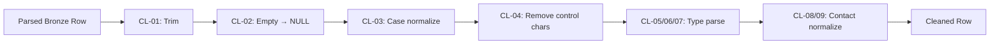

### 3.3 Domain-Specific Cleansing

#### Merchant

| Field | Cleansing Rule |
|-------|----------------|
| `legal_name` | Trim, collapse spaces, remove trailing punctuation |
| `dba_name` | Same as legal_name; NULL if identical to legal_name |
| `tax_id` | Remove dashes/spaces; validate format by country |
| `country_code` | UPPER; must be ISO 3166-1 alpha-2 |
| `contact_email` | Lowercase; trim |
| `contact_phone` | Strip non-digits except leading `+` |

#### Transaction

| Field | Cleansing Rule |
|-------|----------------|
| `currency_code` | UPPER; 3-char ISO 4217 |
| `amount_minor` | Must be non-negative BIGINT; reject floats |
| `status` | UPPER; map known aliases (`COMPLETE` → `COMPLETED`) |
| `response_code` | Zero-pad to 2 chars if numeric |
| `card_type` | UPPER; map `VISA`, `MC`, `MASTERCARD` → `MASTERCARD` |

#### Settlement

| Field | Cleansing Rule |
|-------|----------------|
| `net_amount` | Parse to DECIMAL(18,4); round half-up |
| `settlement_date` | Parse to DATE; reject future dates > 1 day |
| `blob_path` | Normalize to ABFS URI format |
| `checksum_sha256` | Lowercase hex |

---

## 4. Deduplication

### 4.1 Deduplication Strategy

Bronze may contain duplicate events (Flink retry, replay, or Debezium re-delivery). Silver deduplicates to produce **one authoritative row per business key** (or one current SCD row per key).

**Primary rule:** For each primary key, retain the event with the **highest `source_lsn`** (lexicographic binlog position ordering).

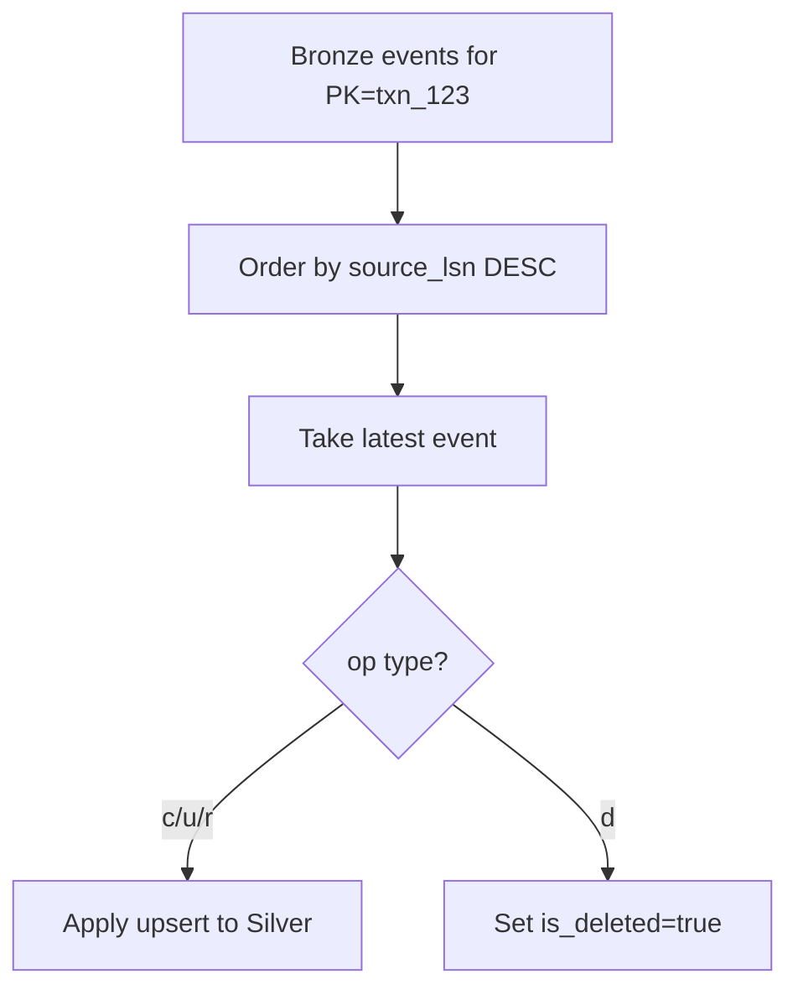

### 4.2 Dedup Implementation — Streaming (Flink)

```
Key:     (source_table, primary_key)
Value:   max_source_lsn_seen
         + latest_parsed_row (Row state)

On event:
  1. Parse primary_key from payload
  2. If event.source_lsn <= state.max_source_lsn.bsn:
       DROP (stale event)
  3. Else:
       UPDATE state
       EMIT to downstream (cleansing pipeline)
```

| Parameter | Value |
|-----------|-------|
| State TTL | 7 days (longer than Bronze dedup) |
| State backend | RocksDB |
| State size estimate | ~500 bytes × active PKs |

### 4.3 Dedup Implementation — Batch (Replay)

For Bronze batch replays, use SQL window deduplication:

```sql
SELECT *
FROM (
    SELECT
        *,
        ROW_NUMBER() OVER (
            PARTITION BY transaction_id
            ORDER BY source_lsn DESC, source_ts_ms DESC
        ) AS rn
    FROM lakehouse.bronze_transaction.transactions_cdc
    WHERE flink_ingest_ts >= TIMESTAMP '2026-07-01 00:00:00'
) t
WHERE rn = 1;
```

### 4.4 Snapshot vs. Streaming Ordering

During Debezium initial snapshot, `op = r` events may arrive before streaming `op = u` events for the same row.

| Scenario | Resolution |
|----------|------------|
| `r` then `u` (same PK) | `u` wins (higher LSN) |
| `r` then `c` (same PK) | Impossible (PK already exists) → quarantine duplicate PK |
| Replay overlaps live stream | Highest LSN wins; idempotent MERGE |

### 4.5 Change Detection — `record_hash`

After dedup, compute SHA-256 hash of business columns to detect **no-op updates** (CDC event where data unchanged):

```
record_hash = SHA256(
    CONCAT_WS('|',
        COALESCE(legal_name, ''),
        COALESCE(status, ''),
        ...
    )
)
```

| Condition | Action |
|-----------|--------|
| `record_hash` unchanged from previous Silver row | Skip SCD version bump; update audit columns only |
| `record_hash` changed | Apply upsert / new SCD2 row |

---

## 5. Data Standardization

### 5.1 Standard Value Sets

| Domain | Field | Standard | Valid Values |
|--------|-------|----------|--------------|
| Merchant | `status` | Enterprise enum | `ACTIVE`, `SUSPENDED`, `CLOSED`, `PENDING` |
| Merchant | `kyc_status` | Enterprise enum | `PENDING`, `IN_REVIEW`, `APPROVED`, `REJECTED`, `EXPIRED` |
| Transaction | `status` | Enterprise enum | `PENDING`, `AUTHORIZED`, `COMPLETED`, `DECLINED`, `REFUNDED`, `VOIDED` |
| Transaction | `transaction_type` | Enterprise enum | `SALE`, `REFUND`, `VOID`, `AUTH_ONLY` |
| Transaction | `payment_method` | Enterprise enum | `CARD`, `ACH`, `WALLET`, `WIRE` |
| Settlement | `status` | Enterprise enum | `PENDING`, `PROCESSING`, `COMPLETED`, `FAILED` |
| Document | `document_type` | Enterprise enum | `KYC`, `CONTRACT`, `BANK_STATEMENT`, `SETTLEMENT`, `CORRESPONDENCE` |
| All | `currency_code` | ISO 4217 | From `silver_reference.ref_currencies` |
| All | `country_code` | ISO 3166-1 alpha-2 | From `silver_reference.ref_countries` |

### 5.2 Source-to-Standard Mapping

Unknown source values are mapped via a **mapping table** (`silver_reference.ref_status_mappings`):

| source_table | source_field | source_value | standard_value |
|--------------|-------------|--------------|----------------|
| `transactions` | `status` | `COMPLETE` | `COMPLETED` |
| `transactions` | `status` | `FAIL` | `DECLINED` |
| `merchants` | `status` | `LIVE` | `ACTIVE` |
| `merchants` | `kyc_status` | `VERIFIED` | `APPROVED` |

**Unmapped values:** Route to quarantine with reason `UNKNOWN_ENUM_VALUE` unless configured as `WARN` (write with `dq_status = WARN`).

### 5.3 Regional Standardization

| Field | Rule |
|-------|------|
| `merchant_region` | Derived from `country_code` via `ref_countries.region` |
| `amount_usd` | Convert from `amount_minor` using daily FX rate from `ref_fx_rates` |
| `event_ts` | Always UTC; strip timezone offsets from source |

**FX conversion:**

```
amount_usd = (amount_minor / 10^decimal_places) * fx_rate_to_usd
```

If FX rate unavailable for currency/date: set `amount_usd = NULL`, `dq_status = WARN`.

---

## 6. Reference Data Enrichment

### 6.1 Reference Data Architecture

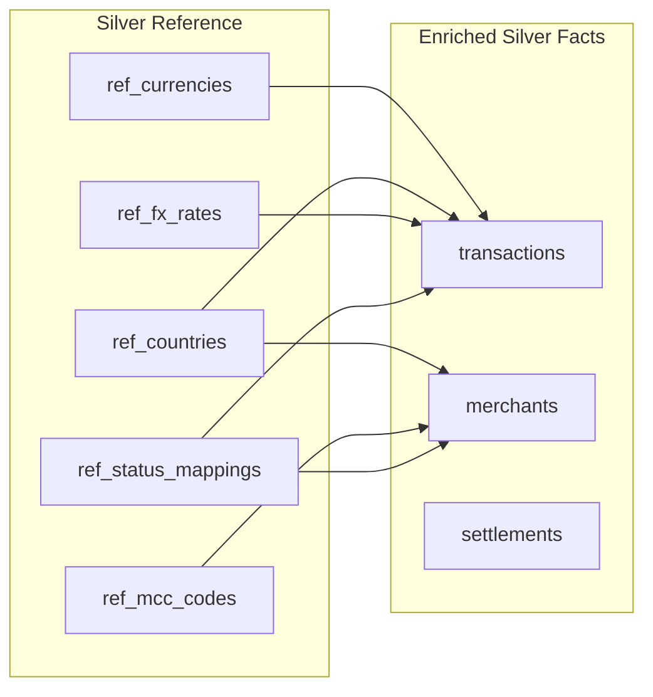

### 6.2 Reference Table Specifications

#### `silver_reference.ref_currencies`

| Column | Type | Description |
|--------|------|-------------|
| `currency_code` | STRING PK | ISO 4217 (e.g., `USD`) |
| `currency_name` | STRING | Full name |
| `decimal_places` | INT | Minor unit decimal places |
| `is_active` | BOOLEAN | Currently supported |

#### `silver_reference.ref_countries`

| Column | Type | Description |
|--------|------|-------------|
| `country_code` | STRING PK | ISO 3166-1 alpha-2 |
| `country_name` | STRING | Full name |
| `region` | STRING | `US-EAST`, `US-WEST`, `EU`, `APAC`, `LATAM` |
| `is_sanctioned` | BOOLEAN | Sanctions list flag |

#### `silver_reference.ref_mcc_codes`

| Column | Type | Description |
|--------|------|-------------|
| `mcc_code` | STRING PK | 4-digit MCC |
| `description` | STRING | Category description |
| `risk_tier` | STRING | `LOW`, `MEDIUM`, `HIGH` |

### 6.3 Enrichment Join Strategy (Flink)

| Pattern | Use Case | Implementation |
|---------|----------|----------------|
| **Broadcast join** | Small reference tables (< 10 MB) | Broadcast `ref_currencies`, `ref_countries`, `ref_mcc_codes` |
| **Temporal join** | FX rates (date-effective) | `FOR SYSTEM_TIME AS OF event_date` |
| **Async lookup** | Large reference sets (future) | Async I/O to Trino (avoid in v1) |

### 6.4 Enrichment Outputs Added to Facts

| Silver Table | Enriched Columns | Source |
|--------------|-----------------|--------|
| `transactions` | `merchant_region`, `amount_usd`, `currency_name` | ref_countries, ref_fx_rates, ref_currencies |
| `merchants` | `region`, `mcc_description`, `mcc_risk_tier` | ref_countries, ref_mcc_codes |
| `settlements` | `merchant_region`, `currency_name` | ref_countries, ref_currencies |

### 6.5 Referential Integrity Validation

| Child Table | FK Column | Parent Table | On Missing Parent |
|-------------|-----------|--------------|-------------------|
| `transactions` | `merchant_id` | `merchants` | Quarantine if merchant not found after 1-hour grace |
| `transactions` | `currency_code` | `ref_currencies` | Quarantine |
| `merchants` | `country_code` | `ref_countries` | Quarantine |
| `merchants` | `industry_mcc` | `ref_mcc_codes` | WARN (write with NULL mcc enrichment) |
| `settlements` | `merchant_id` | `merchants` | Quarantine after grace period |
| `settlement_files` | `settlement_id` | `settlements` | Quarantine after grace period |
| `document_metadata` | `merchant_id` | `merchants` | Quarantine after grace period |

**Grace period:** 1-hour allowed lateness for parent-child ordering (merchant created before first transaction).

---

## 7. Business Validation

### 7.1 Validation Rule Framework

| Severity | Code | Behavior |
|----------|------|----------|
| **ERROR** | `E-*` | Reject to quarantine; do not write Silver |
| **WARN** | `W-*` | Write Silver with `dq_status = WARN` |
| **INFO** | `I-*` | Write Silver with `dq_status = PASS`; log only |

### 7.2 Merchant Validation Rules

| Rule ID | Rule | Severity |
|---------|------|----------|
| E-MER-001 | `merchant_id` NOT NULL | ERROR |
| E-MER-002 | `legal_name` NOT NULL and length ≥ 2 | ERROR |
| E-MER-003 | `status` in valid enum set | ERROR |
| E-MER-004 | `kyc_status` in valid enum set | ERROR |
| E-MER-005 | `country_code` exists in `ref_countries` | ERROR |
| W-MER-001 | `tax_id` format valid for country | WARN |
| W-MER-002 | `contact_email` matches email regex | WARN |
| W-MER-003 | `onboarding_date` not in future | WARN |
| I-MER-001 | `dba_name` differs from `legal_name` | INFO |

### 7.3 Transaction Validation Rules

| Rule ID | Rule | Severity |
|---------|------|----------|
| E-TXN-001 | `transaction_id` NOT NULL | ERROR |
| E-TXN-002 | `merchant_id` NOT NULL | ERROR |
| E-TXN-003 | `amount_minor` > 0 | ERROR |
| E-TXN-004 | `currency_code` in `ref_currencies` | ERROR |
| E-TXN-005 | `status` in valid enum set | ERROR |
| E-TXN-006 | `event_ts` NOT NULL and not > now() + 5 min | ERROR |
| E-TXN-007 | `merchant_id` exists in `merchants` (after grace) | ERROR |
| W-TXN-001 | `amount_usd` > 100,000 | WARN (large transaction flag) |
| W-TXN-002 | `response_code` NULL for COMPLETED status | WARN |
| W-TXN-003 | `authorized_ts` > `event_ts` | WARN |

### 7.4 Settlement Validation Rules

| Rule ID | Rule | Severity |
|---------|------|----------|
| E-STL-001 | `settlement_id` NOT NULL | ERROR |
| E-STL-002 | `merchant_id` NOT NULL | ERROR |
| E-STL-003 | `settlement_date` NOT NULL | ERROR |
| E-STL-004 | `net_amount` is valid DECIMAL | ERROR |
| E-STL-005 | `status` in valid enum set | ERROR |
| E-STL-006 | `merchant_id` exists in `merchants` | ERROR |
| W-STL-001 | `net_amount` = 0 | WARN |
| E-SFL-001 | `blob_path` NOT NULL for AVAILABLE files | ERROR |
| E-SFL-002 | `checksum_sha256` matches 64-char hex | ERROR |

---

## 8. Master Data Management

### 8.1 MDM Scope

The lakehouse implements **lightweight MDM** principles within Silver — not a full MDM platform, but golden record survivorship for merchant entities.

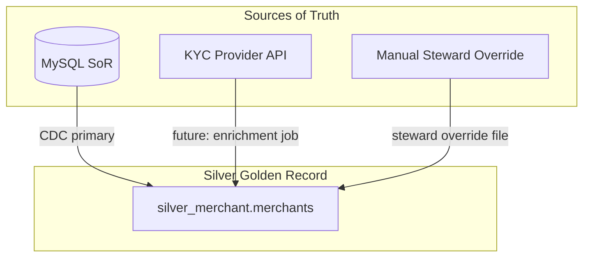

### 8.2 Golden Record — Merchant

| Attribute Category | Survivorship Rule | Source Priority |
|--------------------|-------------------|-----------------|
| Identity (merchant_id, legal_name) | MySQL SoR wins | 1. MySQL |
| KYC status | Most restrictive wins | 1. KYC provider, 2. MySQL |
| Contact info | Most recent timestamp wins | 1. MySQL, 2. Manual override |
| Address | SCD Type 2 history | MySQL CDC |
| Status (ACTIVE/SUSPENDED) | MySQL SoR wins | 1. MySQL |
| Risk attributes | Fraud system (future) | 1. Fraud, 2. MySQL |

### 8.3 Match and Merge (Future Phase)

| Match Key | Use Case | Threshold |
|-----------|----------|-----------|
| `tax_id` + `country_code` | Duplicate merchant detection | Exact match → merge alert |
| `legal_name_normalized` + `country_code` | Fuzzy duplicate detection | Levenshtein ≤ 2 → review queue |
| `contact_email` | Cross-merchant email reuse | Exact match → review queue |

**Phase 3 scope:** Match detection only (alert to steward). Automated merge deferred to Phase 4+.

### 8.4 Steward Override Process

| Step | Action |
|------|--------|
| 1 | Steward submits override CSV to `abfss://lakehouse@stlakehotprod/_steward/overrides/merchants/` |
| 2 | Validation job checks format and authorization |
| 3 | Flink batch job applies overrides with `source_op = 'STEWARD'` |
| 4 | Override logged in `audit.steward_override_log` |
| 5 | `record_hash` recalculated; SCD2 row created if attributes changed |

---

## 9. Slowly Changing Dimensions

### 9.1 SCD Strategy by Entity

| Entity | SCD Type | Rationale |
|--------|----------|-----------|
| `merchants` | **Type 2** | Track status/KYC history for compliance |
| `merchant_addresses` | **Type 2** | Address change history required |
| `transactions` | **Type 1** (upsert) | Facts are immutable events; updates overwrite |
| `authorizations` | **Type 1** | Same as transactions |
| `settlements` | **Type 1** | Status updates overwrite |
| `document_metadata` | **Type 1** | Version tracked via `version_id` column |
| `ref_*` | **Type 1** | Reference data; history not required |

### 9.2 SCD Type 2 — Merchant Implementation

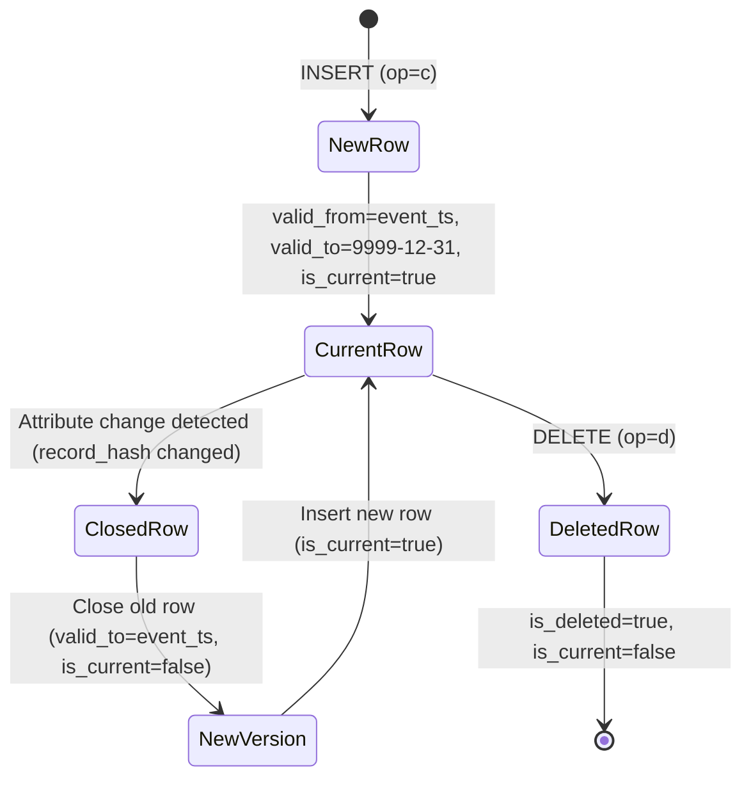

**MERGE logic (pseudocode):**

```
ON attribute change (record_hash differs):
  1. UPDATE existing row SET valid_to = event_ts, is_current = false
     WHERE merchant_id = ? AND is_current = true
  2. INSERT new row with updated attributes,
     valid_from = event_ts, valid_to = '9999-12-31', is_current = true

ON DELETE (op = d):
  1. UPDATE current row SET is_deleted = true, is_current = false, valid_to = event_ts
```

### 9.3 SCD Type 2 — SQL Pattern (Trino Maintenance / Batch)

```sql
-- Close current version
UPDATE lakehouse.silver_merchant.merchants
SET valid_to = TIMESTAMP '2026-07-02 10:30:00',
    is_current = false,
    ingest_ts = CURRENT_TIMESTAMP
WHERE merchant_id = 'mer_abc123'
  AND is_current = true;

-- Insert new version
INSERT INTO lakehouse.silver_merchant.merchants (
    merchant_id, legal_name, status, kyc_status,
    valid_from, valid_to, is_current,
    ingest_ts, source_ts_ms, source_op, source_lsn,
    is_deleted, record_hash, dq_status, data_classification
) VALUES (
    'mer_abc123', 'Acme Payments LLC', 'ACTIVE', 'APPROVED',
    TIMESTAMP '2026-07-02 10:30:00', TIMESTAMP '9999-12-31 23:59:59', true,
    CURRENT_TIMESTAMP, 1719907200045, 'u', 'mysql-bin.00042:1543287',
    false, 'sha256:abc...', 'PASS', 'PII'
);
```

### 9.4 SCD Query Patterns

**Current merchants only:**

```sql
SELECT * FROM lakehouse.silver_merchant.merchants
WHERE is_current = true AND is_deleted = false;
```

**Merchant status at a point in time:**

```sql
SELECT * FROM lakehouse.silver_merchant.merchants
WHERE merchant_id = 'mer_abc123'
  AND valid_from <= TIMESTAMP '2025-06-01 00:00:00'
  AND valid_to > TIMESTAMP '2025-06-01 00:00:00';
```

**KYC status change history:**

```sql
SELECT merchant_id, kyc_status, valid_from, valid_to
FROM lakehouse.silver_merchant.merchants
WHERE merchant_id = 'mer_abc123'
ORDER BY valid_from;
```

---

## 10. Data Quality Rules

### 10.1 DQ Rule Execution Points

```mermaid
flowchart LR
    subgraph Inline — Flink Silver
        IV1[Schema / type validation]
        IV2[Required field checks]
        IV3[Enum validation]
        IV4[Referential integrity]
        IV5[Business rules E-*]
    end

    subgraph Batch — Great Expectations
        BV1[Completeness suites]
        BV2[Uniqueness suites]
        BV3[Anomaly detection]
    end

    STREAM[Silver Stream] --> Inline
    Inline -->|pass/warn| SILVER[(Silver Tables)]
    Inline -->|fail| QUAR[(Quarantine)]
    SILVER --> Batch
    Batch --> SCORE[DQ Score → Prometheus]
```

### 10.2 Inline vs. Batch DQ

| Check Type | Inline (Flink) | Batch (GE) |
|------------|----------------|------------|
| NOT NULL | ✅ | ✅ |
| Enum values | ✅ | ✅ |
| FK existence | ✅ (with grace) | ✅ |
| Uniqueness | ✅ (per event) | ✅ (aggregate) |
| Completeness % | ❌ | ✅ |
| Statistical anomaly | ❌ | ✅ |
| Cross-table reconciliation | ❌ | ✅ |

### 10.3 DQ Status Assignment

| Condition | `dq_status` |
|-----------|-------------|
| All rules PASS | `PASS` |
| WARN rules triggered only | `WARN` |
| Any ERROR rule (but overridden by steward) | `WARN` |
| Record in quarantine | N/A (not in Silver) |

See `07-data-quality.md` for the complete DQ framework and scoring model.

---

## 11. Null Handling and Invalid Data

### 11.1 Null Handling Policy

| Field Category | NULL Allowed | On NULL |
|----------------|-------------|---------|
| Primary key | **Never** | Quarantine: `E-*-001` |
| Required business fields | **Never** | Quarantine |
| Optional business fields | Yes | Write NULL to Silver |
| Enrichment fields (e.g., `amount_usd`) | Yes if FX unavailable | WARN status |
| Audit columns | **Never** | Pipeline error (bug) |

### 11.2 Required Fields Matrix

| Table | Required Fields |
|-------|----------------|
| `merchants` | `merchant_id`, `legal_name`, `status`, `kyc_status`, `country_code`, `merchant_region` |
| `transactions` | `transaction_id`, `merchant_id`, `amount_minor`, `currency_code`, `status`, `transaction_type`, `payment_method`, `event_ts`, `merchant_region` |
| `settlements` | `settlement_id`, `merchant_id`, `settlement_date`, `net_amount`, `status` |
| `settlement_files` | `file_id`, `settlement_id`, `status` |
| `document_metadata` | `document_id`, `merchant_id`, `document_type`, `blob_path`, `upload_ts` |

### 11.3 Invalid Data Strategy

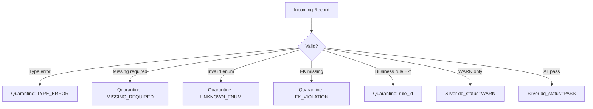

| Invalid Data Category | Action | Recoverable |
|-----------------------|--------|-------------|
| Parse/type error | Quarantine | Yes — fix source or mapping |
| Missing required field | Quarantine | Yes — fix source data |
| Unknown enum value | Quarantine | Yes — add mapping |
| FK violation (after grace) | Quarantine | Yes — wait for parent or fix |
| Duplicate PK (snapshot conflict) | Quarantine | Manual investigation |
| Corrupt JSON payload | Quarantine | Replay from Bronze |
| Out-of-sequence (stale LSN) | Drop silently | N/A — expected behavior |

### 11.4 Invalid Data Metrics

| Metric | Alert Threshold |
|--------|-----------------|
| Quarantine rate (transactions) | > 0.5% of events/hour |
| Quarantine rate (merchants) | > 1% of events/hour |
| WARN rate (any table) | > 5% of events/hour |
| FK violation rate | > 0.1% after grace period |

---

## 12. Rejected Record Handling

### 12.1 Quarantine Zone Architecture

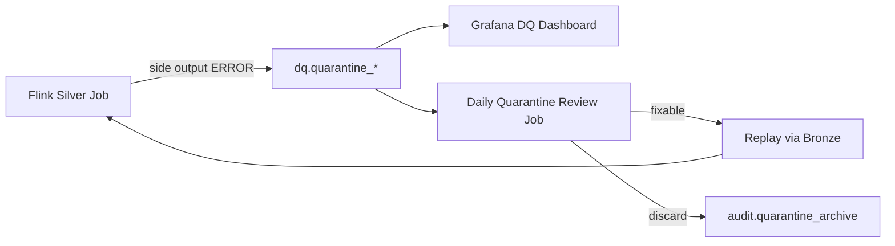

### 12.2 Quarantine Table Schema

```sql
CREATE TABLE IF NOT EXISTS lakehouse.dq.quarantine_transaction (
    quarantine_id           STRING NOT NULL,
    source_table            STRING NOT NULL,
    source_pk               STRING,
    reject_reason           STRING NOT NULL,
    reject_rule_id          STRING NOT NULL,
    reject_severity         STRING NOT NULL,
    raw_payload             STRING NOT NULL,
    bronze_source_lsn       STRING,
    bronze_op               STRING,
    quarantine_ts           TIMESTAMP(6) NOT NULL,
    resolved_ts             TIMESTAMP(6),
    resolution_action       STRING,
    resolved_by             STRING,
    replay_count            INT DEFAULT 0
)
USING iceberg
PARTITIONED BY (days(quarantine_ts), reject_rule_id);
```

### 12.3 Quarantine Workflow

| Step | Owner | Action | SLA |
|------|-------|--------|-----|
| 1 | Automated | Record written to quarantine | Immediate |
| 2 | Automated | Alert if rate exceeds threshold | 15 min |
| 3 | Data Engineer | Triage quarantine records daily | 24 hr |
| 4 | Data Steward | Decide: fix source, add mapping, or discard | 48 hr |
| 5 | Data Engineer | Replay fixed records from Bronze | 24 hr after fix |
| 6 | Automated | Mark `resolution_action`; archive after 90 days | 90 days |

### 12.4 Resolution Actions

| Action | When Used | Procedure |
|--------|-----------|-----------|
| `REPLAYED` | Source data fixed or mapping added | Reset Bronze replay for affected PKs |
| `DISCARDED` | Invalid test data or duplicate | Document reason; no replay |
| `MANUAL_FIX` | Steward override applied | Direct Silver correction with audit log |
| `SOURCE_BUG` | Application bug identified | Ticket to app team; hold until fix deployed |

---

## 13. Late Arriving Events

### 13.1 Lateness Definition

| Term | Definition |
|------|------------|
| **Event time** | `event_ts` (business timestamp from source) |
| **Processing time** | `ingest_ts` (Flink write timestamp) |
| **Lateness** | `ingest_ts - event_ts` |
| **Allowed lateness** | Maximum lateness before side-output to late stream |

### 13.2 Watermark Configuration

| Domain | Bounded Out-of-Orderness | Allowed Lateness | Rationale |
|--------|-------------------------|------------------|-----------|
| transaction | 30 seconds | 24 hours | High volume; mostly ordered |
| merchant | 10 seconds | 24 hours | Low volume |
| settlement | 5 minutes | 48 hours | Batch settlement processing |
| document | 1 minute | 24 hours | Blob event ordering |

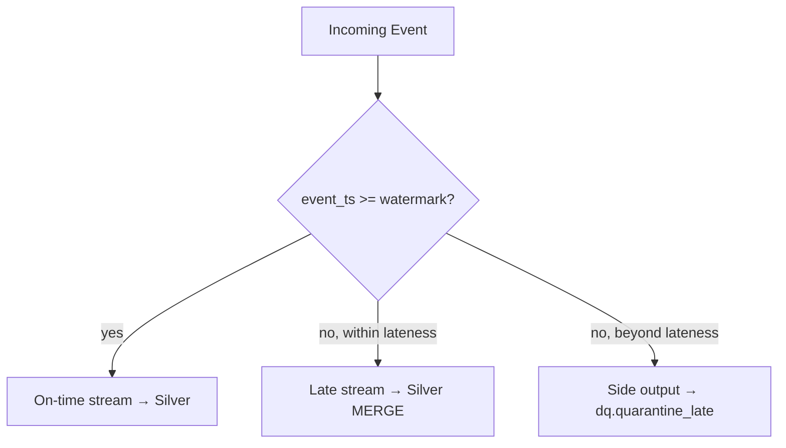

### 13.3 Late Event Handling by Entity

| Entity | Partition Key | Late Event Impact | Handling |
|--------|--------------|-------------------|----------|
| `transactions` | `days(event_ts)` | Row lands in older partition | Iceberg MERGE upsert; partition correct by event_ts |
| `merchants` (SCD2) | `merchant_region` | May require SCD correction | Apply MERGE; close/reopen SCD if needed |
| `settlements` | `months(settlement_date)` | May affect closed financial period | WARN if > 30 days late; alert Finance |
| `document_metadata` | `days(upload_ts)` | Metadata update for old doc | Upsert by document_id |

### 13.4 Financial Period Cutoff

| Rule | Threshold | Action |
|------|-----------|--------|
| Settlement late arrival | > 30 days after `settlement_date` | `dq_status = WARN`; alert Finance |
| Transaction late arrival | > 7 days after `event_ts` | `dq_status = WARN`; include in reconciliation |
| Merchant update late arrival | > 90 days | Process normally; log INFO |

### 13.5 Reconciliation for Late Events

Daily job compares Silver row counts by `event_ts` date against MySQL counts. Late arrivals may cause prior-day count mismatches that self-resolve within the allowed lateness window.

---

## 14. Example Transformations

### 14.1 Merchant — Bronze → Silver

**Source:** `bronze_merchant.merchants_cdc`  
**Target:** `silver_merchant.merchants` (SCD Type 2)

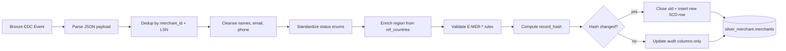

**Transformation mapping:**

| Bronze (JSON field) | Silver Column | Transformation |
|---------------------|---------------|----------------|
| `merchant_id` | `merchant_id` | Direct |
| `legal_name` | `legal_name` | TRIM, collapse spaces |
| `dba_name` | `dba_name` | TRIM; NULL if same as legal_name |
| `tax_id` | `tax_id` | Remove dashes |
| `status` | `status` | Map via ref_status_mappings → UPPER |
| `kyc_status` | `kyc_status` | Map via ref_status_mappings |
| `industry_mcc` | `industry_mcc` | Direct; validate against ref_mcc_codes |
| `country_code` | `country_code` | UPPER; validate FK |
| — | `merchant_region` | JOIN ref_countries.region |
| `onboarding_date` | `onboarding_date` | MySQL epoch days → DATE |
| `contact_email` | `contact_email` | Lowercase, trim |
| `contact_phone` | `contact_phone` | E.164 normalize |
| `op = d` | `is_deleted` | Set true; close SCD row |

---

### 14.2 Transaction — Bronze → Silver

**Source:** `bronze_transaction.transactions_cdc`  
**Target:** `silver_transaction.transactions` (SCD Type 1 upsert)

**Transformation mapping:**

| Bronze (JSON field) | Silver Column | Transformation |
|---------------------|---------------|----------------|
| `transaction_id` | `transaction_id` | Direct |
| `merchant_id` | `merchant_id` | Direct; FK validate (1hr grace) |
| `authorization_id` | `authorization_id` | Direct |
| `amount_minor` | `amount_minor` | Cast BIGINT; reject ≤ 0 |
| `currency_code` | `currency_code` | UPPER; FK validate |
| — | `amount_usd` | FX conversion via ref_fx_rates |
| `transaction_type` | `transaction_type` | Standardize enum |
| `status` | `status` | Map aliases → standard enum |
| `response_code` | `response_code` | Zero-pad to 2 chars |
| `card_type` | `card_type` | UPPER; standardize MC/MASTERCARD |
| `payment_method` | `payment_method` | Standardize enum |
| — | `merchant_region` | JOIN merchants or ref_countries |
| `event_ts` | `event_ts` | Epoch ms → TIMESTAMP UTC |
| `authorized_ts` | `authorized_ts` | Epoch ms → TIMESTAMP UTC |
| `settled_ts` | `settled_ts` | Epoch ms → TIMESTAMP UTC |
| `op = d` | `is_deleted` | Set true |

**Flink pseudocode:**

```java
// Simplified Flink Silver transaction mapper
ParsedTransaction parse(BronzeEvent event) {
    JsonNode after = parsePayload(event.payload_after);
    if (event.op.equals("d")) {
        return ParsedTransaction.softDelete(event);
    }
    return ParsedTransaction.builder()
        .transactionId(after.get("transaction_id").asText())
        .merchantId(after.get("merchant_id").asText())
        .amountMinor(after.get("amount_minor").asLong())
        .currencyCode(upper(after.get("currency_code").asText()))
        .amountUsd(fxConvert(amountMinor, currencyCode, eventTs))
        .status(standardizeStatus(after.get("status").asText()))
        .eventTs(epochMsToTimestamp(after.get("event_ts").asLong()))
        .merchantRegion(enrichRegion(after.get("merchant_id").asText()))
        .sourceLsn(event.source_lsn)
        .recordHash(computeHash(...))
        .build();
}
```

---

### 14.3 Settlement — Bronze → Silver

**Source:** `bronze_settlement.settlements_cdc`, `settlement_files_cdc`  
**Target:** `silver_settlement.settlements`, `silver_settlement.settlement_files`

#### Settlements transformation

| Bronze Field | Silver Column | Transformation |
|--------------|---------------|----------------|
| `settlement_id` | `settlement_id` | Direct |
| `merchant_id` | `merchant_id` | FK validate |
| `settlement_date` | `settlement_date` | Parse DATE; reject future > 1 day |
| `gross_amount` | `gross_amount` | DECIMAL(18,4) |
| `fee_amount` | `fee_amount` | DECIMAL(18,4) |
| `net_amount` | `net_amount` | DECIMAL(18,4); validate gross - fee = net (WARN) |
| `currency_code` | `currency_code` | UPPER; FK validate |
| `status` | `status` | Standardize enum |
| — | `merchant_region` | Enrich from merchants |
| `op = d` | `is_deleted` | Set true |

#### Settlement files transformation (post-BLOB migration)

| Bronze Field | Silver Column | Transformation |
|--------------|---------------|----------------|
| `file_id` | `file_id` | Direct |
| `settlement_id` | `settlement_id` | FK validate |
| `file_name` | `file_name` | Trim |
| `blob_path` | `blob_path` | Normalize to ABFS URI |
| `blob_version_id` | `blob_version_id` | Direct |
| `checksum_sha256` | `checksum_sha256` | Lowercase hex; validate 64 chars |
| `file_size_bytes` | `file_size_bytes` | Cast BIGINT |
| `status` | `status` | Standardize: `PENDING`, `AVAILABLE`, `FAILED` |
| — | `created_date` | Derive from `created_at` or path |

**Post-migration validation job:** Compare `checksum_sha256` in Silver against actual Blob MD5/SHA256 to verify migration integrity.

---

## 15. Flink Silver Job Design

### 15.1 Job Architecture

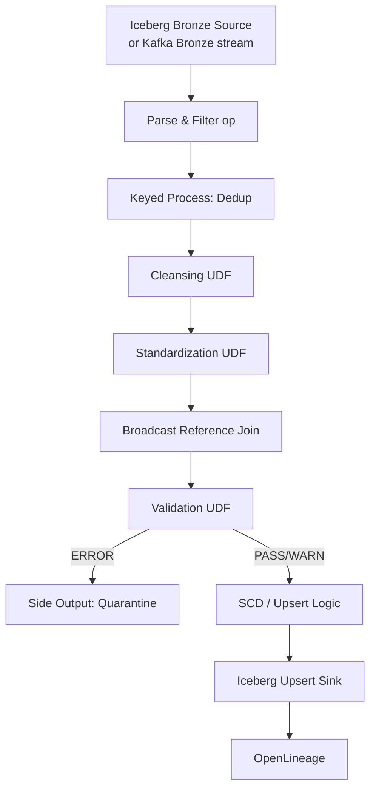

### 15.2 Job Configuration — Transactions

```yaml
job:
  name: flink-silver-transaction-transactions-prod
  parallelism: 32
  checkpointing:
    mode: EXACTLY_ONCE
    interval: 5m

source:
  connector: iceberg
  catalog: lakehouse
  database: bronze_transaction
  table: transactions_cdc
  streaming: true
  start-snapshot-id: null  # follow latest

process:
  watermark:
    column: event_ts
    bounded-delay: 30s
  allowed-lateness: 24h
  state-ttl: 7d

sink:
  connector: iceberg
  catalog: lakehouse
  database: silver_transaction
  table: transactions
  upsert: true
  equality-fields: [transaction_id]

side-outputs:
  quarantine:
    connector: iceberg
    database: dq
    table: quarantine_transaction
```

### 15.3 Monitoring Metrics

| Metric | Alert Threshold |
|--------|-----------------|
| Silver ingest lag (Bronze → Silver) | p99 > 10 min |
| Quarantine record rate | > 0.5%/hr |
| MERGE commit duration | > 60 sec |
| FK violation rate | > 0.1%/hr |
| WARN rate | > 5%/hr |
| Dedup drop rate | Informational only |

---

## 16. Design Decisions and Trade-offs

| ADR | Decision | Benefit | Trade-off | Mitigation |
|-----|----------|---------|-----------|------------|
| ADR-S05-001 | SCD2 for merchants only | Compliance history | Storage growth | `is_current` query pattern; compaction |
| ADR-S05-002 | 1-hour FK grace period | Handles out-of-order parent-child | Temporary orphan risk | Quarantine after grace |
| ADR-S05-003 | Quarantine vs silent drop | Auditability | Quarantine ops overhead | Daily triage workflow |
| ADR-S05-004 | Broadcast ref join | Low latency enrichment | Memory per TaskManager | Keep ref tables small |
| ADR-S05-005 | WARN writes to Silver | Business continuity | Imperfect data in Silver | DQ score + batch validation |
| ADR-S05-006 | record_hash skip no-op updates | Fewer SCD2 rows | Hash compute cost | Cheap SHA-256 UDF |
| ADR-S05-007 | 24h allowed lateness | Handles delayed events | State size | TTL cleanup |
| ADR-S05-008 | Lightweight MDM (not full platform) | Faster delivery | No automated merge | Phase 4+ MDM evaluation |

---

## 17. Production Recommendations

### 17.1 Pre-Production Checklist

| # | Item | Priority |
|---|------|----------|
| 1 | All Silver Iceberg tables created with audit columns | P0 |
| 2 | Reference tables loaded (`ref_currencies`, `ref_countries`, `ref_mcc_codes`) | P0 |
| 3 | Status mapping table populated | P0 |
| 4 | Flink Silver jobs deployed with upsert + quarantine side output | P0 |
| 5 | Quarantine tables created in `dq` namespace | P0 |
| 6 | Masked views created for PII columns | P1 |
| 7 | Daily reconciliation job (MySQL vs Silver) | P1 |
| 8 | Daily quarantine triage workflow documented | P1 |
| 9 | OpenLineage emitter on all Silver jobs | P1 |
| 10 | FX rate ingestion job for `ref_fx_rates` | P2 |

### 17.2 Silver Layer Exit Criteria (Phase 3)

| Criterion | Target |
|-----------|--------|
| All entity tables deployed | 100% of catalog |
| DQ pass rate | ≥ 98% |
| End-to-end freshness | p99 ≤ 15 min |
| Reconciliation (MySQL vs Silver) | Delta < 0.01% |
| Quarantine backlog | < 1000 unresolved records |
| Data stewards assigned | All domains |

---

## Appendix A — Silver Table Catalog

| Namespace | Table | Type | SCD | Flink Job |
|-----------|-------|------|-----|-----------|
| `silver_merchant` | `merchants` | Dimension | Type 2 | `flink-silver-merchant-merchants` |
| `silver_merchant` | `merchant_addresses` | Dimension | Type 2 | `flink-silver-merchant-addresses` |
| `silver_transaction` | `transactions` | Fact | Type 1 | `flink-silver-transaction-transactions` |
| `silver_transaction` | `authorizations` | Fact | Type 1 | `flink-silver-transaction-authorizations` |
| `silver_settlement` | `settlements` | Fact | Type 1 | `flink-silver-settlement-settlements` |
| `silver_settlement` | `settlement_files` | Fact | Type 1 | `flink-silver-settlement-files` |
| `silver_document` | `document_metadata` | Fact | Type 1 | `flink-silver-document-metadata` |
| `silver_reference` | `ref_currencies` | Reference | Type 1 | `flink-silver-reference-sync` |
| `silver_reference` | `ref_countries` | Reference | Type 1 | `flink-silver-reference-sync` |
| `silver_reference` | `ref_mcc_codes` | Reference | Type 1 | `flink-silver-reference-sync` |
| `silver_reference` | `ref_fx_rates` | Reference | Type 1 | `flink-silver-fx-rates` |
| `silver_reference` | `ref_status_mappings` | Reference | Type 1 | Manual seed + CDC |

---

## Appendix B — Quarantine Rule ID Index

| Rule ID | Domain | Description |
|---------|--------|-------------|
| E-MER-001..005 | Merchant | Required fields and FK |
| E-TXN-001..007 | Transaction | Required fields and FK |
| E-STL-001..006 | Settlement | Required fields and FK |
| E-SFL-001..002 | Settlement files | Blob metadata validation |
| `UNKNOWN_ENUM_VALUE` | All | Unmapped status/code |
| `FK_VIOLATION` | All | Missing parent record |
| `TYPE_ERROR` | All | Parse/cast failure |
| `LATE_ARRIVAL` | All | Beyond allowed lateness |

---

## Appendix C — Related Documents

| Document | Relationship |
|----------|-------------|
| `03-medallion-architecture.md` | Silver layer definition and table designs |
| `04-bronze-layer.md` | Upstream Bronze CDC source |
| `06-gold-layer.md` | Downstream Gold aggregations |
| `07-data-quality.md` | Batch DQ framework and scoring |
| `08-governance.md` | Stewardship and certification |
| `13-runbook.md` | Reconciliation and quarantine triage jobs |

---

## Appendix D — Revision History

| Version | Date | Author | Changes |
|---------|------|--------|---------|
| 1.0.0 | 2026-07-02 | Data Platform Architecture | Initial Silver layer design |
