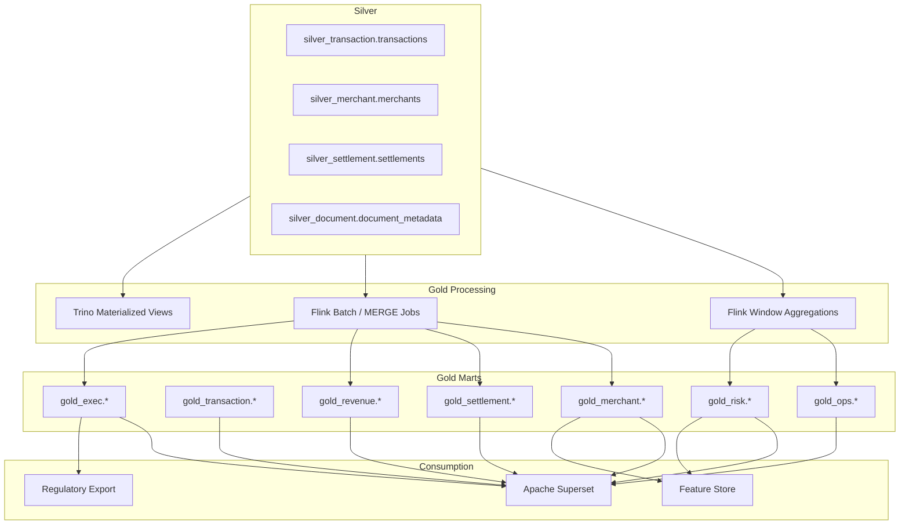
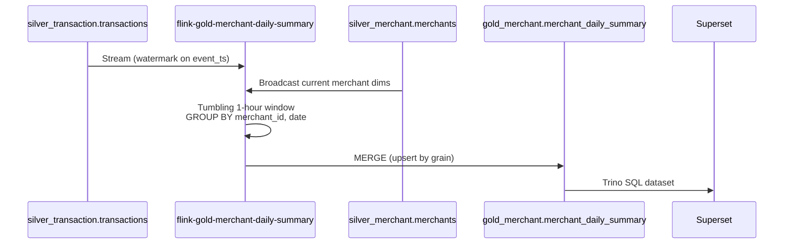
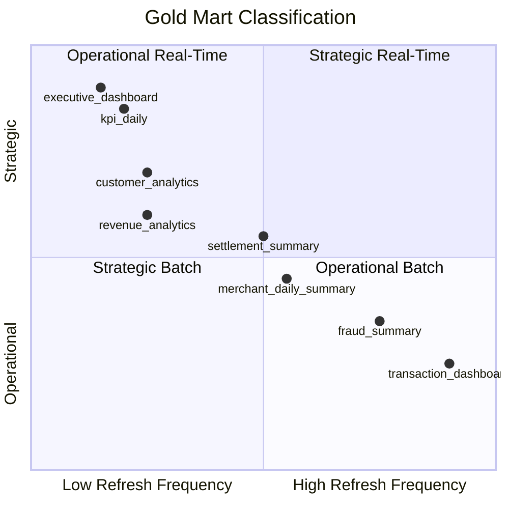
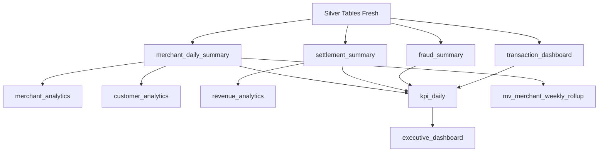
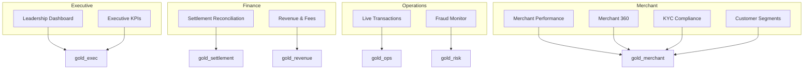
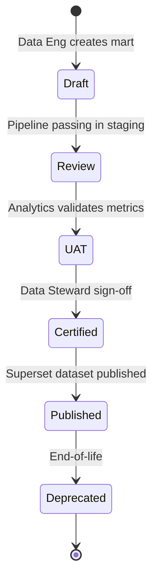

# Part 6 — Gold Layer Design

**Document ID:** DLH-ARB-2026-001-06  
**Version:** 1.0.0  
**Classification:** Internal — Confidential  
**Status:** Draft — For ARB Review

---

## Table of Contents

1. [Overview](#1-overview)
2. [Gold Layer Architecture](#2-gold-layer-architecture)
3. [Mart Catalog](#3-mart-catalog)
4. [Aggregation Framework](#4-aggregation-framework)
5. [Materialized Views and Semantic Layer](#5-materialized-views-and-semantic-layer)
6. [Refresh Strategy](#6-refresh-strategy)
7. [Merchant Analytics Marts](#7-merchant-analytics-marts)
8. [Transaction and Operations Marts](#8-transaction-and-operations-marts)
9. [Settlement and Revenue Marts](#9-settlement-and-revenue-marts)
10. [Risk and Fraud Marts](#10-risk-and-fraud-marts)
11. [Executive and KPI Marts](#11-executive-and-kpi-marts)
12. [Customer Analytics Marts](#12-customer-analytics-marts)
13. [Superset Integration](#13-superset-integration)
14. [Certification and Governance](#14-certification-and-governance)
15. [Design Decisions and Trade-offs](#15-design-decisions-and-trade-offs)
16. [Production Recommendations](#16-production-recommendations)

---

## 1. Overview

### 1.1 Purpose

This document specifies the **production implementation** of the Gold layer — the business-facing analytics tier of the Data Lakehouse. Gold transforms conformed Silver entities into pre-aggregated, dashboard-ready marts that power Superset dashboards, executive reporting, regulatory exports, and ML feature stores.

**Gold answers:** *"What are the KPIs, trends, and summaries the business needs to decide?"*

### 1.2 Scope

| In Scope | Out of Scope |
|----------|--------------|
| Gold mart definitions, schemas, and grains | Silver conformation (see `05-silver-layer.md`) |
| Aggregation logic and refresh schedules | ML model training (see `12-ml-ai-roadmap.md`) |
| Flink streaming/batch Gold jobs | Raw CDC (see `04-bronze-layer.md`) |
| Trino materialized views (lightweight) | Full semantic layer / metrics store (future) |
| Superset dataset mapping | Customer-facing analytics API |

### 1.3 Gold Layer in Context



### 1.4 Design Principles

| ID | Principle | Implementation |
|----|-----------|----------------|
| GL-01 | **Certified datasets only in BI** | Superset connects to Gold marts exclusively |
| GL-02 | **Explicit grain** | Every mart documents its grain in OpenMetadata |
| GL-03 | **No raw PII** | Gold excludes email, phone, tax_id unless ARB-approved |
| GL-04 | **Idempotent refresh** | MERGE or partition overwrite; safe to re-run |
| GL-05 | **Point-in-time dimensions** | Denormalized attributes reflect state at aggregation time |
| GL-06 | **Versioned marts** | `_gold_version` SemVer on every table |
| GL-07 | **Observable freshness** | `last_updated_ts` on every row; monitored via SLO |

---

## 2. Gold Layer Architecture

### 2.1 Processing Patterns

| Pattern | Use Case | Engine | Write Mode |
|---------|----------|--------|------------|
| **Streaming window** | Ops dashboards, fraud (minutes) | Flink tumbling/sliding windows | MERGE into Gold |
| **Micro-batch** | Merchant daily summary (hourly) | Flink continuous + trigger | MERGE into Gold |
| **Scheduled batch** | Executive KPIs, revenue (daily) | Flink batch or Trino INSERT | Partition overwrite |
| **Materialized view** | Lightweight derived metrics | Trino MV refresh | Iceberg backing table |
| **Snapshot mart** | End-of-day financial close | Trino MERGE | Monthly tagged snapshot |

### 2.2 Namespace Layout

```
Catalog: lakehouse
├── gold_merchant/       # Merchant performance, compliance
├── gold_transaction/    # Transaction-level summaries (aggregated)
├── gold_settlement/     # Settlement and reconciliation
├── gold_revenue/        # Revenue, fees, margin
├── gold_risk/           # Fraud and risk signals
├── gold_ops/            # Operational / NOC dashboards
└── gold_exec/           # Executive KPIs
```

### 2.3 Gold Job Register

| Job ID | Flink / Trino Job | Source Silver Tables | Target Gold Mart | Refresh |
|--------|-------------------|----------------------|------------------|---------|
| GLD-01 | `flink-gold-merchant-daily-summary` | `transactions`, `merchants` | `merchant_daily_summary` | Hourly |
| GLD-02 | `flink-gold-merchant-analytics` | `transactions`, `merchants`, `settlements` | `merchant_analytics` | Daily |
| GLD-03 | `flink-gold-settlement-summary` | `settlements`, `settlement_files` | `settlement_summary` | Hourly |
| GLD-04 | `flink-gold-revenue-analytics` | `transactions`, `settlements` | `revenue_analytics` | Daily |
| GLD-05 | `flink-gold-fraud-summary` | `transactions`, `merchants` | `fraud_summary` | 15 min |
| GLD-06 | `flink-gold-transaction-dashboard` | `transactions` | `transaction_dashboard` | 5 min |
| GLD-07 | `flink-gold-customer-analytics` | `merchants`, `transactions` | `customer_analytics` | Daily |
| GLD-08 | `flink-gold-kpi-daily` | Multiple Gold marts | `kpi_daily` | Daily 06:00 UTC |
| GLD-09 | `flink-gold-executive-dashboard` | `kpi_daily` | `executive_dashboard` | Daily 06:30 UTC |
| GLD-10 | `flink-gold-document-compliance` | `document_metadata`, `merchants` | `document_compliance_summary` | Daily |
| GLD-11 | Trino MV refresh | `merchant_daily_summary` | `mv_merchant_weekly_rollup` | Daily |

### 2.4 Data Flow — Merchant Daily Summary Example



---

## 3. Mart Catalog

### 3.1 Complete Mart Register

| Mart | Namespace | Grain | Refresh | Owner | Superset Dashboard |
|------|-----------|-------|---------|-------|-------------------|
| Merchant Daily Summary | `gold_merchant` | merchant_id + date | Hourly | Merchant Analytics | Merchant Performance |
| Merchant Analytics | `gold_merchant` | merchant_id | Daily | Merchant Analytics | Merchant 360 |
| Document Compliance | `gold_merchant` | merchant_id | Daily | Compliance | KYC Compliance |
| Settlement Summary | `gold_settlement` | settlement_id + date | Hourly | Finance | Settlement Reconciliation |
| Revenue Analytics | `gold_revenue` | date + region | Daily | Finance | Revenue & Fees |
| Fraud Summary | `gold_risk` | merchant_id + date | 15 min | Fraud Ops | Fraud Monitor |
| Transaction Dashboard | `gold_ops` | hour + region | 5 min | NOC | Live Transactions |
| Customer Analytics | `gold_merchant` | segment + month | Daily | Product | Customer Segmentation |
| KPI Daily | `gold_exec` | date + metric_name | Daily | Chief of Staff | Executive KPIs |
| Executive Dashboard | `gold_exec` | date + metric_name | Daily | Executive | Leadership Dashboard |

### 3.2 Mart Classification



### 3.3 Priority Matrix (Phase 3 Delivery)

| Priority | Mart | Rationale |
|----------|------|-----------|
| **P0** | `merchant_daily_summary` | Core business metric |
| **P0** | `settlement_summary` | Finance dependency |
| **P0** | `transaction_dashboard` | Operations visibility |
| **P0** | `kpi_daily` | Executive requirement |
| **P1** | `fraud_summary` | Risk monitoring |
| **P1** | `revenue_analytics` | Finance reporting |
| **P1** | `executive_dashboard` | Leadership consumption |
| **P2** | `merchant_analytics` | Merchant 360 |
| **P2** | `customer_analytics` | Segmentation |
| **P2** | `document_compliance_summary` | Compliance reporting |

---

## 4. Aggregation Framework

### 4.1 Standard Aggregation Functions

| Metric Type | SQL Pattern | Null Handling |
|-------------|-------------|---------------|
| Count | `COUNT(*)` or `COUNT(DISTINCT id)` | Zero if no rows |
| Sum | `SUM(amount_usd)` | Zero if no rows |
| Average | `SUM(amount) / NULLIF(COUNT(*), 0)` | NULL if no rows |
| Rate | `numerator / NULLIF(denominator, 0)` | NULL if denominator zero |
| Percentile | `approx_percentile(amount, 0.99)` | Flink DataSketches |
| Distinct count | `COUNT(DISTINCT merchant_id)` | HyperLogLog in Flink |

### 4.2 Standard Metric Definitions

| Metric Name | Definition | Source |
|-------------|------------|--------|
| `txn_count` | COUNT of transactions where `status = COMPLETED` and `is_deleted = false` | `silver_transaction.transactions` |
| `txn_amount_usd` | SUM of `amount_usd` for completed transactions | Same |
| `decline_rate` | `decline_count / NULLIF(auth_count, 0)` | Same |
| `refund_rate` | `refund_count / NULLIF(txn_count, 0)` | Same |
| `chargeback_rate` | `chargeback_count / NULLIF(txn_count, 0)` | Same |
| `avg_txn_amount_usd` | `txn_amount_usd / NULLIF(txn_count, 0)` | Derived |
| `net_settlement_usd` | SUM of `net_amount` converted to USD | `silver_settlement.settlements` |
| `active_merchant_count` | COUNT DISTINCT merchants with ≥1 txn in period | Gold/Silver join |
| `fraud_flag_rate` | COUNT where fraud_score > threshold / txn_count | Risk model (Phase 5) |

### 4.3 Dimension Denormalization Rules

When aggregating, flatten current dimension attributes from Silver:

| Gold Mart | Denormalized Columns | Source | Point-in-Time Rule |
|-----------|---------------------|--------|-------------------|
| `merchant_daily_summary` | `merchant_status`, `kyc_status`, `industry_mcc` | `merchants` WHERE `is_current=true` | Status at aggregation run time |
| `settlement_summary` | `merchant_region`, `merchant_status` | `merchants` | At settlement_date |
| `fraud_summary` | `mcc_risk_tier`, `merchant_region` | `merchants` + `ref_mcc_codes` | At aggregation time |

**Rule:** For historical accuracy on dimension attributes, use SCD Type 2 join:

```sql
-- Point-in-time merchant status for transaction on 2025-06-15
SELECT t.*, m.status AS merchant_status_at_txn
FROM silver_transaction.transactions t
JOIN silver_merchant.merchants m
  ON t.merchant_id = m.merchant_id
 AND t.event_ts >= m.valid_from
 AND t.event_ts < m.valid_to
WHERE t.is_deleted = false;
```

### 4.4 Incremental vs. Full Aggregation

| Strategy | When Used | Implementation |
|----------|-----------|----------------|
| **Incremental MERGE** | Hourly/daily marts with clear grain | MERGE on `(grain_keys)` updating metrics |
| **Rolling window rebuild** | 5-min/15-min ops marts | Overwrite last N hours partition |
| **Full partition overwrite** | Daily executive KPIs | `INSERT OVERWRITE` target date partition |
| **Snapshot append** | Month-end financial close | New partition tagged `month_end_YYYYMM` |

---

## 5. Materialized Views and Semantic Layer

### 5.1 Trino Materialized Views

Trino materialized views provide **lightweight derived aggregations** without a separate Flink job. Used for rollups of existing Gold marts.

| MV Name | Base Table | Definition | Refresh |
|---------|------------|------------|---------|
| `mv_merchant_weekly_rollup` | `merchant_daily_summary` | SUM metrics GROUP BY merchant_id, week | Daily 07:00 UTC |
| `mv_region_daily_rollup` | `merchant_daily_summary` | SUM metrics GROUP BY region, date | Daily 07:00 UTC |
| `mv_fraud_7day_trend` | `fraud_summary` | Rolling 7-day SUM by merchant | Hourly |

**Example — weekly rollup MV:**

```sql
CREATE MATERIALIZED VIEW lakehouse.gold_merchant.mv_merchant_weekly_rollup
WITH (partitioning = ARRAY['month(summary_week)'])
AS
SELECT
    date_trunc('week', summary_date) AS summary_week,
    merchant_id,
    merchant_region,
    SUM(txn_count)              AS txn_count,
    SUM(txn_amount_usd)         AS txn_amount_usd,
    SUM(decline_count)          AS decline_count,
    SUM(refund_count)           AS refund_count,
    MAX(last_updated_ts)        AS last_updated_ts
FROM lakehouse.gold_merchant.merchant_daily_summary
GROUP BY 1, 2, 3;
```

### 5.2 MV Refresh Strategy

| MV | Refresh Mode | Schedule | Invalidation |
|----|-------------|----------|--------------|
| `mv_merchant_weekly_rollup` | REFRESH FULL | Daily 07:00 UTC | After `merchant_daily_summary` job completes |
| `mv_region_daily_rollup` | REFRESH FULL | Daily 07:00 UTC | Same |
| `mv_fraud_7day_trend` | REFRESH INCREMENTAL | Hourly | Last 7 days partition |

```sql
-- Trino MV refresh (scheduled via Airflow/cron Trino client)
REFRESH MATERIALIZED VIEW lakehouse.gold_merchant.mv_merchant_weekly_rollup;
```

### 5.3 Semantic Layer (Superset)

Superset serves as the **semantic layer** for Gold marts:

| Layer | Responsibility |
|-------|----------------|
| Gold Iceberg table | Physical storage; certified metrics |
| Superset dataset | Column labels, formats, calculated metrics |
| Superset dashboard | Visualization and filters |
| OpenMetadata glossary | KPI business definitions |

**Calculated metrics in Superset (not stored in Gold):**

| Calculated Metric | Formula |
|-------------------|---------|
| `Decline Rate %` | `decline_count / auth_count * 100` |
| `MoM Growth %` | `(txn_amount_usd - prior_month) / prior_month * 100` |
| `ARPU` | `txn_amount_usd / active_merchant_count` |

**Rule:** Store base counts and sums in Gold; derive rates and percentages in Superset unless used by multiple dashboards.

---

## 6. Refresh Strategy

### 6.1 Refresh Tier Summary

| Tier | Latency Target | Marts | Engine |
|------|---------------|-------|--------|
| **T1 — Real-time** | ≤ 5 min | `transaction_dashboard` | Flink 5-min tumbling window |
| **T2 — Near-real-time** | ≤ 15 min | `fraud_summary` | Flink 15-min sliding window |
| **T3 — Hourly** | ≤ 1 hour | `merchant_daily_summary`, `settlement_summary` | Flink hourly trigger MERGE |
| **T4 — Daily** | By 06:00–08:00 UTC | `kpi_daily`, `revenue_analytics`, `merchant_analytics` | Flink batch / Trino |
| **T5 — On-demand** | Manual trigger | Regulatory exports, month-end close | Trino |

### 6.2 Daily Schedule (UTC)

```mermaid
gantt
    title Gold Layer Daily Schedule (UTC)
    dateFormat HH:mm
    axisFormat %H:%M

    section Continuous
    transaction_dashboard (5 min)     :active, t1, 00:00, 24h
    fraud_summary (15 min)            :active, t2, 00:00, 24h

    section Hourly
    merchant_daily_summary            :t3a, 00:00, 24h
    settlement_summary                :t3b, 00:00, 24h

    section Daily Batch
    merchant_analytics                :t4a, 05:00, 45min
    revenue_analytics                 :t4b, 05:30, 45min
    document_compliance               :t4c, 05:45, 30min
    kpi_daily                         :t4d, 06:00, 30min
    executive_dashboard               :t4e, 06:30, 15min
    customer_analytics                :t4f, 07:00, 45min
    MV refresh                        :t4g, 07:00, 30min
```



### 6.3 Dependency Chain



### 6.4 Freshness SLOs

| Mart | SLO | Measurement | Alert |
|------|-----|-------------|-------|
| `transaction_dashboard` | p99 ≤ 5 min | `now() - max(last_updated_ts)` | > 7 min |
| `fraud_summary` | p99 ≤ 15 min | Same | > 20 min |
| `merchant_daily_summary` | p99 ≤ 1 hr | Same | > 75 min |
| `settlement_summary` | p99 ≤ 1 hr | Same | > 75 min |
| `kpi_daily` | By 06:00 UTC daily | Job completion metric | Not complete by 06:30 |
| `executive_dashboard` | By 06:30 UTC daily | Job completion metric | Not complete by 07:00 |

### 6.5 Backfill and Reprocessing

| Scenario | Procedure |
|----------|-----------|
| Silver replay for date range | Re-run Gold MERGE for affected `(grain)` keys and dates |
| Gold job bug fix | `INSERT OVERWRITE` target partitions after fix deployed |
| New metric added to mart | Bump `_gold_version`; backfill from Silver history |
| Month-end restatement | Create tagged snapshot `month_end_YYYYMM`; retain prior version |

---

## 7. Merchant Analytics Marts

### 7.1 Merchant Daily Summary

**Table:** `gold_merchant.merchant_daily_summary`  
**Grain:** One row per `merchant_id` + `summary_date`  
**Refresh:** Hourly (Flink MERGE)  
**Owner:** Merchant Analytics Lead

```sql
CREATE TABLE IF NOT EXISTS lakehouse.gold_merchant.merchant_daily_summary (
    summary_date            DATE NOT NULL,
    merchant_id             STRING NOT NULL,
    merchant_region         STRING NOT NULL,
    merchant_status         STRING NOT NULL,
    kyc_status              STRING NOT NULL,
    industry_mcc            STRING,
    txn_count               BIGINT NOT NULL DEFAULT 0,
    txn_amount_usd          DECIMAL(18,2) NOT NULL DEFAULT 0,
    auth_count              BIGINT NOT NULL DEFAULT 0,
    decline_count           BIGINT NOT NULL DEFAULT 0,
    decline_rate            DECIMAL(7,4),
    refund_count            BIGINT NOT NULL DEFAULT 0,
    refund_amount_usd       DECIMAL(18,2) NOT NULL DEFAULT 0,
    chargeback_count        BIGINT NOT NULL DEFAULT 0,
    avg_txn_amount_usd      DECIMAL(18,2),
    last_updated_ts         TIMESTAMP(6) NOT NULL,
    record_count            BIGINT,
    _gold_version           STRING NOT NULL DEFAULT '1.0.0'
)
USING iceberg
PARTITIONED BY (months(summary_date))
TBLPROPERTIES (
    'format-version' = '2',
    'write.parquet.compression-codec' = 'zstd',
    'write.target-file-size-bytes' = '536870912'
);
```

**Aggregation logic:**

```sql
-- Conceptual MERGE source query
SELECT
    CAST(t.event_ts AS DATE)                    AS summary_date,
    t.merchant_id,
    t.merchant_region,
    m.status                                    AS merchant_status,
    m.kyc_status,
    m.industry_mcc,
    COUNT(*) FILTER (WHERE t.status = 'COMPLETED')     AS txn_count,
    SUM(t.amount_usd) FILTER (WHERE t.status = 'COMPLETED') AS txn_amount_usd,
    COUNT(*) FILTER (WHERE t.status IN ('AUTHORIZED','COMPLETED','DECLINED')) AS auth_count,
    COUNT(*) FILTER (WHERE t.status = 'DECLINED')      AS decline_count,
    COUNT(*) FILTER (WHERE t.status = 'REFUNDED')      AS refund_count,
    SUM(t.amount_usd) FILTER (WHERE t.status = 'REFUNDED') AS refund_amount_usd,
    COUNT(*) FILTER (WHERE t.is_chargeback = true)     AS chargeback_count,
    CURRENT_TIMESTAMP                           AS last_updated_ts,
    COUNT(*)                                    AS record_count
FROM lakehouse.silver_transaction.transactions t
JOIN lakehouse.silver_merchant.merchants m
  ON t.merchant_id = m.merchant_id AND m.is_current = true
WHERE t.is_deleted = false
  AND t.event_ts >= :window_start
  AND t.event_ts < :window_end
GROUP BY 1, 2, 3, 4, 5, 6;
```

---

### 7.2 Merchant Analytics (Merchant 360)

**Table:** `gold_merchant.merchant_analytics`  
**Grain:** One row per `merchant_id` (lifetime rolling metrics)  
**Refresh:** Daily 05:00 UTC

| Column Group | Key Columns |
|--------------|-------------|
| Identity | `merchant_id`, `merchant_region`, `industry_mcc` |
| Lifetime metrics | `lifetime_txn_count`, `lifetime_txn_amount_usd`, `first_txn_date`, `last_txn_date` |
| Rolling 30d | `txn_count_30d`, `txn_amount_usd_30d`, `decline_rate_30d` |
| Rolling 90d | `txn_count_90d`, `txn_amount_usd_90d` |
| Growth | `mom_growth_pct`, `yoy_growth_pct` |
| Settlement | `lifetime_settlement_usd`, `avg_settlement_cycle_days` |
| Risk | `chargeback_rate_90d`, `fraud_flag_count_30d` |

---

### 7.3 Document Compliance Summary

**Table:** `gold_merchant.document_compliance_summary`  
**Grain:** One row per `merchant_id`  
**Refresh:** Daily 05:45 UTC

| Column | Description |
|--------|-------------|
| `merchant_id` | PK |
| `kyc_status` | From Silver merchants |
| `required_doc_count` | Based on merchant type rules |
| `uploaded_doc_count` | From document_metadata |
| `approved_doc_count` | `scan_status = CLEAN` AND approved |
| `completeness_pct` | `uploaded / required * 100` |
| `oldest_pending_doc_age_days` | Compliance SLA tracking |
| `is_compliant` | Boolean; all required docs approved |

---

## 8. Transaction and Operations Marts

### 8.1 Transaction Dashboard (Operational)

**Table:** `gold_ops.transaction_dashboard`  
**Grain:** One row per `summary_hour` (TIMESTAMP) + `merchant_region`  
**Refresh:** Every 5 minutes (Flink tumbling window)

```sql
CREATE TABLE IF NOT EXISTS lakehouse.gold_ops.transaction_dashboard (
    summary_hour            TIMESTAMP(6) NOT NULL,
    merchant_region         STRING NOT NULL,
    txn_count               BIGINT NOT NULL DEFAULT 0,
    txn_amount_usd          DECIMAL(18,2) NOT NULL DEFAULT 0,
    auth_count              BIGINT NOT NULL DEFAULT 0,
    decline_count           BIGINT NOT NULL DEFAULT 0,
    decline_rate            DECIMAL(7,4),
    avg_latency_ms          DECIMAL(10,2),
    p99_latency_ms          DECIMAL(10,2),
    error_count             BIGINT NOT NULL DEFAULT 0,
    tps_peak                DECIMAL(10,2),
    last_updated_ts         TIMESTAMP(6) NOT NULL,
    _gold_version           STRING NOT NULL DEFAULT '1.0.0'
)
USING iceberg
PARTITIONED BY (days(summary_hour))
TBLPROPERTIES (
    'format-version' = '2',
    'write.target-file-size-bytes' = '268435456'
);
```

**Retention:** 90-day rolling window (hot only); older partitions dropped.

**Superset dashboard:** Live Transactions — auto-refresh every 60 seconds.

---

### 8.2 Transaction Summary (Daily Regional)

**Table:** `gold_transaction.transaction_summary_daily`  
**Grain:** `summary_date` + `merchant_region` + `payment_method`  
**Refresh:** Hourly

| Metric | Description |
|--------|-------------|
| `txn_count_by_method` | Breakdown by CARD, ACH, WALLET |
| `txn_amount_usd_by_method` | Volume by payment method |
| `cross_border_pct` | % transactions where merchant_country ≠ card_country |

---

## 9. Settlement and Revenue Marts

### 9.1 Settlement Summary

**Table:** `gold_settlement.settlement_summary`  
**Grain:** One row per `settlement_id` + `settlement_date`  
**Refresh:** Hourly  
**Owner:** Finance Controller

```sql
CREATE TABLE IF NOT EXISTS lakehouse.gold_settlement.settlement_summary (
    settlement_id           STRING NOT NULL,
    settlement_date         DATE NOT NULL,
    merchant_id             STRING NOT NULL,
    merchant_region         STRING NOT NULL,
    merchant_status         STRING NOT NULL,
    currency_code           STRING NOT NULL,
    gross_amount            DECIMAL(18,4) NOT NULL,
    fee_amount              DECIMAL(18,4) NOT NULL,
    net_amount              DECIMAL(18,4) NOT NULL,
    net_amount_usd          DECIMAL(18,2) NOT NULL,
    txn_count_in_batch      BIGINT,
    settlement_status       STRING NOT NULL,
    file_count              BIGINT NOT NULL DEFAULT 0,
    files_available         BIGINT NOT NULL DEFAULT 0,
    last_updated_ts         TIMESTAMP(6) NOT NULL,
    _gold_version           STRING NOT NULL DEFAULT '1.0.0'
)
USING iceberg
PARTITIONED BY (months(settlement_date));
```

**Key validations (batch, post-write):**
- `net_amount = gross_amount - fee_amount` (tolerance ± 0.01)
- `files_available <= file_count`
- Reconciliation: SUM(`net_amount_usd`) by date matches Finance GL (± 0.1%)

---

### 9.2 Revenue Analytics

**Table:** `gold_revenue.revenue_analytics`  
**Grain:** `summary_date` + `merchant_region` + `revenue_type`  
**Refresh:** Daily 05:30 UTC

| Column | Description |
|--------|-------------|
| `summary_date` | Date |
| `merchant_region` | Region |
| `revenue_type` | `INTERCHANGE`, `PROCESSING_FEE`, `PLATFORM_FEE`, `OTHER` |
| `gross_revenue_usd` | Total revenue |
| `merchant_count` | Active merchants contributing |
| `txn_volume_usd` | Underlying transaction volume |
| `effective_rate_bps` | Revenue / volume × 10000 |
| `mom_change_pct` | Month-over-month change |

**Revenue type derivation:**

| revenue_type | Source Logic |
|--------------|--------------|
| `PROCESSING_FEE` | SUM of `fee_amount` from settlements |
| `INTERCHANGE` | Derived from transaction margin rules |
| `PLATFORM_FEE` | Fixed per-merchant fees from contract table (future) |

---

## 10. Risk and Fraud Marts

### 10.1 Fraud Summary

**Table:** `gold_risk.fraud_summary`  
**Grain:** `merchant_id` + `summary_date`  
**Refresh:** Every 15 minutes  
**Owner:** Fraud Team Lead

```sql
CREATE TABLE IF NOT EXISTS lakehouse.gold_risk.fraud_summary (
    summary_date            DATE NOT NULL,
    merchant_id             STRING NOT NULL,
    merchant_region         STRING NOT NULL,
    mcc_risk_tier           STRING,
    txn_count               BIGINT NOT NULL DEFAULT 0,
    txn_amount_usd          DECIMAL(18,2) NOT NULL DEFAULT 0,
    decline_count           BIGINT NOT NULL DEFAULT 0,
    decline_rate            DECIMAL(7,4),
    velocity_txn_count_1h   BIGINT,
    velocity_amount_usd_1h  DECIMAL(18,2),
    velocity_txn_count_24h  BIGINT,
    velocity_amount_usd_24h DECIMAL(18,2),
    chargeback_count        BIGINT NOT NULL DEFAULT 0,
    chargeback_rate         DECIMAL(7,4),
    high_value_txn_count    BIGINT,
    anomaly_score           DECIMAL(8,4),
    fraud_rule_hits         BIGINT NOT NULL DEFAULT 0,
    last_updated_ts         TIMESTAMP(6) NOT NULL,
    _gold_version           STRING NOT NULL DEFAULT '1.0.0'
)
USING iceberg
PARTITIONED BY (days(summary_date));
```

**Fraud rule hits (Phase 3 — rule-based; Phase 5 — ML scores):**

| Rule | Condition | Flag |
|------|-----------|------|
| FR-01 | `velocity_txn_count_1h` > 100 | Increment `fraud_rule_hits` |
| FR-02 | `avg_txn_amount_usd` > 3× merchant 30d avg | Increment |
| FR-03 | `decline_rate` > 0.5 | Increment |
| FR-04 | `mcc_risk_tier = HIGH` AND `txn_amount_usd` > 10000 | Increment |

---

## 11. Executive and KPI Marts

### 11.1 KPI Daily

**Table:** `gold_exec.kpi_daily`  
**Grain:** `summary_date` + `metric_name`  
**Refresh:** Daily 06:00 UTC  
**Owner:** Chief of Staff

```sql
CREATE TABLE IF NOT EXISTS lakehouse.gold_exec.kpi_daily (
    summary_date            DATE NOT NULL,
    metric_name             STRING NOT NULL,
    metric_category         STRING NOT NULL,
    metric_value            DECIMAL(18,4) NOT NULL,
    metric_unit             STRING NOT NULL,
    prior_day_value         DECIMAL(18,4),
    prior_week_value        DECIMAL(18,4),
    change_pct_dod          DECIMAL(8,4),
    change_pct_wow          DECIMAL(8,4),
    target_value            DECIMAL(18,4),
    is_on_target            BOOLEAN,
    last_updated_ts         TIMESTAMP(6) NOT NULL,
    _gold_version           STRING NOT NULL DEFAULT '1.0.0'
)
USING iceberg
PARTITIONED BY (years(summary_date));
```

### 11.2 Executive KPI Definitions

| metric_name | metric_category | metric_unit | Source Mart / Logic |
|-------------|-----------------|-------------|---------------------|
| `total_transaction_volume_usd` | revenue | USD | SUM `txn_amount_usd` from `merchant_daily_summary` |
| `total_transaction_count` | revenue | count | SUM `txn_count` |
| `active_merchant_count` | merchant | count | DISTINCT merchants with txn_count > 0 |
| `new_merchant_count` | merchant | count | Merchants with first txn in period |
| `avg_decline_rate` | risk | percentage | Weighted avg decline_rate |
| `total_settlement_usd` | settlement | USD | SUM `net_amount_usd` from `settlement_summary` |
| `total_revenue_usd` | revenue | USD | SUM from `revenue_analytics` |
| `chargeback_rate` | risk | percentage | Weighted chargeback rate |
| `platform_uptime_pct` | ops | percentage | External NOC feed (future) |
| `kyc_compliance_rate` | compliance | percentage | % merchants `is_compliant=true` |

### 11.3 Executive Dashboard

**Table:** `gold_exec.executive_dashboard`  
**Grain:** `summary_date` + `metric_name` (presentation-optimized subset of `kpi_daily`)  
**Refresh:** Daily 06:30 UTC

| Column | Description |
|--------|-------------|
| `metric_display_name` | Human-readable label |
| `metric_value_formatted` | Pre-formatted string for dashboard |
| `trend_direction` | `UP`, `DOWN`, `FLAT` |
| `trend_color` | `GREEN`, `RED`, `NEUTRAL` (target-based) |
| `sparkline_values` | JSON array of last 30 daily values |

**Superset dashboard:** Leadership Dashboard — daily email snapshot at 07:00 UTC.

---

## 12. Customer Analytics Marts

### 12.1 Customer Analytics (Segmentation)

**Table:** `gold_merchant.customer_analytics`  
**Grain:** `merchant_segment` + `summary_month`  
**Refresh:** Daily 07:00 UTC

```sql
CREATE TABLE IF NOT EXISTS lakehouse.gold_merchant.customer_analytics (
    summary_month           DATE NOT NULL,
    merchant_segment        STRING NOT NULL,
    merchant_region         STRING NOT NULL,
    merchant_count          BIGINT NOT NULL,
    active_merchant_count   BIGINT NOT NULL,
    txn_count               BIGINT NOT NULL,
    txn_amount_usd          DECIMAL(18,2) NOT NULL,
    avg_txn_amount_usd      DECIMAL(18,2),
    avg_txn_count_per_merchant DECIMAL(10,2),
    retention_rate          DECIMAL(7,4),
    churn_count             BIGINT,
    new_merchant_count      BIGINT,
    last_updated_ts         TIMESTAMP(6) NOT NULL,
    _gold_version           STRING NOT NULL DEFAULT '1.0.0'
)
USING iceberg
PARTITIONED BY (years(summary_month));
```

### 12.2 Merchant Segmentation Rules

| merchant_segment | Criteria |
|------------------|----------|
| `ENTERPRISE` | `lifetime_txn_amount_usd` > $10M OR custom contract |
| `MID_MARKET` | $1M – $10M lifetime volume |
| `SMB` | $100K – $1M lifetime volume |
| `STARTUP` | < $100K lifetime volume AND onboarding < 12 months |
| `DORMANT` | No transactions in last 90 days |

**Segment assignment:** Computed daily in `merchant_analytics`; joined into `customer_analytics` aggregation.

---

## 13. Superset Integration

### 13.1 Dataset Mapping

| Superset Dataset | Gold Table | Connection | Cache TTL |
|------------------|------------|------------|-----------|
| Merchant Performance | `gold_merchant.merchant_daily_summary` | Trino `gold_merchant` | 1 hour |
| Merchant 360 | `gold_merchant.merchant_analytics` | Trino `gold_merchant` | 24 hours |
| Live Transactions | `gold_ops.transaction_dashboard` | Trino `gold_ops` | 1 minute |
| Fraud Monitor | `gold_risk.fraud_summary` | Trino `gold_risk` | 5 minutes |
| Settlement Reconciliation | `gold_settlement.settlement_summary` | Trino `gold_settlement` | 1 hour |
| Revenue & Fees | `gold_revenue.revenue_analytics` | Trino `gold_revenue` | 24 hours |
| Executive KPIs | `gold_exec.kpi_daily` | Trino `gold_exec` | 24 hours |
| Leadership Dashboard | `gold_exec.executive_dashboard` | Trino `gold_exec` | 24 hours |
| KYC Compliance | `gold_merchant.document_compliance_summary` | Trino `gold_merchant` | 24 hours |
| Customer Segments | `gold_merchant.customer_analytics` | Trino `gold_merchant` | 24 hours |

### 13.2 Dashboard Catalog



### 13.3 Row-Level Security in Superset

| Dashboard | RLS Rule | Entra Group |
|-----------|----------|-------------|
| Merchant Performance | `merchant_id IN ({user_portfolio})` | `grp-analyst-merchant` |
| Fraud Monitor | `merchant_region IN ({user_regions})` | `grp-fraud` |
| Live Transactions | `merchant_region = {user_region}` OR full access | `grp-ops` |
| Executive KPIs | No RLS (aggregated) | `grp-executive` |

---

## 14. Certification and Governance

### 14.1 Mart Certification Workflow



### 14.2 Certification Checklist

| # | Criterion | Required |
|---|-----------|----------|
| 1 | Grain documented in OpenMetadata | ✅ |
| 2 | All metrics defined in glossary | ✅ |
| 3 | DQ score ≥ 95% for 7 consecutive days | ✅ |
| 4 | Freshness SLO met for 7 consecutive days | ✅ |
| 5 | Reconciliation with Silver validated | ✅ |
| 6 | No raw PII columns | ✅ |
| 7 | RLS policy configured (if applicable) | ✅ |
| 8 | Data Steward sign-off recorded | ✅ |
| 9 | `_gold_version` set | ✅ |
| 10 | Superset dataset reviewed by Analytics lead | ✅ |

### 14.3 Version Management

| Change Type | `_gold_version` Bump | Backfill Required |
|-------------|---------------------|-------------------|
| New metric column (nullable) | Minor (1.0 → 1.1) | Optional |
| Metric definition change | Major (1.x → 2.0) | Yes |
| Grain change | Major | Yes + ARB review |
| Column rename | Major | Yes |

---

## 15. Design Decisions and Trade-offs

| ADR | Decision | Benefit | Trade-off | Mitigation |
|-----|----------|---------|-----------|------------|
| ADR-G06-001 | Denormalize dims into Gold | Fast Superset queries | Stale dim attributes | Document point-in-time rule |
| ADR-G06-002 | Flink for T1–T3 refresh | Unified streaming platform | Complex window logic | Reusable aggregation library |
| ADR-G06-003 | Trino batch for executive KPIs | Simpler daily orchestration | Higher latency (daily) | Acceptable for exec use case |
| ADR-G06-004 | Rates computed in Superset | Avoid redundant storage | Inconsistent if duplicated | Document single source |
| ADR-G06-005 | 90-day rolling window for ops marts | Cost control | No long-term ops history | Aggregate to daily for archive |
| ADR-G06-006 | `kpi_daily` sources from Gold not Silver | Consistent exec numbers | Cascade dependency | Dependency-aware scheduler |
| ADR-G06-007 | No transaction-level Gold table | Prevents PII exposure | No drill-through in BI | Controlled Silver access for fraud |
| ADR-G06-008 | MERGE over INSERT OVERWRITE for hourly | Idempotent; late data safe | Higher commit cost | Iceberg compaction |

---

## 16. Production Recommendations

### 16.1 Phase 3 Delivery Order

| Sprint | Deliverables |
|--------|-------------|
| Sprint 1 | `merchant_daily_summary`, `transaction_dashboard` |
| Sprint 2 | `settlement_summary`, `fraud_summary` |
| Sprint 3 | `kpi_daily`, `revenue_analytics` |
| Sprint 4 | `executive_dashboard`, Superset dashboards (P0) |
| Sprint 5 | `merchant_analytics`, `customer_analytics`, `document_compliance_summary` |

### 16.2 Pre-Production Checklist

| # | Item | Priority |
|---|------|----------|
| 1 | All P0 Gold tables created in Polaris | P0 |
| 2 | Flink Gold jobs deployed with MERGE/idempotent writes | P0 |
| 3 | Freshness monitoring and alerts configured | P0 |
| 4 | Superset datasets created (Gold only) | P0 |
| 5 | KPI glossary entries in OpenMetadata | P1 |
| 6 | Certification workflow tested on one mart | P1 |
| 7 | Daily dependency scheduler (Airflow or Flink cron) | P1 |
| 8 | Finance reconciliation script for settlement_summary | P1 |
| 9 | Trino MV refresh jobs scheduled | P2 |
| 10 | Monthly snapshot tagging for finance marts | P2 |

### 16.3 Gold Layer Exit Criteria

| Criterion | Target |
|-----------|--------|
| P0 marts certified and published | 100% |
| Superset dashboards live | ≥ 5 dashboards |
| Freshness SLOs met | 7 consecutive days |
| DQ score on Gold | ≥ 95% |
| Executive KPI reconciliation | Finance sign-off |

---

## Appendix A — Gold Table Catalog

| Namespace | Table | Grain | Refresh | Phase |
|-----------|-------|-------|---------|-------|
| `gold_merchant` | `merchant_daily_summary` | merchant + day | Hourly | 3 |
| `gold_merchant` | `merchant_analytics` | merchant | Daily | 3 |
| `gold_merchant` | `document_compliance_summary` | merchant | Daily | 3 |
| `gold_merchant` | `customer_analytics` | segment + month | Daily | 3 |
| `gold_merchant` | `mv_merchant_weekly_rollup` | merchant + week | Daily | 3 |
| `gold_transaction` | `transaction_summary_daily` | date + region + method | Hourly | 3 |
| `gold_settlement` | `settlement_summary` | settlement + date | Hourly | 3 |
| `gold_revenue` | `revenue_analytics` | date + region + type | Daily | 3 |
| `gold_risk` | `fraud_summary` | merchant + day | 15 min | 3 |
| `gold_ops` | `transaction_dashboard` | hour + region | 5 min | 3 |
| `gold_exec` | `kpi_daily` | date + metric | Daily | 3 |
| `gold_exec` | `executive_dashboard` | date + metric | Daily | 3 |

---

## Appendix B — Metric Formula Reference

| Metric | Formula |
|--------|---------|
| `decline_rate` | `decline_count / NULLIF(auth_count, 0)` |
| `chargeback_rate` | `chargeback_count / NULLIF(txn_count, 0)` |
| `refund_rate` | `refund_count / NULLIF(txn_count, 0)` |
| `avg_txn_amount_usd` | `txn_amount_usd / NULLIF(txn_count, 0)` |
| `effective_rate_bps` | `(gross_revenue_usd / NULLIF(txn_volume_usd, 0)) * 10000` |
| `completeness_pct` | `uploaded_doc_count / NULLIF(required_doc_count, 0) * 100` |
| `change_pct_dod` | `(metric_value - prior_day_value) / NULLIF(ABS(prior_day_value), 0) * 100` |
| `retention_rate` | `1 - (churn_count / NULLIF(merchant_count, 0))` |

---

## Appendix C — Related Documents

| Document | Relationship |
|----------|-------------|
| `03-medallion-architecture.md` | Gold layer overview and conventions |
| `05-silver-layer.md` | Upstream Silver source entities |
| `07-data-quality.md` | DQ certification requirements |
| `08-governance.md` | Mart certification workflow |
| `12-ml-ai-roadmap.md` | Feature store sourced from Gold |
| `13-runbook.md` | Gold job schedules and backfill procedures |

---

## Appendix D — Revision History

| Version | Date | Author | Changes |
|---------|------|--------|---------|
| 1.0.0 | 2026-07-02 | Data Platform Architecture | Initial Gold layer design |
