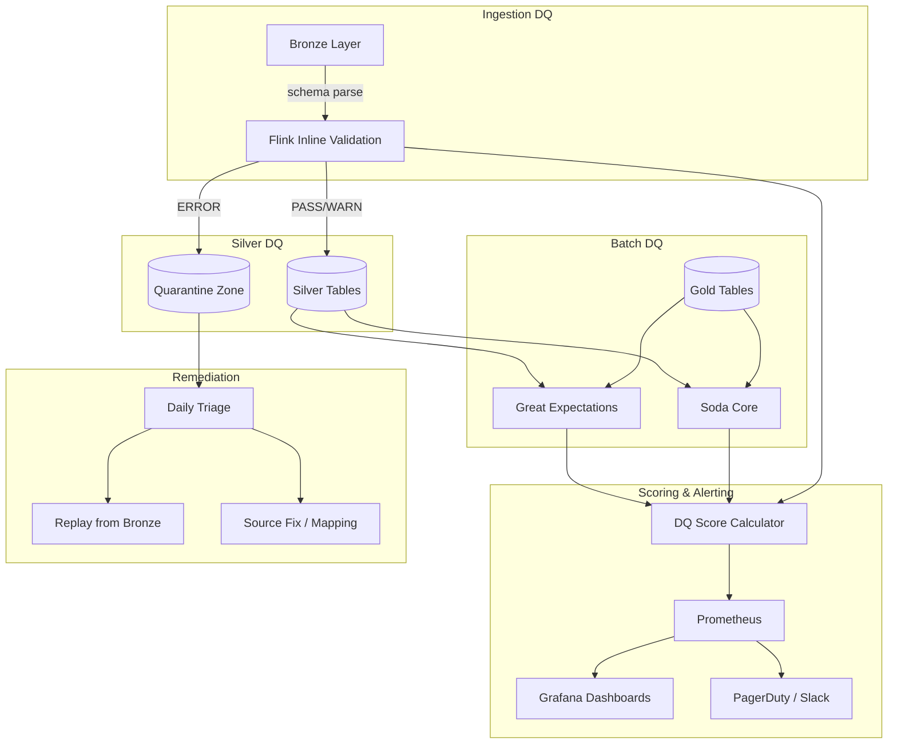
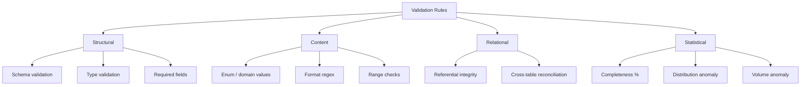
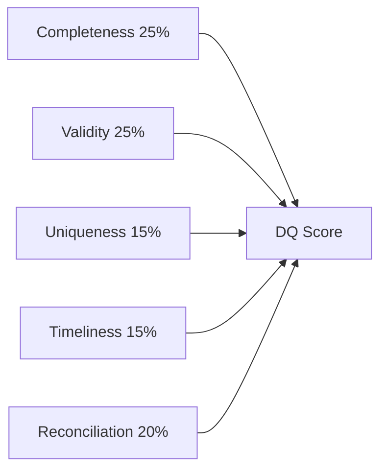
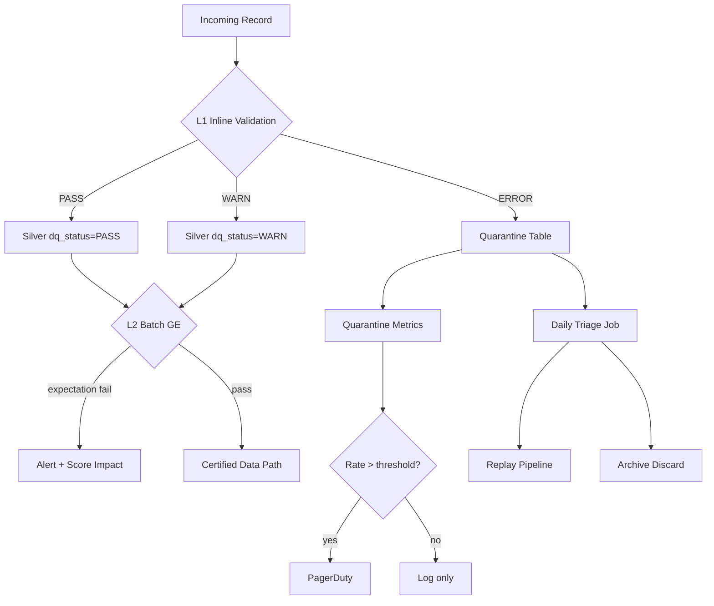
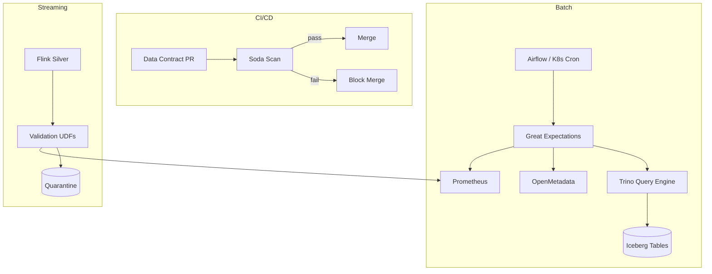
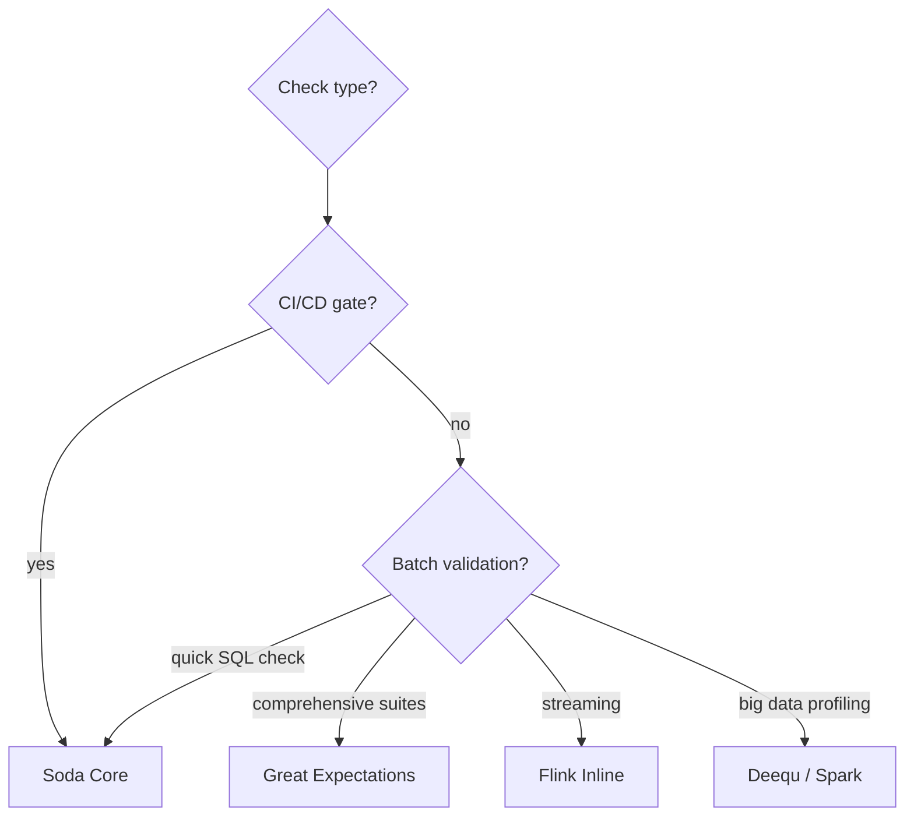

# Part 7 — Data Quality Framework

**Document ID:** DLH-ARB-2026-001-07  
**Version:** 1.0.0  
**Classification:** Internal — Confidential  
**Status:** Draft — For ARB Review

---

## Table of Contents

1. [Overview](#1-overview)
2. [Data Quality Architecture](#2-data-quality-architecture)
3. [Validation Rule Framework](#3-validation-rule-framework)
4. [Schema Validation](#4-schema-validation)
5. [Duplicate Detection](#5-duplicate-detection)
6. [Referential Integrity](#6-referential-integrity)
7. [Business Rule Validation](#7-business-rule-validation)
8. [Data Quality Score](#8-data-quality-score)
9. [Failed Record Pipeline](#9-failed-record-pipeline)
10. [Quarantine Zone](#10-quarantine-zone)
11. [Threshold Alerts](#11-threshold-alerts)
12. [Tool Selection and Integration](#12-tool-selection-and-integration)
13. [Great Expectations Implementation](#13-great-expectations-implementation)
14. [Deequ Implementation](#14-deequ-implementation)
15. [Soda Implementation](#15-soda-implementation)
16. [Layer-Specific DQ Policies](#16-layer-specific-dq-policies)
17. [Operational Runbook](#17-operational-runbook)
18. [Design Decisions and Trade-offs](#18-design-decisions-and-trade-offs)
19. [Production Recommendations](#19-production-recommendations)

---

## 1. Overview

### 1.1 Purpose

This document defines the **production-grade Data Quality (DQ) framework** for the enterprise Data Lakehouse. It specifies how data is validated across Bronze, Silver, and Gold layers; how failed records are quarantined; how quality is scored and monitored; and how alerting drives remediation.

The framework ensures that **analytics consumers trust published datasets** and that data quality incidents are detected, contained, and resolved before they impact business decisions.

### 1.2 Scope

| In Scope | Out of Scope |
|----------|--------------|
| Inline Flink validation (Silver ingest) | Source application data entry validation |
| Batch validation (GE, Soda on Trino) | Full MDM data stewardship tooling |
| Quarantine zone design and workflow | Manual Excel-based QA processes |
| DQ scoring and Prometheus metrics | Third-party data vendor SLAs |
| Alerting thresholds and escalation | Application-level fraud scoring (Phase 5) |

### 1.3 Quality Objectives

| Objective | Target | Measurement |
|-----------|--------|-------------|
| **Accuracy** | ≥ 99.9% reconciliation with MySQL SoR | Daily count reconciliation |
| **Completeness** | ≥ 98% required fields populated | GE completeness suites |
| **Timeliness** | Layer freshness SLOs met | Freshness metrics |
| **Consistency** | Cross-table FK integrity ≥ 99.9% | FK validation rules |
| **Uniqueness** | Zero duplicate PKs in Silver/Gold | Uniqueness suites |
| **Validity** | ≥ 98% records pass enum/format rules | Inline + batch validation |
| **Gold trust** | DQ score ≥ 95% on all certified marts | Daily DQ score |

### 1.4 DAMA-DMBOK Alignment

| DQ Dimension | Lakehouse Implementation |
|--------------|-------------------------|
| Accuracy | Reconciliation jobs; amount validation rules |
| Completeness | NOT NULL rules; completeness % suites |
| Consistency | Cross-layer count reconciliation |
| Timeliness | Freshness SLO monitoring |
| Validity | Enum, format, range validation |
| Uniqueness | PK uniqueness; dedup in Silver |

---

## 2. Data Quality Architecture

### 2.1 End-to-End DQ Flow



### 2.2 DQ Execution Layers

| Layer | When | Engine | Latency | Outcome |
|-------|------|--------|---------|---------|
| **L1 — Inline streaming** | Per event during Silver ingest | Flink UDF | Milliseconds | Pass / Warn / Quarantine |
| **L2 — Batch table suites** | Hourly (Silver) / Daily (Gold) | Great Expectations | Minutes | Score + alert |
| **L3 — Contract CI** | On PR to data-contracts repo | Soda Core | Seconds | Block merge |
| **L4 — Reconciliation** | Daily | Trino SQL | Minutes | Accuracy metric |
| **L5 — Profiling (optional)** | Weekly | Deequ (if Spark added) | Hours | Anomaly baseline |

### 2.3 Component Inventory

| Component | Role | Deployment |
|-----------|------|------------|
| Flink Validation UDFs | Inline L1 rules | Embedded in Silver jobs |
| Great Expectations | L2 batch suites, documentation | AKS cron job + GE Cloud (optional) |
| Soda Core | L3 contract CI, L2 SQL checks | GitHub Actions / Azure DevOps |
| Deequ | L5 statistical profiling | Optional Spark job (Phase 4+) |
| Prometheus | Metrics storage | Azure Managed Prometheus |
| Grafana | DQ dashboards | Azure Managed Grafana |
| Iceberg `dq.*` tables | Quarantine + score history | ADLS Gen2 |
| OpenMetadata | DQ results surfacing | AKS |

---

## 3. Validation Rule Framework

### 3.1 Rule Taxonomy



### 3.2 Rule Severity Model

| Severity | Code Prefix | Silver Behavior | Gold Impact |
|----------|-------------|-----------------|-------------|
| **ERROR** | `E-` | Quarantine; no Silver write | Blocks certification |
| **WARN** | `W-` | Write with `dq_status = WARN` | Lowers DQ score |
| **INFO** | `I-` | Write with `dq_status = PASS`; log only | No score impact |

### 3.3 Rule Registry Schema

Rules are registered in `data-contracts/dq-rules/{domain}/{table}.yaml`:

```yaml
# data-contracts/dq-rules/transaction/transactions.yaml
table: silver_transaction.transactions
version: "1.2.0"
rules:
  - id: E-TXN-001
    name: transaction_id_not_null
    severity: ERROR
    type: not_null
    column: transaction_id
    layers: [inline, batch]

  - id: E-TXN-003
    name: amount_minor_positive
    severity: ERROR
    type: range
    column: amount_minor
    min: 1
    layers: [inline, batch]

  - id: W-TXN-001
    name: large_transaction_flag
    severity: WARN
    type: range
    column: amount_usd
    min: 100000
    layers: [inline]

  - id: E-TXN-007
    name: merchant_fk_exists
    severity: ERROR
    type: foreign_key
    column: merchant_id
    reference: silver_merchant.merchants.merchant_id
    grace_period: 1h
    layers: [inline, batch]
```

### 3.4 Rule ID Naming Convention

| Pattern | Example | Domain |
|---------|---------|--------|
| `E-{DOM}-{NNN}` | `E-TXN-003` | Error rule, transaction domain |
| `W-{DOM}-{NNN}` | `W-MER-002` | Warn rule, merchant domain |
| `I-{DOM}-{NNN}` | `I-STL-001` | Info rule, settlement domain |
| `R-{NNN}` | `R-001` | Reconciliation rule (cross-domain) |

---

## 4. Schema Validation

### 4.1 Schema Validation Points

| Point | What Is Validated | Tool | Action on Failure |
|-------|-------------------|------|-------------------|
| Bronze ingest | CDC envelope fields present | Flink | DLQ |
| Silver parse | JSON payload parseable; expected PK extractable | Flink | Quarantine |
| Silver write | Iceberg schema compatibility | Iceberg | Pipeline error |
| Contract CI | YAML contract vs actual Polaris schema | Soda + CI | Block PR |
| Batch | Column existence, types | Great Expectations | Alert |

### 4.2 Data Contract Schema

Each Silver/Gold table has a contract in `data-contracts/schemas/`:

```yaml
# data-contracts/schemas/silver_transaction/transactions.yaml
table: silver_transaction.transactions
version: "1.0.0"
columns:
  - name: transaction_id
    type: STRING
    nullable: false
    primary_key: true
  - name: merchant_id
    type: STRING
    nullable: false
    foreign_key: silver_merchant.merchants.merchant_id
  - name: amount_minor
    type: BIGINT
    nullable: false
  - name: amount_usd
    type: DECIMAL(18,4)
    nullable: true
  - name: status
    type: STRING
    nullable: false
    enum: [PENDING, AUTHORIZED, COMPLETED, DECLINED, REFUNDED, VOIDED]
  - name: event_ts
    type: TIMESTAMP(6)
    nullable: false
partition_by:
  - days(event_ts)
  - merchant_region
classification: CONFIDENTIAL
owner: payments-product@company.com
```

### 4.3 Schema Drift Detection

| Drift Type | Detection | Response |
|------------|-----------|----------|
| New column in MySQL | Debezium schema change event | Auto-absorb Bronze; steward review for Silver |
| Missing column in payload | Flink parse NULL for expected field | Quarantine if required |
| Type change in MySQL | Schema change event | ARB review; contract version bump |
| Iceberg schema mismatch | GE `expect_table_columns_to_match` | Alert; block Gold refresh |

### 4.4 Great Expectations — Schema Expectations

```python
# expectations/silver_transaction/transactions_schema.json (conceptual)
{
  "expectation_suite_name": "silver_transaction.transactions.schema",
  "expectations": [
    {
      "expectation_type": "expect_table_columns_to_match_ordered_list",
      "kwargs": {
        "column_list": ["transaction_id", "merchant_id", "amount_minor", "..."]
      }
    },
    {
      "expectation_type": "expect_column_values_to_be_of_type",
      "kwargs": {"column": "amount_minor", "type_": "LongType"}
    }
  ]
}
```

---

## 5. Duplicate Detection

### 5.1 Duplicate Detection Strategy by Layer

| Layer | Duplicate Definition | Detection Method | Resolution |
|-------|---------------------|------------------|------------|
| **Bronze** | Same `source_lsn` re-delivered | Flink keyed state (48h TTL) | Skip append |
| **Silver** | Same PK with stale LSN | Flink dedup by PK + LSN | Latest wins |
| **Silver (batch)** | Multiple `is_current=true` for SCD2 | GE uniqueness on `(merchant_id) WHERE is_current` | Alert |
| **Gold** | Duplicate grain keys | GE uniqueness on grain columns | Alert; MERGE fix |

### 5.2 Uniqueness Rules

| Table | Uniqueness Constraint | GE Expectation |
|-------|----------------------|----------------|
| `silver_transaction.transactions` | `transaction_id` unique where `is_deleted=false` | `expect_compound_columns_to_be_unique` |
| `silver_merchant.merchants` | One `is_current=true` per `merchant_id` | Custom SQL expectation |
| `gold_merchant.merchant_daily_summary` | `(merchant_id, summary_date)` | `expect_compound_columns_to_be_unique` |
| `gold_exec.kpi_daily` | `(summary_date, metric_name)` | `expect_compound_columns_to_be_unique` |

### 5.3 Duplicate Detection SQL (Batch)

```sql
-- Daily duplicate PK check on Silver transactions
SELECT transaction_id, COUNT(*) AS cnt
FROM lakehouse.silver_transaction.transactions
WHERE is_deleted = false
GROUP BY transaction_id
HAVING COUNT(*) > 1;
```

**Pass criteria:** Zero rows returned.

### 5.4 Flink Inline Dedup (Silver)

```
Key:    (source_table, primary_key)
State:  max_source_lsn

On event:
  IF event.source_lsn <= state.max_source_lsn:
    EMIT to side output: duplicate_stale (metrics only)
    DROP
  ELSE:
    UPDATE state
    CONTINUE pipeline
```

---

## 6. Referential Integrity

### 6.1 FK Validation Matrix

| Child Table | FK Column | Parent Table | Grace Period | Severity |
|-------------|-----------|--------------|--------------|----------|
| `transactions` | `merchant_id` | `merchants` | 1 hour | ERROR (after grace) |
| `transactions` | `currency_code` | `ref_currencies` | 0 | ERROR |
| `merchants` | `country_code` | `ref_countries` | 0 | ERROR |
| `merchants` | `industry_mcc` | `ref_mcc_codes` | 0 | WARN |
| `settlements` | `merchant_id` | `merchants` | 1 hour | ERROR |
| `settlement_files` | `settlement_id` | `settlements` | 1 hour | ERROR |
| `document_metadata` | `merchant_id` | `merchants` | 1 hour | ERROR |
| `authorizations` | `transaction_id` | `transactions` | 30 min | WARN |

### 6.2 FK Validation — Inline (Flink)

```java
// Conceptual FK validation with grace period
boolean validateFk(String fkValue, String parentTable, long eventTs) {
    Optional<ParentRecord> parent = parentState.lookup(fkValue);
    if (parent.isPresent()) return true;
    if (withinGracePeriod(eventTs, gracePeriodMs)) {
        scheduleRecheck(fkValue, eventTs);
        return true; // defer
    }
    return false; // quarantine
}
```

### 6.3 FK Validation — Batch (Great Expectations)

```python
# Custom GE expectation via Trino SQL
expectation = {
    "expectation_type": "expect_table_row_count_to_equal",
    "meta": {"note": "orphan transactions check"},
    "kwargs": {
        "value": 0,
        # Implemented as custom SQL:
        # SELECT COUNT(*) FROM transactions t
        # LEFT JOIN merchants m ON t.merchant_id = m.merchant_id AND m.is_current
        # WHERE m.merchant_id IS NULL AND t.is_deleted = false
    }
}
```

### 6.4 Reconciliation Rules

| Rule ID | Description | Query | Frequency | Threshold |
|---------|-------------|-------|-----------|-----------|
| R-001 | MySQL vs Silver transaction count (24h) | Count comparison | Daily | Delta < 0.01% |
| R-002 | Silver vs Gold txn_count sum (daily) | Sum reconciliation | Daily | Delta < 0.01% |
| R-003 | Settlement net_amount sum vs Finance GL | External reconciliation | Monthly | Delta < 0.1% |
| R-004 | Bronze event count vs Event Hub offset lag | Pipeline completeness | Hourly | Zero unexplained gap |

---

## 7. Business Rule Validation

### 7.1 Complete Rule Catalog — Silver

#### Merchant (`silver_merchant.merchants`)

| Rule ID | Rule | Severity |
|---------|------|----------|
| E-MER-001 | `merchant_id` NOT NULL | ERROR |
| E-MER-002 | `legal_name` NOT NULL, length ≥ 2 | ERROR |
| E-MER-003 | `status` in valid enum | ERROR |
| E-MER-004 | `kyc_status` in valid enum | ERROR |
| E-MER-005 | `country_code` in `ref_countries` | ERROR |
| W-MER-001 | `tax_id` format valid for country | WARN |
| W-MER-002 | `contact_email` matches email regex | WARN |
| W-MER-003 | `onboarding_date` not in future | WARN |

#### Transaction (`silver_transaction.transactions`)

| Rule ID | Rule | Severity |
|---------|------|----------|
| E-TXN-001 | `transaction_id` NOT NULL | ERROR |
| E-TXN-002 | `merchant_id` NOT NULL | ERROR |
| E-TXN-003 | `amount_minor` > 0 | ERROR |
| E-TXN-004 | `currency_code` in `ref_currencies` | ERROR |
| E-TXN-005 | `status` in valid enum | ERROR |
| E-TXN-006 | `event_ts` NOT NULL, not > now() + 5 min | ERROR |
| E-TXN-007 | `merchant_id` FK exists (after grace) | ERROR |
| W-TXN-001 | `amount_usd` > 100,000 | WARN |
| W-TXN-002 | `response_code` NULL for COMPLETED | WARN |

#### Settlement (`silver_settlement.settlements`)

| Rule ID | Rule | Severity |
|---------|------|----------|
| E-STL-001 | `settlement_id` NOT NULL | ERROR |
| E-STL-002 | `merchant_id` NOT NULL | ERROR |
| E-STL-003 | `settlement_date` NOT NULL | ERROR |
| E-STL-004 | `net_amount` valid DECIMAL | ERROR |
| E-STL-005 | `status` in valid enum | ERROR |
| W-STL-001 | `net_amount` = `gross_amount` - `fee_amount` (±0.01) | WARN |
| W-STL-002 | `net_amount` = 0 | WARN |

### 7.2 Gold Business Rules

| Rule ID | Mart | Rule | Severity |
|---------|------|------|----------|
| E-GLD-001 | `merchant_daily_summary` | `txn_count` ≥ 0 | ERROR |
| E-GLD-002 | `merchant_daily_summary` | `decline_rate` BETWEEN 0 AND 1 | ERROR |
| E-GLD-003 | `settlement_summary` | `net_amount_usd` NOT NULL | ERROR |
| W-GLD-001 | `kpi_daily` | `change_pct_dod` > 50% or < -50% | WARN (anomaly) |
| W-GLD-002 | `fraud_summary` | `decline_rate` > 0.8 | WARN |
| R-GLD-001 | `merchant_daily_summary` | SUM matches Silver source for date | Reconciliation |

---

## 8. Data Quality Score

### 8.1 Score Model

The **Data Quality Score (DQS)** is a composite 0–100 metric computed daily per table (and rolled up by layer/domain).



### 8.2 Score Formula

```
DQ Score = (Completeness × 0.25)
         + (Validity × 0.25)
         + (Uniqueness × 0.15)
         + (Timeliness × 0.15)
         + (Reconciliation × 0.20)
```

| Component | Calculation | Source |
|-----------|-------------|--------|
| **Completeness** | `1 - (null_violations / total_rows × required_fields)` | GE not_null expectations |
| **Validity** | `passed_validity_rules / total_validity_rules` | GE enum, range, regex |
| **Uniqueness** | `1 - (duplicate_pk_count / total_pk_count)` | GE uniqueness + SQL |
| **Timeliness** | `1.0 if freshness_slo_met else 0.0` | Prometheus freshness |
| **Reconciliation** | `1 - ABS(mysql_count - silver_count) / mysql_count` | R-001 reconciliation |

### 8.3 Score Thresholds

| Layer | Green | Yellow | Red | Action |
|-------|-------|--------|-----|--------|
| **Silver** | ≥ 98% | 95–98% | < 95% | Red: PagerDuty to Data Eng |
| **Gold** | ≥ 95% | 90–95% | < 90% | Red: Block Superset refresh; notify steward |
| **Gold (executive)** | ≥ 99% | 97–99% | < 97% | Red: Escalate to exec sponsor |

### 8.4 Score Storage

```sql
CREATE TABLE IF NOT EXISTS lakehouse.dq.dq_score_history (
    score_date              DATE NOT NULL,
    table_fqn               STRING NOT NULL,
    layer                   STRING NOT NULL,
    domain                  STRING NOT NULL,
    dq_score                DECIMAL(5,2) NOT NULL,
    completeness_score      DECIMAL(5,2) NOT NULL,
    validity_score          DECIMAL(5,2) NOT NULL,
    uniqueness_score        DECIMAL(5,2) NOT NULL,
    timeliness_score        DECIMAL(5,2) NOT NULL,
    reconciliation_score    DECIMAL(5,2) NOT NULL,
    total_rows_evaluated    BIGINT,
    failed_expectations     INT,
    quarantine_count_24h    BIGINT,
    computed_ts             TIMESTAMP(6) NOT NULL
)
USING iceberg
PARTITIONED BY (months(score_date));
```

### 8.5 Score Dashboard Metrics

| Grafana Panel | Query |
|---------------|-------|
| DQ Score by table | `dq_score{table="gold_merchant.merchant_daily_summary"}` |
| Score trend (30d) | Time series from `dq_score_history` |
| Quarantine rate | `quarantine_records_total / ingest_records_total` |
| Failed expectations | `ge_failed_expectations_total` |

---

## 9. Failed Record Pipeline

### 9.1 Failure Routing Architecture



### 9.2 Failure Classification

| Failure Class | Route | Recoverable | SLA to Resolve |
|---------------|-------|-------------|----------------|
| Parse error | Quarantine | Yes | 24 hr |
| Missing required field | Quarantine | Yes | 24 hr |
| FK violation | Quarantine | Yes (grace retry) | 48 hr |
| Unknown enum | Quarantine | Yes (add mapping) | 48 hr |
| Duplicate PK conflict | Quarantine | Manual | 72 hr |
| Schema drift (breaking) | Halt pipeline | After contract update | 1 week |
| Volume anomaly | Alert only | Investigation | 24 hr |
| Reconciliation mismatch | Alert + ticket | Yes | 48 hr |

### 9.3 Failed Record Metrics

| Metric | Prometheus Name | Labels |
|--------|-----------------|--------|
| Quarantine total | `dq_quarantine_records_total` | `table`, `rule_id`, `severity` |
| Quarantine rate | `dq_quarantine_rate` | `table` |
| Inline reject rate | `dq_inline_reject_total` | `job`, `rule_id` |
| GE failed expectations | `ge_failed_expectations_total` | `suite`, `expectation` |
| Unresolved quarantine age | `dq_quarantine_oldest_unresolved_hours` | `table` |

---

## 10. Quarantine Zone

### 10.1 Quarantine Architecture

The **Quarantine Zone** is the `dq` namespace in Polaris — a dedicated area for rejected records that failed ERROR-severity validation.

```mermaid
flowchart LR
    subgraph Quarantine Zone — dq namespace
        QT[quarantine_transaction]
        QM[quarantine_merchant]
        QS[quarantine_settlement]
        QD[quarantine_document]
        QL[quarantine_late_arrival]
        QA[quarantine_archive]
    end

    FLINK[Flink Silver Jobs] --> QT & QM & QS & QD & QL
    QT & QM & QS & QD --> TRIAGE[Triage Workflow]
    TRIAGE --> QA
    TRIAGE -->|replay| FLINK
```

### 10.2 Quarantine Table Standard Schema

All quarantine tables share this schema:

```sql
CREATE TABLE IF NOT EXISTS lakehouse.dq.quarantine_transaction (
    quarantine_id           STRING NOT NULL,
    source_table            STRING NOT NULL,
    source_pk               STRING,
    reject_reason           STRING NOT NULL,
    reject_rule_id          STRING NOT NULL,
    reject_severity         STRING NOT NULL DEFAULT 'ERROR',
    failure_class           STRING NOT NULL,
    raw_payload             STRING NOT NULL,
    bronze_source_lsn       STRING,
    bronze_op               STRING,
    pipeline_job            STRING NOT NULL,
    quarantine_ts           TIMESTAMP(6) NOT NULL,
    resolved_ts             TIMESTAMP(6),
    resolution_action       STRING,
    resolved_by             STRING,
    replay_count            INT NOT NULL DEFAULT 0,
    notes                   STRING
)
USING iceberg
PARTITIONED BY (
    days(quarantine_ts),
    reject_rule_id
);
```

### 10.3 Quarantine Table Register

| Table | Source Pipeline | Typical Volume |
|-------|-----------------|----------------|
| `quarantine_transaction` | `flink-silver-transaction-*` | 0.1–0.5% of events |
| `quarantine_merchant` | `flink-silver-merchant-*` | 0.5–1% of events |
| `quarantine_settlement` | `flink-silver-settlement-*` | 0.1% of events |
| `quarantine_document` | `flink-silver-document-*` | 0.2% of events |
| `quarantine_late_arrival` | All Silver jobs (side output) | Variable |
| `quarantine_archive` | Resolved/discarded records | Accumulated |

### 10.4 Quarantine Workflow

| Step | Owner | Action | SLA |
|------|-------|--------|-----|
| 1 | Automated | Write to quarantine; increment metrics | Immediate |
| 2 | Automated | Slack alert if hourly rate > threshold | 15 min |
| 3 | Data Engineer | Daily triage review in Grafana | 24 hr |
| 4 | Data Steward | Classify: fix source / add mapping / discard | 48 hr |
| 5 | Data Engineer | Execute replay or manual fix | 24 hr after classification |
| 6 | Automated | Archive resolved records after 90 days | 90 days |

### 10.5 Resolution Actions

| Action | When | Procedure |
|--------|------|-----------|
| `REPLAYED` | Source fixed or mapping added | Re-process from Bronze for affected PKs |
| `DISCARDED` | Test data, duplicate, irreparable | Document in `notes`; archive |
| `MANUAL_FIX` | Steward override | Direct Silver correction + audit log |
| `SOURCE_BUG` | Application defect | Jira ticket; hold until deployed |
| `AUTO_RESOLVED` | FK grace period satisfied on retry | Automated replay job |

---

## 11. Threshold Alerts

### 11.1 Alert Tier Model

| Tier | Channel | Response Time | Examples |
|------|---------|---------------|----------|
| **P1 — Critical** | PagerDuty + Slack | 15 min | Gold DQ score < 90%; pipeline halt |
| **P2 — High** | Slack #data-platform | 1 hr | Quarantine rate > 1%; reconciliation fail |
| **P3 — Medium** | Slack #data-quality | 4 hr | WARN rate > 5%; freshness SLA miss |
| **P4 — Low** | Email digest | Next business day | INFO rules; weekly trend report |

### 11.2 Alert Rules

| Alert ID | Condition | Tier | Runbook |
|----------|-----------|------|---------|
| ALT-DQ-001 | Gold DQ score < 90% for any certified table | P1 | `13-runbook.md` §DQ-001 |
| ALT-DQ-002 | Silver DQ score < 95% | P2 | §DQ-002 |
| ALT-DQ-003 | Quarantine rate > 1% for 15 min | P2 | §DQ-003 |
| ALT-DQ-004 | Reconciliation R-001 delta > 0.01% | P2 | §DQ-004 |
| ALT-DQ-005 | GE suite failure on Gold mart | P1 | §DQ-005 |
| ALT-DQ-006 | Unresolved quarantine > 1000 records | P3 | §DQ-006 |
| ALT-DQ-007 | Oldest unresolved quarantine > 72 hr | P3 | §DQ-007 |
| ALT-DQ-008 | `kpi_daily` anomaly: DoD change > 50% | P2 | §DQ-008 |
| ALT-DQ-009 | Freshness SLO miss (Gold) | P2 | §11-monitoring.md |
| ALT-DQ-010 | Inline validation job failure | P1 | §DQ-010 |

### 11.3 Prometheus Alert Rules (Example)

```yaml
# prometheus-rules/dq-alerts.yaml
groups:
  - name: data_quality
    rules:
      - alert: GoldDQScoreCritical
        expr: dq_score{layer="gold"} < 90
        for: 15m
        labels:
          severity: critical
        annotations:
          summary: "Gold DQ score below 90% for {{ $labels.table }}"

      - alert: QuarantineRateHigh
        expr: rate(dq_quarantine_records_total[15m]) / rate(dq_ingest_records_total[15m]) > 0.01
        for: 15m
        labels:
          severity: high
        annotations:
          summary: "Quarantine rate exceeds 1% for {{ $labels.table }}"
```

### 11.4 Escalation Matrix

| Duration Unresolved | Escalation |
|---------------------|------------|
| 0–1 hr | On-call Data Engineer |
| 1–4 hr | Data Engineering Lead |
| 4–24 hr | Domain Data Steward + Product Owner |
| > 24 hr (P1/P2) | Head of Data + Executive Sponsor |
| Gold exec KPI impacted | Chief of Staff notified |

---

## 12. Tool Selection and Integration

### 12.1 Tool Comparison Matrix

| Capability | Great Expectations | Deequ | Soda | Flink Inline |
|------------|-------------------|-------|------|--------------|
| Inline streaming validation | ❌ | ❌ | ❌ | ✅ |
| Batch SQL validation | ✅ | ✅ | ✅ | ❌ |
| Trino integration | ✅ (experimental/custom) | ❌ (Spark) | ✅ | ❌ |
| Data docs / catalog | ✅ | ❌ | ✅ | ❌ |
| CI/CD contract checks | ✅ | ❌ | ✅ | ❌ |
| Statistical profiling | ✅ | ✅✅ | Partial | ❌ |
| Anomaly detection | ✅ (beta) | ✅ | ✅ | ❌ |
| Iceberg native | Via Trino | Via Spark | Via Trino | ✅ |
| Learning curve | Medium | Medium | Low | High |

### 12.2 Recommended Tool Roles

| Tool | Primary Role | Layer | Phase |
|------|-------------|-------|-------|
| **Flink Inline UDFs** | Real-time validation during Silver ingest | Silver | Phase 3 |
| **Great Expectations** | Batch suites, data docs, profiling | Silver, Gold | Phase 4 |
| **Soda Core** | Contract CI/CD; lightweight SQL checks | All (CI) | Phase 4 |
| **Deequ** | Advanced profiling and anomaly detection | Silver, Gold | Phase 4+ (if Spark) |
| **Prometheus/Grafana** | Score metrics and alerting | All | Phase 3 |

### 12.3 Integration Architecture



---

## 13. Great Expectations Implementation

### 13.1 Deployment Architecture

| Component | Specification |
|-----------|---------------|
| GE version | 0.18+ |
| Execution | AKS CronJob (daily 04:00 UTC for Gold; hourly for Silver) |
| Datasource | Custom Trino datasource |
| Expectation store | Git repo `data-platform/ge-expectations/` |
| Validation results | `dq.ge_validation_results` Iceberg table + OpenMetadata |
| Data docs | S3/Blob static site (optional) |

### 13.2 Expectation Suite Organization

```
ge-expectations/
├── silver_merchant/
│   ├── merchants.json
│   └── merchant_addresses.json
├── silver_transaction/
│   ├── transactions.json
│   └── authorizations.json
├── silver_settlement/
│   ├── settlements.json
│   └── settlement_files.json
├── gold_merchant/
│   ├── merchant_daily_summary.json
│   └── merchant_analytics.json
├── gold_settlement/
│   └── settlement_summary.json
├── gold_exec/
│   └── kpi_daily.json
└── checkpoints/
    ├── silver_daily.yml
    └── gold_daily.yml
```

### 13.3 Sample Expectation Suite — Gold

```python
# ge-expectations/gold_merchant/merchant_daily_summary.json (conceptual)
{
  "expectation_suite_name": "gold_merchant.merchant_daily_summary.daily",
  "meta": {"contract_version": "1.0.0"},
  "expectations": [
    {
      "expectation_type": "expect_compound_columns_to_be_unique",
      "kwargs": {"column_list": ["merchant_id", "summary_date"]}
    },
    {
      "expectation_type": "expect_column_values_to_not_be_null",
      "kwargs": {"column": "txn_count"}
    },
    {
      "expectation_type": "expect_column_values_to_be_between",
      "kwargs": {"column": "decline_rate", "min_value": 0, "max_value": 1}
    },
    {
      "expectation_type": "expect_column_sum_to_be_between",
      "kwargs": {
        "column": "txn_count",
        "min_value": 1,
        "max_value": 100000000,
        "row_condition": "summary_date = CURRENT_DATE - INTERVAL '1' DAY"
      }
    }
  ]
}
```

### 13.4 Checkpoint Configuration

```yaml
# ge-expectations/checkpoints/gold_daily.yml
name: gold_daily_checkpoint
config_version: 1.0
class_name: Checkpoint
validations:
  - batch_request:
      datasource_name: trino_lakehouse
      data_asset_name: gold_merchant.merchant_daily_summary
    expectation_suite_name: gold_merchant.merchant_daily_summary.daily
  - batch_request:
      datasource_name: trino_lakehouse
      data_asset_name: gold_settlement.settlement_summary
    expectation_suite_name: gold_settlement.settlement_summary.daily
  - batch_request:
      datasource_name: trino_lakehouse
      data_asset_name: gold_exec.kpi_daily
    expectation_suite_name: gold_exec.kpi_daily.daily
action_list:
  - name: store_validation_result
  - name: update_data_docs
  - name: publish_metrics_to_prometheus
```

### 13.5 GE Execution Schedule

| Checkpoint | Schedule | Tables Covered |
|------------|----------|----------------|
| `silver_hourly` | Every hour at :15 | All Silver entity tables |
| `gold_daily` | Daily 04:00 UTC | All certified Gold marts |
| `reconciliation_daily` | Daily 04:30 UTC | R-001 through R-004 |
| `profiling_weekly` | Sunday 06:00 UTC | Silver + Gold (full profile) |

---

## 14. Deequ Implementation

### 14.1 Role in the Platform

**Deequ** (AWS open-source, Spark-based) is recommended for **advanced statistical profiling and anomaly detection** when Spark is introduced for batch backfills or large-scale profiling. It is **not required for Phase 3–4** launch.

| Use Case | Deequ Feature | Priority |
|----------|---------------|----------|
| Column profiling baseline | `ColumnProfilerRunner` | Phase 4+ |
| Constraint suggestion | `ConstraintSuggestionRunner` | Phase 4+ |
| Anomaly detection | `AnomalyDetectionStrategy` | Phase 5 |
| Large-scale validation | `VerificationSuite` on Spark | Backfill only |

### 14.2 Deequ vs Great Expectations

| Scenario | Recommended Tool |
|----------|-----------------|
| Daily Gold mart validation | Great Expectations (Trino) |
| Weekly profiling 500M+ row table | Deequ (Spark) |
| CI contract check | Soda |
| Streaming per-event validation | Flink inline |

### 14.3 Future Deequ Job Design

```scala
// Conceptual — Phase 4+ Spark profiling job
import com.amazon.deequ.profiles.ColumnProfilerRunner

val result = ColumnProfilerRunner()
  .onData(spark.read.format("iceberg").load("silver_transaction.transactions"))
  .run()

// Output to dq.deequ_profiles Iceberg table
// Feed constraint suggestions to GE expectation suites
```

---

## 15. Soda Implementation

### 15.1 Role in the Platform

**Soda Core** provides **lightweight YAML-based SQL checks** ideal for CI/CD contract validation and quick ad-hoc monitoring without full GE infrastructure.

### 15.2 Soda Scan Configuration

```yaml
# soda/checks/silver_transaction/transactions.yml
checks for silver_transaction.transactions:
  - row_count > 0:
      name: transactions_not_empty
  - missing_count(transaction_id) = 0:
      name: transaction_id_not_null
  - invalid_count(status) = 0:
      valid values: [PENDING, AUTHORIZED, COMPLETED, DECLINED, REFUNDED, VOIDED]
      name: status_valid_enum
  - duplicate_count(transaction_id) = 0:
      filter: is_deleted = false
      name: no_duplicate_active_transactions
  - freshness(event_ts) < 1h:
      name: data_freshness_slo
```

### 15.3 CI/CD Integration

```yaml
# .github/workflows/data-contract-ci.yml (conceptual)
name: Data Contract CI
on:
  pull_request:
    paths:
      - 'data-contracts/**'
      - 'soda/**'

jobs:
  soda-scan-staging:
    runs-on: ubuntu-latest
    steps:
      - uses: actions/checkout@v4
      - name: Run Soda Scan
        run: |
          soda scan -d trino_staging -c soda/configuration.yml \
            soda/checks/**/*.yml
      - name: Fail on errors
        if: failure()
        run: echo "Soda checks failed — merge blocked"
```

### 15.4 Soda vs GE Decision Tree



---

## 16. Layer-Specific DQ Policies

### 16.1 Bronze Layer

| Policy | Rule |
|--------|------|
| Validation scope | CDC envelope integrity only |
| Failed records | Route to Event Hub DLQ |
| DQ score | Not computed (operational metrics only) |
| Analyst access | Denied |

### 16.2 Silver Layer

| Policy | Rule |
|--------|------|
| Validation scope | Full inline + hourly GE |
| ERROR failures | Quarantine |
| WARN failures | Write with `dq_status = WARN` |
| DQ score target | ≥ 98% |
| Certification | Required before Gold promotion |

### 16.3 Gold Layer

| Policy | Rule |
|--------|------|
| Validation scope | Daily GE + reconciliation |
| ERROR failures | Block Superset refresh; alert P1 |
| WARN failures | Lower DQ score; dashboard note |
| DQ score target | ≥ 95% (≥ 99% for exec marts) |
| Certification | Required before Superset publish |

### 16.4 DQ Policy Summary Table

| Attribute | Bronze | Silver | Gold |
|-----------|--------|--------|------|
| Inline validation | Envelope only | Full | N/A |
| Batch GE | ❌ | Hourly | Daily |
| Soda CI | ❌ | ✅ | ✅ |
| Quarantine | DLQ | `dq.quarantine_*` | N/A (Silver gate) |
| DQ score computed | ❌ | ✅ | ✅ |
| Score threshold | — | 98% | 95% |
| Blocks BI | — | — | ✅ if red |

---

## 17. Operational Runbook

### 17.1 Daily DQ Jobs

| Time (UTC) | Job | Owner |
|------------|-----|-------|
| 04:00 | GE Gold daily checkpoint | Automated |
| 04:30 | Reconciliation R-001–R-004 | Automated |
| 05:00 | DQ score computation → `dq_score_history` | Automated |
| 05:00 | Quarantine triage report → Slack | Automated |
| 09:00 | Data Engineer reviews quarantine backlog | Data Eng |
| 17:00 | Steward review of WARN trends | Data Steward |

### 17.2 Incident Response — DQ Score Red

| Step | Action |
|------|--------|
| 1 | Identify failing expectations in GE results / Grafana |
| 2 | Determine scope: single table vs systemic |
| 3 | If pipeline bug: pause Gold refresh; fix and replay |
| 4 | If source data issue: notify app team; quarantine affected records |
| 5 | If false positive: adjust expectation threshold with steward approval |
| 6 | Re-run GE checkpoint; confirm score ≥ threshold |
| 7 | Post-incident review if P1 |

### 17.3 Quarantine Triage Query

```sql
-- Daily quarantine summary by rule
SELECT
    reject_rule_id,
    failure_class,
    COUNT(*) AS record_count,
    MIN(quarantine_ts) AS oldest,
    MAX(quarantine_ts) AS newest
FROM lakehouse.dq.quarantine_transaction
WHERE resolved_ts IS NULL
GROUP BY 1, 2
ORDER BY record_count DESC;
```

---

## 18. Design Decisions and Trade-offs

| ADR | Decision | Benefit | Tradeoff | Mitigation |
|-----|----------|---------|----------|------------|
| ADR-DQ-001 | Inline + batch (not batch only) | Real-time containment | Two rule maintenance paths | Single rule registry YAML |
| ADR-DQ-002 | Quarantine vs silent drop | Auditability | Storage + triage ops | Daily workflow; 90-day archive |
| ADR-DQ-003 | GE primary batch tool | Rich expectations; data docs | Trino integration custom | Wrapper scripts |
| ADR-DQ-004 | Soda for CI only (Phase 4) | Fast PR feedback | Third tool | Minimal checks in Soda |
| ADR-DQ-005 | Deequ deferred to Phase 4+ | Avoid Spark dependency early | Less profiling depth | GE profiling sufficient initially |
| ADR-DQ-006 | Composite DQ score | Single trust metric | Weight tuning debate | Document formula; review quarterly |
| ADR-DQ-007 | WARN writes to Silver | Business continuity | Imperfect data downstream | Gold certification gate |
| ADR-DQ-008 | Block Superset on Gold red | Protect executives from bad data | Dashboard stale | Clear comms template |

---

## 19. Production Recommendations

### 19.1 Phase 4 Implementation Checklist

| # | Item | Priority |
|---|------|----------|
| 1 | Deploy Flink inline validation UDFs in all Silver jobs | P0 |
| 2 | Create all `dq.quarantine_*` tables | P0 |
| 3 | Configure quarantine side outputs and metrics | P0 |
| 4 | Deploy GE with Trino datasource | P1 |
| 5 | Author expectation suites for Silver + Gold P0 marts | P1 |
| 6 | Schedule GE checkpoints (hourly Silver, daily Gold) | P1 |
| 7 | Implement DQ score computation job | P1 |
| 8 | Configure Prometheus alerts ALT-DQ-001 through ALT-DQ-010 | P1 |
| 9 | Build Grafana DQ dashboard | P1 |
| 10 | Integrate Soda into data-contracts CI | P2 |
| 11 | Publish GE results to OpenMetadata | P2 |
| 12 | Evaluate Deequ for weekly profiling (Phase 4+) | P3 |

### 19.2 Success Criteria

| Criterion | Target | Measurement Period |
|-----------|--------|-------------------|
| Silver DQ score | ≥ 98% | 7 consecutive days |
| Gold DQ score | ≥ 95% | 7 consecutive days |
| Quarantine backlog | < 500 unresolved | Daily |
| Reconciliation R-001 | Delta < 0.01% | Daily |
| GE suite pass rate (Gold) | 100% expectations | Daily |
| Mean time to triage | < 24 hr | Weekly avg |

---

## Appendix A — Expectation Catalog Summary

| Table | GE Expectations Count | Soda Checks | Inline Rules |
|-------|----------------------|-------------|--------------|
| `silver_transaction.transactions` | 15 | 8 | 12 |
| `silver_merchant.merchants` | 12 | 6 | 10 |
| `silver_settlement.settlements` | 10 | 5 | 8 |
| `gold_merchant.merchant_daily_summary` | 12 | 6 | — |
| `gold_settlement.settlement_summary` | 10 | 5 | — |
| `gold_exec.kpi_daily` | 8 | 4 | — |

---

## Appendix B — Grafana Dashboard Panels

| Panel | Type | Data Source |
|-------|------|-------------|
| DQ Score Heatmap (all tables) | Heatmap | `dq_score_history` |
| Quarantine Rate by Table | Time series | Prometheus |
| Top Failing Rules (24h) | Bar chart | `dq.quarantine_*` |
| Reconciliation Delta | Stat | R-001 job output |
| GE Expectation Pass Rate | Gauge | GE validation results |
| Unresolved Quarantine Age | Histogram | Quarantine tables |
| Freshness vs DQ Score | Scatter | Prometheus |

---

## Appendix C — Related Documents

| Document | Relationship |
|----------|-------------|
| `05-silver-layer.md` | Inline validation and quarantine routing |
| `06-gold-layer.md` | Gold certification DQ requirements |
| `08-governance.md` | Data contract approval workflow |
| `11-monitoring.md` | Freshness SLO and Grafana setup |
| `13-runbook.md` | Daily DQ job schedule |

---

## Appendix D — Revision History

| Version | Date | Author | Changes |
|---------|------|--------|---------|
| 1.0.0 | 2026-07-02 | Data Platform Architecture | Initial data quality framework |
