# Parts 8 & 9 — Metadata, Governance, and Data Lineage

**Document ID:** DLH-ARB-2026-001-08  
**Version:** 1.0.0  
**Classification:** Internal — Confidential  
**Status:** Draft — For ARB Review

---

## Table of Contents

### Part 8 — Metadata and Governance
1. [Overview](#1-overview)
2. [Governance Framework](#2-governance-framework)
3. [Apache Polaris Catalog](#3-apache-polaris-catalog)
4. [Metadata Architecture](#4-metadata-architecture)
5. [Business Metadata](#5-business-metadata)
6. [Technical Metadata](#6-technical-metadata)
7. [Ownership Model](#7-ownership-model)
8. [Classification and Tagging](#8-classification-and-tagging)
9. [PII and Sensitive Column Management](#9-pii-and-sensitive-column-management)
10. [Versioning and Change Management](#10-versioning-and-change-management)
11. [Dataset Lifecycle](#11-dataset-lifecycle)
12. [Approval Workflow](#12-approval-workflow)

### Part 9 — Data Lineage
13. [Lineage Architecture](#13-lineage-architecture)
14. [End-to-End Lineage Chain](#14-end-to-end-lineage-chain)
15. [OpenLineage Integration](#15-openlineage-integration)
16. [Lineage by Component](#16-lineage-by-component)
17. [Column-Level Lineage](#17-column-level-lineage)
18. [Operational Lineage](#18-operational-lineage)

### Cross-Cutting
19. [Design Decisions and Trade-offs](#19-design-decisions-and-trade-offs)
20. [Production Recommendations](#20-production-recommendations)

---

# PART 8 — METADATA AND GOVERNANCE

## 1. Overview

### 1.1 Purpose

This document defines the **metadata management, data governance, and data lineage** capabilities for the enterprise Data Lakehouse. It specifies how datasets are cataloged, classified, owned, approved, and traced from source systems through to business intelligence consumption.

Governance ensures that data is **discoverable, trustworthy, secure, and compliant** with organizational policies and regulatory requirements (GDPR, PCI DSS).

### 1.2 Scope

| In Scope | Out of Scope |
|----------|--------------|
| Polaris catalog governance | Enterprise-wide non-analytics data governance |
| OpenMetadata / business glossary | Full enterprise MDM platform |
| Classification, PII tagging, ownership | Legal contract management |
| Data contracts and approval workflows | Application-level audit logging |
| OpenLineage + Marquez lineage | Custom lineage for non-lakehouse systems |
| Dataset lifecycle (draft → deprecated) | Physical records management |

### 1.3 Governance Principles

| ID | Principle | Implementation |
|----|-----------|----------------|
| GV-01 | **Single catalog of truth** | OpenMetadata synced from Polaris |
| GV-02 | **Govern by default** | No Gold publish without certification |
| GV-03 | **Classification drives controls** | PII/PCI tags trigger masking and RLS |
| GV-04 | **Lineage is mandatory** | OpenLineage on all Flink and Trino jobs |
| GV-05 | **Contracts as code** | Git-based data contracts with CI validation |
| GV-06 | **Accountable ownership** | Every dataset has owner + steward |
| GV-07 | **Audit everything** | Catalog changes logged to immutable audit store |

### 1.4 Governance Architecture

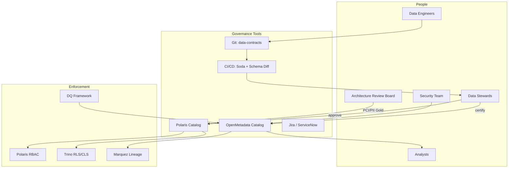

---

## 2. Governance Framework

### 2.1 DAMA-DMBOK Governance Areas

| DAMA Area | Lakehouse Implementation | Primary Tool |
|-----------|-------------------------|--------------|
| Data Governance | Stewardship model, policies, ARB gates | OpenMetadata + Jira |
| Data Architecture | Medallion layers, naming standards | This blueprint |
| Metadata Management | Technical + business metadata | Polaris + OpenMetadata |
| Data Quality | DQ framework, quarantine | GE + Flink (see `07-data-quality.md`) |
| Data Security | Classification, PII, access | Polaris + Trino (see `09-security.md`) |
| Reference & Master Data | Silver reference tables, MDM light | Silver layer |
| Data Integration | CDC pipelines, lineage | Flink + OpenLineage |
| Documents & Content | Document metadata in Silver | Blob + `document_metadata` |

### 2.2 Governance Operating Model

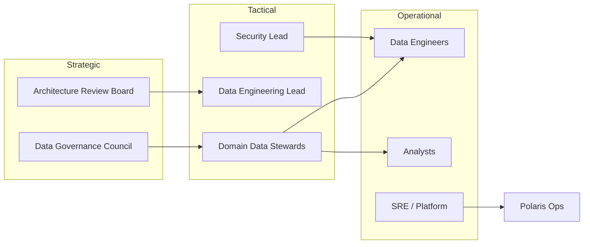

### 2.3 Policy Register

| Policy ID | Title: | Enforcement |
|-----------|------------|-------------|
| POL-GV-001 | All production datasets MUST be registered in OpenMetadata | CI gate |
| POL-GV-002 | Gold marts MUST be certified before Superset publish | Certification workflow |
| POL-GV-003 | PII columns MUST be tagged and masked in Trino | CLS policies |
| POL-GV-004 | PCI data MUST NOT appear in clear text outside PCI namespace | Namespace isolation |
| POL-GV-005 | Schema changes MUST go through data contract PR | CI + steward approval |
| POL-GV-006 | All Flink/Trino jobs MUST emit OpenLineage events | Pipeline CI check |
| POL-GV-007 | Dataset retention MUST be registered in `audit.retention_registry` | Lifecycle job |
| POL-GV-008 | Deprecated datasets MUST follow 90-day sunset period | Steward review |

---

## 3. Apache Polaris Catalog

### 3.1 Catalog Architecture

Apache Polaris is the **authoritative technical catalog** for all Iceberg tables. It provides REST API access for Flink, Trino, and maintenance jobs.

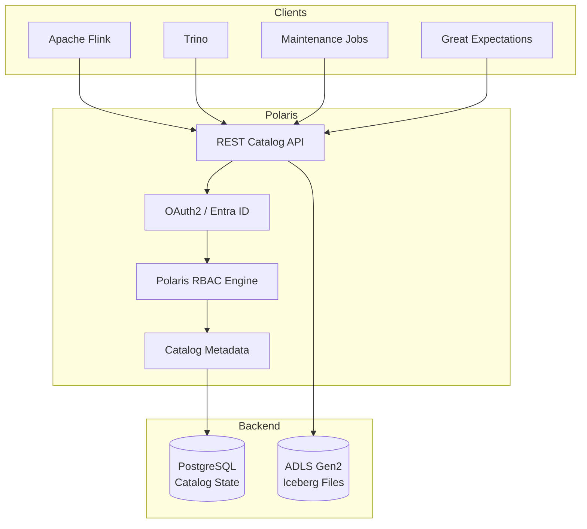

### 3.2 Production Configuration

| Attribute | Specification |
|-----------|---------------|
| Catalog name | `lakehouse` |
| Deployment | AKS, 2 replicas, HPA on CPU |
| Backend DB | Azure PostgreSQL Flexible Server (zone redundant) |
| Authentication | OAuth2 via Entra ID |
| Authorization | Polaris native RBAC |
| REST endpoint | `https://polaris.internal.company.com/api/catalog` |
| Warehouse | `abfss://lakehouse@stlakehotprod/` |
| Backup | PostgreSQL daily backup, 35-day retention |
| DR | Point-in-time restore; documented runbook |

### 3.3 Namespace Hierarchy

```
Catalog: lakehouse
│
├── bronze_merchant/
├── bronze_transaction/
├── bronze_settlement/
├── bronze_document/
│
├── silver_merchant/
├── silver_transaction/
├── silver_settlement/
├── silver_document/
├── silver_reference/
│
├── gold_merchant/
├── gold_transaction/
├── gold_settlement/
├── gold_revenue/
├── gold_risk/
├── gold_ops/
├── gold_exec/
│
├── dq/
├── audit/
│
└── pci/                    # Isolated PCI namespace (restricted)
    ├── silver_transaction/
    └── gold_risk/
```

### 3.4 Polaris RBAC Model

| Polaris Role | Permissions | Mapped Entra Group |
|--------------|-------------|-------------------|
| `catalog_admin` | Full catalog management | `grp-polaris-admin` |
| `namespace_admin` | Manage tables in assigned namespaces | `grp-engineer-data` |
| `table_reader` | SELECT on assigned namespaces | `grp-analyst-*` |
| `table_writer` | INSERT/UPDATE via service accounts | `grp-svc-flink`, `grp-svc-trino` |
| `pci_reader` | Read PCI namespace only | `grp-pci-analyst` |

**Privilege mapping example:**

```json
{
  "role": "table_reader",
  "namespace": "gold_merchant",
  "privileges": ["TABLE_READ", "VIEW_READ"]
}
```

### 3.5 Polaris ↔ Iceberg Integration

| Operation | Polaris Role | Iceberg Feature |
|-----------|-------------|-----------------|
| Create table | Register metadata in Polaris | Create metadata.json |
| Schema evolution | ALTER TABLE via REST | Iceberg schema update |
| Snapshot management | Expose snapshots via API | Iceberg snapshots |
| Branch/tag | REST branch operations | Iceberg branches/tags |
| Access control | Polaris RBAC check before commit | — |

### 3.6 Catalog Sync to OpenMetadata

| Sync Direction | Frequency | Mechanism |
|----------------|-----------|-----------|
| Polaris → OpenMetadata | Every 15 min | OpenMetadata ingestion connector |
| Data contracts → OpenMetadata | On PR merge | CI webhook |
| GE results → OpenMetadata | After checkpoint | GE action callback |
| Manual glossary edits | Real-time | OpenMetadata UI |

---

## 4. Metadata Architecture

### 4.1 Metadata Types

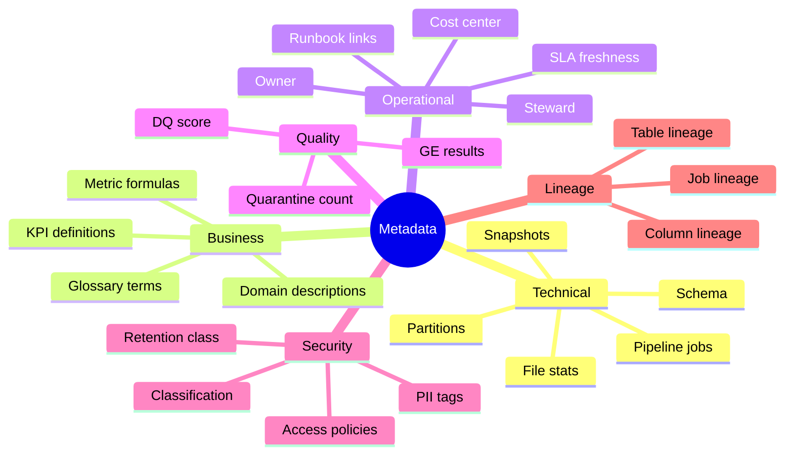

### 4.2 System of Record Matrix

| Metadata Type | System of Record | Consumer UI |
|---------------|------------------|-------------|
| Table schema, partitions | Polaris + Iceberg | OpenMetadata |
| Business glossary | OpenMetadata | OpenMetadata |
| KPI definitions | OpenMetadata | OpenMetadata + Superset |
| Ownership, stewardship | OpenMetadata | OpenMetadata |
| Classification, PII tags | OpenMetadata | OpenMetadata + Trino CLS |
| DQ scores | `dq.dq_score_history` | OpenMetadata + Grafana |
| Lineage graph | Marquez | OpenMetadata (lineage view) |
| Access policies | Entra ID + Polaris | Security admin |
| Retention policy | `audit.retention_registry` | OpenMetadata |
| Data contracts | Git (`data-contracts`) | CI + OpenMetadata |

### 4.3 OpenMetadata Deployment

| Component | Specification |
|-----------|-------------|
| Version | 1.4+ |
| Deployment | AKS, 2 replicas |
| Backend DB | PostgreSQL (shared or dedicated) |
| Authentication | Entra ID SSO |
| Ingestion | Polaris, Trino, Superset, GE connectors |
| Lineage | Marquez integration |

### 4.4 Metadata Flow

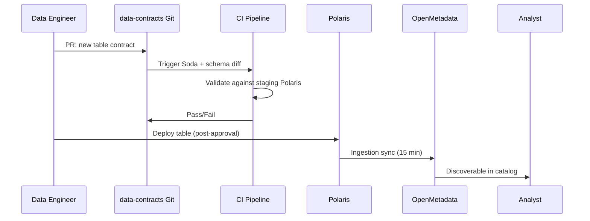

---

## 5. Business Metadata

### 5.1 Business Glossary Structure

| Glossary Domain | Terms (examples) | Owner |
|-----------------|------------------|-------|
| **Merchant** | Merchant, KYC Status, MCC, Onboarding | Merchant Operations |
| **Transaction** | Transaction, Authorization, Decline Rate | Payments Product |
| **Settlement** | Settlement Batch, Net Settlement, Reconciliation | Finance |
| **Revenue** | Processing Fee, Interchange, Effective Rate | Finance |
| **Risk** | Fraud Score, Velocity, Chargeback Rate | Fraud Team |
| **Compliance** | PII, PCI, Retention Period, Data Subject | Compliance |

### 5.2 Sample Glossary Entries

| Term | Definition | Formula / Source | Related Tables |
|------|------------|------------------|----------------|
| **Net Settlement** | Amount paid to merchant after fees | `gross_amount - fee_amount` | `gold_settlement.settlement_summary` |
| **Decline Rate** | % of authorizations declined | `decline_count / auth_count` | `gold_merchant.merchant_daily_summary` |
| **Active Merchant** | Merchant with ≥1 completed txn in period | `txn_count > 0` | `gold_merchant.merchant_daily_summary` |
| **KYC Compliance** | All required docs uploaded and approved | `is_compliant = true` | `gold_merchant.document_compliance_summary` |
| **Transaction Volume** | Total USD value of completed transactions | `SUM(txn_amount_usd)` | `gold_exec.kpi_daily` |

### 5.3 KPI Registry

Each Gold mart metric MUST link to a glossary term in OpenMetadata:

```yaml
# data-contracts/glossary/kpi_daily.yaml
terms:
  - name: total_transaction_volume_usd
    display_name: Total Transaction Volume (USD)
    definition: Sum of completed transaction amounts in USD for the reporting date
    domain: revenue
    source_table: gold_exec.kpi_daily
    source_column: metric_value
    filter: metric_name = 'total_transaction_volume_usd'
    owner: finance-controller@company.com
    refresh: daily_06:00_utc
    certification_status: certified
```

### 5.4 Business Metadata on Datasets

Every registered dataset in OpenMetadata carries:

| Field | Required | Example |
|-------|----------|---------|
| `displayName` | ✅ | Merchant Daily Summary |
| `description` | ✅ | Daily rollup of merchant transaction metrics |
| `domain` | ✅ | Merchant |
| `owner` | ✅ | merchant-analytics@company.com |
| `dataSteward` | ✅ | merchant-ops-lead@company.com |
| `tier` | ✅ | Tier 1 (Gold certified) |
| `retentionPolicy` | ✅ | 5 years tiered |
| `classification` | ✅ | CONFIDENTIAL |
| `tags` | ✅ | `[gold, certified, merchant]` |
| `glossaryTerms` | Gold only | Linked KPI terms |

---

## 6. Technical Metadata

### 6.1 Technical Metadata Catalog

| Attribute | Source | Sync Frequency |
|-----------|--------|----------------|
| Table name, namespace | Polaris | 15 min |
| Column name, type, nullable | Polaris / Iceberg schema | 15 min |
| Partition spec | Iceberg table metadata | 15 min |
| Table properties | Iceberg (`write.format.default`, etc.) | 15 min |
| Snapshot list | Iceberg | Hourly |
| File count, total size | Iceberg snapshots | Daily |
| Row count (estimate) | Trino `ANALYZE` / Iceberg stats | Daily |
| Last modified | Iceberg snapshot timestamp | 15 min |
| Format version | Iceberg | 15 min |
| Pipeline job name | Flink OpenLineage | Per run |
| Freshness (`last_updated_ts`) | Gold table column / Prometheus | 5 min |

### 6.2 Iceberg Table Properties (Standard)

All production tables MUST set these Iceberg properties (surfaced in OpenMetadata):

| Property | Bronze | Silver | Gold |
|----------|--------|--------|------|
| `format-version` | `2` | `2` | `2` |
| `write.format.default` | `parquet` | `parquet` | `parquet` |
| `write.parquet.compression-codec` | `zstd` | `zstd` | `zstd` |
| `owner` | data-eng@company.com | steward@company.com | product-owner@company.com |
| `classification` | INTERNAL | CONFIDENTIAL/PII | CONFIDENTIAL |
| `domain` | {domain} | {domain} | {domain} |
| `contract_version` | — | SemVer | SemVer |

### 6.3 Technical Metadata — Pipeline Jobs

| Job Metadata | Stored In | Example |
|--------------|-----------|---------|
| Job name | OpenLineage / Marquez | `flink-silver-transaction-transactions-prod` |
| Source tables | OpenLineage inputs | `bronze_transaction.transactions_cdc` |
| Target tables | OpenLineage outputs | `silver_transaction.transactions` |
| Last run status | Marquez + Flink REST | `COMPLETE` |
| Last run duration | Marquez | `4m 32s` |
| Checkpoint ID | Flink metrics | `chk-12847` |

---

## 7. Ownership Model

### 7.1 RACI — Dataset Ownership

| Activity | Data Owner | Data Steward | Data Engineer | Security | Analyst |
|----------|-----------|--------------|---------------|----------|---------|
| Define business requirements | **A** | **R** | C | I | C |
| Author data contract | C | C | **R** | I | I |
| Approve schema changes | I | **A** | R | C | I |
| Build pipeline | I | C | **R/A** | I | I |
| Certify Gold mart | C | **A** | R | C | C |
| Define access policy | I | C | I | **A** | I |
| Consume in Superset | I | I | I | I | **R** |
| Deprecate dataset | C | **A** | R | C | I |

*R = Responsible, A = Accountable, C = Consulted, I = Informed*

### 7.2 Ownership Register

| Domain | Data Owner | Data Steward | Backup Steward |
|--------|-----------|--------------|----------------|
| merchant | VP Merchant Operations | Merchant Ops Lead | Data Eng Lead |
| transaction | VP Payments Product | Payments Product Owner | Fraud Team Lead |
| settlement | CFO / Finance Controller | Finance Controller | Data Eng Lead |
| document | Chief Compliance Officer | Compliance Officer | Merchant Ops Lead |
| risk | VP Risk | Fraud Team Lead | Security Lead |
| exec | Chief of Staff | Chief of Staff | Analytics Lead |
| reference | Data Engineering Lead | Data Eng Lead | Platform Lead |

### 7.3 Service Account Ownership

| Service Account | Purpose | Namespace Access |
|-----------------|---------|------------------|
| `svc-flink-prod` | Flink pipeline writes | bronze_*, silver_*, gold_*, dq |
| `svc-trino-prod` | Trino maintenance, GE | All (read); audit (write) |
| `svc-ge-prod` | Great Expectations batch | All (read) |
| `svc-superset-prod` | Superset queries | gold_* (read) |
| `svc-lineage-prod` | OpenLineage emitter | Marquez (write) |

---

## 8. Classification and Tagging

### 8.1 Classification Levels

| Level | Code | Description | Access | Encryption | Masking |
|-------|------|-------------|--------|------------|---------|
| Public | `PUBLIC` | Non-sensitive aggregated data | All employees | Standard | None |
| Internal | `INTERNAL` | Internal business data | All employees | Standard | None |
| Confidential | `CONFIDENTIAL` | Sensitive business data | Need-to-know RBAC | SSE-KMS | Optional |
| PII | `PII` | Personal identifiable information | Restricted RBAC | SSE-KMS + CMK | Required |
| PCI | `PCI` | Cardholder data environment | PCI group only | SSE-KMS + PCI CMK | Required; tokenized at source |

### 8.2 Tag Taxonomy

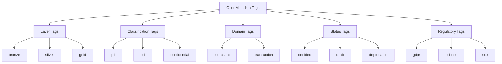

### 8.3 Classification by Layer (Default)

| Layer | Default Classification | Override Process |
|-------|----------------------|------------------|
| Bronze | INTERNAL | Steward approval for PII tagging |
| Silver (merchant) | PII | Cannot downgrade |
| Silver (transaction) | CONFIDENTIAL | ARB for PCI columns |
| Gold | CONFIDENTIAL | Aggregated; PII excluded by default |
| Gold (exec) | INTERNAL | Pre-aggregated KPIs |
| PCI namespace | PCI | ARB mandatory |

### 8.4 Tagging Workflow

| Step | Action | Owner |
|------|--------|-------|
| 1 | Auto-tag layer and domain on table creation | CI pipeline |
| 2 | Steward assigns classification in contract YAML | Data Steward |
| 3 | Security reviews PII/PCI tags on new Silver tables | Security |
| 4 | Tags synced to OpenMetadata on deploy | Ingestion job |
| 5 | Trino CLS policies auto-applied based on tags | Platform (see `09-security.md`) |
| 6 | Quarterly tag recertification | Data Governance Council |

---

## 9. PII and Sensitive Column Management

### 9.1 PII Column Register

| Table | Column | PII Category | Masking Rule | Gold Allowed |
|-------|--------|--------------|--------------|--------------|
| `silver_merchant.merchants` | `legal_name` | Identity | Partial mask in non-prod | Aggregated only |
| `silver_merchant.merchants` | `tax_id` | Financial identity | `mask_full` | ❌ Never |
| `silver_merchant.merchants` | `contact_email` | Contact | `mask_email` | ❌ Never |
| `silver_merchant.merchants` | `contact_phone` | Contact | `mask_phone_last4` | ❌ Never |
| `silver_merchant.merchant_addresses` | `address_line1` | Location | `mask_full` | ❌ Never |
| `silver_transaction.transactions` | `card_last4` | PCI adjacent | Show last 4 only | ❌ Never |
| `silver_document.document_metadata` | `blob_path` | Internal | No mask | Path metadata only |

### 9.2 PCI Column Policy

| Rule | Specification |
|------|---------------|
| PAN storage | NEVER in lakehouse clear text; tokenized at source |
| PCI namespace | `pci.silver_*`, `pci.gold_*` — separate Polaris namespace |
| Access | `grp-pci-analyst` only; annual access review |
| Logging | All PCI namespace queries logged to SIEM |
| Masking | All columns masked except aggregated counts |
| ARB gate | Any new PCI table requires ARB approval |

### 9.3 Column Tagging in OpenMetadata

```yaml
# data-contracts/schemas/silver_merchant/merchants.yaml (column tags)
columns:
  - name: tax_id
    tags: [pii, financial-identity, gdpr]
    masking: mask_full
  - name: contact_email
    tags: [pii, contact, gdpr]
    masking: mask_email
  - name: legal_name
    tags: [pii, identity]
    masking: mask_partial
  - name: merchant_id
    tags: [business-key]
    masking: none
```

### 9.4 Masked Views

Silver PII tables MUST expose masked views for analyst access:

```sql
CREATE OR REPLACE VIEW lakehouse.silver_merchant.merchants_masked AS
SELECT
    merchant_id,
    CONCAT(SUBSTR(legal_name, 1, 3), '***')     AS legal_name,
    status,
    kyc_status,
    industry_mcc,
    merchant_region,
    country_code,
    onboarding_date,
    mask_email(contact_email)                  AS contact_email,
    mask_phone_last4(contact_phone)            AS contact_phone,
    valid_from,
    valid_to,
    is_current,
    is_deleted,
    dq_status
FROM lakehouse.silver_merchant.merchants
WHERE is_current = true;
```

---

## 10. Versioning and Change Management

### 10.1 Version Types

| Version Type | Format | Applies To | Bump Trigger |
|--------------|--------|------------|--------------|
| Data contract | SemVer `MAJOR.MINOR.PATCH` | Schema YAML | Breaking/minor/patch change |
| Gold mart | `_gold_version` column | Gold tables | Metric or grain change |
| Iceberg schema | Iceberg schema ID (internal) | All tables | ALTER TABLE |
| Pipeline | Git tag on Flink JAR | Flink jobs | Logic change |
| Glossary term | `version` field | Business terms | Definition change |

### 10.2 SemVer Rules for Data Contracts

| Change | Version Bump | Example |
|--------|-------------|---------|
| Add nullable column | MINOR | 1.0 → 1.1 |
| Add required column | MAJOR | 1.1 → 2.0 |
| Drop column | MAJOR | 2.0 → 3.0 |
| Rename column | MAJOR | — |
| Change column type | MAJOR | — |
| Change partition spec | MAJOR | — |
| Update description only | PATCH | 1.1.0 → 1.1.1 |
| Add DQ rule (non-breaking) | PATCH | — |

### 10.3 Schema Change Workflow

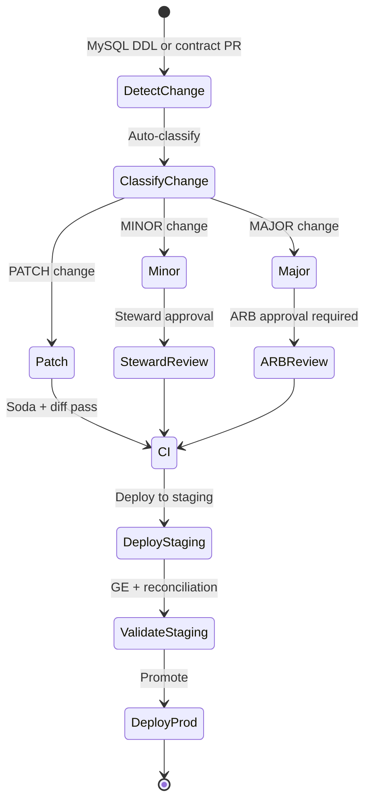

### 10.4 Change Log

All schema changes logged to `audit.schema_change_log`:

| Column | Description |
|--------|-------------|
| `change_id` | UUID |
| `table_fqn` | Fully qualified table |
| `contract_version_from` | Previous SemVer |
| `contract_version_to` | New SemVer |
| `change_type` | ADD_COLUMN, DROP_COLUMN, etc. |
| `ddl_statement` | Source DDL if from MySQL |
| `approved_by` | Steward or ARB ticket |
| `deployed_ts` | Production deploy timestamp |

---

## 11. Dataset Lifecycle

### 11.1 Lifecycle States

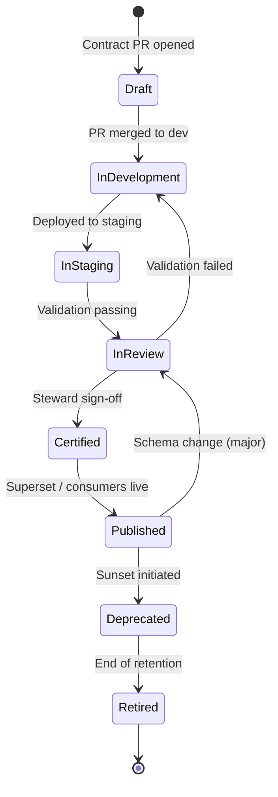

### 11.2 Lifecycle State Definitions

| State | Description | Consumer Access | CI/CD |
|-------|-------------|-----------------|-------|
| **Draft** | Contract in PR; not deployed | None | PR checks only |
| **InDevelopment** | Deployed to dev catalog | Engineers only | Auto on merge |
| **InStaging** | Deployed to staging | Engineers + stewards | Promotion gate |
| **InReview** | Validation in progress | Stewards | GE must pass |
| **Certified** | Steward approved | Engineers; pre-prod Superset | Ready for prod |
| **Published** | Production live | All authorized consumers | Prod deploy |
| **Deprecated** | Sunset announced | Read-only; warning banners | No new consumers |
| **Retired** | Archived or deleted | None | Table dropped/archived |

### 11.3 Retention Integration

Dataset lifecycle ties to `audit.retention_registry` (see `10-storage-retention.md`):

| Lifecycle Event | Retention Action |
|-----------------|------------------|
| Published | Apply hot tier policy |
| Deprecated | Stop new writes; maintain read |
| Retired | Execute archive migration; expire snapshots |
| 5-year mark | Cool tier (automated) |
| >5-year mark | Archive tier (automated) |

### 11.4 Deprecation Process

| Step | Action | Duration |
|------|--------|----------|
| 1 | Steward initiates deprecation ticket | — |
| 2 | Notify all consumers (Slack + email) | Day 0 |
| 3 | Mark dataset `deprecated` in OpenMetadata | Day 0 |
| 4 | Superset banner: "Dataset retiring on {date}" | Day 0 |
| 5 | Migration guide published for replacement dataset | Within 7 days |
| 6 | Read-only period | 90 days |
| 7 | Remove Superset datasets | After 90 days |
| 8 | Archive Iceberg table; update retention registry | After 90 days |

---

## 12. Approval Workflow

### 12.1 Approval Types

| Approval Type | Trigger | Approver | SLA |
|---------------|---------|----------|-----|
| Schema change (minor) | Contract PR | Data Steward | 2 business days |
| Schema change (major) | Contract PR | ARB | 1 week |
| Gold mart certification | Pre-publish checklist | Data Steward + Analytics Lead | 3 business days |
| PII column addition | Contract PR | Security + Steward | 3 business days |
| PCI namespace table | New table in `pci.*` | ARB + CISO delegate | 2 weeks |
| Access request | ServiceNow ticket | Data Owner + Security | 2 business days |
| Deprecation | Steward ticket | Data Owner | 1 week notice |

### 12.2 Gold Certification Workflow

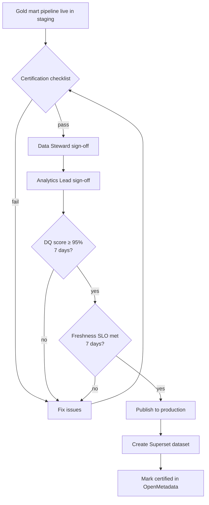

### 12.3 Data Contract PR Checklist

| # | Check | Automated |
|---|-------|-----------|
| 1 | Soda scan passes on staging | ✅ CI |
| 2 | Schema diff reviewed | ✅ CI |
| 3 | SemVer bump correct | ✅ CI |
| 4 | Classification tags present | ✅ CI |
| 5 | PII columns tagged | ✅ CI |
| 6 | Owner and steward assigned | ✅ CI |
| 7 | DQ rules updated | Manual |
| 8 | Steward approval (CODEOWNERS) | ✅ GitHub |
| 9 | ARB ticket linked (if major/PCI) | Manual |
| 10 | OpenMetadata description updated | Manual |

### 12.4 Git Repository Structure

```
data-contracts/
├── README.md
├── CODEOWNERS                    # Steward review required
├── schemas/
│   ├── silver_merchant/
│   ├── silver_transaction/
│   ├── gold_merchant/
│   └── gold_exec/
├── dq-rules/
│   ├── merchant/
│   └── transaction/
├── glossary/
│   ├── merchant.yaml
│   ├── revenue.yaml
│   └── kpi_daily.yaml
└── .github/
    └── workflows/
        ├── contract-ci.yml       # Soda + schema diff
        └── deploy-staging.yml
```

---

# PART 9 — DATA LINEAGE

## 13. Lineage Architecture

### 13.1 Purpose

Data lineage provides **end-to-end traceability** from business source systems through every transformation to the dashboard metrics consumed by analysts and executives. Lineage supports impact analysis, root cause investigation, regulatory audit, and GDPR data subject requests.

### 13.2 Lineage Platform Stack

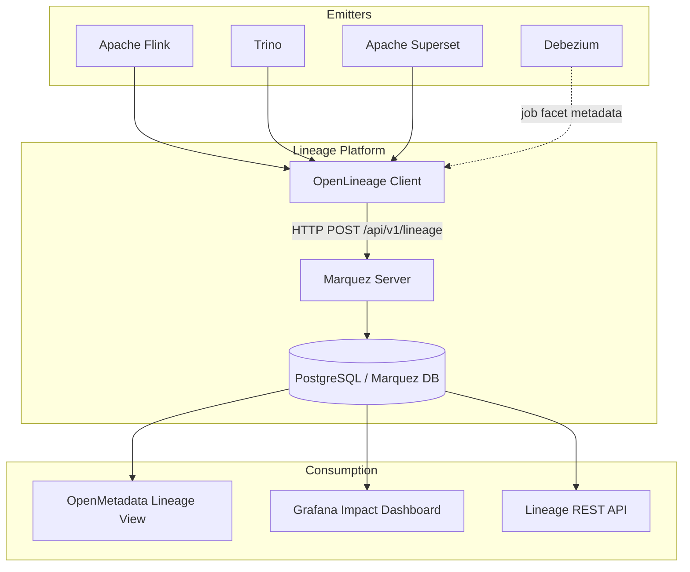

### 13.3 Lineage Metadata Standards

| Standard | Version | Usage |
|----------|---------|-------|
| OpenLineage | 1.x | Event format for all emitters |
| Marquez | 0.50+ | Lineage storage and API |
| OpenMetadata | 1.4+ | Lineage visualization |

---

## 14. End-to-End Lineage Chain

### 14.1 Complete Lineage — Transaction Domain

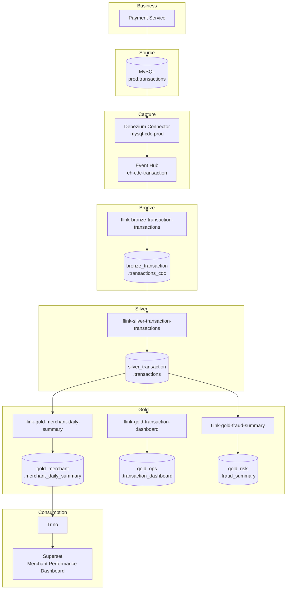

### 14.2 Lineage Node Register

| Node ID | Type | Name | OpenLineage Namespace |
|---------|------|------|----------------------|
| LN-001 | Source | MySQL `prod.transactions` | `mysql://prod` |
| LN-002 | Job | Debezium CDC | `debezium://mysql-cdc-prod` |
| LN-003 | Dataset | Event Hub topic | `eventhub://eh-cdc-transaction` |
| LN-004 | Job | Flink Bronze | `flink://flink-bronze-transaction-transactions` |
| LN-005 | Dataset | Bronze table | `iceberg://lakehouse.bronze_transaction.transactions_cdc` |
| LN-006 | Job | Flink Silver | `flink://flink-silver-transaction-transactions` |
| LN-007 | Dataset | Silver table | `iceberg://lakehouse.silver_transaction.transactions` |
| LN-008 | Job | Flink Gold | `flink://flink-gold-merchant-daily-summary` |
| LN-009 | Dataset | Gold mart | `iceberg://lakehouse.gold_merchant.merchant_daily_summary` |
| LN-010 | Job | Trino query | `trino://adhoc-{query_id}` |
| LN-011 | Dataset | Superset dataset | `superset://dataset/merchant_performance` |

### 14.3 Cross-Domain Lineage Map

| Source Entity | Bronze | Silver | Gold Marts |
|---------------|--------|--------|------------|
| MySQL `merchants` | `merchants_cdc` | `merchants` | `merchant_daily_summary`, `merchant_analytics`, `fraud_summary`, `document_compliance_summary` |
| MySQL `transactions` | `transactions_cdc` | `transactions` | `merchant_daily_summary`, `transaction_dashboard`, `fraud_summary`, `kpi_daily` |
| MySQL `settlements` | `settlements_cdc` | `settlements` | `settlement_summary`, `revenue_analytics`, `kpi_daily` |
| Blob documents | `document_events` | `document_metadata` | `document_compliance_summary` |

---

## 15. OpenLineage Integration

### 15.1 OpenLineage Event Structure

All emitters produce events conforming to OpenLineage 1.x:

```json
{
  "eventType": "COMPLETE",
  "eventTime": "2026-07-02T10:30:00.000Z",
  "run": {
    "runId": "550e8400-e29b-41d4-a716-446655440000",
    "facets": {
      "processing_engine": {
        "version": "1.18.0",
        "name": "flink",
        "openlineageAdapterVersion": "1.2.0"
      },
      "environment": {
        "environment": "prod"
      }
    }
  },
  "job": {
    "namespace": "flink://data-platform",
    "name": "flink-silver-transaction-transactions-prod",
    "facets": {
      "documentation": {
        "description": "Silver conformation for transactions"
      },
      "sourceCodeLocation": {
        "type": "git",
        "url": "https://github.com/company/data-platform/tree/main/flink/silver/transaction"
      }
    }
  },
  "inputs": [
    {
      "namespace": "iceberg://lakehouse",
      "name": "bronze_transaction.transactions_cdc",
      "facets": {
        "schema": { "fields": ["transaction_id", "payload_after", "op", "..."] }
      }
    }
  ],
  "outputs": [
    {
      "namespace": "iceberg://lakehouse",
      "name": "silver_transaction.transactions",
      "facets": {
        "schema": { "fields": ["transaction_id", "merchant_id", "amount_minor", "..."] },
        "outputStatistics": {
          "rowCount": 1250000,
          "size": 524288000
        }
      }
    },
    {
      "namespace": "iceberg://lakehouse",
      "name": "dq.quarantine_transaction",
      "facets": {
        "outputStatistics": { "rowCount": 342 }
      }
    }
  ],
  "producer": "https://github.com/OpenLineage/OpenLineage/tree/main/integration/flink"
}
```

### 15.2 Marquez Deployment

| Component | Specification |
|-----------|---------------|
| Version | 0.50+ |
| Deployment | AKS, 2 replicas |
| Backend DB | PostgreSQL |
| API endpoint | `https://marquez.internal.company.com/api/v1` |
| Retention | Lineage events retained 2 years |
| Auth | API key (Key Vault) for emitters; SSO for UI |

### 15.3 Emitter Configuration

| Emitter | Integration | Config |
|---------|-------------|--------|
| **Flink** | `openlineage-flink` | `execution.job-status-changed.enabled=true` |
| **Trino** | `trino-openlineage` event listener | `event-listener.name=openlineage` |
| **Superset** | OpenLineage Superset plugin | Dataset creation/update events |
| **Debezium** | Custom facet on connector | Source table metadata |

**Flink OpenLineage config:**

```yaml
# flink-conf.yaml (excerpt)
execution.job-status-changed.enabled: true
execution.job-status-changed.listener.openlineage.class: io.openlineage.flink.OpenLineageFlinkJobListener
execution.job-status-changed.listener.openlineage.transport.type: http
execution.job-status-changed.listener.openlineage.transport.url: https://marquez.internal.company.com/api/v1/namespaces/flink%3A%2F%2Fdata-platform
execution.job-status-changed.listener.openlineage.transport.endpoint: /lineage
execution.job-status-changed.listener.openlineage.transport.auth.type: api_key
execution.job-status-changed.listener.openlineage.transport.auth.apiKey: ${MARQUEZ_API_KEY}
```

**Trino OpenLineage config:**

```properties
# etc/event-listener.properties
event-listener.name=openlineage
openlineage.namespace=trino://lakehouse-prod
openlineage.url=https://marquez.internal.company.com/api/v1/lineage
openlineage.api-key=${ENV:MARQUEZ_API_KEY}
```

---

## 16. Lineage by Component

### 16.1 MySQL → Debezium

| Lineage Aspect | Detail |
|----------------|--------|
| Job | `debezium://mysql-cdc-prod` |
| Input | `mysql://prod.{table}` |
| Output | `eventhub://eh-cdc-{domain}` |
| Facets | `schemaDataset`, binlog position |
| Frequency | Continuous |

Debezium emits job metadata via Kafka Connect metrics; custom exporter maps connector name to OpenLineage job.

### 16.2 Event Hub → Flink Bronze

| Lineage Aspect | Detail |
|----------------|--------|
| Job | `flink://flink-bronze-{domain}-{table}` |
| Input | `eventhub://eh-cdc-{domain}` |
| Output | `iceberg://lakehouse.bronze_{domain}.{table}_cdc` |
| Facets | `processing_engine`, row counts, schema |
| Run events | START, COMPLETE, FAIL |

### 16.3 Flink Silver → Gold

| Lineage Aspect | Detail |
|----------------|--------|
| Job | `flink://flink-gold-{mart}` |
| Input | One or more Silver tables + reference tables |
| Output | Gold mart + optional quarantine |
| Facets | `columnLineage` (see §17), `outputStatistics` |

### 16.4 Trino → Superset

| Lineage Aspect | Detail |
|----------------|--------|
| Job | `trino://query/{query_id}` (adhoc) or named scheduled query |
| Input | Gold table(s) |
| Output | Superset dataset (virtual) or exported file |
| Facets | SQL query text (hashed for sensitive), column lineage from parser |

### 16.5 Lineage Coverage Requirements

| Component | Lineage Required | Phase |
|-----------|-----------------|-------|
| All Flink jobs (Bronze/Silver/Gold) | ✅ Mandatory | Phase 3 |
| Trino scheduled queries | ✅ Mandatory | Phase 4 |
| Trino adhoc queries | ✅ Best effort | Phase 4 |
| Superset datasets | ✅ Mandatory | Phase 3 |
| Debezium connectors | ✅ Job metadata | Phase 3 |
| GE checkpoints | Optional (job facet) | Phase 4 |
| Manual CSV exports | Manual registration | Phase 4 |

---

## 17. Column-Level Lineage

### 17.1 Column Lineage — Transaction Example

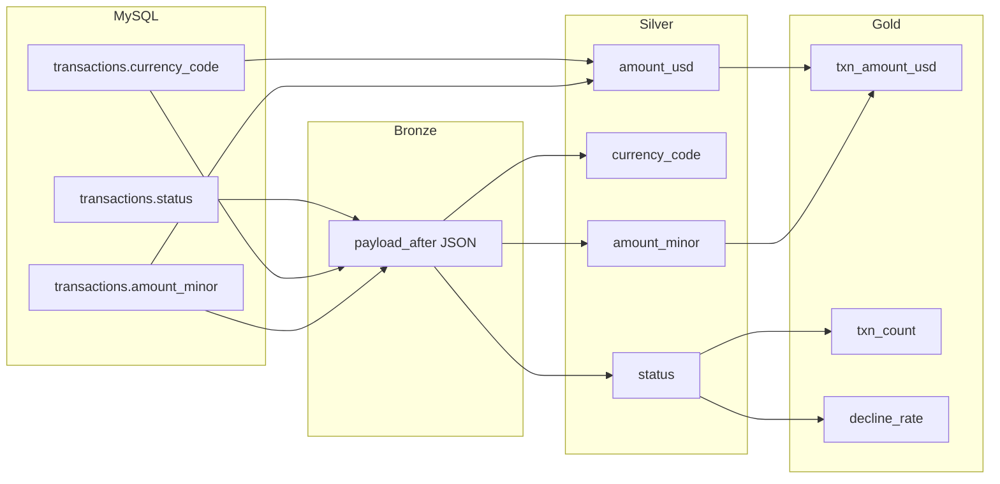

### 17.2 Column Lineage Facet

```json
{
  "columnLineage": {
    "fields": {
      "txn_amount_usd": {
        "inputFields": [
          {
            "namespace": "iceberg://lakehouse",
            "name": "silver_transaction.transactions",
            "field": "amount_usd"
          }
        ],
        "transformationDescription": "SUM(amount_usd) WHERE status = COMPLETED",
        "transformationType": "AGGREGATION"
      },
      "decline_rate": {
        "inputFields": [
          {
            "namespace": "iceberg://lakehouse",
            "name": "silver_transaction.transactions",
            "field": "status"
          }
        ],
        "transformationDescription": "COUNT(status=DECLINED) / COUNT(auth statuses)",
        "transformationType": "AGGREGATION"
      }
    }
  }
}
```

### 17.3 Column Lineage by Gold Mart

| Gold Column | Silver Source Column(s) | Transformation |
|-------------|------------------------|----------------|
| `merchant_daily_summary.txn_count` | `transactions.status` | COUNT WHERE COMPLETED |
| `merchant_daily_summary.txn_amount_usd` | `transactions.amount_usd` | SUM WHERE COMPLETED |
| `merchant_daily_summary.decline_rate` | `transactions.status` | decline / auth ratio |
| `merchant_daily_summary.merchant_status` | `merchants.status` | JOIN current merchant |
| `settlement_summary.net_amount_usd` | `settlements.net_amount`, FX | Convert to USD |
| `kpi_daily.metric_value` | Multiple Gold marts | Aggregated per KPI definition |
| `fraud_summary.velocity_txn_count_1h` | `transactions.event_ts` | Window COUNT 1 hour |

### 17.4 PII Column Lineage Tracking

PII columns MUST have lineage tagged with `pii` facet for GDPR erasure requests:

| PII Column | Lineage Path | Erasure Scope |
|------------|-------------|---------------|
| `merchants.contact_email` | MySQL → Bronze → Silver → (not Gold) | Silver + Bronze purge on request |
| `merchants.tax_id` | MySQL → Bronze → Silver → (not Gold) | Same |
| `merchants.legal_name` | MySQL → Bronze → Silver → aggregated in Gold | Silver purge; Gold retains aggregates |

**GDPR erasure procedure:** Trace lineage in Marquez → identify all datasets containing column → execute crypto-shred or partition delete per `09-security.md`.

---

## 18. Operational Lineage

### 18.1 Impact Analysis Use Cases

| Scenario | Lineage Query | Action |
|----------|---------------|--------|
| MySQL column dropped | Downstream datasets affected? | Alert engineers; halt pipelines |
| Silver schema change | Which Gold marts impacted? | Re-run Gold jobs |
| Gold mart deprecated | Which Superset dashboards affected? | Notify analysts |
| Debezium connector failure | Which tables stale? | Trace from MySQL to Gold freshness |
| GDPR erasure request | All locations of PII column? | Column lineage query |

### 18.2 Impact Analysis Example

**Question:** What is impacted if `silver_transaction.transactions.amount_usd` changes type?

```
Query Marquez API:
  GET /api/v1/lineage?nodeId=iceberg://lakehouse.silver_transaction.transactions&depth=5

Response (truncated):
  silver_transaction.transactions
    → gold_merchant.merchant_daily_summary (txn_amount_usd, avg_txn_amount_usd)
    → gold_ops.transaction_dashboard (txn_amount_usd)
    → gold_risk.fraud_summary (txn_amount_usd, velocity_amount_usd_1h)
    → gold_exec.kpi_daily (total_transaction_volume_usd)
    → Superset: Merchant Performance, Live Transactions, Fraud Monitor, Executive KPIs
```

### 18.3 Root Cause Analysis Flow

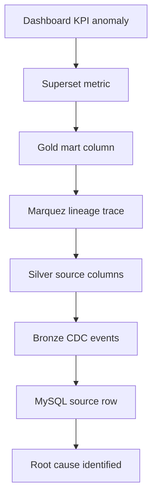

### 18.4 Lineage Quality Metrics

| Metric | Target | Measurement |
|--------|--------|-------------|
| Flink job lineage coverage | 100% | Jobs with COMPLETE events / total jobs |
| Gold mart lineage completeness | 100% | Marts with upstream lineage linked |
| Superset dataset lineage | 100% | Datasets with Gold source |
| Column lineage (Gold) | ≥ 80% columns | Column facets populated |
| Lineage freshness | < 5 min lag | Event time vs processing time |

### 18.5 Lineage Audit Report

Monthly lineage audit report (automated):

| Section | Content |
|---------|---------|
| Coverage summary | % jobs and datasets with lineage |
| New datasets | Lineage established within 24 hr? |
| Broken lineage | Gaps detected (missing RUN events) |
| Orphan datasets | Datasets with no upstream lineage |
| PII lineage | All PII columns traced to source |
| Dashboard mapping | Superset → Gold → Silver chain complete |

---

## 19. Design Decisions and Trade-offs

| ADR | Decision | Benefit | Tradeoff | Mitigation |
|-----|----------|---------|----------|------------|
| ADR-G08-001 | Polaris + OpenMetadata (dual catalog) | Best-of-breed for each role | Sync lag | 15-min ingestion |
| ADR-G08-002 | Git-based data contracts | Version control; CI gates | Non-technical user barrier | OpenMetadata UI for glossary |
| ADR-G08-003 | Marquez for lineage storage | Open standard | Additional infrastructure | HA deployment; 2-year retention |
| ADR-G08-004 | Certification before Superset publish | Trust in dashboards | Slower time-to-dashboard | P0/P1 prioritization |
| ADR-G08-005 | PII tagging in contracts YAML | Shift-left governance | Engineer responsibility | CI validation |
| ADR-G08-006 | Column lineage on Gold only (Phase 4) | Focused effort | Incomplete Silver lineage | Expand in Phase 5 |
| ADR-G08-007 | 90-day deprecation period | Consumer migration time | Prolonged maintenance | Clear comms template |
| ADR-G08-008 | PCI namespace isolation | Compliance | Duplicate pipeline patterns | Shared Silver; restricted Gold |

---

## 20. Production Recommendations

### 20.1 Phase 4 Implementation Checklist

| # | Item | Priority |
|---|------|----------|
| 1 | Deploy OpenMetadata with Entra ID SSO | P0 |
| 2 | Configure Polaris → OpenMetadata ingestion (15 min) | P0 |
| 3 | Create `data-contracts` Git repo with CODEOWNERS | P0 |
| 4 | Deploy Marquez with HA PostgreSQL backend | P0 |
| 5 | Enable OpenLineage on all Flink jobs | P0 |
| 6 | Enable OpenLineage Trino event listener | P1 |
| 7 | Enable Superset OpenLineage plugin | P1 |
| 8 | Populate business glossary (P0 terms) | P1 |
| 9 | Tag all Silver PII columns in contracts | P1 |
| 10 | Implement certification workflow in Jira | P1 |
| 11 | Configure column lineage facets on Gold jobs | P2 |
| 12 | Monthly lineage audit report automation | P2 |

### 20.2 Success Criteria

| Criterion | Target |
|-----------|--------|
| Datasets registered in OpenMetadata | 100% production tables |
| Gold marts certified | 100% before Superset publish |
| Flink lineage coverage | 100% jobs |
| PII columns tagged | 100% |
| Glossary terms for Gold KPIs | 100% P0 marts |
| Lineage trace (MySQL → Superset) | Demonstrated for 3 domains |

---

## Appendix A — OpenMetadata Entity Mapping

| Lakehouse Entity | OpenMetadata Entity Type |
|------------------|-------------------------|
| Polaris catalog | Database Service |
| Polaris namespace | Database / Schema |
| Iceberg table | Table |
| Trino view | Table (view) |
| Glossary term | Glossary Term |
| KPI definition | Metric |
| Flink job | Pipeline |
| Data Steward | User / Team |

---

## Appendix B — Marquez API Examples

```bash
# Get lineage for a Gold mart
curl -s "https://marquez.internal.company.com/api/v1/lineage?\
nodeId=iceberg://lakehouse.gold_merchant.merchant_daily_summary&depth=10"

# Get jobs for a namespace
curl -s "https://marquez.internal.company.com/api/v1/namespaces/flink://data-platform/jobs"

# Search datasets
curl -s "https://marquez.internal.company.com/api/v1/search?q=merchant_daily"
```

---

## Appendix C — Related Documents

| Document | Relationship |
|----------|-------------|
| `02-production-architecture.md` | Platform services overview |
| `07-data-quality.md` | DQ results in OpenMetadata |
| `09-security.md` | Classification enforcement, GDPR erasure |
| `10-storage-retention.md` | Retention registry integration |
| `13-runbook.md` | Catalog backup, lineage troubleshooting |

---

## Appendix D — Revision History

| Version | Date | Author | Changes |
|---------|------|--------|---------|
| 1.0.0 | 2026-07-02 | Data Platform Architecture | Initial metadata, governance, and lineage design |
