# Part 10 — Security Architecture

**Document ID:** DLH-ARB-2026-001-09  
**Version:** 1.0.0  
**Classification:** Internal — Confidential  
**Status:** Draft — For ARB Review

---

## Table of Contents

1. [Overview](#1-overview)
2. [Security Architecture](#2-security-architecture)
3. [Identity and Authentication](#3-identity-and-authentication)
4. [Role-Based Access Control (RBAC)](#4-role-based-access-control-rbac)
5. [Attribute-Based Access Control (ABAC)](#5-attribute-based-access-control-abac)
6. [Row-Level Security (RLS)](#6-row-level-security-rls)
7. [Column-Level Security (CLS) and Dynamic Masking](#7-column-level-security-cls-and-dynamic-masking)
8. [Encryption at Rest](#8-encryption-at-rest)
9. [Encryption in Transit](#9-encryption-in-transit)
10. [Key Management (KMS)](#10-key-management-kms)
11. [Key Rotation](#11-key-rotation)
12. [Secrets Management](#12-secrets-management)
13. [Data Classification Enforcement](#13-data-classification-enforcement)
14. [Network Security](#14-network-security)
15. [Audit and Monitoring](#15-audit-and-monitoring)
16. [GDPR Compliance](#16-gdpr-compliance)
17. [PCI DSS Compliance](#17-pci-dss-compliance)
18. [Design Decisions and Trade-offs](#18-design-decisions-and-trade-offs)
19. [Production Recommendations](#19-production-recommendations)

---

## 1. Overview

### 1.1 Purpose

This document defines the **production security architecture** for the enterprise Data Lakehouse platform on Microsoft Azure. It specifies identity, access control, encryption, key management, network isolation, and regulatory compliance controls (GDPR, PCI DSS) that protect data from unauthorized access, disclosure, and tampering.

Security is implemented as **defense in depth** — no single control is relied upon exclusively.

### 1.2 Scope

| In Scope | Out of Scope |
|----------|--------------|
| Lakehouse platform security (Flink, Trino, Iceberg, Polaris, Superset) | MySQL OLTP application security (App team) |
| Entra ID integration, RBAC, ABAC, RLS, CLS | Corporate endpoint security |
| Encryption at rest and in transit | Physical data center security |
| Key Vault, CMK, key rotation | Third-party vendor SOC audits |
| GDPR data subject rights (lakehouse) | Legal privacy policy authoring |
| PCI DSS for analytics environment | PCI Level 1 merchant certification process |

### 1.3 Security Principles

| ID | Principle | Implementation |
|----|-----------|----------------|
| SEC-01 | **Least privilege** | Minimum access required per role |
| SEC-02 | **Zero trust network** | Private Link; no public data plane endpoints |
| SEC-03 | **Encryption everywhere** | SSE-KMS at rest; TLS 1.2+ in transit |
| SEC-04 | **Classification-driven controls** | PII/PCI tags trigger masking and isolation |
| SEC-05 | **Separation of duties** | Engineers cannot self-approve access |
| SEC-06 | **Audit all access** | Query logs, catalog changes → SIEM |
| SEC-07 | **No clear-text PCI** | Tokenization at source; PCI namespace isolated |
| SEC-08 | **Secrets never in code** | Key Vault + AKS CSI driver |

### 1.4 Compliance Framework Mapping

| Framework | Applicable Controls | Primary Sections |
|-----------|--------------------|--------------------|
| **PCI DSS v4.0** | Req 3, 4, 7, 8, 10 | §4, §7, §8, §9, §17 |
| **GDPR** | Art. 5, 17, 25, 32 | §6, §7, §13, §16 |
| **SOC 2 Type II** | CC6, CC7 | §4, §15 |
| **ISO 27001** | A.9, A.10, A.12 | All sections |
| **Azure Well-Architected — Security** | Identity, data, network | All sections |

---

## 2. Security Architecture

### 2.1 Defense in Depth — Layer Model

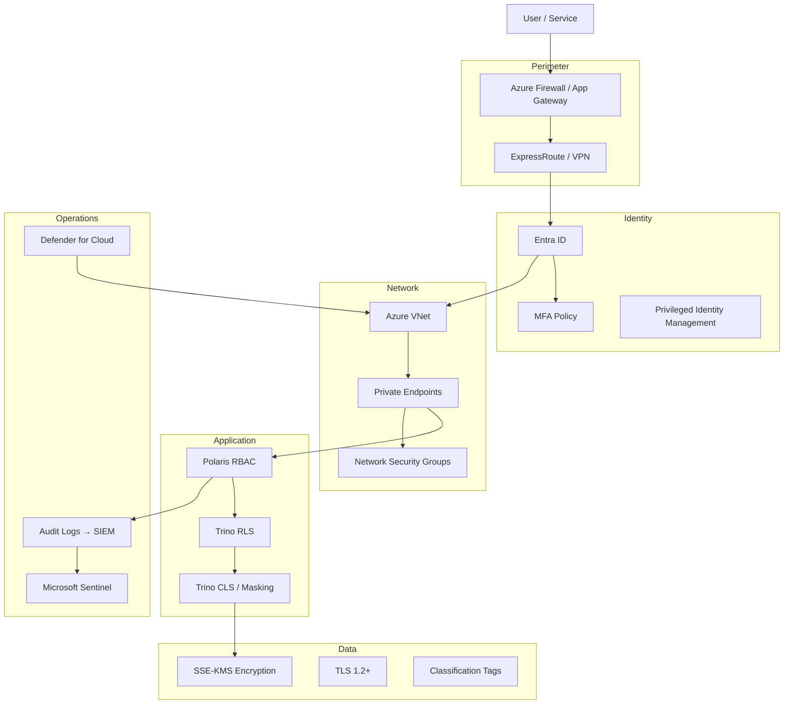

### 2.2 Security Control Matrix

| Layer | Control | Technology | Owner |
|-------|---------|------------|-------|
| Identity | Authentication | Entra ID OAuth2/OIDC | Security |
| Identity | MFA | Entra ID Conditional Access | Security |
| Identity | Service principals | Entra ID app registrations | Platform |
| Authorization | Catalog RBAC | Polaris RBAC | Platform |
| Authorization | Query RBAC | Trino system access control | Platform |
| Authorization | Row filters | Trino row-level security | Data Eng + Security |
| Authorization | Column masks | Trino column masks + UDF | Security |
| Network | Private connectivity | Azure Private Link | Platform |
| Network | Segmentation | VNet, NSG, subnets | Platform |
| Data | Encryption at rest | SSE-KMS (CMK) | Platform |
| Data | Encryption in transit | TLS 1.2+ | Platform |
| Data | Key management | Azure Key Vault | Security |
| Secrets | Secret storage | Key Vault + CSI driver | Platform |
| Monitoring | Audit logging | Trino audit, Azure Activity Log | SRE |
| Monitoring | SIEM | Microsoft Sentinel | Security |
| Compliance | Classification | OpenMetadata tags | Governance |

### 2.3 Trust Boundaries

```mermaid
flowchart LR
    subgraph Untrusted
        INTERNET[Internet]
    end

    subgraph DMZ
        AGW[Application Gateway<br/>Superset WAF]
    end

    subgraph Trusted — Corp Network
        ANALYST[Analysts via VPN/ExpressRoute]
    end

    subgraph Trusted — Data Platform VNet
        AKS[AKS Data Platform]
        PAAS[PaaS Private Endpoints]
    end

    subgraph Trusted — App VNet
        MYSQL[(MySQL)]
        APP[Business Services]
    end

    INTERNET -.->|blocked| AKS
    ANALYST --> AGW --> AKS
    AKS --> PAAS
    AKS -->|Private Link| MYSQL
    APP --> MYSQL
```

---

## 3. Identity and Authentication

### 3.1 Identity Provider

| Attribute | Specification |
|-----------|---------------|
| IdP | Microsoft Entra ID (Azure AD) |
| Protocol | OAuth 2.0 / OpenID Connect |
| MFA | Required for all human users |
| Conditional Access | Block legacy auth; require compliant device for PCI group |
| Guest access | Disabled for data platform groups |
| Session timeout | 8 hours (analysts); 1 hour (PCI group) |

### 3.2 Authentication Flow — Human Users

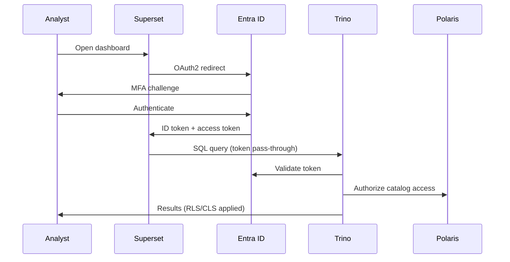

### 3.3 Service Principal Register

| Service Principal | Purpose | Auth Method | Key Rotation |
|-------------------|---------|-------------|--------------|
| `svc-flink-prod` | Flink pipeline writes | Managed Identity | N/A (MI) |
| `svc-trino-prod` | Trino coordinator/workers | Managed Identity | N/A |
| `svc-ge-prod` | Great Expectations batch | Managed Identity | N/A |
| `svc-superset-prod` | Superset → Trino | OAuth2 client credentials | 90 days |
| `svc-polaris-prod` | Polaris REST API | Managed Identity | N/A |
| `svc-debezium-prod` | Debezium → Event Hub | Connection string (KV) | 90 days |
| `svc-lineage-prod` | Marquez API | API key (KV) | 90 days |
| `svc-openmetadata-prod` | Metadata ingestion | Managed Identity | N/A |

### 3.4 Managed Identity Strategy

**Rule:** All AKS-hosted services MUST use **Azure Managed Identity** (system-assigned or user-assigned) instead of stored credentials where supported.

| Service | Identity Type | Scoped Permissions |
|---------|--------------|-------------------|
| Flink pods | User-assigned MI | Storage Blob Data Contributor on lake accounts |
| Trino pods | User-assigned MI | Storage Blob Data Reader on lake accounts |
| Polaris | User-assigned MI | Storage Blob Data Contributor (warehouse) |
| GE runner | User-assigned MI | Storage Blob Data Reader |

### 3.5 Privileged Access Management

| Role | PIM Eligible | Max Activation | Approval Required |
|------|-------------|----------------|---------------------|
| `catalog_admin` (Polaris) | ✅ | 4 hours | Security + Data Eng Lead |
| `grp-polaris-admin` | ✅ | 8 hours | Security |
| `grp-pci-analyst` | ✅ | 2 hours | Security + Compliance |
| Production Key Vault admin | ✅ | 1 hour | CISO delegate |

---

## 4. Role-Based Access Control (RBAC)

### 4.1 RBAC Architecture

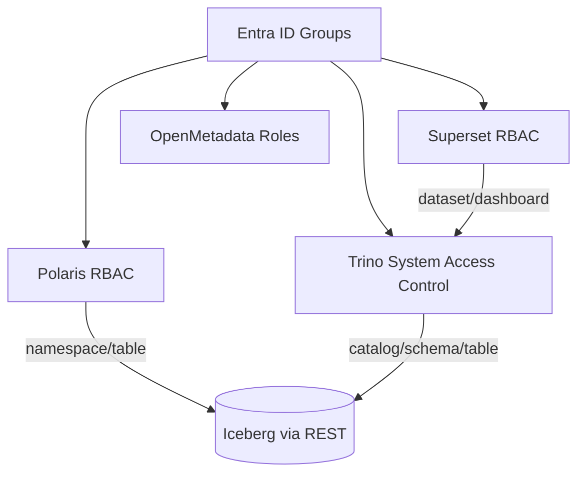

### 4.2 Entra ID Group Register

| Group | Purpose | Members |
|-------|---------|---------|
| `grp-engineer-data` | Data engineers — pipeline development | Data Engineering team |
| `grp-engineer-platform` | Platform engineers — infra | Platform Engineering |
| `grp-analyst-merchant` | Merchant portfolio analysts | Merchant Operations |
| `grp-analyst-finance` | Finance analysts | Finance team |
| `grp-fraud` | Fraud/risk analysts | Fraud Operations |
| `grp-executive` | Executive dashboard consumers | Leadership |
| `grp-ops` | NOC / operations dashboards | Operations |
| `grp-pci-analyst` | PCI-scoped analytics | Restricted fraud/compliance |
| `grp-polaris-admin` | Catalog administrators | Platform + Security |
| `grp-admin-security` | Security auditors | Security team |

### 4.3 Polaris RBAC — Namespace Permissions

| Group | Namespaces | Privileges |
|-------|------------|------------|
| `grp-engineer-data` | All | TABLE_READ; TABLE_WRITE (via svc-flink only for bronze/silver/gold) |
| `grp-analyst-merchant` | `gold_merchant`, `gold_ops` (filtered) | TABLE_READ, VIEW_READ |
| `grp-analyst-finance` | `gold_settlement`, `gold_revenue`, `gold_exec` | TABLE_READ |
| `grp-fraud` | `gold_risk`, `gold_transaction`, `silver_transaction` (masked) | TABLE_READ |
| `grp-executive` | `gold_exec` | TABLE_READ |
| `grp-ops` | `gold_ops` | TABLE_READ |
| `grp-pci-analyst` | `pci.*` | TABLE_READ |
| `grp-engineer-data` | `bronze_*` | TABLE_READ (prod: audit only) |
| **DENY** | `bronze_*` for all analyst groups | — |
| **DENY** | `dq.*` quarantine for analysts | — |

### 4.4 Trino RBAC — System Access Control

Trino uses file-based or Apache Ranger integration for fine-grained access:

```json
{
  "catalogs": [
    {
      "user": "grp-analyst-merchant",
      "catalog": "lakehouse",
      "allow": "read-only",
      "schema": "gold_merchant|gold_ops"
    },
    {
      "user": "grp-analyst-finance",
      "catalog": "lakehouse",
      "allow": "read-only",
      "schema": "gold_settlement|gold_revenue|gold_exec"
    },
    {
      "user": "svc-flink-prod",
      "catalog": "lakehouse",
      "allow": "all",
      "schema": "bronze_.*|silver_.*|gold_.*|dq"
    }
  ]
}
```

### 4.5 Superset RBAC

| Superset Role | Permissions | Mapped Group |
|---------------|-------------|--------------|
| `Admin` | Full Superset admin | `grp-engineer-platform` |
| `Alpha` | Create datasets, dashboards | `grp-engineer-data` |
| `Gamma` | View assigned dashboards | All analyst groups |
| `Public` | **Disabled** | — |

**Rule:** Analysts receive `Gamma` role scoped to certified dashboards only. No SQL Lab access in production.

### 4.6 Access Request Workflow

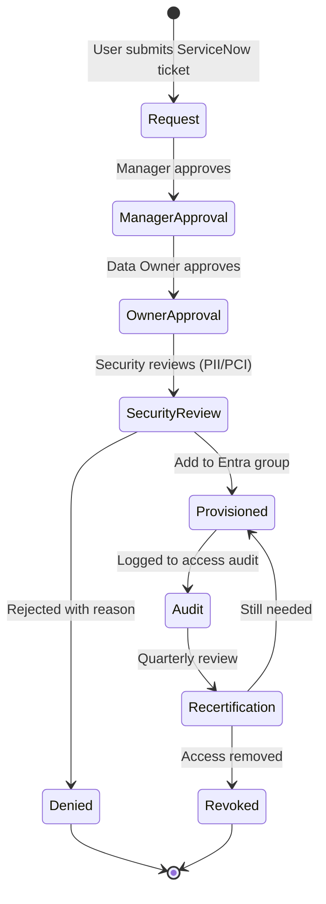

| Step | SLA |
|------|-----|
| Manager approval | 1 business day |
| Data Owner approval | 2 business days |
| Security review (PII/PCI) | 2 business days |
| Provisioning | Same day after approval |
| Quarterly recertification | 100% completion required |

---

## 5. Attribute-Based Access Control (ABAC)

### 5.1 ABAC Model

ABAC extends RBAC with **dynamic attributes** evaluated at query time. Trino row filters and column masks use ABAC attributes from Entra ID token claims and OpenMetadata tags.

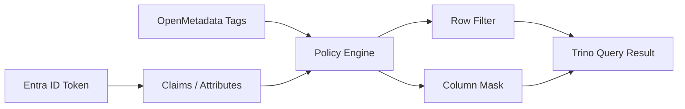

### 5.2 Attribute Definitions

| Attribute | Source | Example Values | Used For |
|-----------|--------|----------------|----------|
| `user_id` | Entra ID `oid` | UUID | Audit logging |
| `user_email` | Entra ID `upn` | user@company.com | Audit |
| `department` | Entra ID claim | `Finance`, `Risk` | ABAC policy |
| `merchant_portfolio` | Entra ID custom claim | `["mer_001", "mer_002"]` | RLS on merchant_id |
| `region` | Entra ID custom claim | `US-EAST`, `EU` | RLS on merchant_region |
| `data_classification` | OpenMetadata tag | `PII`, `PCI` | CLS trigger |
| `clearance_level` | Entra ID custom claim | `standard`, `elevated` | PCI access |
| `environment` | Request context | `prod`, `staging` | Environment isolation |

### 5.3 ABAC Policy Examples

| Policy ID | Condition | Effect |
|-----------|-----------|--------|
| ABAC-001 | `department = Merchant Ops` | Allow `gold_merchant.*` with RLS on portfolio |
| ABAC-002 | `region = EU` | Filter `merchant_region IN ('EU')` |
| ABAC-003 | `clearance_level != elevated` | Deny `pci.*` namespace |
| ABAC-004 | `data_classification = PCI` | Require `grp-pci-analyst` membership |
| ABAC-005 | `environment = prod` AND `role = engineer` | Allow Silver read; deny Bronze |

### 5.4 Custom Claims Configuration

Entra ID custom security attributes (or claims mapping policy):

```json
{
  "merchant_portfolio": ["mer_abc123", "mer_def456"],
  "region": "US-EAST",
  "clearance_level": "standard",
  "department": "Merchant Operations"
}
```

**Managed by:** Data Owner via ServiceNow access request → automated provisioning to Entra ID custom attributes.

---

## 6. Row-Level Security (RLS)

### 6.1 RLS Architecture

Row-Level Security restricts which **rows** a user sees based on identity attributes. Implemented in Trino via row filters on views or system access control plugins.

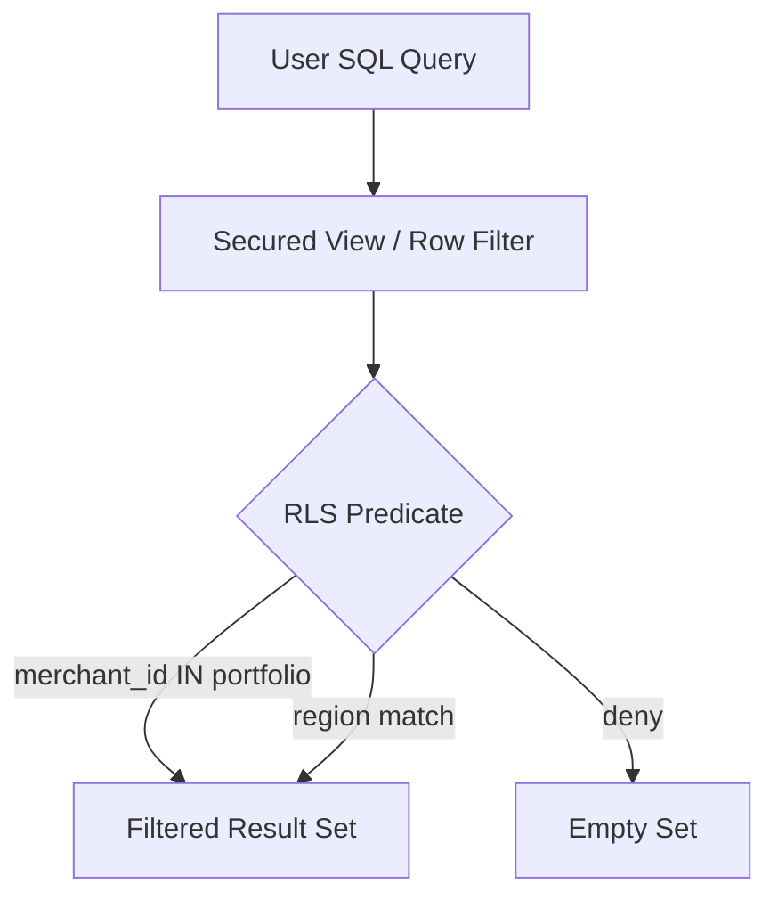

### 6.2 RLS Policy Register

| View / Table | Group | RLS Predicate | Columns Used |
|--------------|-------|---------------|--------------|
| `gold_merchant.merchant_daily_summary` | `grp-analyst-merchant` | `merchant_id IN ({user.merchant_portfolio})` | `merchant_id` |
| `gold_merchant.merchant_analytics` | `grp-analyst-merchant` | Same | `merchant_id` |
| `gold_risk.fraud_summary` | `grp-fraud` | `merchant_region IN ({user.region})` | `merchant_region` |
| `gold_ops.transaction_dashboard` | `grp-ops` | `merchant_region = {user.region}` OR full access for NOC lead | `merchant_region` |
| `silver_transaction.transactions` | `grp-fraud` | `merchant_region IN ({user.region})` | `merchant_region` |
| `gold_exec.*` | `grp-executive` | No filter (pre-aggregated) | — |
| `gold_settlement.*` | `grp-analyst-finance` | No filter | — |

### 6.3 RLS Implementation — Trino Secured Views

```sql
-- gold_merchant.v_merchant_daily_summary_secured
-- Trino passes $user_merchant_portfolio from session property set by OAuth interceptor

CREATE OR REPLACE VIEW lakehouse.gold_merchant.v_merchant_daily_summary_secured AS
SELECT *
FROM lakehouse.gold_merchant.merchant_daily_summary
WHERE merchant_id IN (
    SELECT merchant_id
    FROM lakehouse.audit.user_merchant_portfolio
    WHERE user_email = current_user
);
```

**Alternative:** Apache Ranger row filter policies (recommended for scale):

```
Policy: merchant-portfolio-rls
Resources: catalog=lakehouse, schema=gold_merchant, table=*
Users: grp-analyst-merchant
Row Filter: merchant_id IN (${user.merchant_portfolio})
```

### 6.4 RLS Testing Requirements

| Test | Frequency | Owner |
|------|-----------|-------|
| User A cannot see User B's merchants | Per policy change | Security |
| Executive sees all regions in KPIs | Quarterly | Security |
| Fraud analyst restricted to assigned region | Quarterly | Security |
| Service account bypasses RLS (pipeline writes) | Per deployment | Data Eng |
| RLS not bypassed via JOIN to unrestricted table | Per new Gold mart | Security |

### 6.5 RLS Exceptions

| Exception | Justification | Approval |
|-----------|---------------|----------|
| `svc-flink-prod` | Pipeline writes require full access | Pre-approved service account |
| `grp-analyst-finance` on settlement | Finance requires cross-merchant view | Data Owner + CISO |
| `grp-engineer-data` on Silver | Debugging with audit logging | PIM activation only |

---

## 7. Column-Level Security (CLS) and Dynamic Masking

### 7.1 CLS Architecture

Column-Level Security hides or masks sensitive **column values** based on user role and classification tags.

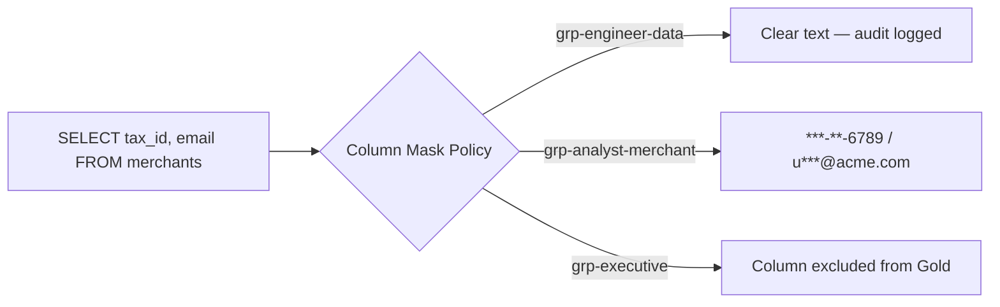

### 7.2 Masking Functions

| Function | Input | Output | Used For |
|----------|-------|--------|----------|
| `mask_full(value)` | `12-3456789` | `***********` | tax_id, address |
| `mask_email(value)` | `user@acme.com` | `u***@acme.com` | contact_email |
| `mask_phone_last4(value)` | `+15550123456` | `*******3456` | contact_phone |
| `mask_partial_name(value)` | `Acme Payments LLC` | `Acm***` | legal_name (non-prod) |
| `mask_show_last4(value)` | `4111111111111111` | `************1111` | card tokens |
| `mask_null(value)` | any | `NULL` | PCI columns for non-PCI users |
| `mask_hash(value)` | any | SHA-256 prefix | reversible lookup by security only |

### 7.3 CLS Policy Register

| Table | Column | Classification | Groups with Clear Text | Others |
|-------|--------|---------------|------------------------|--------|
| `silver_merchant.merchants` | `tax_id` | PII | `grp-engineer-data` (PIM) | `mask_full` |
| `silver_merchant.merchants` | `contact_email` | PII | `grp-engineer-data` | `mask_email` |
| `silver_merchant.merchants` | `contact_phone` | PII | `grp-engineer-data` | `mask_phone_last4` |
| `silver_merchant.merchant_addresses` | `address_line1` | PII | `grp-engineer-data` (PIM) | `mask_full` |
| `silver_transaction.transactions` | `card_last4` | PCI adjacent | `grp-pci-analyst`, `grp-fraud` | `mask_show_last4` |
| `pci.silver_transaction.transactions` | `payment_token` | PCI | `grp-pci-analyst` | `mask_null` |

### 7.4 Trino Column Mask Implementation

```sql
-- Register masking functions (deployed as Trino plugin UDFs)
CREATE FUNCTION mask_email(input VARCHAR)
RETURNS VARCHAR
RETURN CONCAT(SUBSTR(input, 1, 1), '***@', SPLIT(input, '@')[2]);

-- Column mask policy via view (simpler deployment)
CREATE OR REPLACE VIEW lakehouse.silver_merchant.merchants_masked AS
SELECT
    merchant_id,
    mask_partial_name(legal_name)     AS legal_name,
    status,
    kyc_status,
    industry_mcc,
    merchant_region,
    country_code,
    onboarding_date,
    mask_email(contact_email)         AS contact_email,
    mask_phone_last4(contact_phone)   AS contact_phone,
    valid_from,
    valid_to,
    is_current,
    is_deleted,
    dq_status
FROM lakehouse.silver_merchant.merchants
WHERE is_current = true;
```

### 7.5 Dynamic Masking Rules

| Rule | Behavior |
|------|----------|
| DM-01 | Masking applied at query time, not storage time |
| DM-02 | Clear-text access requires group membership + audit log entry |
| DM-03 | PIM activation required for clear-text PII in production |
| DM-04 | Gold marts MUST NOT expose PII columns (masking not sufficient — exclude column) |
| DM-05 | Masking functions are deterministic (same input → same mask) except `mask_hash` |
| DM-06 | Export/download of unmasked PII requires separate approval workflow |

### 7.6 Superset and CLS

Superset datasets MUST point to **masked views** or Gold marts (no PII columns) — never raw Silver PII tables.

| Dataset | Source | PII Exposure |
|---------|--------|--------------|
| Merchant Performance | `gold_merchant.merchant_daily_summary` | None |
| Merchant 360 | `gold_merchant.merchant_analytics` | None |
| Fraud Monitor | `gold_risk.fraud_summary` | None |
| KYC Compliance | `gold_merchant.document_compliance_summary` | None |
| Fraud Investigation (exception) | `silver_merchant.merchants_masked` | Masked only |

---

## 8. Encryption at Rest

### 8.1 Encryption Architecture

```mermaid
flowchart TB
    subgraph Key Management
        KV[Azure Key Vault]
        CMK_LAKE[CMK: lakehouse-data]
        CMK_PCI[CMK: pci-data]
        CMK_DOC[CMK: documents]
    end

    subgraph Storage — SSE-KMS
        HOT[stlakehotprod]
        COOL[stlakecoolprod]
        ARCH[stlakearchiveprod]
        DOC[stdocumentsprod]
        OPS[stlakeopsprod]
    end

    subgraph Databases
        PG_POL[(PostgreSQL — Polaris)]
        PG_MARQ[(PostgreSQL — Marquez)]
        PG_OM[(PostgreSQL — OpenMetadata)]
    end

    KV --> CMK_LAKE & CMK_PCI & CMK_DOC
    CMK_LAKE --> HOT & COOL & ARCH & OPS
    CMK_PCI --> HOT
    CMK_DOC --> DOC
    PG_POL & PG_MARQ & PG_OM -->|TDE| KV
```

### 8.2 Storage Account Encryption

| Storage Account | Encryption | CMK | Double Encryption |
|-----------------|------------|-----|-------------------|
| `stlakehotprod` | SSE-KMS | `cmk-lakehouse-data` | Optional |
| `stlakecoolprod` | SSE-KMS | `cmk-lakehouse-data` | Optional |
| `stlakearchiveprod` | SSE-KMS | `cmk-lakehouse-data` | Optional |
| `stlakeopsprod` | SSE-KMS | `cmk-lakehouse-ops` | No |
| `stdocumentsprod` | SSE-KMS | `cmk-documents` | Yes (recommended) |
| `stauditprod` | SSE-KMS | `cmk-audit` | Yes |

### 8.3 Encryption Scope

| Data Type | At Rest Encryption | Key |
|-----------|-------------------|-----|
| Iceberg Parquet data files | SSE-KMS | CMK lakehouse |
| Iceberg metadata files | SSE-KMS | CMK lakehouse |
| Flink checkpoints / savepoints | SSE-KMS | CMK ops |
| Document blobs | SSE-KMS | CMK documents |
| PostgreSQL (Polaris, Marquez, OM) | Azure TDE | Platform-managed or CMK |
| Event Hub | Microsoft-managed keys | Platform |
| AKS etcd secrets | Azure-managed | Platform |

### 8.4 Infrastructure Encryption

| Setting | Value |
|---------|-------|
| Infrastructure encryption | Enabled on `stdocumentsprod`, `stauditprod` |
| Blob versioning | Enabled on documents and audit accounts |
| Soft delete | 90 days on all storage accounts |
| Immutable storage | WORM policy on legal hold containers |

---

## 9. Encryption in Transit

### 9.1 TLS Requirements

| Connection | Protocol | Min Version | Certificate |
|------------|----------|-------------|-------------|
| User → Superset (App Gateway) | HTTPS | TLS 1.2 | Public CA (Let's Encrypt / DigiCert) |
| Superset → Trino | HTTPS | TLS 1.2 | Internal CA |
| Trino → Polaris REST | HTTPS | TLS 1.2 | Internal CA |
| Trino/ Flink → ADLS (ABFS) | HTTPS | TLS 1.2 | Azure service |
| Flink → Event Hub | SASL_SSL | TLS 1.2 | Azure service |
| Debezium → MySQL | TLS optional (Private Link preferred) | TLS 1.2 if enabled | Internal CA |
| All Private Link | Microsoft backbone | TLS 1.2+ | Microsoft |

### 9.2 Network Encryption Diagram

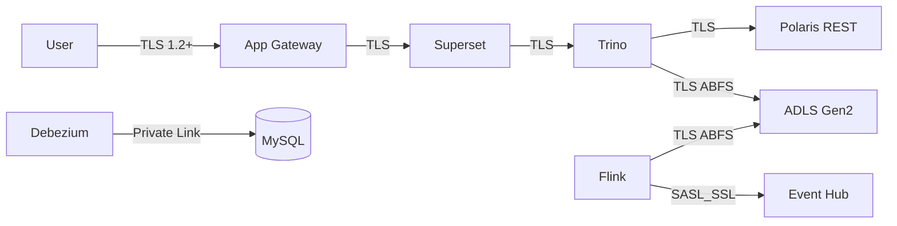

### 9.3 Prohibited Protocols

| Protocol | Status |
|----------|--------|
| TLS 1.0 / 1.1 | **Blocked** |
| HTTP (unencrypted) to data plane | **Blocked** |
| Public Blob endpoints | **Disabled** (Azure Policy) |
| FTP / SFTP to storage | **Not used** |

### 9.4 Certificate Management

| Certificate | Owner | Renewal |
|-------------|-------|---------|
| App Gateway (Superset) | Platform | Auto-renew via Key Vault integration |
| Internal CA (Trino, Polaris) | Security | 1-year; automated renewal |
| mTLS between services (future) | Platform | Phase 4+ |

---

## 10. Key Management (KMS)

### 10.1 Azure Key Vault Architecture

| Key Vault | Purpose | SKU | Region |
|-----------|---------|-----|--------|
| `kv-data-platform-prod` | Lakehouse CMKs, service secrets | Premium (HSM-backed) | Primary region |
| `kv-data-platform-prod-dr` | DR key replicas | Premium | DR region |
| `kv-pci-prod` | PCI CMK (isolated) | Premium HSM | Primary region |

### 10.2 Customer-Managed Key (CMK) Register

| CMK Name | Key Type | Used By | HSM Backed |
|----------|----------|---------|------------|
| `cmk-lakehouse-data` | RSA 4096 | stlakehot/cool/archive | ✅ |
| `cmk-lakehouse-ops` | RSA 4096 | stlakeopsprod | ✅ |
| `cmk-documents` | RSA 4096 | stdocumentsprod | ✅ |
| `cmk-audit` | RSA 4096 | stauditprod | ✅ |
| `cmk-pci-data` | RSA 4096 | PCI namespace storage | ✅ HSM required |
| `cmk-postgresql` | RSA 4096 | PostgreSQL TDE (optional) | ✅ |

### 10.3 Key Vault Access Policy

| Principal | Keys (wrap/unwrap) | Secrets (get/list) |
|-----------|-------------------|-------------------|
| `svc-flink-prod` MI | cmk-lakehouse-data | debezium conn string |
| `svc-trino-prod` MI | cmk-lakehouse-data | — |
| Platform admin (PIM) | All CMKs | All secrets |
| Security auditor | — | Read audit logs only |
| AKS CSI driver | — | Mount secrets to pods |

### 10.4 Key Usage Audit

All Key Vault operations logged to:
- Azure Activity Log → Log Analytics → Sentinel
- Alert on: `KeyDelete`, `KeyBackup`, unauthorized `KeyGet`

---

## 11. Key Rotation

### 11.1 Key Rotation Schedule

| Key / Secret Type | Rotation Frequency | Method | Owner |
|-------------------|-------------------|--------|-------|
| CMK (storage encryption) | Annual | Azure Key Vault auto-rotation | Security |
| PostgreSQL TDE key | Annual | Azure automated | Platform |
| Service principal secrets | 90 days | Key Vault + automation runbook | Platform |
| Debezium MySQL password | 90 days | Key Vault + rolling update | App DBA + Data Eng |
| Marquez API key | 90 days | Key Vault | Platform |
| Event Hub SAS keys | 180 days | Azure portal + KV update | Platform |
| TLS certificates (internal) | 1 year | ACME / internal CA automation | Platform |
| Superset OAuth client secret | 90 days | Entra ID app registration | Platform |

### 11.2 CMK Rotation Procedure

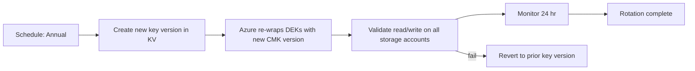

**Zero-downtime requirement:** CMK rotation MUST NOT require data re-encryption or pipeline downtime. Azure SSE-KMS supports automatic DEK re-wrap.

### 11.3 Secret Rotation Runbook (Summary)

| Step | Action |
|------|--------|
| 1 | Generate new secret in source system |
| 2 | Store new version in Key Vault |
| 3 | Rolling restart of consuming pods (AKS) |
| 4 | Validate pipeline connectivity |
| 5 | Disable old secret version after 24 hr |
| 6 | Log rotation in `audit.secret_rotation_log` |

---

## 12. Secrets Management

### 12.1 Secrets Architecture

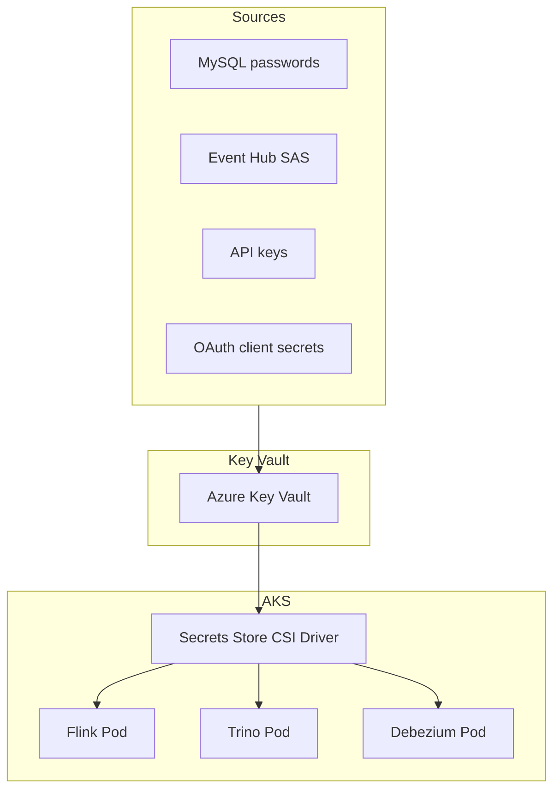

### 12.2 Secrets Register

| Secret Name | KV Path | Consumers | Rotation |
|-------------|---------|-----------|----------|
| `mysql-debezium-password` | `secrets/mysql/debezium` | Debezium | 90 days |
| `eventhub-connection-string` | `secrets/eventhub/cdc` | Debezium, Flink | 180 days |
| `marquez-api-key` | `secrets/marquez/api-key` | Flink, Trino | 90 days |
| `superset-oauth-secret` | `secrets/superset/oauth` | Superset | 90 days |
| `polaris-db-password` | `secrets/polaris/postgres` | Polaris | 90 days |
| `ge-trino-password` | `secrets/ge/trino` | GE runner | 90 days |

### 12.3 AKS CSI Driver Configuration

```yaml
# SecretProviderClass example
apiVersion: secrets-store.csi.x-k8s.io/v1
kind: SecretProviderClass
metadata:
  name: flink-secrets
spec:
  provider: azure
  parameters:
    usePodIdentity: "false"
    useVMManagedIdentity: "true"
    userAssignedIdentityID: "${FLINK_MI_CLIENT_ID}"
    keyvaultName: "kv-data-platform-prod"
    objects: |
      array:
        - objectName: eventhub-connection-string
          objectType: secret
    tenantId: "${AZURE_TENANT_ID}"
  secretObjects:
    - secretName: eventhub-conn
      type: Opaque
      data:
        - objectName: eventhub-connection-string
          key: connection-string
```

### 12.4 Secrets Security Rules

| Rule | Requirement |
|------|-------------|
| SEC-S01 | No secrets in Git repositories (including encrypted) |
| SEC-S02 | No secrets in environment variables without CSI mount |
| SEC-S03 | No secrets in Flink JAR or Docker images |
| SEC-S04 | Key Vault firewall: allow AKS subnet + corp VPN only |
| SEC-S05 | Secret access logged to Sentinel |
| SEC-S06 | Emergency break-glass access via PIM only |

---

## 13. Data Classification Enforcement

### 13.1 Classification-to-Control Mapping

| Classification | RBAC | RLS | CLS | Namespace | Encryption | Audit |
|----------------|------|-----|-----|-----------|------------|-------|
| PUBLIC | All employees | None | None | Any Gold | Standard SSE | Standard |
| INTERNAL | All employees | Optional | None | Any | SSE-KMS | Standard |
| CONFIDENTIAL | Need-to-know groups | Optional | Optional | Silver/Gold | SSE-KMS CMK | Enhanced |
| PII | Restricted groups | Required | Required | Silver | SSE-KMS CMK | Enhanced + PIM |
| PCI | `grp-pci-analyst` only | Required | Required | `pci.*` only | HSM CMK | Full SIEM |

### 13.2 Automated Enforcement Pipeline

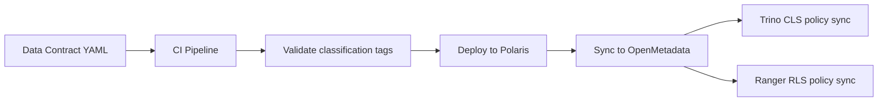

### 13.3 Data Loss Prevention (DLP)

| Control | Implementation |
|---------|---------------|
| Export limits | Superset row limit: 10,000 rows for analysts |
| Download audit | All CSV exports logged to SIEM |
| PII export block | DLP rule blocks download of masked view clear-text |
| Email exfiltration | Corporate DLP on email attachments |
| Defender for Storage | Malware scan on document uploads |

---

## 14. Network Security

### 14.1 Network Architecture Summary

| Component | Network Control |
|-----------|----------------|
| AKS data platform | Private cluster; no public API server |
| ADLS Gen2 | Private Endpoint only; public access disabled |
| Event Hub | Private Endpoint |
| Key Vault | Private Endpoint + firewall |
| PostgreSQL | Private Endpoint; no public access |
| Superset | App Gateway WAF → internal AKS ingress |
| MySQL | App VNet; Private Link from Debezium subnet |

### 14.2 Azure Policy Deny Rules

| Policy | Effect |
|--------|--------|
| Deny public network access on storage accounts | Deny |
| Require TLS 1.2 on storage | Deny |
| Require Private Link for Key Vault | Audit → Deny (Phase 4) |
| Deny IP firewall rules on PostgreSQL | Deny |
| Require NSG on subnets | Audit |

### 14.3 WAF Rules (Superset App Gateway)

| Rule | Action |
|------|--------|
| OWASP Core Rule Set 3.2 | Block |
| Bot protection | Block known bad bots |
| Geo-filter (if applicable) | Allow corp countries only |
| Rate limiting | 1000 req/min per IP |
| Request size limit | 10 MB |

---

## 15. Audit and Monitoring

### 15.1 Audit Log Sources

| Source | Events Logged | Destination |
|--------|---------------|-------------|
| Trino | Query text (hashed for sensitive), user, tables, rows | `stauditprod` + Sentinel |
| Polaris | Catalog changes, access denials | Azure Activity Log |
| Entra ID | Sign-in, group changes, PIM activation | Sentinel |
| Key Vault | Key/secret access | Sentinel |
| Azure Storage | Blob read/write (diagnostic settings) | Sentinel |
| Superset | Dashboard access, export events | Superset audit + Sentinel |
| Flink | Job start/stop (security-relevant) | Azure Monitor |

### 15.2 Security Monitoring Alerts

| Alert | Condition | Severity |
|-------|-----------|----------|
| SEC-ALT-001 | Failed auth > 10 in 5 min for one user | High |
| SEC-ALT-002 | PIM activation for PCI group | Info (audit) |
| SEC-ALT-003 | Query on PCI namespace outside business hours | Medium |
| SEC-ALT-004 | Bulk export > 10K rows | Medium |
| SEC-ALT-005 | Key Vault KeyDelete operation | Critical |
| SEC-ALT-006 | New user added to `grp-pci-analyst` | High |
| SEC-ALT-007 | Trino query accessing unmasked PII clear-text | High |
| SEC-ALT-008 | Public access enabled on storage (policy violation) | Critical |

### 15.3 Audit Retention

| Log Type | Retention | Storage |
|----------|-----------|---------|
| Trino query audit | 2 years | `stauditprod` Cool tier |
| Entra ID sign-in | 1 year | Sentinel |
| Key Vault access | 2 years | Sentinel |
| Security alerts | 3 years | Sentinel archive |
| Access recertification records | 5 years | Governance archive |

---

## 16. GDPR Compliance

### 16.1 GDPR Applicability

The lakehouse processes **personal data** (merchant contact information, identity data) subject to GDPR for EU merchants and employees.

| GDPR Article | Requirement | Lakehouse Implementation |
|--------------|-------------|-------------------------|
| Art. 5 — Principles | Lawfulness, minimization | PII excluded from Gold; masking in Silver |
| Art. 17 — Right to erasure | Delete on request | Crypto-shred + catalog tombstone (§16.3) |
| Art. 25 — Privacy by design | Default protection | Classification tags; RLS/CLS by default |
| Art. 30 — Records of processing | Processing register | OpenMetadata + governance docs |
| Art. 32 — Security | Appropriate measures | This document |
| Art. 33 — Breach notification | 72-hour notification | Sentinel alerts + incident runbook |
| Art. 35 — DPIA | Impact assessment | Required for new PII processing |

### 16.2 Lawful Basis Register

| Processing Activity | Lawful Basis | Data Categories |
|----------------------|--------------|-----------------|
| Merchant analytics | Contract (merchant agreement) | Business data, transaction data |
| KYC compliance | Legal obligation | Identity documents, contact info |
| Fraud detection | Legitimate interest | Transaction patterns |
| Executive reporting | Legitimate interest | Aggregated KPIs (no PII) |
| Employee audit logs | Legitimate interest | User IDs, query metadata |

### 16.3 Right to Erasure Procedure

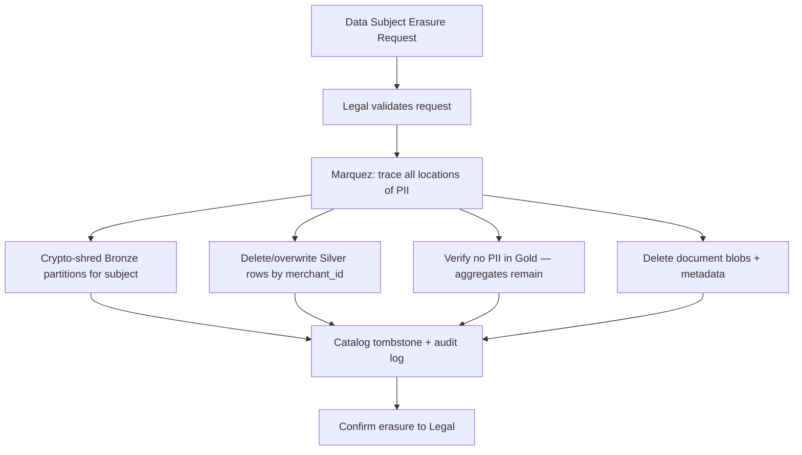

| Step | Action | Timeline |
|------|--------|----------|
| 1 | Legal receives and validates erasure request | Day 0 |
| 2 | Identify `merchant_id` / data subject keys | Day 1–3 |
| 3 | Run lineage query in Marquez for all PII columns | Day 3 |
| 4 | Execute erasure scripts on Bronze, Silver, documents | Day 4–10 |
| 5 | Verify Gold contains no re-identifiable data | Day 10 |
| 6 | Update OpenMetadata with tombstone record | Day 10 |
| 7 | Confirm completion to Legal (30-day SLA) | Day 30 |

### 16.4 Data Minimization Controls

| Control | Implementation |
|---------|---------------|
| Gold excludes PII | Policy POL-GV-003 |
| Analysts use masked views | `merchants_masked` |
| Retention limits | 5-year tiered; erasure after legal hold release |
| Purpose limitation | Access groups scoped to business need |
| Pseudonymization | `merchant_id` as pseudonym in cross-domain analytics |

### 16.5 Cross-Border Transfer

| Scenario | Control |
|----------|---------|
| EU merchant data in US Azure region | Standard Contractual Clauses (SCCs) with Microsoft |
| EU analyst accessing US-hosted lakehouse | Documented in DPA; RLS by region |
| Data residency requirement (future) | EU region deployment option (Phase 6+) |

---

## 17. PCI DSS Compliance

### 17.1 PCI Scope for Lakehouse

The lakehouse analytics environment is **NOT** in scope for full PCI DSS Level 1 merchant certification. However, it must comply with PCI DSS requirements for **service providers processing or storing cardholder data environment (CDE) adjacent data**.

**Critical rule:** Primary Account Numbers (PAN) are **never stored in clear text** in the lakehouse. Tokenization occurs at the payment application before data reaches MySQL CDC.

### 17.2 PCI DSS Requirement Mapping

| PCI DSS v4.0 Req | Requirement Summary | Lakehouse Control |
|------------------|---------------------|-------------------|
| **Req 3** | Protect stored account data | No clear-text PAN; tokenization; PCI namespace |
| **Req 4** | Protect data in transit | TLS 1.2+ everywhere |
| **Req 7** | Restrict access by business need | RBAC + RLS + PCI group isolation |
| **Req 8** | Identify and authenticate access | Entra ID + MFA |
| **Req 10** | Log and monitor access | Trino audit + Sentinel |
| **Req 11** | Test security regularly | Quarterly access review; annual pen test |
| **Req 12** | Information security policy | This document + governance policies |

### 17.3 PCI Namespace Isolation

```mermaid
flowchart TB
    subgraph Standard Lakehouse
        SILVER[silver_transaction.transactions]
        GOLD[gold_risk.fraud_summary]
    end

    subgraph PCI Namespace — Restricted
        PCI_SILVER[pci.silver_transaction.transactions]
        PCI_GOLD[pci.gold_risk.fraud_detail]
    end

    SILVER -->|no PAN columns| GOLD
    MYSQL[(MySQL — tokenized)] --> SILVER
    MYSQL -->|token + last4 only| PCI_SILVER --> PCI_GOLD

    SEC[grp-pci-analyst ONLY] --> PCI_SILVER & PCI_GOLD
```

| Control | Standard Namespace | PCI Namespace |
|---------|-------------------|---------------|
| PAN storage | ❌ Never | ❌ Never (tokens only) |
| Token storage | ❌ | ✅ Token reference only |
| Card last 4 | Masked | Visible to PCI group |
| Access group | General fraud group | `grp-pci-analyst` only |
| CMK | `cmk-lakehouse-data` | `cmk-pci-data` (HSM) |
| Audit | Enhanced | Full SIEM + quarterly review |
| ARB approval | Standard | Required for any new table |

### 17.4 PCI Data Elements in Lakehouse

| Element | Allowed in Lakehouse | Form | Namespace |
|---------|---------------------|------|-----------|
| PAN | ❌ **NEVER** | — | — |
| Tokenized PAN | ✅ | Payment token (irreversible) | `pci.*` only |
| Card last 4 | ✅ | `4111` | Masked in standard; clear in PCI |
| Expiry date | ❌ | — | — |
| CVV/CVC | ❌ **NEVER** | — | — |
| Cardholder name | ❌ in clear text | Masked or excluded | — |
| Track data | ❌ **NEVER** | — | — |

### 17.5 PCI Access Controls

| Requirement | Implementation |
|-------------|---------------|
| Unique IDs | Entra ID individual accounts; no shared accounts |
| MFA | Required for `grp-pci-analyst` |
| Access review | Quarterly recertification by CISO delegate |
| Session timeout | 1 hour idle timeout |
| Failed login lockout | Entra ID Smart Lockout |
| PIM for elevated access | Required for clear-text token access |

### 17.6 PCI Logging and Monitoring

| Event | Logged | Retention | Review Frequency |
|-------|--------|-----------|------------------|
| All PCI namespace queries | ✅ Trino audit | 1 year | Daily automated |
| Access to `pci.*` tables | ✅ Sentinel | 1 year | Daily |
| Failed PCI access attempts | ✅ Alert P1 | 1 year | Real-time |
| Changes to PCI namespace schema | ✅ Polaris audit | 2 years | Per change |
| `grp-pci-analyst` membership changes | ✅ Entra ID | 2 years | Real-time alert |

---

## 18. Design Decisions and Trade-offs

| ADR | Decision | Benefit | Tradeoff | Mitigation |
|-----|----------|---------|----------|------------|
| ADR-S09-001 | Entra ID as sole IdP | SSO; MFA; Conditional Access | Azure dependency | HA Entra ID SLA |
| ADR-S09-002 | Trino RLS via views + Ranger | Flexible row filters | View proliferation | Ranger for scale (Phase 4) |
| ADR-S09-003 | Masked views vs storage encryption of PII | Query-time masking; auditable | View maintenance | Auto-generate from contract tags |
| ADR-S09-004 | CMK on all storage accounts | Customer control; compliance | Key management overhead | Automated rotation |
| ADR-S09-005 | Private Link only (no public endpoints) | Zero trust network | VPN/ExpressRoute required | App Gateway for Superset |
| ADR-S09-006 | PCI namespace isolation | Scope reduction | Duplicate pipeline for PCI | Shared Silver where possible |
| ADR-S09-007 | No PAN in lakehouse ever | PCI scope minimization | Limited fraud ML features | Token + behavioral features |
| ADR-S09-008 | Managed Identity over secrets | No credential rotation for MI | Not all services support MI | KV secrets for exceptions |

---

## 19. Production Recommendations

### 19.1 Phase 1–3 Security Checklist (Must-Have)

| # | Item | Priority |
|---|------|----------|
| 1 | Disable public access on all storage accounts | P0 |
| 2 | Enable SSE-KMS with CMK on all storage | P0 |
| 3 | Deploy Private Link for ADLS, Event Hub, Key Vault | P0 |
| 4 | Configure Entra ID OAuth for Trino and Superset | P0 |
| 5 | Enforce MFA via Conditional Access | P0 |
| 6 | Create Entra ID groups per §4.2 | P0 |
| 7 | Configure Polaris RBAC per §4.3 | P0 |
| 8 | Deploy Key Vault with firewall rules | P0 |
| 9 | AKS CSI driver for secrets | P0 |
| 10 | Enable Trino query audit logging | P0 |

### 19.2 Phase 4 Security Checklist

| # | Item | Priority |
|---|------|----------|
| 11 | Deploy masked Silver views for all PII tables | P1 |
| 12 | Implement RLS on merchant-facing Gold marts | P1 |
| 13 | Configure Sentinel alerts SEC-ALT-001–008 | P1 |
| 14 | Quarterly access recertification process | P1 |
| 15 | PCI namespace isolation (if in scope) | P1 |
| 16 | Apache Ranger for Trino (optional upgrade) | P2 |
| 17 | Annual penetration test | P2 |
| 18 | GDPR erasure runbook tested | P2 |

### 19.3 Security Exit Criteria

| Criterion | Target |
|-----------|--------|
| Public storage access | Zero accounts |
| MFA enrollment | 100% human users |
| PII columns masked in analyst paths | 100% |
| Audit log coverage (Trino, KV, Entra) | 100% |
| Access recertification | 100% quarterly |
| Penetration test | No critical findings open |

---

## Appendix A — Entra ID Group to Permission Matrix

| Group | Bronze | Silver | Gold | PCI | Superset SQL Lab |
|-------|--------|--------|------|-----|------------------|
| grp-engineer-data | Read (audit) | Read/Write (pipelines) | Read/Write (pipelines) | ❌ | Staging only |
| grp-analyst-merchant | ❌ | Masked read | RLS read | ❌ | ❌ |
| grp-analyst-finance | ❌ | ❌ | Read | ❌ | ❌ |
| grp-fraud | ❌ | Masked read | RLS read | ❌ | ❌ |
| grp-executive | ❌ | ❌ | exec only | ❌ | ❌ |
| grp-pci-analyst | ❌ | ❌ | ❌ | Read | ❌ |
| grp-polaris-admin | Admin | Admin | Admin | Admin | — |

---

## Appendix B — Incident Response Summary

| Severity | Example | Response Time | Team |
|----------|---------|---------------|------|
| SEV-1 | Suspected data breach; Key Vault compromise | 15 min | Security + CISO |
| SEV-2 | Unauthorized PCI namespace access | 1 hr | Security + Data Eng |
| SEV-3 | Failed access recertification overdue | 4 hr | Governance |
| SEV-4 | Certificate expiry warning | 24 hr | Platform |

---

## Appendix C — Related Documents

| Document | Relationship |
|----------|-------------|
| `02-production-architecture.md` | Network topology, Private Link |
| `08-governance.md` | Classification, PII tagging, ownership |
| `10-storage-retention.md` | Encryption tier lifecycle |
| `11-monitoring.md` | Security alert dashboards |
| `13-runbook.md` | Key rotation, erasure procedures |

---

## Appendix D — Revision History

| Version | Date | Author | Changes |
|---------|------|--------|---------|
| 1.0.0 | 2026-07-02 | Data Platform Architecture | Initial security architecture |
