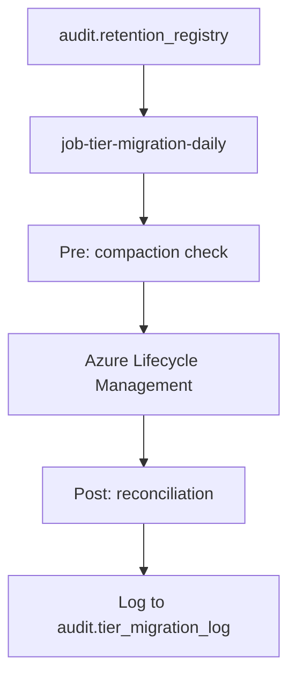
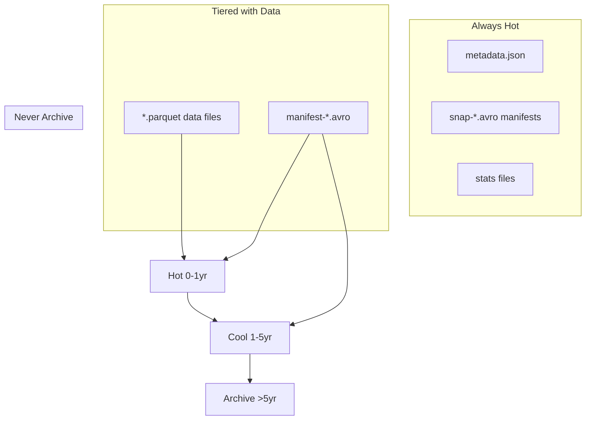
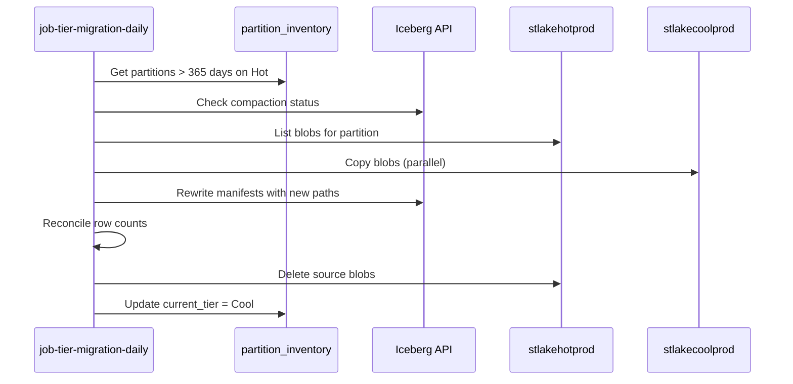
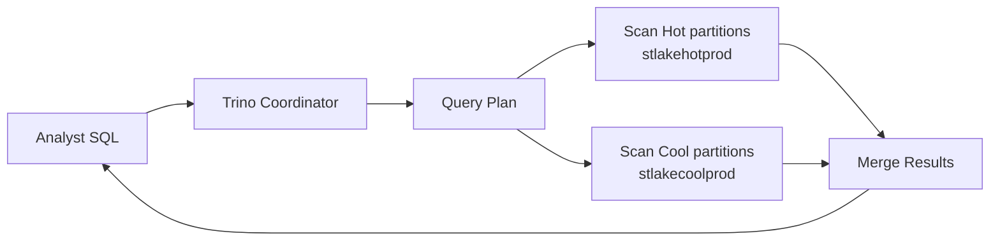
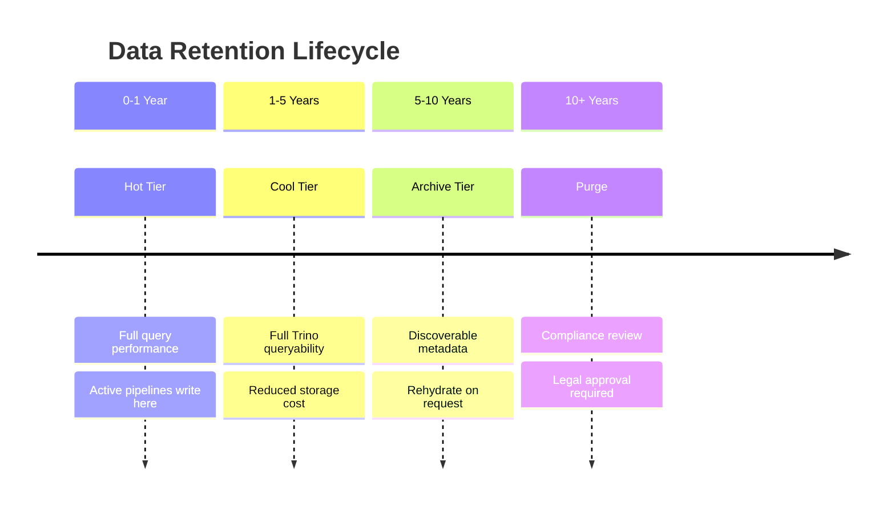
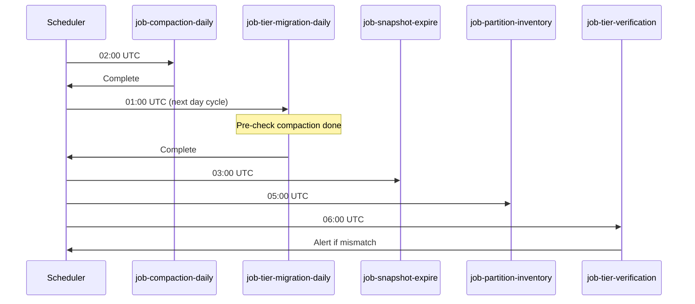
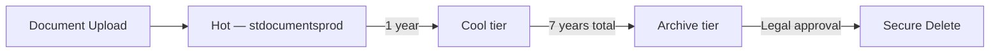

# Parts 11 & 12 — Storage Strategy and Five-Year Retention

**Document ID:** DLH-ARB-2026-001-10  
**Version:** 1.0.0  
**Classification:** Internal — Confidential  
**Status:** Draft — For ARB Review

---

## Table of Contents

### Part 11 — Storage Strategy
1. [Overview](#1-overview)
2. [Storage Hierarchy](#2-storage-hierarchy)
3. [Storage Account Architecture](#3-storage-account-architecture)
4. [Hot Storage Tier](#4-hot-storage-tier)
5. [Cool Storage Tier](#5-cool-storage-tier)
6. [Cold Storage Tier](#6-cold-storage-tier)
7. [Archive Storage Tier](#7-archive-storage-tier)
8. [Blob Lifecycle Policies](#8-blob-lifecycle-policies)
9. [Iceberg Metadata and Storage Coordination](#9-iceberg-metadata-and-storage-coordination)
10. [Partition Migration Strategy](#10-partition-migration-strategy)
11. [Historical Query Strategy](#11-historical-query-strategy)
12. [Restore Strategy](#12-restore-strategy)
13. [Cost Optimization](#13-cost-optimization)

### Part 12 — Five-Year Retention Strategy
14. [Retention Policy Overview](#14-retention-policy-overview)
15. [Age Tier 0–1 Years (Hot)](#15-age-tier-01-years-hot)
16. [Age Tier 1–5 Years (Cool)](#16-age-tier-15-years-cool)
17. [Age Tier >5 Years (Cold / Archive)](#17-age-tier-5-years-cold--archive)
18. [Compression Strategy](#18-compression-strategy)
19. [Metadata and Snapshot Retention](#19-metadata-and-snapshot-retention)
20. [Lifecycle Automation](#20-lifecycle-automation)
21. [Document Storage Retention](#21-document-storage-retention)
22. [Design Decisions and Trade-offs](#22-design-decisions-and-trade-offs)
23. [Production Recommendations](#23-production-recommendations)

---

# PART 11 — STORAGE STRATEGY

## 1. Overview

### 1.1 Purpose

This document defines the **storage hierarchy, lifecycle policies, and five-year retention strategy** for the enterprise Data Lakehouse on Azure Blob Storage / ADLS Gen2 with Apache Iceberg tables.

Company policy requires analytics data to remain **online and queryable for five years**, then transition to **low-cost archive storage** while remaining **discoverable** by Data Engineers and Business Analysts.

### 1.2 Scope

| In Scope | Out of Scope |
|----------|--------------|
| Iceberg table data on ADLS Gen2 | MySQL OLTP storage (App DBA) |
| Document blob storage (`stdocumentsprod`) | Event Hub message retention |
| Flink checkpoints / ops storage | AKS node disk storage |
| Audit log storage | Backup vault pricing negotiation |
| Retention registry and automation jobs | Legal hold case management tooling |

### 1.3 Storage Design Principles

| ID | Principle | Implementation |
|----|-----------|----------------|
| ST-01 | **Separate accounts by tier** | Hot, Cool, Archive, Ops, Documents |
| ST-02 | **Metadata always queryable** | Iceberg metadata never in Archive tier |
| ST-03 | **Compact before tiering** | Daily compaction precedes lifecycle migration |
| ST-04 | **Policy-driven lifecycle** | `audit.retention_registry` drives all jobs |
| ST-05 | **Partition-aware migration** | Tier by partition date, not table age alone |
| ST-06 | **Cost vs. queryability tradeoff** | Documented per tier; analyst access preserved 5 years |
| ST-07 | **Reversibility** | Rehydrate from Archive on audit/compliance request |

### 1.4 Business Retention Requirement

| Requirement | Specification |
|-------------|---------------|
| Online queryable retention | **5 years** from record creation date |
| Discoverable beyond 5 years | **10 years** (metadata + archive) |
| Settlement / finance records | **7 years** (regulatory) |
| KYC documents | **7 years** |
| Audit logs | **2 years** online; **5 years** archive |
| Bronze CDC raw data | **90 days** (not subject to 5-year policy) |

---

## 2. Storage Hierarchy

### 2.1 Tier Architecture

```mermaid
flowchart TB
    subgraph Ingestion
        FLINK[Flink / Pipelines]
    end

    subgraph Hot — 0 to 1 Year
        HOT[(stlakehotprod<br/>Access Tier: Hot)]
    end

    subgraph Cool — 1 to 5 Years
        COOL[(stlakecoolprod<br/>Access Tier: Cool)]
    end

    subgraph Cold — Transitional
        COLD[(stlakearchiveprod<br/>Access Tier: Cold)]
    end

    subgraph Archive — Greater than 5 Years
        ARCH[(stlakearchiveprod<br/>Access Tier: Archive)]
    end

    subgraph Supporting
        OPS[(stlakeopsprod<br/>Checkpoints / Temp)]
        DOC[(stdocumentsprod<br/>Documents)]
        AUDIT[(stauditprod<br/>Audit Logs)]
    end

    FLINK --> HOT
    HOT -->|lifecycle 365d| COOL
    COOL -->|lifecycle 1825d| COLD
    COLD -->|lifecycle policy| ARCH
    ARCH -->|rehydrate| HOT
```

### 2.2 Tier Comparison Matrix

| Tier | Age | Azure Access Tier | Account | Query via Trino | Latency | Cost Index |
|------|-----|-------------------|---------|-----------------|---------|------------|
| **Hot** | 0–365 days | Hot | `stlakehotprod` | ✅ Full | Low (ms) | 1.0× |
| **Cool** | 366–1825 days (1–5 yr) | Cool | `stlakecoolprod` | ✅ Full | Medium (sec) | ~0.5× |
| **Cold** | >1825 days (transitional) | Cold | `stlakearchiveprod` | ⚠️ Rehydrate required | 1–5 hours | ~0.2× |
| **Archive** | >1825 days (compliance) | Archive | `stlakearchiveprod` | ⚠️ Rehydrate required | Up to 15 hours | ~0.1× |

### 2.3 Data Placement by Medallion Layer

| Layer | Hot Duration | Cool Duration | Archive | Notes |
|-------|-------------|---------------|---------|-------|
| **Bronze** | 90 days max | ❌ | Optional audit export | Expires; not 5-year policy |
| **Silver** | 0–1 year | 1–5 years | >5 years (summary only) | Full 5-year online |
| **Gold** | 0–1 year | 1–5 years | >5 years (aggregates) | Full 5-year online |
| **DQ quarantine** | 90 days | ❌ | Archive resolved records | Short retention |
| **Audit** | 1 year | 1–4 years | >5 years | Compliance |

---

## 3. Storage Account Architecture

### 3.1 Account Register

| Account | Purpose | Default Tier | Replication | CMK |
|---------|---------|--------------|-------------|-----|
| `stlakehotprod` | Active Iceberg data (0–1 yr) | Hot | LRS | `cmk-lakehouse-data` |
| `stlakecoolprod` | Historical Iceberg (1–5 yr) | Cool | LRS | `cmk-lakehouse-data` |
| `stlakearchiveprod` | Compliance archive (>5 yr) | Archive | RA-GRS | `cmk-lakehouse-data` |
| `stlakeopsprod` | Flink checkpoints, savepoints, spill | Hot | LRS | `cmk-lakehouse-ops` |
| `stdocumentsprod` | Merchant + settlement documents | Hot | RA-GRS | `cmk-documents` |
| `stauditprod` | Audit logs, lineage exports, compliance | Cool | GRS | `cmk-audit` |

### 3.2 Container Layout — Lakehouse Accounts

```
stlakehotprod/
├── lakehouse/                          # Primary Iceberg warehouse
│   ├── bronze/
│   ├── silver/
│   ├── gold/
│   ├── dq/
│   └── audit/
├── _staging/                           # Compaction temp space
└── _exports/                           # Regulatory export staging

stlakecoolprod/
└── lakehouse/                          # Tiered historical partitions
    ├── silver/
    └── gold/

stlakearchiveprod/
└── lakehouse/                          # Archived Parquet data files
    ├── silver/
    └── gold/
```

### 3.3 ABFS Path Convention

```
# Hot (active)
abfss://lakehouse@stlakehotprod/{layer}/{domain}/{table}/data/{partition}/part-*.parquet

# Cool (historical — same path structure, different account)
abfss://lakehouse@stlakecoolprod/silver/transaction/transactions/data/event_ts_day=2024-06-01/...

# Cross-account pointer: Iceberg metadata updated to reflect cool/archive location
```

### 3.4 Network and Security

| Account | Public Access | Private Endpoint | Firewall |
|---------|--------------|------------------|----------|
| All lake accounts | **Disabled** | ✅ Required | AKS subnet + corp VPN |
| `stdocumentsprod` | **Disabled** | ✅ Required | App + AKS subnets |
| `stauditprod` | **Disabled** | ✅ Security team only | Restricted |

See `09-security.md` for encryption and access control details.

---

## 4. Hot Storage Tier

### 4.1 Purpose

Hot tier holds **all newly ingested and actively queried data** (0–365 days from partition date). This is the primary workspace for Flink pipelines, Trino queries, and Superset dashboards.

### 4.2 Characteristics

| Attribute | Specification |
|-----------|---------------|
| Azure access tier | Hot |
| Account | `stlakehotprod` |
| Data | All Bronze (90d), Silver, Gold recent partitions |
| Iceberg metadata | Always on Hot (never tiered away) |
| Target file size | 128 MB write; 512 MB post-compaction |
| Compression | ZSTD level 3 |
| Expected volume (Year 2) | ~15 TB |

### 4.3 Hot Tier Contents

| Content Type | Path | Retention on Hot |
|--------------|------|------------------|
| Bronze CDC tables | `bronze/` | 90 days |
| Silver entity tables (recent partitions) | `silver/` | 365 days per partition |
| Gold marts (recent partitions) | `gold/` | 365 days per partition |
| Iceberg metadata (all tables) | `*/metadata/` | Always (all ages) |
| Iceberg manifests (recent) | `*/metadata/` | 365 days minimum |
| DQ quarantine | `dq/` | 90 days |
| Compaction staging | `_staging/` | 7 days |

### 4.4 Hot Tier Performance Targets

| Metric | Target |
|--------|--------|
| Trino scan throughput | ≥ 500 MB/s per worker |
| Flink write latency (p99) | < 2 sec per checkpoint |
| List operations (partition discovery) | < 5 sec for 30-day range |
| Small file ratio | < 20% of files < 10 MB |

---

## 5. Cool Storage Tier

### 5.1 Purpose

Cool tier stores **historical Iceberg data files aged 1–5 years** that must remain **directly queryable via Trino** without rehydration. This satisfies the company policy for five-year online analytics access at reduced storage cost.

### 5.2 Characteristics

| Attribute | Specification |
|-----------|---------------|
| Azure access tier | Cool |
| Account | `stlakecoolprod` |
| Data | Silver and Gold Parquet data files (1–5 yr) |
| Queryability | **Full Trino access** — no rehydration |
| Latency vs Hot | 2–5× higher first-byte latency |
| Cost savings | ~50% vs Hot |
| Expected volume (Year 5) | ~60 TB cumulative |

### 5.3 Cool Tier Migration Rules

| Rule | Specification |
|------|---------------|
| Migration trigger | Partition date > 365 days |
| Pre-migration | Compaction job ensures files ≥ 256 MB |
| Metadata update | Iceberg manifest entries updated with cool ABFS paths |
| Migration method | Azure Blob lifecycle OR custom tier migration job |
| Verification | Post-migration row count reconciliation |
| Rollback | Copy back to Hot if query validation fails |

### 5.4 Cool Tier Query Behavior

Trino reads Cool-tier files transparently when Iceberg metadata points to `stlakecoolprod`:

```sql
-- Analyst query spanning Hot + Cool partitions (transparent)
SELECT summary_date, SUM(txn_amount_usd)
FROM lakehouse.gold_merchant.merchant_daily_summary
WHERE summary_date BETWEEN DATE '2022-01-01' AND DATE '2026-06-01'
GROUP BY 1
ORDER BY 1;
-- Partitions from 2022–2023 served from Cool; 2025–2026 from Hot
```

**Performance guidance for analysts:**
- Queries spanning >3 years may be slower; filter by date range where possible
- Use Gold marts (pre-aggregated) for multi-year trends
- Monthly partition pruning essential for Cool scans

---

## 6. Cold Storage Tier

### 6.1 Purpose

Cold tier is a **transitional tier** for data files beyond 5 years that may still need occasional access with moderate rehydration latency (1–5 hours). Used as a stepping stone before Archive or for data with extended discoverability requirements.

### 6.2 Characteristics

| Attribute | Specification |
|-----------|---------------|
| Azure access tier | Cold |
| Account | `stlakearchiveprod` |
| Queryability | Requires **rehydrate to Hot** before Trino scan |
| Rehydration priority | Standard (default) or High (audit urgency) |
| Rehydration duration | 1–5 hours |
| Cost | ~20% of Hot |

### 6.3 When to Use Cold vs Archive Directly

| Scenario | Tier |
|----------|------|
| Data aged 5–7 years; possible audit query | Cold first |
| Data aged >7 years; compliance retention only | Archive |
| Regulatory hold active | Cold (faster rehydrate than Archive) |
| Finance month-end restatement (historical) | Rehydrate from Cold to Hot temp prefix |

---

## 7. Archive Storage Tier

### 7.1 Purpose

Archive tier provides **lowest-cost long-term retention** (>5 years) while maintaining **catalog discoverability**. Data is not directly queryable; rehydration is required for access.

### 7.2 Characteristics

| Attribute | Specification |
|-----------|---------------|
| Azure access tier | Archive |
| Account | `stlakearchiveprod` |
| Replication | RA-GRS (geo-redundant) |
| Queryability | **Not directly queryable** — metadata discoverable |
| Rehydration (Standard) | Up to 15 hours |
| Rehydration (High priority) | ~1 hour (premium cost) |
| Cost | ~10% of Hot |
| Minimum storage duration | 180 days (Archive tier penalty if deleted early) |

### 7.3 Discoverability Without Queryability

Even when Parquet files are in Archive, the dataset remains **discoverable**:

| Discoverable Element | Location | Tier |
|---------------------|----------|------|
| Table schema | Iceberg metadata on Hot | Hot |
| Partition list | Iceberg manifests on Hot/Cool | Hot/Cool |
| Row counts (approximate) | Iceberg statistics in metadata | Hot |
| Retention policy | `audit.retention_registry` | Hot |
| Business glossary | OpenMetadata | — |
| Archive location pointer | Iceberg manifest + registry | Hot |
| Sample query template | OpenMetadata / runbook | — |

**Analyst experience for archived data:**
1. Search OpenMetadata catalog → find table and partition range
2. Confirm data is in Archive tier via retention registry
3. Submit rehydration request (ServiceNow ticket)
4. Data Engineering runs rehydrate job
5. Analyst queries rehydrated copy in temp Hot prefix (30-day TTL)

---

## 8. Blob Lifecycle Policies

### 8.1 Lifecycle Policy Architecture



### 8.2 Azure Lifecycle Management Rules

**Rule 1 — Hot to Cool (data files only):**

```json
{
  "name": "lakehouse-hot-to-cool",
  "enabled": true,
  "type": "Lifecycle",
  "definition": {
    "filters": {
      "blobTypes": ["blockBlob"],
      "prefixMatch": ["lakehouse/silver/", "lakehouse/gold/"]
    },
    "actions": {
      "baseBlob": {
        "tierToCool": { "daysAfterModificationGreaterThan": 365 }
      }
    }
  }
}
```

**Rule 2 — Cool to Archive:**

```json
{
  "name": "lakehouse-cool-to-archive",
  "enabled": true,
  "type": "Lifecycle",
  "definition": {
    "filters": {
      "blobTypes": ["blockBlob"],
      "prefixMatch": ["lakehouse/"]
    },
    "actions": {
      "baseBlob": {
        "tierToArchive": { "daysAfterModificationGreaterThan": 1825 }
      }
    }
  }
}
```

**Rule 3 — Bronze expiration:**

```json
{
  "name": "bronze-expire-90d",
  "enabled": true,
  "definition": {
    "filters": { "prefixMatch": ["lakehouse/bronze/"] },
    "actions": {
      "baseBlob": { "delete": { "daysAfterModificationGreaterThan": 90 } }
    }
  }
}
```

**Rule 4 — Ops cleanup:**

```json
{
  "name": "ops-staging-cleanup",
  "enabled": true,
  "definition": {
    "filters": { "prefixMatch": ["_staging/", "flink-checkpoints/"] },
    "actions": {
      "baseBlob": { "delete": { "daysAfterModificationGreaterThan": 7 } }
    }
  }
}
```

### 8.3 Lifecycle Exclusions (Never Auto-Tier)

| Path Pattern | Reason |
|--------------|--------|
| `*/metadata/*` | Iceberg metadata must stay Hot |
| `*/metadata/*.json` | Table metadata files |
| `*/metadata/snap-*.avro` | Manifest lists |
| `lakehouse/dq/` (active quarantine) | Operational |
| `audit/retention_registry/` | Policy source of truth |

### 8.4 Custom Tier Migration Job

Azure lifecycle rules operate on **blob modification time**. Iceberg-aware migration uses partition date from `audit.retention_registry`:

```sql
-- Identify partitions eligible for Cool migration
SELECT
    table_fqn,
    partition_date,
    file_count,
    total_bytes
FROM lakehouse.audit.partition_inventory
WHERE partition_date < CURRENT_DATE - INTERVAL '365' DAY
  AND current_tier = 'Hot'
  AND table_fqn IN (
      SELECT table_fqn FROM lakehouse.audit.retention_registry
      WHERE cool_days > 0
  );
```

**Job:** `job-tier-migration-daily` (Trino + Azure SDK)
1. Read eligible partitions from inventory
2. Verify compaction complete (no files < 10 MB)
3. Copy blobs to `stlakecoolprod` (or tier in-place if same account)
4. Update Iceberg manifest paths via maintenance procedure
5. Verify row counts
6. Delete Hot copies after verification
7. Log to `audit.tier_migration_log`

---

## 9. Iceberg Metadata and Storage Coordination

### 9.1 Iceberg File Types and Tier Rules



| File Type | Location | Hot | Cool | Archive |
|-----------|----------|-----|------|---------|
| `metadata.json` | `{table}/metadata/` | ✅ Always | ❌ | ❌ |
| `snap-*.avro` (snapshots) | `{table}/metadata/` | ✅ Always | ❌ | ❌ |
| `manifest-*.avro` | `{table}/metadata/` | ✅ | ✅ (older) | ❌ |
| `*.parquet` (data) | `{table}/data/` | ✅ | ✅ | ✅ |
| Delete vectors | `{table}/data/` | Follows data | Follows data | Follows data |

### 9.2 Multi-Account Iceberg Configuration

Iceberg tables can reference data files across accounts when manifest entries use full ABFS URIs:

```
# Manifest entry (Cool tier example)
abfss://lakehouse@stlakecoolprod/silver/transaction/transactions/data/event_ts_day=2023-06-15/part-00001.parquet
```

**Trino catalog configuration** must grant Managed Identity read access to **all three lake accounts** (hot, cool, archive for rehydrated data).

### 9.3 Snapshot and Metadata Retention vs Storage Tier

| Layer | Snapshot Retention | Metadata Location | Data Tier |
|-------|-------------------|-------------------|-----------|
| Bronze | 7 days | Hot | Hot (90d) |
| Silver | 30 days | Hot | Hot → Cool → Archive |
| Gold | 90 days + monthly tags | Hot | Hot → Cool → Archive |

**Monthly tags** (`month_end_YYYYMM`) retained 5 years on Gold for regulatory point-in-time queries.

---

## 10. Partition Migration Strategy

### 10.1 Partition-Based Tiering

Tiering decisions are made at the **partition level** based on partition column value (business date), not table creation date.

| Table | Partition Column | Tier Boundary Example |
|-------|-----------------|----------------------|
| `silver_transaction.transactions` | `event_ts_day` | `2025-06-01` → Hot; `2024-01-01` → Cool |
| `gold_merchant.merchant_daily_summary` | `summary_date` | Same logic |
| `gold_ops.transaction_dashboard` | `summary_hour` | 90-day Hot only (ops mart) |

### 10.2 Partition Migration Workflow



### 10.3 Partition Inventory Table

```sql
CREATE TABLE IF NOT EXISTS lakehouse.audit.partition_inventory (
    table_fqn               STRING NOT NULL,
    partition_spec          STRING NOT NULL,
    partition_date          DATE NOT NULL,
    current_tier            STRING NOT NULL,
    file_count              BIGINT,
    total_bytes             BIGINT,
    smallest_file_bytes     BIGINT,
    largest_file_bytes      BIGINT,
    is_compacted            BOOLEAN,
    last_compaction_ts      TIMESTAMP(6),
    last_tier_change_ts     TIMESTAMP(6),
    inventory_ts            TIMESTAMP(6) NOT NULL
)
USING iceberg
PARTITIONED BY (months(partition_date));
```

### 10.4 Partition Evolution and Migration

When Iceberg partition spec evolves (e.g., add `merchant_region`), migration jobs handle **all partition specs** independently:

| Scenario | Handling |
|----------|----------|
| Old spec: `days(event_ts)` only | Tier by event_ts_day |
| New spec: `days(event_ts), merchant_region` | Tier each sub-partition independently |
| Partition evolution mid-history | Both specs coexist; inventory tracks separately |

---

## 11. Historical Query Strategy

### 11.1 Query Patterns by Age

| Data Age | Tier | Query Method | Expected Latency |
|----------|------|--------------|------------------|
| 0–90 days | Hot | Standard Trino SQL | Seconds |
| 90–365 days | Hot | Standard Trino SQL | Seconds–minutes |
| 1–3 years | Cool | Standard Trino SQL | Minutes |
| 3–5 years | Cool | Standard Trino SQL (date filter required) | Minutes–tens of minutes |
| 5–7 years | Archive | Rehydrate → query temp Hot | Hours (incl. rehydrate) |
| >7 years | Archive | Metadata discovery only; rehydrate on request | Days (approval) |

### 11.2 Query Optimization for Historical Data

| Technique | Benefit |
|-----------|---------|
| Partition pruning (`WHERE event_ts_day >= ...`) | Skip irrelevant Cool partitions |
| Gold marts for trends | Pre-aggregated; fewer files to scan |
| Monthly tags for point-in-time | `FOR SYSTEM_TIME AS OF` with tagged snapshot |
| Materialized views | Pre-rollup across Hot+Cool (`mv_merchant_weekly_rollup`) |
| Limit column projection | Reduce IO on wide Silver tables |

### 11.3 Cross-Tier Query Architecture



Trino treats Hot and Cool as a **single logical table** via Iceberg metadata — no analyst action required for 0–5 year queries.

### 11.4 Regulatory / Audit Historical Queries

For audits requiring >5 year data:

| Step | Action | SLA |
|------|--------|-----|
| 1 | Submit ServiceNow ticket with table, date range, justification | — |
| 2 | Data Owner + Compliance approve | 2 business days |
| 3 | Run `job-rehydrate-archive` to temp Hot prefix | 15 hours (Standard) |
| 4 | Analyst queries rehydrated data | 30-day window |
| 5 | Auto-delete temp rehydrated copy | 30 days |

---

## 12. Restore Strategy

### 12.1 Restore Scenarios

| Scenario | Method | RTO | RPO |
|----------|--------|-----|-----|
| Accidental file delete (Hot) | Blob soft delete (90d) + versioning | 1 hour | 0 |
| Accidental table drop | Iceberg `UNDROP` / snapshot rollback | 1 hour | 0 |
| Iceberg snapshot corruption | Rollback to prior snapshot | 30 min | Last good snapshot |
| Hot account region loss | RA-GRS failover read | 4 hours | 15 min |
| Archive rehydrate for audit | `SetBlobTier` rehydrate job | 15 hours | N/A |
| Full catalog loss | PostgreSQL PITR restore | 2 hours | 24 hours |
| Settlement file restore | Blob versioning on `stdocumentsprod` | 1 hour | 0 |

### 12.2 Iceberg Time Travel Restore

```sql
-- Restore silver table view to prior snapshot (maintenance)
CALL lakehouse.system.rollback_to_snapshot(
    'silver_transaction.transactions',
    984572837465234
);

-- Query historical state without restore
SELECT * FROM lakehouse.silver_transaction.transactions
FOR SYSTEM_TIME AS OF TIMESTAMP '2025-12-31 23:59:59'
WHERE merchant_id = 'mer_abc123';
```

### 12.3 Archive Rehydration Procedure

```bash
# Azure CLI — rehydrate archive blob to Hot (High priority for audit)
az storage blob set-tier \
  --account-name stlakearchiveprod \
  --container-name lakehouse \
  --name "silver/transaction/transactions/data/event_ts_day=2019-06-01/part-00001.parquet" \
  --tier Hot \
  --rehydrate-priority High
```

**Job:** `job-rehydrate-archive`
- Input: table FQN, partition range, priority (Standard/High)
- Output: Blobs rehydrated to `stlakehotprod/_rehydrate/{request_id}/`
- Notify analyst when complete
- Schedule cleanup after 30 days

### 12.4 Backup Summary

| Asset | Backup Method | Frequency | Retention |
|-------|---------------|-----------|-----------|
| Iceberg Hot data | RA-GRS replication (archive account) | Continuous async | — |
| Iceberg metadata | Versioned + daily export to `stauditprod` | Daily | 90 days |
| Polaris catalog DB | PostgreSQL automated backup | Daily | 35 days |
| `audit.retention_registry` | Iceberg + Git export | Daily | 5 years |
| Document blobs | RA-GRS + versioning | Continuous | Per retention policy |

---

## 13. Cost Optimization

### 13.1 Cost Drivers

| Driver | % of Storage Cost (est.) | Optimization |
|--------|-------------------------|--------------|
| Hot Parquet (recent) | 45% | Compaction; ZSTD; right-size partitions |
| Cool Parquet (1–5 yr) | 35% | Lifecycle automation; drop unused columns |
| Archive (>5 yr) | 10% | Archive tier; summary-only Gold |
| Metadata / small files | 5% | Compaction; manifest rewrite |
| Ops (checkpoints) | 3% | 7-day checkpoint cleanup |
| Documents | 7% | Lifecycle; Archive after 7 yr |

### 13.2 Optimization Techniques

| Technique | Savings (est.) | Implementation |
|-----------|---------------|----------------|
| ZSTD compression | 30–40% vs Snappy | Iceberg table property |
| Daily compaction (512 MB files) | 20% IO cost reduction | `job-compaction-daily` |
| Cool tier migration (1+ yr) | ~50% vs keeping on Hot | Lifecycle policy |
| Archive tier (>5 yr) | ~90% vs Hot | Lifecycle policy |
| Drop Bronze after 90d | Avoids unnecessary Cool cost | Bronze expiration rule |
| Gold aggregate retention vs detail | 80% size reduction for old data | Summary-only archive marts |
| Partition pruning in queries | Reduce scan volume | Analyst training |

### 13.3 Cost Monitoring

| Metric | Dashboard | Alert |
|--------|-----------|-------|
| Daily storage cost by account | Grafana Cost & Storage | >110% of 7-day avg |
| Hot/Cool/Archive ratio | Grafana | Hot > 60% of total after Year 3 |
| Small file ratio | Storage Ops | > 30% |
| Un-tiered old partitions | Weekly audit job | Any partition > 400 days on Hot |
| Archive early deletion penalties | Azure Cost Management | Any occurrence |

### 13.4 Projected Storage TCO (Illustrative)

| Year | Total Volume | Hot | Cool | Archive | Est. Monthly Cost Index |
|------|-------------|-----|------|---------|------------------------|
| 1 | 8 TB | 8 TB | — | — | 1.0× |
| 2 | 20 TB | 12 TB | 8 TB | — | 1.8× |
| 3 | 35 TB | 14 TB | 21 TB | — | 2.5× |
| 5 | 70 TB | 15 TB | 50 TB | 5 TB | 4.0× |
| 7 | 95 TB | 16 TB | 52 TB | 27 TB | 5.0× |

*Without tiering, Year 5 cost index would be ~8× instead of ~4×.*

---

# PART 12 — FIVE-YEAR RETENTION STRATEGY

## 14. Retention Policy Overview

### 14.1 Policy Statement

> **All analytics datasets (Silver and Gold) MUST remain online and queryable via Trino for five (5) years from the record/partition date.** After five years, data files transition to Archive tier while metadata remains discoverable in the catalog for a minimum of ten (10) years total.

### 14.2 Retention Timeline



### 14.3 Retention Registry

All retention policies are registered in `lakehouse.audit.retention_registry`:

```sql
CREATE TABLE IF NOT EXISTS lakehouse.audit.retention_registry (
    table_fqn               STRING NOT NULL,
    layer                   STRING NOT NULL,
    domain                  STRING NOT NULL,
    data_classification     STRING NOT NULL,
    hot_days                INT NOT NULL DEFAULT 365,
    cool_days               INT NOT NULL DEFAULT 1825,
    archive_after_days      INT NOT NULL DEFAULT 1825,
    metadata_retention_days INT NOT NULL DEFAULT 3650,
    purge_after_days        INT,
    snapshot_retention_days INT NOT NULL,
    monthly_tag_retention_days INT,
    legal_hold              BOOLEAN NOT NULL DEFAULT false,
    regulatory_basis        STRING,
    policy_owner            STRING NOT NULL,
    last_reviewed           DATE NOT NULL,
    _registry_version       STRING NOT NULL DEFAULT '1.0.0'
)
USING iceberg;
```

### 14.4 Retention Policy Register

| Table | Hot | Cool Until | Archive After | Metadata | Regulatory Basis |
|-------|-----|------------|---------------|----------|------------------|
| `silver_transaction.transactions` | 365d | 5 yr | 5 yr | 10 yr | SOX, company policy |
| `silver_merchant.merchants` | 365d | 5 yr | 5 yr | 10 yr | GDPR, company policy |
| `silver_settlement.*` | 365d | 7 yr | 7 yr | 10 yr | Finance regulation |
| `gold_merchant.merchant_daily_summary` | 365d | 5 yr | 5 yr | 10 yr | Company policy |
| `gold_settlement.settlement_summary` | 365d | 7 yr | 7 yr | 10 yr | Finance regulation |
| `gold_exec.kpi_daily` | 365d | 5 yr | 5 yr | 10 yr | Company policy |
| `gold_ops.transaction_dashboard` | 90d | 1 yr | Delete | 2 yr | Operational (short) |
| `bronze_*.*` | 90d | — | Export optional | — | Replay window only |
| `dq.quarantine_*` | 90d | — | Archive 1 yr | 2 yr | DQ audit |
| `stdocumentsprod` (KYC) | 365d | 7 yr | 7 yr | 10 yr | KYC regulation |
| `stdocumentsprod` (settlement) | 365d | 7 yr | 7 yr | 10 yr | Finance regulation |

---

## 15. Age Tier 0–1 Years (Hot)

### 15.1 Policy Summary

| Attribute | Specification |
|-----------|---------------|
| Age range | 0–365 days from partition date |
| Storage class | Azure Hot |
| Account | `stlakehotprod` |
| Queryability | **Full** — primary analytics window |
| Who queries | All authorized users via Trino/Superset |
| Pipeline writes | Active (Flink streaming/batch) |

### 15.2 Detailed Requirements

| Requirement | Implementation |
|-------------|----------------|
| Compression | ZSTD level 3 on all Parquet |
| File size target | 512 MB post-compaction |
| Compaction frequency | Daily 02:00 UTC |
| Snapshot expiration | Per layer policy (Silver 30d, Gold 90d) |
| Freshness SLO | Per mart definition (see `06-gold-layer.md`) |
| Cost monitoring | Weekly review of Hot growth rate |

### 15.3 Bronze Exception (90 Days)

Bronze data is **not** subject to the 5-year policy:

| Attribute | Bronze |
|-----------|--------|
| Hot retention | 90 days |
| Cool | Not applicable |
| Archive export | Optional export to `stauditprod` before delete |
| Purpose | CDC replay window; not for analyst query |

---

## 16. Age Tier 1–5 Years (Cool)

### 16.1 Policy Summary

| Attribute | Specification |
|-----------|---------------|
| Age range | 366–1825 days (1–5 years) |
| Storage class | Azure Cool |
| Account | `stlakecoolprod` |
| Queryability | **Full Trino SQL** — no rehydration |
| Discoverability | OpenMetadata + Polaris catalog |
| Access | Same RBAC/RLS/CLS as Hot |

### 16.2 Queryability Guarantees

| Guarantee | Specification |
|-----------|---------------|
| SQL compatibility | 100% — same Trino queries as Hot |
| Schema availability | Current schema; historical partitions may lack new columns (nullable) |
| Time travel | Iceberg snapshots/tags where retained |
| Superset dashboards | Work if date filters include Cool range |
| Performance SLA | Best effort; not same as Hot (no p99 SLA) |

### 16.3 Migration Schedule

| Job | Schedule | Action |
|-----|----------|--------|
| `job-tier-migration-daily` | Daily 01:00 UTC | Migrate partitions crossing 365-day boundary |
| `job-compaction-pre-tier` | Daily 01:30 UTC | Compact partitions scheduled for migration |
| `job-tier-verification` | Daily 06:00 UTC | Reconcile row counts Hot vs Cool |
| `job-retention-audit` | Weekly Monday | Report untiered partitions > 400 days |

### 16.4 Analyst Guidance (1–5 Year Queries)

- Use **Gold marts** for multi-year KPI trends (fewer files, pre-aggregated)
- Always include **date partition filter** in WHERE clause
- Expect **2–5× slower** queries vs recent Hot data — acceptable for ad-hoc historical analysis
- Contact Data Engineering for queries spanning >3 years on raw Silver tables

---

## 17. Age Tier >5 Years (Cold / Archive)

### 17.1 Policy Summary

| Attribute | Specification |
|-----------|---------------|
| Age range | >1825 days (>5 years) |
| Storage class | Azure Archive (primary); Cold (transitional) |
| Account | `stlakearchiveprod` |
| Queryability | **Rehydrate required** for data access |
| Discoverability | **Full** — catalog, schema, partition list, row counts |
| Purge | After 10 years (with Legal approval) |

### 17.2 Queryability vs Discoverability

| Capability | Available Without Rehydrate? |
|------------|------------------------------|
| Find table in OpenMetadata | ✅ Yes |
| View schema and column definitions | ✅ Yes |
| List partition dates and file counts | ✅ Yes |
| View retention policy and tier | ✅ Yes |
| Run `SELECT` query returning data | ❌ No — rehydrate first |
| Export for regulatory submission | ❌ No — rehydrate first |

### 17.3 Restore Time Objectives

| Rehydrate Priority | Tier | Expected Time | Cost Multiplier |
|-------------------|------|---------------|-----------------|
| Standard | Archive | Up to 15 hours | 1× |
| High | Archive | ~1 hour | ~3× |
| Standard | Cold | 1–5 hours | 1× |
| High | Cold | < 1 hour | ~2× |

### 17.4 Summary-Only Archive Strategy

For Gold marts where detail is no longer needed after 5 years, deploy **summary archive tables**:

| Live Gold Mart | Archive Summary Table | Grain |
|----------------|----------------------|-------|
| `merchant_daily_summary` | `gold_merchant.merchant_monthly_summary_archive` | merchant + month |
| `transaction_dashboard` | Not archived (90d retention only) | — |
| `kpi_daily` | Retained full on Cool → Archive | date + metric |

**Benefit:** 95% storage reduction for historical periods while preserving trend analysis capability.

---

## 18. Compression Strategy

### 18.1 Compression Standards

| Layer | Codec | Level | Expected Ratio | CPU Impact |
|-------|-------|-------|----------------|------------|
| Bronze | ZSTD | 3 | 3:1 vs raw JSON | Medium |
| Silver | ZSTD | 3 | 4:1 vs typed CSV | Medium |
| Gold | ZSTD | 3 | 5:1 (aggregated) | Low |
| Archive re-write | ZSTD | 6 | +10% over level 3 | One-time batch |
| Documents (PDF) | N/A (already compressed) | — | — | — |

### 18.2 Iceberg Compression Properties

```sql
-- Standard table property for all production tables
TBLPROPERTIES (
    'write.format.default' = 'parquet',
    'write.parquet.compression-codec' = 'zstd',
    'write.parquet.compression-level' = '3'
);
```

### 18.3 Compression Validation

| Check | Frequency | Pass Criteria |
|-------|-----------|---------------|
| Codec compliance | Weekly | 100% ZSTD on new files |
| Compression ratio | Monthly | Within 20% of baseline |
| Query perf post-compression | After codec change | No regression > 10% |

---

## 19. Metadata and Snapshot Retention

### 19.1 Iceberg Snapshot Retention by Layer

| Layer | Min Snapshots | Max Age | Monthly Tags | Tag Retention |
|-------|--------------|---------|--------------|---------------|
| Bronze | 10 | 7 days | No | — |
| Silver | 20 | 30 days | Optional | — |
| Gold | 30 | 90 days | Yes (`month_end_*`) | 5 years |
| Audit tables | 10 | 365 days | Yes | 10 years |

### 19.2 Snapshot Expiration Job

```sql
-- Daily 03:00 UTC — Gold layer example
CALL lakehouse.system.expire_snapshots(
    table => 'gold_merchant.merchant_daily_summary',
    older_than => CURRENT_TIMESTAMP - INTERVAL '90' DAY,
    retain_last => 30
);

-- Preserve monthly tags
CALL lakehouse.system.expire_snapshots(
    table => 'gold_merchant.merchant_daily_summary',
    snapshot_ids => /* exclude tagged month_end snapshots within 5 years */
);
```

### 19.3 Monthly Tag Strategy

| Tag Pattern | Created | Retained | Purpose |
|-------------|---------|----------|---------|
| `month_end_YYYYMM` | 1st of month (prior month close) | 5 years | Regulatory point-in-time |
| `regulatory_export_YYYYMMDD` | On export request | 7 years | Audit evidence |
| `pre_migration_YYYYMMDD` | Before tier migration | 90 days | Rollback safety |

### 19.4 Metadata Retention (10 Years)

| Metadata Type | Retention | Storage |
|---------------|-----------|---------|
| Iceberg `metadata.json` (current) | Life of table | Hot |
| Iceberg metadata log (versions) | 10 years | Hot/Cool |
| OpenMetadata catalog entries | 10 years | PostgreSQL |
| `audit.retention_registry` | Permanent | Iceberg |
| `audit.tier_migration_log` | 10 years | Iceberg Cool |
| Marquez lineage events | 2 years | PostgreSQL |

---

## 20. Lifecycle Automation

### 20.1 Automation Job Register

| Job ID | Name | Schedule | Dependencies |
|--------|------|----------|--------------|
| LIF-01 | `job-compaction-daily` | Daily 02:00 UTC | — |
| LIF-02 | `job-snapshot-expire` | Daily 03:00 UTC | LIF-01 |
| LIF-03 | `job-tier-migration-daily` | Daily 01:00 UTC | LIF-01 |
| LIF-04 | `job-tier-verification` | Daily 06:00 UTC | LIF-03 |
| LIF-05 | `job-bronze-partition-drop` | Daily 04:00 UTC | — |
| LIF-06 | `job-partition-inventory` | Daily 05:00 UTC | — |
| LIF-07 | `job-retention-audit` | Weekly Mon 08:00 UTC | LIF-04, LIF-06 |
| LIF-08 | `job-archive-summary-rollup` | Monthly 1st 02:00 UTC | LIF-03 |
| LIF-09 | `job-rehydrate-archive` | On demand | Approval ticket |
| LIF-10 | `job-metadata-backup` | Daily 04:30 UTC | — |

### 20.2 Daily Lifecycle Sequence



### 20.3 Tier Migration Log

```sql
CREATE TABLE IF NOT EXISTS lakehouse.audit.tier_migration_log (
    migration_id            STRING NOT NULL,
    table_fqn               STRING NOT NULL,
    partition_spec          STRING NOT NULL,
    source_tier             STRING NOT NULL,
    target_tier             STRING NOT NULL,
    source_account          STRING NOT NULL,
    target_account          STRING NOT NULL,
    file_count              BIGINT,
    bytes_migrated          BIGINT,
    row_count_source        BIGINT,
    row_count_target        BIGINT,
    status                  STRING NOT NULL,
    started_ts              TIMESTAMP(6) NOT NULL,
    completed_ts            TIMESTAMP(6),
    error_message           STRING
)
USING iceberg
PARTITIONED BY (months(started_ts));
```

### 20.4 Failure Handling

| Failure | Action |
|---------|--------|
| Compaction failed for partition | Skip tier migration for that partition; alert |
| Row count mismatch after migration | Rollback; keep data on Hot; P2 alert |
| Lifecycle policy not applied (Azure) | Manual tier via SDK; open Azure support ticket |
| Archive rehydrate timeout | Retry High priority; escalate to Platform |
| Retention registry out of sync | Halt migrations; steward review |

---

## 21. Document Storage Retention

### 21.1 Document Lifecycle



### 21.2 Document Retention by Type

| Document Type | Hot | Online Total | Archive | Purge After |
|---------------|-----|-------------|---------|-------------|
| KYC documents | 1 yr | 7 yr | To 10 yr | 10 yr + legal review |
| Settlement files | 1 yr | 7 yr | To 10 yr | 10 yr + legal review |
| Contracts | 1 yr | 7 yr | To 10 yr | Per contract term |
| Correspondence | 1 yr | 5 yr | 5–10 yr | 10 yr |
| Legal hold documents | Indefinite | Until hold released | — | Hold release + 7 yr |

### 21.3 Document Metadata Linkage

Document retention is governed by `silver_document.document_metadata.retention_until` synced from retention registry. Blob lifecycle policies on `stdocumentsprod` align with metadata dates.

---

## 22. Design Decisions and Trade-offs

| ADR | Decision | Benefit | Tradeoff | Mitigation |
|-----|----------|---------|----------|------------|
| ADR-ST-001 | Separate storage accounts per tier | Independent lifecycle and cost tracking | Cross-account manifest URIs | Trino MI access to all accounts |
| ADR-ST-002 | 5-year Cool (not Archive) for online policy | Analyst query without rehydrate | Higher cost than Archive for yrs 1–5 | Cool ~50% cheaper than Hot |
| ADR-ST-003 | Metadata always on Hot | Discoverability for archived data | Hot storage for metadata | Metadata << data volume |
| ADR-ST-004 | Partition-date tiering (not mod time) | Predictable aligned to business retention | Custom migration job required | `partition_inventory` table |
| ADR-ST-005 | Bronze 90-day only | Cost control | Limited replay window | Event Hub 30d + audit export |
| ADR-ST-006 | ZSTD level 3 default | Compression vs CPU balance | — | Level 6 for one-time archive rewrite |
| ADR-ST-007 | Summary archive marts for old Gold | 95% archive storage savings | Loss of detail granularity | Detail on Cool for 5 years first |
| ADR-ST-008 | Rehydrate-on-request for >5 yr | Lowest cost | Analyst friction | Self-service ticket + 30d temp copy |

---

## 23. Production Recommendations

### 23.1 Phase 1 Foundation Checklist

| # | Item | Priority |
|---|------|----------|
| 1 | Create storage accounts: hot, cool, archive, ops, documents, audit | P0 |
| 2 | Enable SSE-KMS on all accounts | P0 |
| 3 | Disable public access; configure Private Link | P0 |
| 4 | Deploy Azure lifecycle policies (Rules 1–4) | P0 |
| 5 | Create `audit.retention_registry` and populate | P0 |
| 6 | Create `audit.partition_inventory` table | P1 |
| 7 | Schedule `job-compaction-daily` | P1 |
| 8 | Schedule `job-snapshot-expire` | P1 |

### 23.2 Phase 6 Optimization Checklist

| # | Item | Priority |
|---|------|----------|
| 9 | Deploy `job-tier-migration-daily` | P0 |
| 10 | Deploy `job-tier-verification` | P0 |
| 11 | Schedule `job-retention-audit` weekly | P1 |
| 12 | Build Grafana storage cost dashboard | P1 |
| 13 | Document rehydrate runbook for analysts | P1 |
| 14 | Deploy summary archive Gold marts | P2 |
| 15 | Quarterly retention policy review with Governance | P2 |

### 23.3 Success Criteria

| Criterion | Target |
|-----------|--------|
| Partitions tiered within 30 days of policy boundary | 100% |
| Row count reconciliation after migration | 100% match |
| Hot storage % of total (Year 3+) | < 40% |
| Untiered partitions > 400 days on Hot | Zero |
| Analyst 5-year query success (Cool) | 100% (no rehydrate) |
| Storage cost YoY growth at 2× data volume | ≤ 15% |

---

## Appendix A — Retention Quick Reference Card

| Age | Tier | Account | Query? | Action to Access |
|-----|------|---------|--------|------------------|
| 0–90d (Bronze) | Hot | stlakehotprod | Engineers only | Standard SQL |
| 0–1 yr | Hot | stlakehotprod | ✅ All authorized | Standard SQL |
| 1–5 yr | Cool | stlakecoolprod | ✅ All authorized | Standard SQL (slower) |
| 5–10 yr | Archive | stlakearchiveprod | ❌ Rehydrate | ServiceNow ticket |
| 10+ yr | Purged | — | ❌ | Legal request only |

---

## Appendix B — Azure Storage Tier Pricing Model (Relative)

| Tier | Storage Cost | Read Cost | Write Cost | Early Delete Penalty |
|------|-------------|-----------|------------|---------------------|
| Hot | 1.00× | Low | Low | None |
| Cool | ~0.50× | Medium | Medium | 30 days |
| Cold | ~0.20× | Higher | Higher | 90 days |
| Archive | ~0.10× | Rehydrate fee | Rehydrate fee | 180 days |

*Exact pricing varies by Azure region — use Azure Pricing Calculator for TCO models.*

---

## Appendix C — Related Documents

| Document | Relationship |
|----------|-------------|
| `02-production-architecture.md` | Storage account inventory |
| `03-medallion-architecture.md` | Layer retention defaults |
| `08-governance.md` | Retention registry governance |
| `09-security.md` | Encryption per account |
| `13-runbook.md` | Lifecycle job procedures |
| `04-bronze-layer.md` | Iceberg snapshot policies (Bronze) |

---

## Appendix D — Revision History

| Version | Date | Author | Changes |
|---------|------|--------|---------|
| 1.0.0 | 2026-07-02 | Data Platform Architecture | Initial storage and retention strategy |
