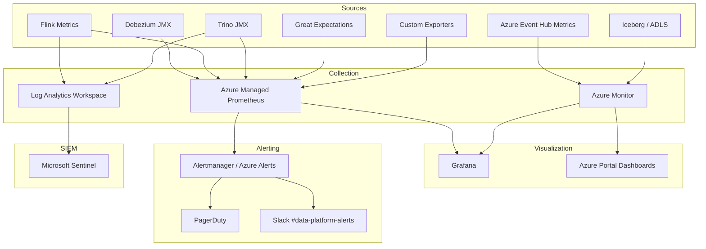
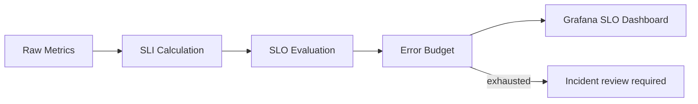
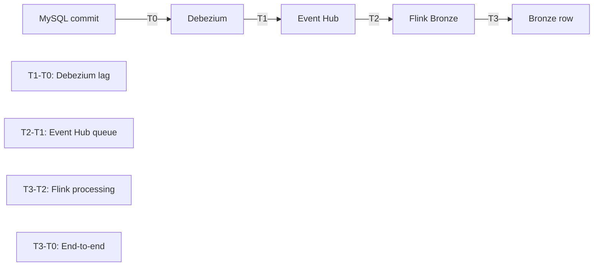
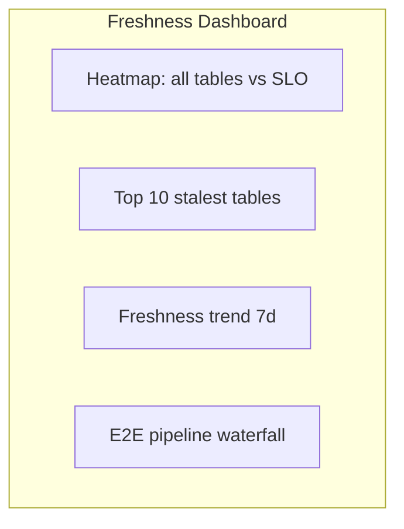
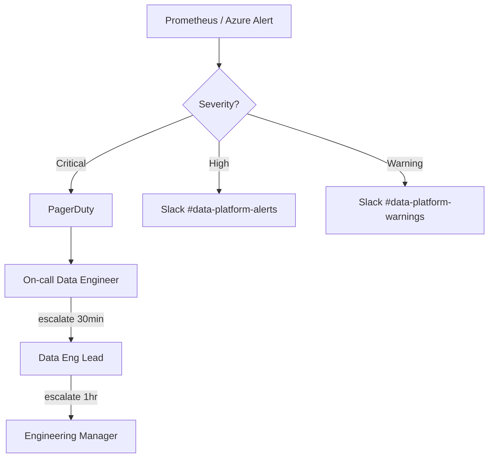
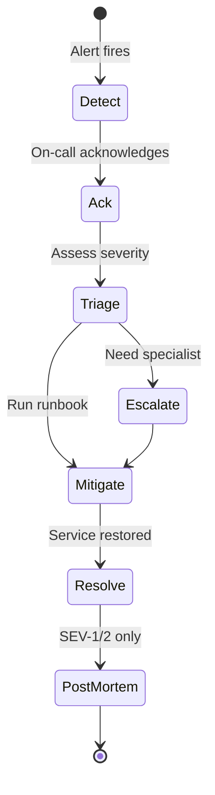

# Parts 16 & 17 — Monitoring, Observability, and Disaster Recovery

**Document ID:** DLH-ARB-2026-001-11  
**Version:** 1.0.0  
**Classification:** Internal — Confidential  
**Status:** Draft — For ARB Review

---

## Table of Contents

### Part 16 — Monitoring and Observability
1. [Overview](#1-overview)
2. [Observability Architecture](#2-observability-architecture)
3. [Service Level Objectives](#3-service-level-objectives)
4. [Ingestion and CDC Metrics](#4-ingestion-and-cdc-metrics)
5. [Flink Pipeline Metrics](#5-flink-pipeline-metrics)
6. [Event Hub Metrics](#6-event-hub-metrics)
7. [Data Freshness Metrics](#7-data-freshness-metrics)
8. [Data Quality Metrics](#8-data-quality-metrics)
9. [Storage and Compaction Metrics](#9-storage-and-compaction-metrics)
10. [Query and Consumption Metrics](#10-query-and-consumption-metrics)
11. [Cost Metrics](#11-cost-metrics)
12. [Alerting Framework](#12-alerting-framework)
13. [Grafana Dashboards](#13-grafana-dashboards)
14. [Logging and Tracing](#14-logging-and-tracing)
15. [On-Call and Incident Response](#15-on-call-and-incident-response)

### Part 17 — Disaster Recovery
16. [DR Overview](#16-dr-overview)
17. [Recovery Objectives](#17-recovery-objectives)
18. [DR Architecture](#18-dr-architecture)
19. [Blob Storage Replication and Backup](#19-blob-storage-replication-and-backup)
20. [Catalog and Metadata Backup](#20-catalog-and-metadata-backup)
21. [DR Scenarios and Runbooks](#21-dr-scenarios-and-runbooks)
22. [DR Testing Program](#22-dr-testing-program)
23. [Design Decisions and Trade-offs](#23-design-decisions-and-trade-offs)
24. [Production Recommendations](#24-production-recommendations)

---

# PART 16 — MONITORING AND OBSERVABILITY

## 1. Overview

### 1.1 Purpose

This document defines the **production monitoring, observability, and alerting** framework for the enterprise Data Lakehouse. It specifies what to measure, how to alert, and how teams detect and respond to pipeline failures, data freshness degradation, quality incidents, and cost anomalies before they impact business consumers.

### 1.2 Scope

| In Scope | Out of Scope |
|----------|--------------|
| Platform metrics (CDC, Flink, Event Hub, Trino, Iceberg) | MySQL OLTP APM (App team) |
| Data freshness and DQ SLOs | Business application logging |
| Grafana dashboards and Prometheus alerts | End-user browser RUM |
| Azure Monitor integration | Third-party SaaS APM (unless adopted) |
| On-call escalation for data platform | Corporate NOC for non-data systems |

### 1.3 Observability Principles

| ID | Principle | Implementation |
|----|-----------|----------------|
| OBS-01 | **Monitor the pipeline, not just infra** | Freshness, lag, DQ scores as first-class metrics |
| OBS-02 | **SLO-driven alerting** | Alert on user impact, not every blip |
| OBS-03 | **Golden signals everywhere** | Latency, traffic, errors, saturation |
| OBS-04 | **Actionable alerts** | Every alert links to runbook section |
| OBS-05 | **Unified dashboards** | Role-based Grafana views |
| OBS-06 | **Audit trail** | All incidents logged; post-mortems for SEV-1/2 |

### 1.4 Golden Signals — Data Platform

| Signal | Lakehouse Interpretation |
|--------|-------------------------|
| **Latency** | CDC lag, query p99, Gold freshness |
| **Traffic** | Events/sec ingest, Trino queries/min |
| **Errors** | Failed checkpoints, quarantine rate, GE failures |
| **Saturation** | Flink backpressure, Event Hub TUs, Trino queue depth |

---

## 2. Observability Architecture

### 2.1 Stack Overview



### 2.2 Component Register

| Component | Role | Deployment |
|-----------|------|------------|
| Azure Managed Prometheus | Metrics storage (Prometheus-compatible) | Azure managed |
| Grafana | Dashboards and exploration | Azure Managed Grafana |
| Azure Monitor | PaaS metrics (Event Hub, Storage, AKS) | Azure native |
| Log Analytics | Log aggregation | Workspace per env |
| Microsoft Sentinel | Security SIEM + correlation | Optional SOC integration |
| PagerDuty | On-call escalation | SaaS |
| Custom exporters | Freshness, DQ score, reconciliation | AKS CronJobs |

### 2.3 Metric Naming Convention

```
{namespace}_{subsystem}_{metric_name}_{unit}

Examples:
  lakehouse_cdc_lag_seconds
  lakehouse_flink_checkpoint_duration_ms
  lakehouse_gold_freshness_seconds{table="gold_merchant.merchant_daily_summary"}
  lakehouse_dq_score{table="...", layer="gold"}
  lakehouse_eventhub_lag_seconds{topic="eh-cdc-transaction"}
```

**Labels (required where applicable):** `env`, `job`, `table`, `domain`, `layer`, `consumer_group`

---

## 3. Service Level Objectives

### 3.1 Platform SLO Summary

| SLO ID | Service | Target | Window | Error Budget |
|--------|---------|--------|--------|--------------|
| SLO-01 | Bronze freshness (CDC → Bronze) | p99 ≤ 5 min | 30 days | 0.1% (~43 min/month) |
| SLO-02 | Silver freshness (MySQL → Silver) | p99 ≤ 15 min | 30 days | 0.1% |
| SLO-03 | Gold operational freshness | p99 ≤ 15 min | 30 days | 0.5% |
| SLO-04 | Gold executive freshness | Daily by 06:00 UTC | 30 days | 1 miss/month |
| SLO-05 | Trino query availability | 99.5% | 30 days | 3.6 hours/month |
| SLO-06 | Trino interactive query latency | p99 ≤ 30 sec | 30 days | 0.5% |
| SLO-07 | DQ score (Gold certified tables) | ≥ 95% daily | 30 days | 1 day below/month |
| SLO-08 | CDC data completeness | 100% reconciliation | Daily | Zero tolerance |
| SLO-09 | Pipeline availability (Flink jobs running) | 99.5% | 30 days | 3.6 hours/month |

### 3.2 SLO Measurement



**Example SLI — Bronze freshness:**

```
SLI = count(freshness_seconds <= 300) / count(all_freshness_samples)
SLO target = 0.999 (p99 effectively over window)
```

### 3.3 Error Budget Policy

| Budget Remaining | Action |
|------------------|--------|
| > 50% | Normal feature development |
| 25–50% | Increase monitoring; defer risky changes |
| 10–25% | Freeze non-critical deploys; focus on reliability |
| < 10% | Incident review; reliability sprint; ARB escalation |

---

## 4. Ingestion and CDC Metrics

### 4.1 Debezium / CDC Metrics

| Metric | Source | Type | Alert Threshold |
|--------|--------|------|-----------------|
| `debezium_milliseconds_behind_source` | Debezium JMX | Gauge | > 60,000 ms (1 min) |
| `debezium_connected` | Debezium JMX | Gauge | = 0 for > 2 min |
| `debezium_events_total` | Debezium JMX | Counter | Rate drop > 50% for 10 min |
| `mysql_binlog_lag_seconds` | Custom (binlog pos vs MySQL) | Gauge | > 120 sec |
| `cdc_connector_restarts_total` | K8s | Counter | > 3 in 1 hour |

### 4.2 End-to-End CDC Lag



| Lag Segment | Metric | Target p99 |
|-------------|--------|------------|
| MySQL → Debezium | `lakehouse_cdc_debezium_lag_seconds` | 30 sec |
| Debezium → Event Hub | `lakehouse_cdc_publish_lag_seconds` | 15 sec |
| Event Hub → Flink consume | `lakehouse_eventhub_consumer_lag_seconds` | 60 sec |
| Flink → Bronze write | `lakehouse_flink_bronze_processing_seconds` | 120 sec |
| **End-to-end** | `lakehouse_cdc_e2e_lag_seconds` | **300 sec (5 min)** |

### 4.3 CDC Health Dashboard Panels

| Panel | Visualization | Data Source |
|-------|---------------|-------------|
| E2E lag by domain | Time series | Custom exporter |
| Debezium binlog position | Stat + trend | JMX |
| Events/sec by table | Stacked area | Debezium |
| Connector status | Status map | K8s + JMX |
| MySQL vs Bronze reconciliation | Stat (delta %) | Daily job |

---

## 5. Flink Pipeline Metrics

### 5.1 Flink Golden Metrics

| Metric | Prometheus Name | Alert |
|--------|-----------------|-------|
| Checkpoint duration | `flink_jobmanager_job_lastCheckpointDuration` | > 180,000 ms |
| Checkpoint failures | `flink_jobmanager_job_numberOfFailedCheckpoints` | > 0 in 15 min |
| Last checkpoint age | `time() - last_completed_checkpoint_ts` | > 600 sec |
| Records in per sec | `flink_taskmanager_job_task_operator_numRecordsInPerSecond` | < 50% avg 10 min |
| Records out per sec | `flink_taskmanager_job_task_operator_numRecordsOutPerSecond` | < 50% avg 10 min |
| Backpressure | `flink_taskmanager_job_task_busyTimeMsPerSecond` | > 80% sustained 5 min |
| TaskManager count | `flink_jobmanager_numRegisteredTaskManagers` | < expected |
| Job status | `flink_jobmanager_job_uptime` | = 0 (job down) |
| DLQ records rate | `lakehouse_flink_dlq_records_total` | > 10/min |
| Iceberg commit duration | `lakehouse_flink_iceberg_commit_seconds` | > 30 sec |

### 5.2 Flink Job Monitoring Matrix

| Job | Critical Metrics | Checkpoint SLO |
|-----|-----------------|----------------|
| `flink-bronze-transaction-transactions` | Lag, records in, checkpoint | < 3 min duration |
| `flink-silver-transaction-transactions` | Backpressure, quarantine rate | < 3 min |
| `flink-gold-merchant-daily-summary` | Freshness output timestamp | < 5 min |
| `flink-gold-transaction-dashboard` | Window emit delay | < 2 min |
| All jobs | `numberOfFailedCheckpoints` | Zero per hour |

### 5.3 Flink Alert Rules (Prometheus)

```yaml
groups:
  - name: flink_pipeline
    rules:
      - alert: FlinkCheckpointFailure
        expr: increase(flink_jobmanager_job_numberOfFailedCheckpoints[15m]) > 0
        for: 5m
        labels:
          severity: critical
        annotations:
          summary: "Flink checkpoint failed for {{ $labels.job_name }}"
          runbook: "13-runbook.md#flink-checkpoint-failure"

      - alert: FlinkJobNotRunning
        expr: flink_jobmanager_job_uptime == 0
        for: 2m
        labels:
          severity: critical
        annotations:
          summary: "Flink job {{ $labels.job_name }} is not running"

      - alert: FlinkHighBackpressure
        expr: avg(flink_taskmanager_job_task_busyTimeMsPerSecond) > 800
        for: 10m
        labels:
          severity: warning
        annotations:
          summary: "Flink backpressure high on {{ $labels.job_name }}"
```

---

## 6. Event Hub Metrics

### 6.1 Azure Event Hub Metrics

| Metric (Azure) | Description | Alert Threshold |
|----------------|-------------|-----------------|
| `IncomingMessages` | Publish rate | Anomaly: > 200% or < 50% of 1hr avg |
| `IncomingBytes` | Volume | Capacity planning |
| `ServerBusyErrors` | Throttling | > 0 sustained 5 min |
| `UserErrors` | Client errors | > 10/min |
| `QuotaExceededErrors` | TU exhaustion | > 0 |
| `CaptureLag` | If capture enabled | > 1 hour |

### 6.2 Consumer Lag Metrics

| Metric | Calculation | Alert |
|--------|-------------|-------|
| `eventhub_consumer_lag_seconds` | `latest_enqueued_time - consumer_offset_time` | p99 > 300 sec |
| `eventhub_partition_lag_messages` | Offset difference per partition | Any partition > 1M messages |
| `eventhub_consumer_ownership` | Active consumers vs partitions | Consumers < partitions |

**Per consumer group:**

| Consumer Group | Topic | Lag Alert |
|----------------|-------|-----------|
| `cg-flink-bronze-transaction-transactions-prod` | `eh-cdc-transaction` | > 5 min |
| `cg-flink-silver-transaction-transactions-prod` | Internal (Bronze read) | > 10 min |
| `cg-flink-bronze-merchant-merchants-prod` | `eh-cdc-merchant` | > 10 min |

### 6.3 Event Hub Saturation

| Signal | Action |
|--------|--------|
| `ServerBusyErrors` > 0 | Scale TUs; alert Platform |
| TU utilization > 80% sustained | Plan TU increase |
| Partition count insufficient for Flink parallelism | Add partitions (requires planning) |

---

## 7. Data Freshness Metrics

### 7.1 Freshness Definition

```
freshness_seconds = now() - max(last_updated_ts)   -- Gold marts
freshness_seconds = now() - max(ingest_ts)         -- Silver tables
freshness_seconds = now() - max(flink_ingest_ts)   -- Bronze tables
```

### 7.2 Freshness SLO by Mart

| Table / Mart | SLO (p99) | Metric Label | Alert Threshold |
|--------------|-----------|--------------|-----------------|
| `gold_ops.transaction_dashboard` | 5 min | `transaction_dashboard` | > 7 min |
| `gold_risk.fraud_summary` | 15 min | `fraud_summary` | > 20 min |
| `gold_merchant.merchant_daily_summary` | 1 hour | `merchant_daily_summary` | > 75 min |
| `gold_settlement.settlement_summary` | 1 hour | `settlement_summary` | > 75 min |
| `gold_exec.kpi_daily` | Daily 06:00 UTC | `kpi_daily` | Not complete by 06:30 |
| `silver_transaction.transactions` | 15 min E2E | `silver_transactions` | > 20 min |
| `bronze_transaction.transactions_cdc` | 5 min | `bronze_transactions_cdc` | > 10 min |

### 7.3 Freshness Exporter

Custom CronJob (`job-freshness-exporter`) runs every 60 seconds:

```sql
-- Executed via Trino; exported to Prometheus
SELECT
    'gold_merchant.merchant_daily_summary' AS table_fqn,
    'gold' AS layer,
    date_diff('second', MAX(last_updated_ts), CURRENT_TIMESTAMP) AS freshness_seconds
FROM lakehouse.gold_merchant.merchant_daily_summary
WHERE summary_date >= CURRENT_DATE - INTERVAL '7' DAY;
```

**Prometheus metric:**

```
lakehouse_table_freshness_seconds{table="gold_merchant.merchant_daily_summary", layer="gold"} 342
```

### 7.4 Freshness Dashboard



---

## 8. Data Quality Metrics

### 8.1 DQ Metrics Register

| Metric | Source | Alert Threshold |
|--------|--------|-----------------|
| `lakehouse_dq_score` | GE + custom calculator | Gold < 95%; Silver < 98% |
| `lakehouse_quarantine_rate` | Quarantine tables | > 0.5%/hour |
| `lakehouse_quarantine_unresolved_count` | Quarantine tables | > 1000 |
| `lakehouse_ge_failed_expectations_total` | GE checkpoint | > 0 on Gold |
| `lakehouse_reconciliation_delta_pct` | R-001 job | > 0.01% |
| `lakehouse_dq_warn_rate` | Silver `dq_status=WARN` | > 5%/hour |
| `lakehouse_quarantine_oldest_unresolved_hours` | Quarantine | > 72 hours |

### 8.2 DQ Score Export

Daily at 05:00 UTC after GE checkpoint (see `07-data-quality.md`):

```
lakehouse_dq_score{table="gold_merchant.merchant_daily_summary", layer="gold", component="completeness"} 0.99
lakehouse_dq_score{table="gold_merchant.merchant_daily_summary", layer="gold", component="aggregate"} 0.97
```

### 8.3 DQ Alert Integration

| Alert ID | Condition | Severity | Runbook |
|----------|-----------|----------|---------|
| MON-DQ-001 | Gold DQ score < 90% | Critical | §DQ-001 |
| MON-DQ-002 | GE failure on certified Gold mart | Critical | §DQ-005 |
| MON-DQ-003 | Reconciliation delta > 0.01% | High | §DQ-004 |
| MON-DQ-004 | Quarantine rate > 1% | High | §DQ-003 |

---

## 9. Storage and Compaction Metrics

### 9.1 Iceberg / Storage Metrics

| Metric | Source | Alert |
|--------|--------|-------|
| `lakehouse_iceberg_table_size_bytes` | Daily inventory | Anomaly > 150% WoW |
| `lakehouse_iceberg_snapshot_count` | Iceberg API | > 500 per table |
| `lakehouse_small_file_ratio` | Partition inventory | > 30% files < 10 MB |
| `lakehouse_compaction_duration_seconds` | Compaction job | > 4 hours |
| `lakehouse_compaction_files_rewritten_total` | Compaction job | 0 files when ratio high |
| `lakehouse_tier_migration_lag_days` | Partition inventory | Partition > 400 days on Hot |
| `lakehouse_orphan_files_count` | Weekly orphan scan | > 0 |
| `azure_storage_blob_capacity` | Azure Monitor | Trend monitoring |
| `azure_storage_transactions` | Azure Monitor | Throttling errors |

### 9.2 Compaction Health

| Indicator | Healthy | Unhealthy |
|-----------|---------|-----------|
| Small file ratio | < 20% | > 30% |
| Avg file size (Silver txn) | > 256 MB | < 64 MB |
| Snapshots per table | < 100 | > 300 |
| Last compaction age | < 25 hours | > 48 hours |
| Manifest rewrite age | < 8 days | > 14 days |

### 9.3 Storage Alert Rules

```yaml
- alert: SmallFileRatioHigh
  expr: lakehouse_small_file_ratio > 0.30
  for: 1h
  labels:
    severity: warning
  annotations:
    summary: "Small file ratio > 30% on {{ $labels.table_fqn }}"

- alert: UntieredPartitionDetected
  expr: lakehouse_tier_migration_lag_days > 35
  for: 24h
  labels:
    severity: warning
  annotations:
    summary: "Partition {{ $labels.partition }} not tiered on schedule"
```

---

## 10. Query and Consumption Metrics

### 10.1 Trino Metrics

| Metric | Source | Alert |
|--------|--------|-------|
| `trino_execution_QueryManager_QueuedQueries` | JMX | > 20 sustained |
| `trino_execution_QueryManager_RunningQueries` | JMX | At worker capacity > 10 min |
| `trino_execution_QueryManager_FailedQueries` | JMX | Rate > 10/min |
| `trino_execution_QueryManager_ExecutionTime` | JMX p99 | > 30 sec interactive |
| `trino_cluster_MemoryPool_BlockedNodes` | JMX | > 0 |
| `trino_failuredetector_ActiveCount` | JMX | Worker failures |
| Query audit: rows scanned | Trino audit log | Anomaly detection |

### 10.2 Superset Metrics

| Metric | Source | Alert |
|--------|--------|-------|
| Dashboard load time p99 | Superset logs | > 10 sec |
| Chart query failures | Superset logs | > 5% rate |
| Active users | Superset | — |
| Cache hit rate | Redis metrics | < 50% for executive dashboards |

### 10.3 Catalog (Polaris) Metrics

| Metric | Alert |
|--------|-------|
| Polaris REST API latency p99 | > 2 sec |
| Polaris API error rate | > 1% |
| PostgreSQL connection pool saturation | > 80% |
| Catalog commit conflicts | > 10/hour on single table |

---

## 11. Cost Metrics

### 11.1 Cost Monitoring

| Metric | Source | Alert |
|--------|--------|-------|
| Daily storage cost by account | Azure Cost Management | > 110% of 7-day avg |
| Hot tier % of total storage | Custom + Azure | > 60% after Year 3 |
| AKS node pool cost | Azure Cost Management | > 120% of budget |
| Event Hub TU cost | Azure | TU utilization vs provisioned |
| Egress cost | Azure | Anomaly spike |
| Unattached disk / orphan storage | Azure Advisor | Any |

### 11.2 Cost Efficiency KPIs

| KPI | Formula | Target |
|-----|---------|--------|
| Cost per TB ingested | Monthly cost / TB new data | Decrease YoY |
| Hot storage ratio | Hot TB / total TB | < 40% (Year 3+) |
| Query cost proxy | Trino CPU-hours / query count | Stable |
| Compaction ROI | Small file ratio reduction post-compaction | > 50% reduction |

### 11.3 Cost Dashboard Panels

| Panel | Description |
|-------|-------------|
| Daily cost trend (30d) | By account: hot, cool, archive, ops |
| Hot/Cool/Archive split | Pie chart over time |
| Cost vs data volume | Dual axis |
| Top 10 expensive tables | By storage size |
| Budget burn rate | Monthly forecast |

---

## 12. Alerting Framework

### 12.1 Alert Severity Model

| Severity | Response | Channel | Examples |
|----------|----------|---------|----------|
| **Critical (SEV-1)** | 15 min | PagerDuty + Slack | Flink job down; Gold DQ < 90%; E2E lag > 30 min |
| **High (SEV-2)** | 1 hour | Slack + email | Checkpoint slow; reconciliation fail; freshness SLO miss |
| **Warning (SEV-3)** | 4 hours | Slack | Backpressure; small files; cost anomaly |
| **Info** | Next business day | Slack digest | INFO-level DQ; scheduled job completion |

### 12.2 Alert Routing



### 12.3 Alert Catalog

| ID | Name | Condition | Severity |
|----|------|-----------|----------|
| MON-001 | CDC E2E lag critical | `cdc_e2e_lag_seconds` p99 > 1800 | Critical |
| MON-002 | CDC E2E lag warning | p99 > 600 for 10 min | High |
| MON-003 | Flink job not running | uptime = 0 | Critical |
| MON-004 | Flink checkpoint failure | failed checkpoints > 0 | Critical |
| MON-005 | Event Hub throttling | ServerBusyErrors > 0 | High |
| MON-006 | Event Hub consumer lag | > 5 min | High |
| MON-007 | Gold freshness SLO miss | per mart threshold | High |
| MON-008 | Silver freshness SLO miss | > 20 min | High |
| MON-009 | Gold DQ score critical | < 90% | Critical |
| MON-010 | Reconciliation failure | delta > 0.01% | High |
| MON-011 | Trino coordinator down | health check fail | Critical |
| MON-012 | Trino query failure spike | > 10/min | High |
| MON-013 | Small file ratio high | > 30% | Warning |
| MON-014 | Storage cost anomaly | > 110% 7d avg | Warning |
| MON-015 | Polaris API errors | error rate > 1% | High |
| MON-016 | Debezium disconnected | connected = 0 | Critical |
| MON-017 | Daily KPI job not complete | after 06:30 UTC | High |
| MON-018 | Tier migration failure | job status = FAILED | High |

### 12.4 Alert Hygiene

| Rule | Description |
|------|-------------|
| AH-01 | Every alert MUST link to runbook section |
| AH-02 | Alerts firing > 7 days without action → review or remove |
| AH-03 | No alert without `severity` and `team` labels |
| AH-04 | Critical alerts require runbook tested in last 90 days |
| AH-05 | Monthly alert fatigue review — target < 5 critical/week |

---

## 13. Grafana Dashboards

### 13.1 Dashboard Catalog

| Dashboard | UID | Audience | Refresh |
|-----------|-----|----------|---------|
| **Platform Overview** | `lakehouse-overview` | All engineers | 1 min |
| **Ingest Health** | `lakehouse-ingest` | Data Eng | 30 sec |
| **Pipeline Health (Flink)** | `lakehouse-flink` | Data Eng | 30 sec |
| **Gold Freshness** | `lakehouse-freshness` | Data Eng + Analytics | 1 min |
| **Data Quality** | `lakehouse-dq` | Data Eng + Stewards | 5 min |
| **Storage & Compaction** | `lakehouse-storage` | Platform + Data Eng | 15 min |
| **Cost & Storage** | `lakehouse-cost` | Platform + Finance | 1 hour |
| **Trino Performance** | `lakehouse-trino` | Platform | 1 min |
| **SLO Summary** | `lakehouse-slo` | Leadership + Eng | 5 min |
| **Executive Data Health** | `lakehouse-exec` | Executives | 1 hour |

### 13.2 Platform Overview Dashboard Layout

```
┌─────────────────────────────────────────────────────────────┐
│  LAKEHOUSE PLATFORM OVERVIEW                    [🟢 Healthy] │
├──────────────┬──────────────┬──────────────┬───────────────┤
│ E2E CDC Lag  │ Gold Fresh   │ DQ Score     │ Active Alerts │
│   2.3 min    │   4.1 min    │   96.8%      │      0        │
├──────────────┴──────────────┴──────────────┴───────────────┤
│  [Ingest Rate — events/sec by domain          — time series] │
├──────────────────────────┬──────────────────────────────────┤
│  Flink Jobs Status       │  Event Hub Consumer Lag          │
│  [status grid 12 jobs]   │  [time series by consumer group] │
├──────────────────────────┴──────────────────────────────────┤
│  Freshness Heatmap (Gold marts vs SLO)                      │
├──────────────────────────┬──────────────────────────────────┤
│  SLO Error Budget (30d)  │  Top Stale Tables                │
└──────────────────────────┴──────────────────────────────────┘
```

### 13.3 Ingest Health Dashboard — Key Panels

| Panel | Query (conceptual) | Visualization |
|-------|-------------------|---------------|
| CDC E2E lag by domain | `lakehouse_cdc_e2e_lag_seconds` | Time series |
| Debezium lag | JMX metric | Gauge |
| Events/sec ingest | Rate of Bronze writes | Stacked area |
| Failed events (DLQ) | DLQ rate | Bar chart |
| MySQL reconciliation | Daily delta % | Stat |
| Binlog position gap | Custom | Time series |

### 13.4 Role-Based Access

| Role | Dashboards |
|------|-------------|
| Data Engineer | All |
| Platform Engineer | Overview, Flink, Trino, Storage, Cost |
| Analytics Lead | Freshness, DQ, Executive |
| Executive | Executive Data Health only |
| Security | Audit panels (Sentinel link) |

---

## 14. Logging and Tracing

### 14.1 Log Sources

| Source | Destination | Retention |
|--------|-------------|-----------|
| Flink job logs | Log Analytics | 90 days |
| Trino server logs | Log Analytics | 90 days |
| Trino query audit | `stauditprod` + Log Analytics | 2 years |
| Debezium connector logs | Log Analytics | 30 days |
| AKS control plane | Azure Monitor | 90 days |
| Superset application logs | Log Analytics | 90 days |
| Polaris application logs | Log Analytics | 90 days |

### 14.2 Structured Log Format

```json
{
  "timestamp": "2026-07-02T10:30:00.123Z",
  "level": "ERROR",
  "service": "flink-silver-transaction-transactions",
  "job_id": "abc123",
  "message": "Iceberg commit failed after 4 retries",
  "table": "silver_transaction.transactions",
  "exception": "CommitFailedException",
  "trace_id": "550e8400-e29b-41d4-a716-446655440000"
}
```

### 14.3 Distributed Tracing (Future)

| Phase | Capability |
|-------|------------|
| Phase 3 | Correlation IDs in Flink → OpenLineage run IDs |
| Phase 4 | OpenTelemetry export from Trino and Flink |
| Phase 5 | End-to-end trace: CDC event → Superset query |

---

## 15. On-Call and Incident Response

### 15.1 On-Call Rotation

| Team | Coverage | Escalation |
|------|----------|------------|
| Data Engineering | Primary on-call (24/7 for Critical) | Data Eng Lead |
| Platform Engineering | Secondary for infra (Trino, AKS, storage) | Platform Lead |
| Security | Consult for SEC-ALT-* alerts | CISO delegate |

### 15.2 Incident Severity

| Severity | Definition | Example |
|----------|------------|---------|
| SEV-1 | Production data pipeline down; executive KPIs wrong | Flink job failed; DQ < 90% on kpi_daily |
| SEV-2 | Degraded freshness or partial domain failure | Transaction lag > 30 min |
| SEV-3 | Non-critical component; workaround exists | Single TaskManager restart |
| SEV-4 | Cosmetic / planning | Dashboard panel broken |

### 15.3 Incident Workflow



### 15.4 Post-Incident Requirements

| Severity | Post-Mortem | Timeline |
|----------|-------------|----------|
| SEV-1 | Required | Within 5 business days |
| SEV-2 | Required | Within 10 business days |
| SEV-3 | Optional | — |

---

# PART 17 — DISASTER RECOVERY

## 16. DR Overview

### 16.1 Purpose

This section defines **disaster recovery** capabilities for the Data Lakehouse — recovery objectives, replication topology, backup procedures, and runbooks for restoring analytics operations after infrastructure failures ranging from single pod crashes to full region outages.

### 16.2 DR Scope

| In Scope | Out of Scope |
|----------|--------------|
| Lakehouse data (Iceberg on ADLS) | MySQL OLTP DR (App DBA) |
| Polaris catalog | Business application failover |
| Event Hub geo-disaster recovery | Full active-active multi-region analytics |
| Flink job recovery via checkpoints | Zero-downtime cross-region query |

### 16.3 Business Impact

| Outage Duration | Business Impact |
|-----------------|-----------------|
| < 15 min | Minimal — dashboards slightly stale |
| 15 min – 4 hr | Operational dashboards stale; fraud monitoring degraded |
| 4 – 8 hr | Executive reporting delayed; finance reconciliation blocked |
| > 8 hr | Regulatory reporting risk; executive escalation |

---

## 17. Recovery Objectives

### 17.1 RPO and RTO Summary

| Tier | Scope | RPO | RTO | Method |
|------|-------|-----|-----|--------|
| **Tier 0** | Single pod / TaskManager | 0 | Auto (minutes) | K8s restart |
| **Tier 1** | Flink job failure | 5 min | 30 min | Checkpoint restore |
| **Tier 2** | Trino coordinator failure | 0 | 5 min | HA failover |
| **Tier 3** | Debezium / Event Hub partial | 5 min | 1 hr | Offset replay |
| **Tier 4** | ADLS primary unavailable | 15 min | 4 hr | RA-GRS read + replay |
| **Tier 5** | Full primary region outage | 15 min | 8 hr | DR region activation |
| **Tier 6** | Polaris catalog DB loss | 24 hr | 2 hr | PostgreSQL PITR |
| **Tier 7** | Accidental table deletion | 0 | 1 hr | Iceberg snapshot rollback |

### 17.2 RPO / RTO Diagram

```mermaid
quadrantChart
    title Recovery Objectives by Scenario
    x-axis Low RTO --> High RTO
    y-axis Low RPO (less data loss) --> High RPO
    quadrant-1 Quick recovery, minimal loss
    quadrant-2 Quick recovery, more data loss
    quadrant-3 Slow recovery, minimal loss
    quadrant-4 Slow recovery, more data loss
    TaskManager restart: [0.15, 0.95]
    Flink checkpoint: [0.25, 0.85]
    Trino HA failover: [0.10, 0.95]
    Region outage: [0.75, 0.80]
    Polaris DB restore: [0.30, 0.40]
    Table rollback: [0.15, 0.98]
```

### 17.3 Recovery Priority Order

| Priority | Component | Rationale |
|----------|-----------|-----------|
| 1 | Event Hub (buffer) | Prevents data loss during outage |
| 2 | Flink jobs (ingest) | Restore pipeline continuity |
| 3 | ADLS Hot (data) | Query and pipeline dependency |
| 4 | Polaris catalog | Required for Trino queries |
| 5 | Trino cluster | Enable analyst access |
| 6 | Superset | Dashboard access |
| 7 | OpenMetadata / Marquez | Discovery (non-blocking) |

---

## 18. DR Architecture

### 18.1 Multi-Region Topology

```mermaid
flowchart TB
    subgraph Primary — East US
        AKS1[AKS Data Platform]
        ADLS1[ADLS stlakehotprod]
        EH1[Event Hub Primary]
        POL1[Polaris + PostgreSQL]
        FLINK1[Flink Cluster]
        TRINO1[Trino Cluster]
    end

    subgraph DR — West US
        AKS2[AKS Standby — minimal]
        ADLS2[ADLS RA-GRS Replica]
        EH2[Event Hub GRS Secondary]
        POL2[Polaris PG Geo-Backup]
        TRINO2[Trino Standby — cold]
    end

    ADLS1 -->|async GRS| ADLS2
    EH1 -->|Geo-DR pairing| EH2
    POL1 -->|daily backup + replica| POL2
    FLINK1 -->|checkpoints| ADLS1
```

### 18.2 DR Activation Levels

| Level | Trigger | Actions |
|-------|---------|---------|
| **L0 — Normal** | — | Primary region only |
| **L1 — Degraded** | Single component failure | Automated failover (Trino HA, K8s restart) |
| **L2 — Regional stress** | ADLS or Event Hub degradation | Scale resources; enable GRS read |
| **L3 — Region outage** | Primary region unavailable | Execute full DR runbook |
| **L4 — Return to primary** | Primary region restored | Failback procedure |

### 18.3 DR Region Capabilities (Standby)

| Component | Standby State | Activation Time |
|-----------|--------------|-----------------|
| AKS cluster | Pre-provisioned (scaled to zero or minimal) | 1–2 hr scale-up |
| Trino | Helm chart ready; 0 workers | 30 min |
| Flink | Savepoint paths accessible; jobs not running | 2–4 hr restore |
| Superset | Cold standby image | 1 hr |
| Polaris | PostgreSQL geo-restore | 1–2 hr |
| ADLS | RA-GRS read enabled | Immediate (read) |

---

## 19. Blob Storage Replication and Backup

### 19.1 Storage Replication Strategy

| Account | Replication | DR Mechanism | RPO |
|---------|-------------|--------------|-----|
| `stlakehotprod` | LRS (primary) | RA-GRS on `stlakearchiveprod`; cross-region copy for critical metadata | 15 min (async) |
| `stlakecoolprod` | LRS | Same region; Cool data less time-critical for DR | 24 hr acceptable |
| `stlakearchiveprod` | **RA-GRS** | Native geo-redundant | 15 min |
| `stlakeopsprod` | LRS | Checkpoint replicability via savepoints to archive account | 5 min (checkpoints) |
| `stdocumentsprod` | **RA-GRS** | Native geo-redundant | 15 min |
| `stauditprod` | GRS | Audit log durability | 15 min |

### 19.2 Iceberg Data Protection

| Protection Layer | Mechanism |
|------------------|-----------|
| Flink checkpoints | Every 5 min to `stlakeopsprod` |
| Flink savepoints | Pre-deploy to `stlakeopsprod` |
| Iceberg snapshots | Time travel + monthly tags |
| Iceberg metadata backup | Daily export to `stauditprod` |
| Cross-region metadata copy | Daily rsync of `*/metadata/` to archive account GRS |
| Soft delete | 90-day blob soft delete on Hot account |
| Blob versioning | Enabled on documents and audit accounts |

### 19.3 Event Hub Geo-Disaster Recovery

| Configuration | Value |
|---------------|-------|
| Primary namespace | `ehn-data-platform-prod` (East US) |
| Secondary namespace | `ehn-data-platform-prod-dr` (West US) |
| Geo-DR pairing | Enabled on Premium namespace |
| Failover mode | Manual failover (Metadata replication) |
| Retention (primary) | 7 days (transaction); 30 days (critical) |
| Post-failover | Update Debezium + Flink connection strings |

**RPO note:** Unprocessed events in primary at failover time may be lost unless failover occurs before retention expiry. **Target: manual failover within 15 minutes of region declaration.**

### 19.4 Backup Schedule — Storage

| Asset | Method | Frequency | Retention |
|-------|--------|-----------|-----------|
| Iceberg metadata files | Copy to `stauditprod` | Daily | 90 days |
| Flink savepoints | ADLS ops path | Pre-deploy | 30 days |
| Flink checkpoints | Continuous | 5 min | 7 days auto-cleanup |
| Document blobs | RA-GRS + versioning | Continuous | Per retention policy |
| Regulatory export snapshots | Manual to `stauditprod` | On demand | 7 years |

---

## 20. Catalog and Metadata Backup

### 20.1 Polaris Catalog Backup

| Component | Backup Method | Frequency | Retention |
|-----------|---------------|-----------|-----------|
| PostgreSQL (Polaris backend) | Azure automated backup | Daily | 35 days |
| PostgreSQL PITR | Continuous WAL | Continuous | 35 days |
| Polaris config / Helm values | Git repository | Every change | Indefinite |
| Namespace definitions | Export via Polaris API | Daily | 90 days |

**Restore procedure:** PostgreSQL PITR to new instance → repoint Polaris deployment → validate catalog connectivity.

### 20.2 Secondary Metadata Systems

| System | Backup | RPO | RTO |
|--------|--------|-----|-----|
| Marquez (lineage) PostgreSQL | Azure automated backup | 24 hr | 2 hr |
| OpenMetadata PostgreSQL | Azure automated backup | 24 hr | 2 hr |
| `audit.retention_registry` | Iceberg + daily Git export | 0 | 30 min |
| Entra ID group memberships | Microsoft native | — | 4 hr |

### 20.3 Catalog Recovery Runbook (Summary)

| Step | Action | Owner | Duration |
|------|--------|-------|----------|
| 1 | Declare incident; assess corruption scope | Platform Lead | 15 min |
| 2 | Stop all Flink jobs writing to catalog | Data Eng | 5 min |
| 3 | Initiate PostgreSQL PITR to last known good time | Platform | 30 min |
| 4 | Redeploy Polaris against restored DB | Platform | 15 min |
| 5 | Validate table list matches Iceberg metadata | Data Eng | 30 min |
| 6 | Resume Flink jobs from checkpoint | Data Eng | 30 min |
| 7 | Run reconciliation R-001 | Data Eng | 30 min |
| 8 | All-clear communication | Platform Lead | — |

---

## 21. DR Scenarios and Runbooks

### 21.1 Scenario Register

| ID | Scenario | Tier | RPO | RTO | Runbook |
|----|----------|------|-----|-----|---------|
| DR-01 | Flink TaskManager OOM | 0 | 0 | 5 min | Auto-restart |
| DR-02 | Flink JobManager failure | 1 | 5 min | 15 min | §21.2 |
| DR-03 | Flink job corruption | 1 | 5 min | 30 min | §21.3 |
| DR-04 | Trino coordinator failure | 2 | 0 | 5 min | HA failover |
| DR-05 | Debezium connector failure | 3 | 5 min | 30 min | Restart + offset |
| DR-06 | Event Hub throttling/outage | 3 | 0 | 1 hr | Scale TUs / failover |
| DR-07 | ADLS primary unavailable | 4 | 15 min | 4 hr | §21.4 |
| DR-08 | Full region outage | 5 | 15 min | 8 hr | §21.5 |
| DR-09 | Polaris DB corruption | 6 | 24 hr | 2 hr | §20.3 |
| DR-10 | Accidental Iceberg table drop | 7 | 0 | 1 hr | Snapshot rollback |
| DR-11 | Ransomware / data corruption | 5 | 15 min | 8 hr | GRS + snapshot isolation |

### 21.2 Runbook — Flink JobManager Failure (DR-02)

| Step | Action |
|------|--------|
| 1 | Confirm alert `FlinkJobNotRunning` or `FlinkCheckpointFailure` |
| 2 | Check Flink UI / REST API for JobManager status |
| 3 | If TaskManagers healthy: restart JobManager pod |
| 4 | If job not recovering: restore from last completed checkpoint |
| 5 | Command: `flink run -s abfss://flink-checkpoints@stlakeopsprod/.../chk-XXX` |
| 6 | Verify consumer lag decreasing |
| 7 | Run reconciliation for affected domain |
| 8 | Document incident |

### 21.3 Runbook — Flink Job Corruption (DR-03)

| Step | Action |
|------|--------|
| 1 | Stop affected Flink job gracefully (savepoint if possible) |
| 2 | Assess corruption scope (single domain vs systemic) |
| 3 | If savepoint valid: restore from savepoint |
| 4 | If savepoint corrupt: restore from last checkpoint |
| 5 | If checkpoint corrupt: reset Event Hub offset to `now() - 30 min` |
| 6 | Truncate or branch affected Silver tables |
| 7 | Replay from Bronze if needed |
| 8 | Full reconciliation before all-clear |

### 21.4 Runbook — ADLS Primary Unavailable (DR-07)

| Step | Action | Duration |
|------|--------|----------|
| 1 | Confirm Azure status page; open Azure support ticket | 5 min |
| 2 | Halt Flink jobs writing to primary ADLS | 5 min |
| 3 | Enable read access to RA-GRS secondary (archive account GRS) | 15 min |
| 4 | Repoint Trino catalog to GRS-readable paths (if Hot unavailable) | 30 min |
| 5 | Assess Event Hub backlog growth | Ongoing |
| 6 | When primary recovers: validate data integrity | 1 hr |
| 7 | Resume Flink from checkpoints | 30 min |
| 8 | Reconciliation full pipeline | 1 hr |

### 21.5 Runbook — Full Region Outage (DR-08)

| Step | Action | Duration |
|------|--------|----------|
| 1 | Declare DR-08; activate incident command | 15 min |
| 2 | Confirm primary region unavailable via Azure | 5 min |
| 3 | **Event Hub:** Initiate manual geo-failover to secondary namespace | 15 min |
| 4 | **ADLS:** Confirm GRS secondary readable; document RPO gap | 15 min |
| 5 | **AKS DR:** Scale up standby cluster in West US | 1–2 hr |
| 6 | **Polaris:** Restore PostgreSQL from geo-backup | 1–2 hr |
| 7 | **Flink:** Deploy jobs; restore from savepoints/checkpoints on GRS storage | 2–4 hr |
| 8 | **Trino:** Deploy with read access to GRS data | 1 hr |
| 9 | Run full reconciliation R-001 all domains | 1 hr |
| 10 | Enable read-only Superset for critical dashboards | 30 min |
| 11 | Communicate status to stakeholders | Ongoing |
| 12 | Plan failback when primary region restored | T+24 hr |

**Total target RTO: 8 hours to read-only analytics; 24 hours to full pipeline.**

### 21.6 Runbook — Iceberg Table Rollback (DR-10)

```sql
-- 1. Identify last good snapshot before accidental operation
SELECT snapshot_id, committed_at, operation
FROM lakehouse.silver_transaction."transactions$snapshots"
ORDER BY committed_at DESC
LIMIT 20;

-- 2. Rollback table to snapshot
CALL lakehouse.system.rollback_to_snapshot(
    'silver_transaction.transactions',
    984572837465234
);

-- 3. Verify row counts
SELECT COUNT(*) FROM lakehouse.silver_transaction.transactions;

-- 4. Resume downstream Gold jobs
-- 5. Reconcile affected Gold marts
```

---

## 22. DR Testing Program

### 22.1 Test Schedule

| Test | Frequency | Scope | Success Criteria | Owner |
|------|-----------|-------|------------------|-------|
| Flink checkpoint restore | Monthly | One production job (staging mirror) | Job resumes; lag < 15 min | Data Eng |
| Trino coordinator failover | Quarterly | Production HA failover | RTO < 5 min | Platform |
| Debezium restart + offset | Quarterly | Staging | No data loss | Data Eng |
| ADLS GRS read validation | Semi-annual | Read sample tables from secondary | Query succeeds | Platform |
| Polaris PostgreSQL PITR | Semi-annual | Restore to isolated instance | Catalog matches | Platform |
| Event Hub geo-failover drill | Annual | Failover to DR namespace (planned window) | RPO < 15 min documented | Platform |
| Full region DR drill | Annual | DR-08 runbook end-to-end | RTO < 8 hr | All teams |
| Iceberg snapshot rollback | Quarterly | Staging table | Rollback in < 1 hr | Data Eng |
| Backup restoration verification | Monthly | Random backup sample | Restore succeeds | Platform |

### 22.2 DR Test Documentation

Each DR test MUST produce:

| Document | Content |
|----------|---------|
| Test plan | Scope, date, participants, rollback plan |
| Execution log | Timestamped steps |
| Results | RPO/RTO achieved vs target |
| Issues found | Gaps in runbook or infrastructure |
| Remediation tickets | Jira links |
| Runbook updates | PR to `13-runbook.md` if needed |

### 22.3 DR Maturity Model

| Level | Characteristics | Target Phase |
|-------|-----------------|--------------|
| **L1 Ad hoc** | Manual recovery; no tests | — |
| **L2 Defined** | Runbooks exist; quarterly tests | Phase 3 |
| **L3 Managed** | Automated failover (Trino HA); monthly tests | Phase 4 |
| **L4 Optimized** | Annual full DR drill; RTO consistently met | Phase 6 |

---

## 23. Design Decisions and Trade-offs

| ADR | Decision | Benefit | Tradeoff | Mitigation |
|-----|----------|---------|----------|------------|
| ADR-M11-001 | Azure Managed Prometheus | Reduced ops burden | Vendor lock-in | PromQL portable |
| ADR-M11-002 | Manual Event Hub geo-failover | Controlled failover | Slower than auto | Runbook + annual drill |
| ADR-M11-003 | RPO 15 min (not zero) for region DR | Cost-effective GRS | Up to 15 min data at risk | Event Hub retention buffer |
| ADR-M11-004 | Cold Trino standby (not active-active) | Cost savings | 30 min+ Trino RTO in DR | Pre-built Helm charts |
| ADR-M11-005 | Custom freshness exporter vs Trino alone | Gold-specific SLOs | Extra CronJob | Low maintenance |
| ADR-M11-006 | PagerDuty for Critical only | Reduce alert fatigue | Warning may delay | Slack for High/Warning |
| ADR-M11-007 | LRS on Hot (not GRS) | Lower cost/latency | Region loss requires GRS read from archive | Cross-region metadata backup |
| ADR-M11-008 | 8 hr RTO for full region | Realistic for lakehouse | Business impact window | Priority comms plan |

---

## 24. Production Recommendations

### 24.1 Phase 3 Monitoring Checklist

| # | Item | Priority |
|---|------|----------|
| 1 | Deploy Azure Managed Prometheus + Grafana | P0 |
| 2 | Configure Flink Prometheus reporter | P0 |
| 3 | Deploy freshness exporter CronJob | P0 |
| 4 | Create Platform Overview + Ingest Health dashboards | P0 |
| 5 | Configure Critical alerts MON-001–MON-006 | P0 |
| 6 | Integrate PagerDuty with on-call rotation | P0 |
| 7 | Enable Trino JMX → Prometheus | P1 |
| 8 | Enable Azure Monitor for Event Hub + Storage | P1 |
| 9 | Create Gold Freshness + DQ dashboards | P1 |
| 10 | Document on-call runbook links in alerts | P1 |

### 24.2 Phase 4 DR Checklist

| # | Item | Priority |
|---|------|----------|
| 11 | Enable Event Hub Geo-DR pairing | P1 |
| 12 | Configure RA-GRS on archive + documents accounts | P1 |
| 13 | Document DR-01 through DR-11 runbooks in `13-runbook.md` | P1 |
| 14 | Execute first Flink checkpoint restore test | P1 |
| 15 | Polaris PostgreSQL PITR test | P1 |
| 16 | Pre-provision DR region AKS (minimal) | P2 |
| 17 | Annual full DR drill scheduled | P2 |
| 18 | SLO dashboard for leadership | P2 |

### 24.3 Success Criteria

| Criterion | Target |
|-----------|--------|
| Critical alert coverage | 100% pipeline components |
| Mean time to detect (SEV-1) | < 5 min |
| Mean time to acknowledge | < 15 min |
| Flink checkpoint restore test | Monthly pass |
| Full DR drill RTO | < 8 hr |
| SLO dashboard live | 100% defined SLOs |

---

## Appendix A — Prometheus Scrape Config (Excerpt)

```yaml
scrape_configs:
  - job_name: flink-jobmanager
    static_configs:
      - targets: ['flink-jobmanager.data-platform.svc:9249']
    metrics_path: /metrics

  - job_name: trino-coordinator
    static_configs:
      - targets: ['trino-coordinator.data-platform.svc:8080']
    metrics_path: /metrics

  - job_name: lakehouse-freshness-exporter
    scrape_interval: 60s
    static_configs:
      - targets: ['freshness-exporter.data-platform.svc:9090']
```

---

## Appendix B — Incident Communication Template

```
[SEV-{N}] Data Lakehouse Incident — {Brief Title}
Status: Investigating | Mitigating | Resolved
Impact: {e.g., Transaction dashboard stale by ~20 min}
Start: {UTC timestamp}
Owner: {on-call engineer}
Next update: {UTC timestamp + 30 min}

Timeline:
- HH:MM UTC — Alert fired: {alert name}
- HH:MM UTC — On-call acknowledged
- HH:MM UTC — {action taken}

Workaround: {if any}
```

---

## Appendix C — Related Documents

| Document | Relationship |
|----------|-------------|
| `07-data-quality.md` | DQ metrics and alerts |
| `09-security.md` | Sentinel integration, audit logs |
| `10-storage-retention.md` | Storage metrics, backup |
| `13-runbook.md` | Detailed operational runbooks |
| `06-gold-layer.md` | Freshness SLO definitions |

---

## Appendix D — Revision History

| Version | Date | Author | Changes |
|---------|------|--------|---------|
| 1.0.0 | 2026-07-02 | Data Platform Architecture | Initial monitoring and DR design |
