# Part 18 — ML and AI Readiness Roadmap

**Document ID:** DLH-ARB-2026-001-12  
**Version:** 1.0.0  
**Classification:** Internal — Confidential  
**Status:** Draft — For ARB Review

---

## Table of Contents

1. [Overview](#1-overview)
2. [Strategic Context and Principles](#2-strategic-context-and-principles)
3. [Readiness Assessment](#3-readiness-assessment)
4. [ML/AI Architecture](#4-mlai-architecture)
5. [Feature Store Design](#5-feature-store-design)
6. [ML Pipeline Architecture](#6-ml-pipeline-architecture)
7. [Fraud Detection Platform](#7-fraud-detection-platform)
8. [Merchant Risk Scoring](#8-merchant-risk-scoring)
9. [Underwriting and Credit Models](#9-underwriting-and-credit-models)
10. [Embeddings and Vector Database](#10-embeddings-and-vector-database)
11. [Document Intelligence and RAG](#11-document-intelligence-and-rag)
12. [GenAI and LLM Integration](#12-genai-and-llm-integration)
13. [MLOps and Model Governance](#13-mlops-and-model-governance)
14. [Security, Privacy, and Compliance](#14-security-privacy-and-compliance)
15. [Phase 5 Implementation Roadmap](#15-phase-5-implementation-roadmap)
16. [Design Decisions and Trade-offs](#16-design-decisions-and-trade-offs)
17. [Production Recommendations](#17-production-recommendations)

---

## 1. Overview

### 1.1 Purpose

This document defines the **machine learning and artificial intelligence readiness roadmap** for the enterprise Data Lakehouse. It specifies how the platform evolves from governed analytics (Phases 1–4) to production ML and GenAI workloads (Phase 5+) — including feature stores, model training and serving pipelines, fraud and risk scoring, document intelligence via RAG, and responsible LLM integration.

### 1.2 Scope

| In Scope | Out of Scope |
|----------|--------------|
| Feature store on Iceberg | Custom LLM pre-training |
| Fraud, merchant risk, underwriting ML | Real-time payment authorization (OLTP) |
| Embeddings, vector search, RAG | Consumer-facing chatbot product design |
| Azure OpenAI integration patterns | Third-party model marketplace procurement |
| MLOps, model governance, monitoring | Application team A/B testing frameworks |

### 1.3 Relationship to Lakehouse Layers

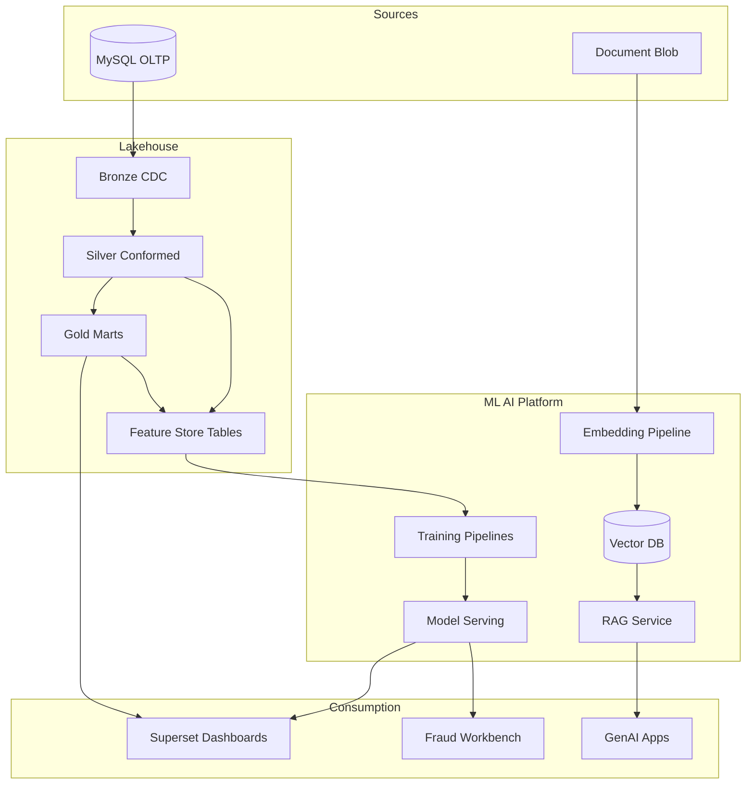

### 1.4 Target Outcomes (Phase 5)

| ID | Outcome | Success Metric | Target Date |
|----|---------|----------------|-------------|
| ML-01 | Feature store MVP operational | 20+ features registered; point-in-time joins validated | Phase 5 Q1 |
| ML-02 | FraudLineage from feature → model → prediction | 100% production models in registry | Phase 5 Q2 |
| ML-03 | Fraud ML model in production | AUC ≥ 0.92; false positive rate ≤ 5% | Phase 5 Q2 |
| ML-04 | Merchant risk score published to Gold | Daily refresh; DQ ≥ 95% | Phase 5 Q2 |
| ML-05 | Document RAG MVP | Top-3 retrieval accuracy ≥ 85% on eval set | Phase 5 Q3 |
| ML-06 | GenAI assistant for analysts | Internal pilot; audit logging 100% | Phase 5 Q4 |

---

## 2. Strategic Context and Principles

### 2.1 Business Drivers

| Driver | Current State (Phase 3) | Target State (Phase 5) |
|--------|-------------------------|------------------------|
| Fraud detection | Rule-based `fraud_rule_hits` on `gold_risk.fraud_summary` | ML ensemble + rules hybrid |
| Merchant onboarding | Manual underwriting review | ML-assisted risk tier + human override |
| Document compliance | Metadata in Silver; manual search | Semantic search + RAG Q&A |
| Analyst productivity | SQL + Superset only | Natural language query assist (governed) |
| Model reuse | Per-project feature engineering | Centralized feature store |

### 2.2 ML/AI Design Principles

| ID | Principle | Implementation |
|----|-----------|----------------|
| AI-01 | **Lakehouse-native features** | Features stored as Iceberg tables; no duplicate data silos |
| AI-02 | **Point-in-time correctness** | Training joins use `as_of_ts`; no label leakage |
| AI-03 | **No PAN in features** | Token + behavioral features only (see `09-security.md` ADR-S09-007) |
| AI-04 | **Governed by default** | Models registered; predictions logged; lineage in Marquez |
| AI-05 | **Human in the loop** | Fraud and underwriting decisions require analyst override path |
| AI-06 | **Batch-first, stream-second** | Batch training and daily scores before real-time inference |
| AI-07 | **Azure OpenAI for GenAI** | No public LLM APIs for confidential data |
| AI-08 | **Explainability required** | SHAP or feature importance for regulated risk models |

### 2.3 Phase Alignment

| Phase | ML/AI Capability |
|-------|------------------|
| Phase 1–2 | Foundation only — no ML |
| Phase 3 | Rule-based fraud flags; Gold marts as feature precursors |
| Phase 4 | Data contracts, lineage, RLS — **prerequisite for ML** |
| **Phase 5** | Feature store, fraud ML, risk scoring, RAG |
| Phase 6 | Real-time inference; model cost optimization |

---

## 3. Readiness Assessment

### 3.1 Prerequisites Checklist

| Prerequisite | Source Document | Phase | Required for ML |
|--------------|-----------------|-------|-----------------|
| Silver conformed entities | `05-silver-layer.md` | 3 | ✅ Yes |
| Gold risk marts | `06-gold-layer.md` | 3 | ✅ Yes |
| DQ score ≥ 95% on Gold | `07-data-quality.md` | 4 | ✅ Yes |
| OpenLineage / Marquez | `08-governance.md` | 4 | ✅ Yes |
| RLS on fraud datasets | `09-security.md` | 4 | ✅ Yes |
| 5-year retention registry | `10-storage-retention.md` | 4 | For training data |
| Freshness SLOs met | `11-monitoring.md` | 3 | ✅ Yes |
| Document metadata in Silver | `05-silver-layer.md` | 3 | For RAG |

### 3.2 Readiness Gap Analysis

| Gap ID | Gap | Impact | Remediation | Phase |
|--------|-----|--------|-------------|-------|
| GAP-ML-01 | No feature registry | Duplicate feature logic per project | Deploy Feast + Polaris registry | 5 Q1 |
| GAP-ML-02 | No model registry | Untracked model versions | MLflow on AKS | 5 Q1 |
| GAP-ML-03 | No vector index for documents | Keyword-only search | Azure AI Search + embeddings | 5 Q3 |
| GAP-ML-04 | `anomaly_score` placeholder in Gold | Column unused | Wire to ML model output | 5 Q2 |
| GAP-ML-05 | No prediction audit log | Compliance gap | `audit.model_predictions` table | 5 Q2 |
| GAP-ML-06 | No GPU/compute pool for training | Slow experimentation | Azure ML compute cluster | 5 Q1 |

### 3.3 Readiness Scorecard

| Dimension | Score (1–5) | Phase 3 | Phase 4 Target | Phase 5 Target |
|-----------|-------------|---------|----------------|----------------|
| Data quality | — | 3 | 4 | 5 |
| Feature reusability | — | 1 | 2 | 4 |
| Lineage for ML | — | 2 | 4 | 5 |
| Model governance | — | 1 | 2 | 4 |
| GenAI infrastructure | — | 1 | 1 | 4 |
| Security for ML | — | 3 | 4 | 5 |

---

## 4. ML/AI Architecture

### 4.1 Platform Architecture

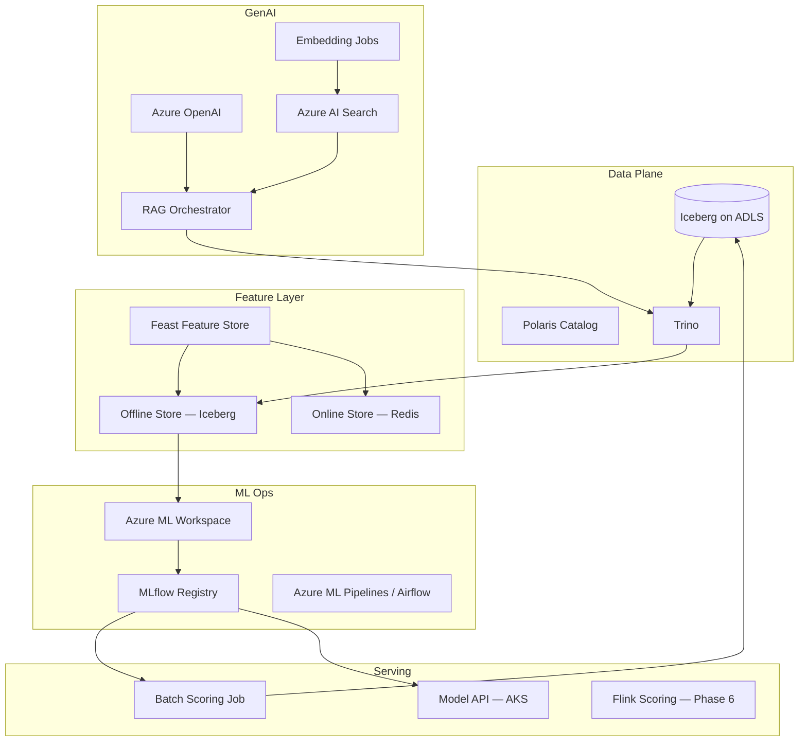

### 4.2 Component Register

| Component | Technology | Purpose | Owner |
|-----------|------------|---------|-------|
| Offline feature store | Feast + Iceberg (`fs_*` namespaces) | Training, batch scoring | ML Eng |
| Online feature store | Redis Enterprise (Azure Cache) | Low-latency inference (Phase 6) | Platform |
| Training | Azure ML + Python (scikit-learn, XGBoost, PyTorch) | Model development | ML Eng |
| Experiment tracking | MLflow | Parameters, metrics, artifacts | ML Eng |
| Model registry | MLflow Model Registry | Versioned production models | ML Eng |
| Batch scoring | Azure ML Batch / Spark on AKS | Daily fraud/risk scores | ML Eng |
| Model serving API | AKS + KServe or FastAPI | REST inference | Platform |
| Embedding model | Azure OpenAI `text-embedding-3-large` | Document vectors | AI Platform |
| Vector database | Azure AI Search (hybrid) | Semantic document retrieval | AI Platform |
| LLM | Azure OpenAI GPT-4o (deployed) | RAG generation, NL assist | AI Platform |
| Orchestration | Airflow (existing) + Azure ML Pipelines | Scheduled ML jobs | Data Eng |

### 4.3 Namespace Convention — ML Artifacts

| Namespace | Purpose | Example Tables |
|-----------|---------|----------------|
| `fs_offline` | Feast offline feature tables | `fs_offline.merchant_risk_features` |
| `fs_online` | Online store snapshots (optional Iceberg mirror) | `fs_online.merchant_risk_features_latest` |
| `ml_models` | Model input/output staging | `ml_models.fraud_scores_daily` |
| `ml_training` | Training datasets (partitioned, ephemeral) | `ml_training.fraud_labels_2026q1` |
| `ml_embeddings` | Document chunk embeddings metadata | `ml_embeddings.document_chunks` |
| `audit` | Prediction and model audit logs | `audit.model_predictions` |

**Feast project name:** `lakehouse_fs`  
**Feast registry:** Git-backed (`feast-registry/` in `data-platform-config` repo)

---

## 5. Feature Store Design

### 5.1 Why Feast on Iceberg

| Option | Pros | Cons | Decision |
|--------|------|------|----------|
| Databricks Feature Store | Managed | Not in stack (Trino/Flink/Polaris) | ❌ Rejected |
| Tecton | Real-time features | Cost; vendor lock-in | ❌ Deferred Phase 6 |
| **Feast + Iceberg** | Open source; same storage; Trino readable | Ops overhead | ✅ **Selected** |
| Custom Iceberg only | Simple | No PIT join abstraction | ❌ Insufficient |

### 5.2 Feature Store Architecture

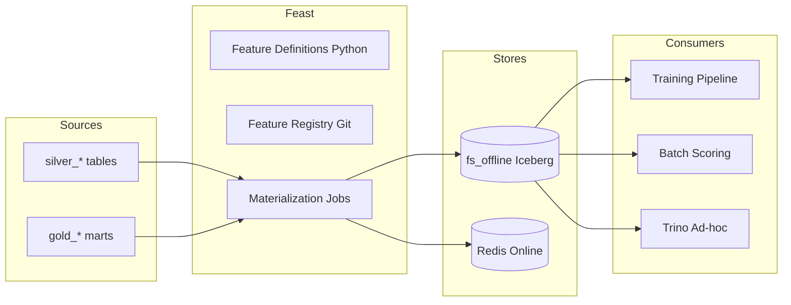

### 5.3 Entity and Feature Catalog

#### Entities

| Entity | Primary Key | Source Table |
|--------|-------------|--------------|
| `merchant` | `merchant_id` | `silver_merchant.merchants` |
| `transaction` | `transaction_id` | `silver_transaction.transactions` |
| `merchant_day` | `merchant_id`, `summary_date` | `gold_merchant.merchant_daily_summary` |

#### Feature Groups — MVP (Phase 5 Q1)

| Feature Group | Entity | Features | Refresh | Source |
|---------------|--------|----------|---------|--------|
| `merchant_profile` | `merchant` | `mcc_code`, `merchant_region`, `merchant_status`, `onboarding_days`, `mcc_risk_tier` | Daily | `silver_merchant.merchants` |
| `merchant_velocity` | `merchant_day` | `txn_count`, `txn_amount_usd`, `decline_rate`, `velocity_txn_count_1h`, `velocity_amount_usd_24h` | 15 min | `gold_risk.fraud_summary` |
| `merchant_history` | `merchant_day` | `chargeback_rate_90d`, `avg_txn_amount_30d`, `active_days_90d` | Daily | `gold_merchant.merchant_daily_summary` |
| `transaction_context` | `transaction` | `amount_usd`, `hour_of_day`, `is_cross_border`, `payment_method_type`, `device_fingerprint_hash` | Near-real-time | `silver_transaction.transactions` |

**Note:** `device_fingerprint_hash` is a one-way hash — no raw device IDs in features.

### 5.4 Feature Definition Example (Feast)

```python
from feast import Entity, FeatureView, Field, FileSource, IcebergSource
from feast.types import Float64, Int64, String
from datetime import timedelta

merchant = Entity(name="merchant", join_keys=["merchant_id"])

merchant_velocity_fv = FeatureView(
    name="merchant_velocity",
    entities=[merchant],
    ttl=timedelta(days=1),
    schema=[
        Field(name="txn_count", dtype=Int64),
        Field(name="decline_rate", dtype=Float64),
        Field(name="velocity_txn_count_1h", dtype=Int64),
        Field(name="velocity_amount_usd_24h", dtype=Float64),
    ],
    source=IcebergSource(
        table="lakehouse.fs_offline.merchant_velocity",
        timestamp_field="event_timestamp",
    ),
    tags={"team": "fraud", "version": "1.0.0"},
)
```

### 5.5 Point-in-Time Join Requirements

| Rule | Description |
|------|-------------|
| PIT-01 | Every training label row MUST include `label_ts` |
| PIT-02 | Feature retrieval uses `as_of_ts = label_ts - lookback_buffer` |
| PIT-03 | No future-dated features in training sets |
| PIT-04 | Materialization job writes `event_timestamp` = feature observation time |
| PIT-05 | Validation test: random 1000 rows manual PIT audit before model promotion |

### 5.6 Feature Materialization Schedule

| Job | Schedule | Source → Target | Owner |
|-----|----------|-----------------|-------|
| `job-fs-materialize-merchant-profile` | Daily 02:00 UTC | Silver → `fs_offline.merchant_profile` | ML Eng |
| `job-fs-materialize-merchant-velocity` | Every 15 min | `gold_risk.fraud_summary` → `fs_offline.merchant_velocity` | ML Eng |
| `job-fs-materialize-merchant-history` | Daily 03:00 UTC | Gold → `fs_offline.merchant_history` | ML Eng |
| `job-fs-online-sync` | Every 15 min | Offline → Redis (Phase 6) | Platform |

---

## 6. ML Pipeline Architecture

### 6.1 Pipeline Stages

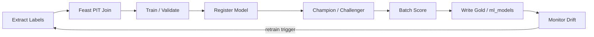

### 6.2 Training Pipeline — Fraud Model

| Stage | Input | Output | Tool |
|-------|-------|--------|------|
| Label extraction | Chargebacks + fraud confirmations | `ml_training.fraud_labels` | Trino SQL |
| Feature join | Labels + Feast offline | Parquet on ADLS | Feast `get_historical_features()` |
| Train/val/test split | Time-based (no random split) | 70/15/15 by month | Python |
| Model training | Feature matrix | XGBoost / LightGBM model | Azure ML |
| Evaluation | Holdout set | AUC, precision@k, FPR | MLflow |
| Registration | Passing model | `fraud-detection:v{N}` in MLflow | MLflow |
| Batch score | Today's merchants | `ml_models.fraud_scores_daily` | Azure ML Batch |
| Gold publish | Scores | Update `gold_risk.fraud_summary.anomaly_score` | Flink or SQL MERGE |

### 6.3 Label Definitions

| Model | Positive Label | Label Source | Latency |
|-------|---------------|--------------|---------|
| Fraud transaction | Confirmed fraud within 30 days | Fraud ops case system + chargebacks | 30-day label window |
| Merchant risk | Suspended or HIGH risk tier assigned | Merchant status history | 90-day window |
| Underwriting | Default within 180 days | Payment delinquency + write-off | 180-day window |

### 6.4 Compute Resources

| Workload | Compute | SKU (example) | Frequency |
|----------|---------|---------------|-----------|
| Feature materialization | AKS CronJob (CPU) | 4 vCPU, 16 GB | Scheduled |
| Fraud model training | Azure ML cluster | Standard_DS13_v2 × 2 | Weekly |
| Hyperparameter tuning | Azure ML | Standard_DS13_v2 × 4 | Monthly |
| Batch scoring | Azure ML / Spark | 8 vCPU | Daily |
| Embedding generation | Azure OpenAI API | Pay-per-token | On document upload + nightly |
| RAG queries | Azure OpenAI + AI Search | Pay-per-query | On demand |

---

## 7. Fraud Detection Platform

### 7.1 Evolution: Rules → Hybrid → ML-Primary

| Phase | Approach | `gold_risk.fraud_summary` Columns |
|-------|----------|-----------------------------------|
| Phase 3 | Rule-based only | `fraud_rule_hits`; `anomaly_score` = NULL |
| Phase 5 Q1 | Rules + batch ML score | `anomaly_score` populated daily |
| Phase 5 Q3 | Rules + ML + champion/challenger | `ml_score`, `rule_score`, `combined_score` |
| Phase 6 | Near-real-time ML | Flink scoring; sub-minute `anomaly_score` |

### 7.2 Fraud Model Architecture

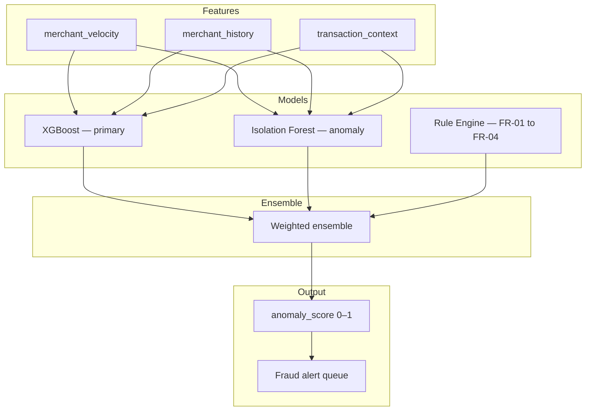

### 7.3 Model Feature Set — Fraud (v1)

| Feature | Type | Source | Notes |
|---------|------|--------|-------|
| `velocity_txn_count_1h` | Numeric | `merchant_velocity` | From Gold |
| `velocity_amount_usd_24h` | Numeric | `merchant_velocity` | |
| `decline_rate` | Numeric | `merchant_velocity` | |
| `chargeback_rate_90d` | Numeric | `merchant_history` | |
| `avg_txn_amount_30d` | Numeric | `merchant_history` | |
| `txn_amount_usd` | Numeric | `transaction_context` | Current txn |
| `amount_vs_30d_avg_ratio` | Derived | Computed | Key signal |
| `mcc_risk_tier_encoded` | Categorical | `merchant_profile` | Ordinal encoding |
| `hour_of_day` | Numeric | `transaction_context` | |
| `is_cross_border` | Boolean | `transaction_context` | |
| `merchant_onboarding_days` | Numeric | `merchant_profile` | New merchant risk |

**Excluded (by policy):** PAN, full card number, raw IP address, contact email.

### 7.4 Model Performance Targets

| Metric | Target | Monitoring |
|--------|--------|------------|
| AUC-ROC | ≥ 0.92 | Weekly eval on holdout |
| Precision @ top 5% | ≥ 0.40 | Fraud ops feedback loop |
| False positive rate | ≤ 5% | Alert volume cap |
| Latency (batch) | Scores by 06:00 UTC daily | Airflow SLA |
| Latency (real-time, Phase 6) | p99 ≤ 100 ms | Model API metrics |
| Model drift (PSI) | < 0.2 on top 10 features | Monthly drift job |

### 7.5 Fraud Scoring Output Schema

**Table:** `ml_models.fraud_scores_daily`

```sql
CREATE TABLE IF NOT EXISTS lakehouse.ml_models.fraud_scores_daily (
    score_date              DATE NOT NULL,
    merchant_id             STRING NOT NULL,
    transaction_id          STRING,
    model_name              STRING NOT NULL,
    model_version           STRING NOT NULL,
    ml_score                DECIMAL(8,6) NOT NULL,
    rule_score              DECIMAL(8,6),
    combined_score            DECIMAL(8,6) NOT NULL,
    score_band              STRING NOT NULL,  -- LOW, MEDIUM, HIGH, CRITICAL
    top_features            STRING,           -- JSON array SHAP top 5
    scored_at               TIMESTAMP(6) NOT NULL,
    _model_run_id           STRING NOT NULL
)
USING iceberg
PARTITIONED BY (days(score_date));
```

**Gold integration:**

```sql
MERGE INTO lakehouse.gold_risk.fraud_summary t
USING (
    SELECT merchant_id, score_date AS summary_date,
           MAX(combined_score) AS anomaly_score
    FROM lakehouse.ml_models.fraud_scores_daily
    WHERE score_date = CURRENT_DATE
    GROUP BY 1, 2
) s
ON t.merchant_id = s.merchant_id AND t.summary_date = s.summary_date
WHEN MATCHED THEN UPDATE SET
    t.anomaly_score = s.anomaly_score,
    t.last_updated_ts = CURRENT_TIMESTAMP;
```

### 7.6 Human-in-the-Loop Workflow

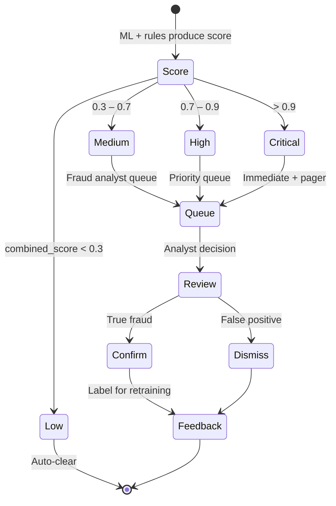

---

## 8. Merchant Risk Scoring

### 8.1 Use Cases

| Use Case | Consumer | Refresh | Output |
|----------|----------|---------|--------|
| Ongoing monitoring | Fraud ops, account management | Daily | `gold_risk.merchant_risk_score` |
| Onboarding triage | Underwriting team | On application + daily | Risk tier recommendation |
| Portfolio reporting | Executive dashboards | Weekly | Aggregated risk distribution |
| Limit adjustments | Finance | Weekly | Input to credit limit engine (external) |

### 8.2 Merchant Risk Score Mart

**Table:** `gold_risk.merchant_risk_score`  
**Grain:** `merchant_id` + `score_date`  
**Refresh:** Daily 05:00 UTC

```sql
CREATE TABLE IF NOT EXISTS lakehouse.gold_risk.merchant_risk_score (
    score_date              DATE NOT NULL,
    merchant_id             STRING NOT NULL,
    merchant_region         STRING NOT NULL,
    risk_score              DECIMAL(5,2) NOT NULL,   -- 0–100
    risk_tier               STRING NOT NULL,          -- LOW, MEDIUM, HIGH, CRITICAL
    score_components        STRING NOT NULL,          -- JSON: factor breakdown
    model_version           STRING NOT NULL,
    previous_risk_tier      STRING,
    tier_changed            BOOLEAN NOT NULL,
    chargeback_factor       DECIMAL(5,2),
    velocity_factor         DECIMAL(5,2),
    compliance_factor       DECIMAL(5,2),
    document_factor         DECIMAL(5,2),
    last_updated_ts         TIMESTAMP(6) NOT NULL
)
USING iceberg
PARTITIONED BY (days(score_date));
```

### 8.3 Risk Score Components

| Component | Weight | Features | Source |
|-----------|--------|----------|--------|
| Transaction behavior | 35% | Velocity, decline rate, amount patterns | `merchant_velocity` |
| Chargeback history | 25% | `chargeback_rate_90d`, dispute count | `merchant_history` |
| Compliance | 20% | KYC status, document expiry, AML flags | `gold_compliance.*` |
| Document completeness | 10% | Required docs present, OCR confidence | `silver_document.*` |
| External signals | 10% | MCC risk tier, region risk index | Reference data |

### 8.4 Model Approach

| Stage | Algorithm | Rationale |
|-------|-----------|-----------|
| MVP (Phase 5 Q2) | Weighted linear scorecard | Interpretable; regulator-friendly |
| v2 (Phase 5 Q4) | Gradient boosted trees | Improved accuracy |
| v3 (Phase 6) | Temporal graph features | Network fraud patterns |

---

## 9. Underwriting and Credit Models

### 9.1 Scope

Underwriting models assist — not replace — human underwriters for merchant onboarding and credit limit decisions. All automated recommendations require analyst approval for limits above configured thresholds.

### 9.2 Underwriting Feature Set

| Feature | Description | PII |
|---------|-------------|-----|
| `business_age_months` | Months since incorporation | No |
| `industry_mcc` | Merchant category | No |
| `requested_limit_usd` | Application amount | No |
| `historical_processing_volume` | Prior processor statements (if available) | No |
| `owner_credit_tier` | External bureau score band (ordinal) | Sensitive — CLS restricted |
| `geography_risk_index` | Country/region risk | No |
| `document_verification_score` | OCR + validation confidence | No |

### 9.3 Underwriting Pipeline

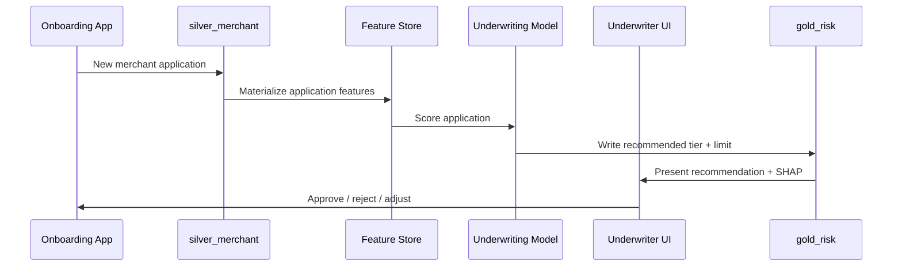

### 9.4 Governance Requirements

| Requirement | Implementation |
|-------------|----------------|
| Adverse action logging | Store reason codes in `audit.underwriting_decisions` |
| Model explainability | SHAP values mandatory for rejections |
| Fairness monitoring | Demographic parity checks on protected attributes (where legal) |
| Retention | Model inputs/outputs 7 years in `audit` namespace |
| Access | `grp-underwriting` + RLS by region |

---

## 10. Embeddings and Vector Database

### 10.1 Document Embedding Pipeline

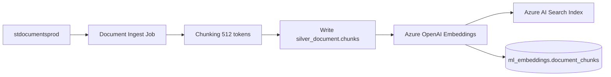

### 10.2 Chunk Metadata Schema

**Table:** `ml_embeddings.document_chunks`

```sql
CREATE TABLE IF NOT EXISTS lakehouse.ml_embeddings.document_chunks (
    chunk_id                STRING NOT NULL,
    document_id             STRING NOT NULL,
    merchant_id             STRING NOT NULL,
    document_type           STRING NOT NULL,
    chunk_index             INT NOT NULL,
    chunk_text              STRING NOT NULL,
    token_count             INT NOT NULL,
    embedding_model         STRING NOT NULL,
    embedding_dims          INT NOT NULL,
    azure_search_doc_id     STRING NOT NULL,
    source_blob_path        STRING NOT NULL,
    classification          STRING NOT NULL,
    created_at              TIMESTAMP(6) NOT NULL,
    _pipeline_version       STRING NOT NULL
)
USING iceberg
PARTITIONED BY (document_type);
```

### 10.3 Azure AI Search Index Design

| Field | Type | Searchable | Filterable |
|-------|------|------------|------------|
| `chunk_id` | Edm.String | No | Yes |
| `document_id` | Edm.String | No | Yes |
| `merchant_id` | Edm.String | No | Yes |
| `document_type` | Edm.String | No | Yes |
| `chunk_text` | Edm.String | Yes (BM25) | No |
| `content_vector` | Collection(Edm.Single) | Yes (HNSW) | No |
| `classification` | Edm.String | No | Yes |
| `created_at` | Edm.DateTimeOffset | No | Yes |

**Index name:** `idx-merchant-documents-prod`  
**Vector profile:** HNSW, cosine similarity, 3072 dimensions (`text-embedding-3-large`)

### 10.4 Supported Document Types (Phase 5)

| Document Type | Source | Chunk Strategy | Priority |
|---------------|--------|----------------|----------|
| `KYC_ID` | `stdocumentsprod/kyc/` | 1 doc = 1–3 chunks | P0 |
| `BANK_STATEMENT` | `stdocumentsprod/financial/` | Page-aware chunks | P0 |
| `MERCHANT_AGREEMENT` | `stdocumentsprod/contracts/` | Section-aware | P1 |
| `SETTLEMENT_REPORT` | `stdocumentsprod/settlement/` | Table-aware | P1 |
| `COMPLIANCE_CERT` | `stdocumentsprod/compliance/` | 1 doc = 1–2 chunks | P2 |

### 10.5 Embedding Refresh Policy

| Trigger | Action |
|---------|--------|
| New document uploaded | Incremental embed within 1 hour |
| Document replaced | Delete old chunks; re-embed |
| Model upgrade | Full re-embed (scheduled maintenance window) |
| Merchant GDPR erasure | Delete chunks + AI Search docs |

---

## 11. Document Intelligence and RAG

### 11.1 RAG Architecture

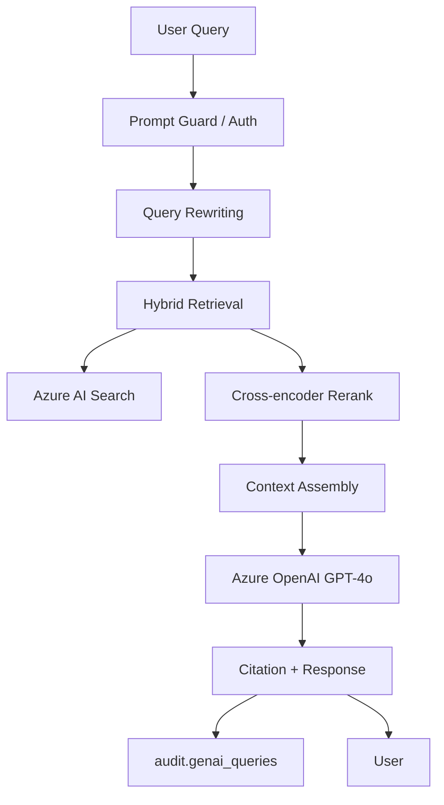

### 11.2 RAG Use Cases

| Use Case | User | Retrieval Scope | LLM Task |
|----------|------|-----------------|----------|
| Merchant document Q&A | Underwriter | Single merchant docs | Answer with citations |
| Compliance policy search | Compliance analyst | Policy corpus | Summarize relevant sections |
| Settlement reconciliation assist | Finance analyst | Settlement reports + Gold marts | Explain discrepancies |
| Fraud investigation | Fraud analyst | Case docs + transaction context | Timeline summary |

### 11.3 Retrieval Configuration

| Parameter | Value | Rationale |
|-----------|-------|-----------|
| Top-K (vector) | 20 | Recall |
| Top-K (BM25) | 10 | Keyword match |
| Rerank top-N | 5 | Context window limit |
| Max context tokens | 8,000 | GPT-4o input budget |
| Temperature | 0.1 | Factual responses |
| Mandatory citations | Yes | Audit and trust |

### 11.4 RAG Prompt Template (Excerpt)

```
You are a document assistant for authorized internal users only.
Answer ONLY using the provided context. If insufficient, say "I don't have enough information."
Always cite sources as [document_id, chunk_index].

Context:
{retrieved_chunks}

User question: {query}

Merchant scope: {merchant_id}
User role: {user_role}
```

### 11.5 RAG Evaluation

| Metric | Target | Method |
|--------|--------|--------|
| Retrieval recall@5 | ≥ 0.85 | Labeled Q&A eval set (200 questions) |
| Answer faithfulness | ≥ 0.90 | LLM-as-judge + human sample |
| Citation accuracy | ≥ 0.95 | Automated link validation |
| Harmful response rate | 0% | Red team quarterly |
| P95 latency | ≤ 8 sec | Production monitoring |

**Eval dataset location:** `ml_training.rag_eval_qa` (Iceberg, access restricted)

---

## 12. GenAI and LLM Integration

### 12.1 Approved GenAI Use Cases (Phase 5)

| ID | Use Case | Data Classification | Approval |
|----|----------|---------------------|----------|
| GEN-01 | Document RAG (§11) | Confidential | ARB Phase 5 |
| GEN-02 | SQL query assist (Trino) | Internal | Security review |
| GEN-03 | Pipeline error summarization | Internal | Auto-approved |
| GEN-04 | Data catalog description generation | Internal | Steward review |
| GEN-05 | Executive narrative from KPI marts | Confidential | Exec sponsor |

**Prohibited:** Sending PAN, full PII, or PCI data to any LLM. Prompt guard enforces redaction.

### 12.2 Azure OpenAI Configuration

| Setting | Value |
|---------|-------|
| Deployment | Azure OpenAI in same tenant/region as data |
| Models | `gpt-4o` (generation), `text-embedding-3-large` (embeddings) |
| Network | Private Endpoint; no public internet |
| Authentication | Entra ID + managed identity |
| Content filtering | Azure AI Content Safety enabled |
| Logging | All prompts/responses to `audit.genai_queries` (redacted) |

### 12.3 SQL Query Assist (Trino)

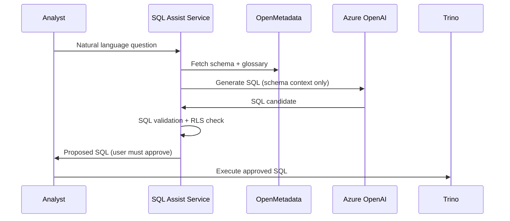

**Safeguards:**
- Generated SQL is **never auto-executed**
- Blocklist: `INSERT`, `UPDATE`, `DELETE`, `DROP`, cross-namespace joins to `pci.*`
- Row limit enforced: `LIMIT 1000` appended
- User's Entra groups applied via Trino RLS

### 12.4 GenAI Audit Schema

**Table:** `audit.genai_queries`

```sql
CREATE TABLE IF NOT EXISTS lakehouse.audit.genai_queries (
    query_id                STRING NOT NULL,
    user_id                 STRING NOT NULL,
    use_case                STRING NOT NULL,
    prompt_hash             STRING NOT NULL,
    response_hash           STRING NOT NULL,
    model_deployment        STRING NOT NULL,
    token_count_prompt      INT,
    token_count_completion  INT,
    retrieval_doc_ids       STRING,
    latency_ms              INT NOT NULL,
    blocked_by_guard        BOOLEAN NOT NULL DEFAULT FALSE,
    created_at              TIMESTAMP(6) NOT NULL
)
USING iceberg
PARTITIONED BY (days(created_at));
```

---

## 13. MLOps and Model Governance

### 13.1 Model Lifecycle

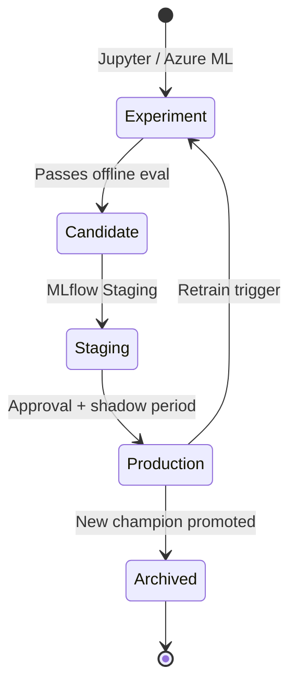

### 13.2 MLflow Model Registry

| Model Name | Type | Owner | Approval Required |
|------------|------|-------|-------------------|
| `fraud-detection` | XGBoost classifier | Fraud ML team | Fraud Lead + ML Lead |
| `merchant-risk-scorecard` | Scorecard / GBT | Risk team | Risk Lead |
| `underwriting-recommendation` | GBT regressor | Underwriting | Compliance + Risk |
| `document-classifier` | Multi-class (OCR type) | Doc AI team | Governance |

### 13.3 Champion / Challenger Framework

| Role | Traffic | Duration | Promotion Criteria |
|------|---------|----------|-------------------|
| Champion | 90% scoring | Until challenger wins | Current production |
| Challenger | 10% shadow scoring | Min 14 days | Beat champion AUC + business KPI |

**Shadow scoring:** Challenger writes to `ml_models.fraud_scores_daily` with `model_version` tag; no downstream alerts until promoted.

### 13.4 Model Monitoring

| Monitor | Frequency | Alert Threshold |
|---------|-----------|-----------------|
| Feature drift (PSI) | Daily | PSI > 0.2 on any top-10 feature |
| Prediction drift | Daily | Score distribution shift > 2σ |
| Label delay | Weekly | > 10% labels missing past window |
| Model latency | Real-time | p99 > SLA |
| Error rate | Real-time | Scoring failures > 0.1% |
| Business KPI | Weekly | Fraud catch rate drop > 10% |

### 13.5 Retraining Triggers

| Trigger | Action |
|---------|--------|
| Scheduled | Weekly fraud model retrain |
| Drift detected | Alert → manual retrain decision within 5 days |
| Label backlog cleared | Retrain with updated labels |
| Regulatory change | Immediate model review |
| Champion underperformance | 14-day challenger evaluation accelerated |

---

## 14. Security, Privacy, and Compliance

### 14.1 ML-Specific Security Controls

| Control | Implementation | Reference |
|---------|----------------|-----------|
| No PAN in features | CI validation on feature definitions | `09-security.md` |
| RLS on score tables | Trino views with region filter | `09-security.md` |
| Model artifact encryption | SSE-KMS on ADLS model store | `09-security.md` |
| PCI namespace isolation | No ML training on `pci.*` | `09-security.md` |
| GenAI prompt redaction | PII scanner pre-LLM | This document §12.2 |
| Prediction audit | 7-year retention | `10-storage-retention.md` |

### 14.2 Access Groups — ML/AI

| Group | Access |
|-------|--------|
| `grp-ml-engineer` | `fs_*`, `ml_*`, training data; no raw PII |
| `grp-fraud` | `gold_risk.*`, `ml_models.fraud_scores_daily` (RLS) |
| `grp-underwriting` | Underwriting scores + RAG (merchant scope) |
| `grp-ai-platform` | Azure OpenAI, AI Search admin |
| `grp-pci-analyst` | `pci.*` only — **no ML pipeline access** |

### 14.3 Regulatory Considerations

| Regulation | ML/AI Implication | Control |
|------------|-------------------|---------|
| GDPR Art. 22 | Automated decision-making | Human review for adverse actions |
| PCI DSS | No cardholder data in ML | Token + behavioral features only |
| Model explainability (internal policy) | Risk models must be interpretable | SHAP + scorecard factors |
| AI Act (EU, future) | High-risk AI documentation | Model cards in MLflow |

### 14.4 Model Card Template (Required)

| Section | Content |
|---------|---------|
| Model name / version | Registry ID |
| Intended use | Business use case |
| Training data | Tables, date range, label definition |
| Features | Full feature list with sources |
| Performance | Offline metrics + fairness checks |
| Limitations | Known failure modes |
| Monitoring | Drift thresholds |
| Owner / approver | Names and dates |

---

## 15. Phase 5 Implementation Roadmap

### 15.1 Phase 5 Timeline

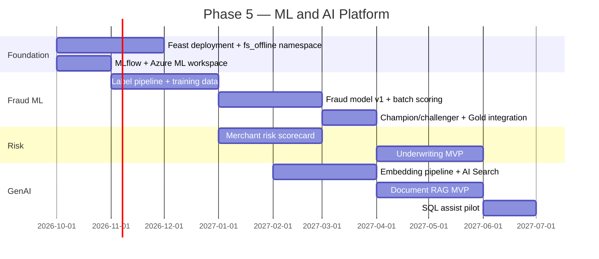

### 15.2 Sprint Milestones

| Sprint | Milestone | Deliverables |
|--------|-----------|--------------|
| P5-S1 | Feature store MVP | Feast deployed; 4 feature groups; materialization jobs |
| P5-S2 | ML platform foundation | MLflow registry; Azure ML workspace; audit tables |
| P5-S3 | Fraud labels + training | Label pipeline; first offline model AUC report |
| P5-S4 | Fraud production v1 | Batch scoring → `anomaly_score` in Gold |
| P5-S5 | Merchant risk score | `gold_risk.merchant_risk_score` daily |
| P5-S6 | Embeddings pipeline | AI Search index; 3 document types |
| P5-S7 | RAG MVP | Underwriter document Q&A pilot |
| P5-S8 | Underwriting assist | Scorecard model + human review UI integration |
| P5-S9 | GenAI governance | Prompt guard; full audit logging |
| P5-S10 | Phase 5 ARB review | Model cards; eval results; production checklist |

### 15.3 Dependencies

| Dependency | Required By | Owner |
|------------|-------------|-------|
| Phase 4 DQ ≥ 95% on Gold | P5-S3 | Data Eng |
| Marquez lineage for features | P5-S1 | Governance |
| Document metadata in Silver | P5-S6 | Data Eng |
| Azure OpenAI quota approved | P5-S6 | AI Platform |
| Fraud ops label feedback process | P5-S3 | Fraud team |
| `gold_compliance.*` marts | P5-S5 | Data Eng |

### 15.4 Phase 5 Exit Criteria

| # | Criterion | Evidence |
|---|-----------|----------|
| 1 | Feature store: 20+ features registered | Feast registry |
| 2 | Fraud model in production with AUC ≥ 0.92 | MLflow metrics |
| 3 | `anomaly_score` populated daily in Gold | Trino query |
| 4 | Merchant risk score published | `gold_risk.merchant_risk_score` |
| 5 | RAG eval recall@5 ≥ 0.85 | Eval report |
| 6 | 100% GenAI queries audited | `audit.genai_queries` row count |
| 7 | Model cards for all production models | MLflow artifacts |
| 8 | No PCI/PAN in feature store (audit pass) | Security scan report |

---

## 16. Design Decisions and Trade-offs

| ADR | Decision | Benefit | Tradeoff | Mitigation |
|-----|----------|---------|----------|------------|
| ADR-ML-001 | Feast on Iceberg (not Databricks FS) | Stack alignment; Trino readable | Feast ops overhead | Platform team owns deployment |
| ADR-ML-002 | Batch scoring before real-time | Simpler; lower cost | Scores lag up to 24 hr initially | Phase 6 Flink scoring |
| ADR-ML-003 | XGBoost primary fraud model | Interpretable; proven | Deep learning edge cases | Isolation Forest ensemble |
| ADR-ML-004 | Azure OpenAI (not open-source LLM) | Enterprise security; Private Link | Cost per token | Caching; prompt optimization |
| ADR-ML-005 | Azure AI Search (not pgvector) | Hybrid search; managed | Vendor dependency | Abstract retrieval interface |
| ADR-ML-006 | Human-in-the-loop mandatory | Regulatory compliance | Slower automation | Tiered auto-clear for LOW |
| ADR-ML-007 | No PAN ever in ML features | PCI scope minimization | Limited card-level models | Network + merchant behavior |
| ADR-ML-008 | MLflow on AKS (not Azure ML registry only) | Portable; open source | Self-managed HA | Azure ML backup registry sync |
| ADR-ML-009 | Scorecard before GBT for merchant risk | Regulator explainability | Lower initial accuracy | GBT v2 in P5-S8 |
| ADR-ML-010 | SQL assist requires user approval | Prevents runaway queries | Extra click for analyst | Clear UX |

---

## 17. Production Recommendations

### 17.1 Phase 5 Launch Checklist

| # | Item | Priority | Owner |
|---|------|----------|-------|
| 1 | Create `fs_offline`, `ml_models`, `ml_embeddings` namespaces in Polaris | P0 | Platform |
| 2 | Deploy Feast on AKS with Iceberg offline store | P0 | ML Eng |
| 3 | Deploy MLflow tracking + registry | P0 | ML Eng |
| 4 | Provision Azure ML workspace + compute | P0 | Platform |
| 5 | Create `audit.model_predictions` and `audit.genai_queries` | P0 | Data Eng |
| 6 | Implement fraud label extraction pipeline | P0 | ML Eng |
| 7 | Register 4 MVP feature groups in Feast | P0 | ML Eng |
| 8 | Train and register fraud model v1 | P1 | ML Eng |
| 9 | Wire batch scoring to `gold_risk.fraud_summary.anomaly_score` | P1 | Data Eng |
| 10 | Deploy Azure OpenAI with Private Endpoint | P1 | AI Platform |
| 11 | Build embedding pipeline for KYC + bank statements | P1 | AI Platform |
| 12 | Create Azure AI Search index | P1 | AI Platform |
| 13 | Deploy RAG service with prompt guard | P1 | AI Platform |
| 14 | Publish model cards for production models | P1 | ML Eng |
| 15 | Add ML metrics to Grafana (`11-monitoring.md`) | P2 | SRE |
| 16 | Execute fairness + drift monitoring jobs | P2 | ML Eng |
| 17 | Fraud ops feedback loop for label refresh | P2 | Fraud team |
| 18 | Phase 5 ARB presentation | P1 | Architecture |

### 17.2 ML Monitoring Additions (for `11-monitoring.md`)

| Metric | Alert |
|--------|-------|
| `lakehouse_ml_score_latency_seconds` | p99 > 300 sec |
| `lakehouse_ml_drift_psi` | > 0.2 |
| `lakehouse_ml_scoring_errors_total` | > 0.1% rate |
| `lakehouse_rag_latency_seconds` | p99 > 10 sec |
| `lakehouse_genai_blocked_total` | Anomaly spike |

### 17.3 Cost Estimate (Phase 5 Steady State)

| Component | Monthly Estimate (USD) | Notes |
|-----------|------------------------|-------|
| Azure ML compute (training) | $2,000–$5,000 | Weekly retrains |
| Azure OpenAI (embeddings + RAG) | $1,500–$4,000 | Volume dependent |
| Azure AI Search (Standard S1) | $250 | Vector + BM25 |
| Redis Enterprise (online FS, Phase 6) | $500 | Deferred |
| AKS ML workloads | $800 | Feast, MLflow, RAG service |
| **Total Phase 5** | **~$5,000–$10,000/mo** | Excludes existing lakehouse |

---

## Appendix A — Feature Registry (MVP)

| Feature Name | Group | Type | Source Column |
|--------------|-------|------|---------------|
| `mcc_code` | merchant_profile | String | `merchants.mcc_code` |
| `merchant_region` | merchant_profile | String | `merchants.region` |
| `onboarding_days` | merchant_profile | Int64 | DATEDIFF from `created_at` |
| `txn_count` | merchant_velocity | Int64 | `fraud_summary.txn_count` |
| `decline_rate` | merchant_velocity | Float64 | `fraud_summary.decline_rate` |
| `velocity_txn_count_1h` | merchant_velocity | Int64 | `fraud_summary.velocity_txn_count_1h` |
| `chargeback_rate_90d` | merchant_history | Float64 | Computed |
| `avg_txn_amount_30d` | merchant_history | Float64 | Computed |
| `amount_usd` | transaction_context | Float64 | `transactions.amount_usd` |
| `hour_of_day` | transaction_context | Int64 | EXTRACT HOUR |
| `is_cross_border` | transaction_context | Bool | Derived |

---

## Appendix B — Model Card — Fraud Detection v1 (Template)

```yaml
model_name: fraud-detection
version: 1.0.0
model_type: XGBoost binary classifier
owner: fraud-ml-team@company.com
approved_by: fraud-lead@company.com
approved_date: TBD

intended_use: >
  Identify high-risk merchant-day and transaction patterns for fraud analyst review.
  NOT for automated account suspension without human approval.

training_data:
  tables:
    - lakehouse.ml_training.fraud_labels
    - lakehouse.fs_offline.merchant_velocity
    - lakehouse.fs_offline.merchant_history
  date_range: 2024-01-01 to 2025-12-31
  row_count: ~2.5M merchant-days

features: 11  # See Appendix A

metrics:
  auc_roc: 0.92
  precision_at_5pct: 0.41
  false_positive_rate: 0.048

limitations:
  - New merchants (< 7 days) have sparse history
  - Cross-border transactions underrepresented in training
  - Does not score card-present vs card-not-present separately (Phase 6)

monitoring:
  drift_psi_threshold: 0.2
  retrain_schedule: weekly
```

---

## Appendix C — RAG Eval Question Examples

| ID | Question | Expected Document Type |
|----|----------|------------------------|
| RAG-E01 | "What is the merchant's registered business name on the KYC document?" | KYC_ID |
| RAG-E02 | "What was the average monthly deposit in the bank statement?" | BANK_STATEMENT |
| RAG-E03 | "When does the merchant agreement expire?" | MERCHANT_AGREEMENT |
| RAG-E04 | "What settlement fees were charged on 2026-03-15?" | SETTLEMENT_REPORT |

---

## Appendix D — Related Documents

| Document | Relationship |
|----------|-------------|
| `06-gold-layer.md` | `fraud_summary`, risk marts |
| `07-data-quality.md` | DQ prerequisites for ML |
| `08-governance.md` | Lineage for features and models |
| `09-security.md` | No PAN policy; RLS; GenAI security |
| `10-storage-retention.md` | Training data and audit retention |
| `11-monitoring.md` | ML metrics and alerting |
| `13-runbook.md` | ML job operational procedures |
| `14-roadmap.md` | Phase 5 in program roadmap |

---

## Appendix E — Revision History

| Version | Date | Author | Changes |
|---------|------|--------|---------|
| 1.0.0 | 2026-07-02 | Data Platform Architecture | Initial ML/AI roadmap |