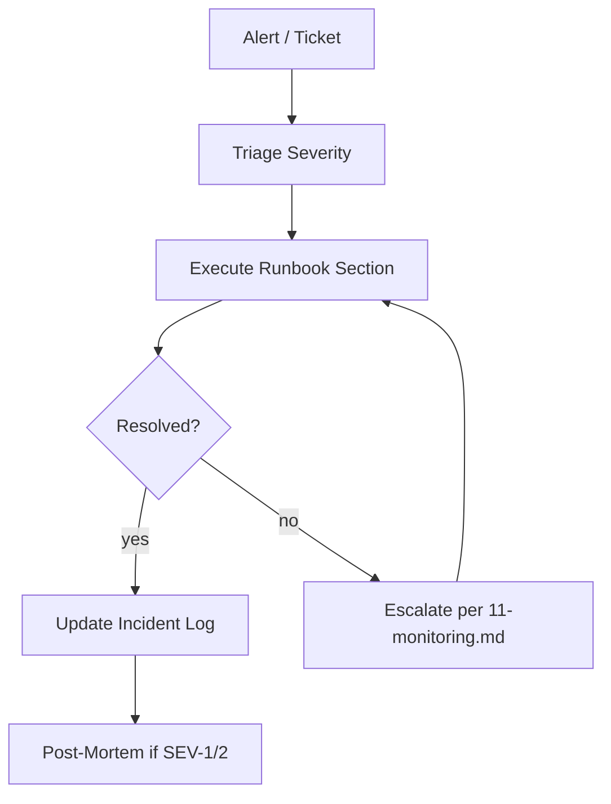
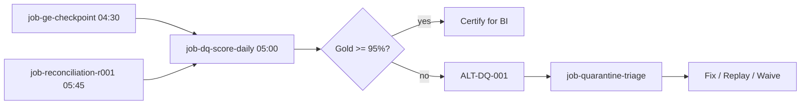
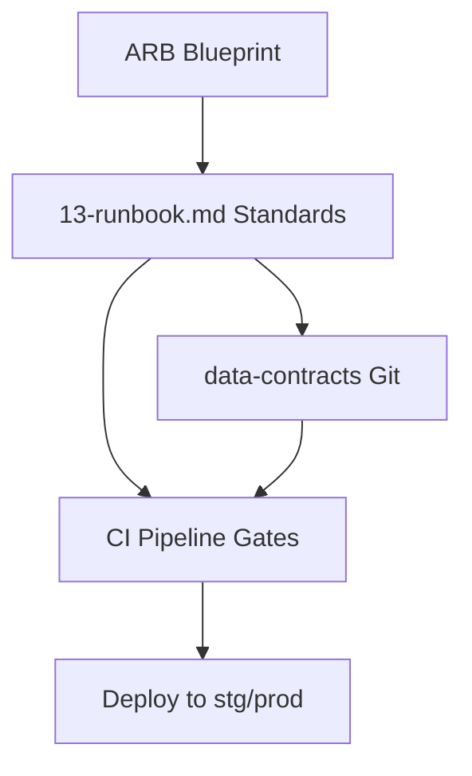
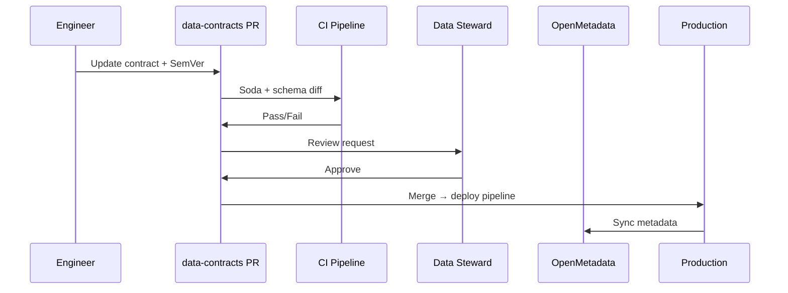
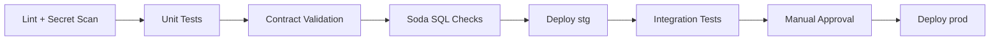
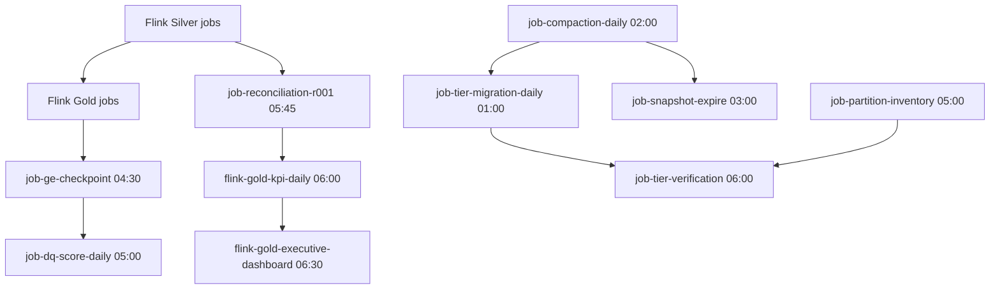

# Parts 19 & 20 — Operational Runbook and Engineering Standards

**Document ID:** DLH-ARB-2026-001-13  
**Version:** 1.0.0  
**Classification:** Internal — Confidential  
**Status:** Draft — For ARB Review

---

## Table of Contents

### Part 19 — Operational Runbook
1. [Overview](#1-overview)
2. [Operations Model](#2-operations-model)
3. [Master Job Schedule](#3-master-job-schedule)
4. [Streaming Pipeline Operations](#4-streaming-pipeline-operations)
5. [Batch and Scheduled Jobs](#5-batch-and-scheduled-jobs)
6. [Compaction and File Optimization](#6-compaction-and-file-optimization)
7. [Snapshot and Metadata Maintenance](#7-snapshot-and-metadata-maintenance)
8. [Storage Lifecycle Operations](#8-storage-lifecycle-operations)
9. [Data Quality Operations](#9-data-quality-operations)
10. [Backup and Restore Procedures](#10-backup-and-restore-procedures)
11. [Incident Runbooks](#11-incident-runbooks)
12. [Backfill and Replay Procedures](#12-backfill-and-replay-procedures)
13. [Change Management and Deployments](#13-change-management-and-deployments)

### Part 20 — Engineering Standards
14. [Engineering Standards Overview](#14-engineering-standards-overview)
15. [Repository and Folder Hierarchy](#15-repository-and-folder-hierarchy)
16. [Naming Conventions](#16-naming-conventions)
17. [Iceberg Table Standards](#17-iceberg-table-standards)
18. [Flink Job Standards](#18-flink-job-standards)
19. [SQL and Trino Standards](#19-sql-and-trino-standards)
20. [Data Contract Standards](#20-data-contract-standards)
21. [Schema Versioning and Change Control](#21-schema-versioning-and-change-control)
22. [Code Review and CI/CD Standards](#22-code-review-and-cicd-standards)
23. [Design Decisions and Production Checklist](#23-design-decisions-and-production-checklist)

---

# PART 19 — OPERATIONAL RUNBOOK

## 1. Overview

### 1.1 Purpose

This document is the **authoritative day-2 operations reference** for the Data Lakehouse platform. It defines scheduled jobs, operational procedures, incident response steps, backup/restore workflows, and the engineering standards that all platform contributors must follow.

### 1.2 Audience

| Role | Primary Sections |
|------|------------------|
| On-call Data Engineer | §3–§12, §11 incident runbooks |
| Platform Engineer | §6–§10, §13 |
| Data Engineer (build) | §14–§22 engineering standards |
| Data Steward | §9, §20 data contracts |
| SRE / DevOps | §3 master schedule, §11 |

### 1.3 Related Documents

| Document | Use When |
|----------|----------|
| `11-monitoring.md` | Alert fires; SLO investigation |
| `10-storage-retention.md` | Tier migration, retention policy |
| `07-data-quality.md` | DQ rule definitions, quarantine triage |
| `09-security.md` | Access issues, audit, PCI |
| `12-ml-ai-roadmap.md` | ML job failures (Phase 5) |

### 1.4 Runbook Conventions

| Symbol | Meaning |
|--------|---------|
| **P0** | Execute immediately; production impact |
| **P1** | Execute within 1 hour |
| **P2** | Execute within 4 hours or next business day |
| `→` | Sequential step |
| `⚠` | Caution — data loss or compliance risk if skipped |

---

## 2. Operations Model

### 2.1 Operating Hours

| Coverage | Hours | Scope |
|----------|-------|-------|
| Automated monitoring | 24/7 | All production pipelines |
| On-call (Critical alerts) | 24/7 | SEV-1, SEV-2 |
| Planned maintenance | Sun 02:00–06:00 UTC | Compaction, deploys, DR tests |
| Business hours support | Mon–Fri 08:00–18:00 local | Change requests, triage |

### 2.2 Responsibility Matrix — Operations

| Activity | Data Eng | Platform Eng | Governance |
|----------|----------|--------------|------------|
| Flink job restart / restore | **R/A** | C | I |
| Compaction / snapshot expire | C | **R/A** | I |
| Tier migration | C | **R/A** | C |
| DQ triage / quarantine | **R/A** | I | C |
| Trino cluster issues | I | **R/A** | I |
| Polaris / catalog restore | C | **R/A** | C |
| Data contract approval | C | I | **R/A** |
| DR execution | **R** | **R/A** | I |

### 2.3 Operational Workflow



---

## 3. Master Job Schedule

### 3.1 Schedule Overview

```mermaid
gantt
    title Production Job Schedule (UTC)
    dateFormat HH:mm
    axisFormat %H:%M

    section Continuous
    Flink streaming jobs (Bronze/Silver/Gold)     :active, 00:00, 24h

    section Hourly
    Gold merchant_daily_summary                   :04:00, 60min
    Gold settlement_summary                       :04:00, 60min

    section Every 15 min
    Gold fraud_summary                            :04:00, 15min

    section Every 5 min
    Gold transaction_dashboard                    :04:00, 5min

    section Daily
    Tier migration 01:00                          :01:00, 30min
    Compaction 02:00                              :02:00, 120min
    Snapshot expire 03:00                         :03:00, 60min
    Bronze partition drop 04:00                   :04:00, 30min
    Metadata backup 04:30                         :04:30, 30min
    Partition inventory 05:00                     :05:00, 30min
    GE checkpoint 04:30                           :04:30, 60min
    DQ score calc 05:00                           :05:00, 30min
    Reconciliation R-001 05:45                    :05:45, 30min
    KPI daily 06:00                               :06:00, 30min
    Tier verification 06:00                       :06:00, 30min
    Executive dashboard 06:30                       :06:30, 30min

    section Weekly
    Retention audit Mon 08:00                     :08:00, 60min
    Orphan file scan Sun 03:00                    :03:00, 60min

    section Monthly
    Archive summary rollup 1st 02:00              :02:00, 120min
```

### 3.2 Job Register — Complete

| Job ID | Job Name | Schedule | Owner | SLA | On Failure |
|--------|----------|----------|-------|-----|------------|
| STR-01 | Flink Bronze jobs (×7) | Continuous | Data Eng | 99.5% | MON-003 alert |
| STR-02 | Flink Silver jobs (×8) | Continuous | Data Eng | 99.5% | MON-003 alert |
| STR-03 | Flink Gold jobs (×10) | Continuous / scheduled | Data Eng | 99.5% | MON-007 alert |
| BAT-01 | `job-ge-checkpoint` | Daily 04:30 UTC | Data Eng | Complete by 05:00 | ALT-DQ-005 |
| BAT-02 | `job-dq-score-daily` | Daily 05:00 UTC | Data Eng | Complete by 05:30 | ALT-DQ-001 |
| BAT-03 | `job-reconciliation-r001` | Daily 05:45 UTC | Data Eng | Delta < 0.01% | ALT-DQ-004 |
| BAT-04 | `job-freshness-exporter` | Every 60 sec | Platform | — | MON-007 |
| BAT-05 | `job-quarantine-triage` | Daily 08:00 UTC | Data Eng | Review queue empty | ALT-DQ-003 |
| LIF-01 | `job-tier-migration-daily` | Daily 01:00 UTC | Platform | Complete by 04:00 | MON-018 |
| LIF-02 | `job-compaction-daily` | Daily 02:00 UTC | Platform | Complete by 05:00 | MON-013 |
| LIF-03 | `job-snapshot-expire` | Daily 03:00 UTC | Platform | Complete by 04:00 | — |
| LIF-04 | `job-bronze-partition-drop` | Daily 04:00 UTC | Data Eng | 90-day policy | — |
| LIF-05 | `job-partition-inventory` | Daily 05:00 UTC | Platform | Complete by 06:00 | — |
| LIF-06 | `job-tier-verification` | Daily 06:00 UTC | Platform | Zero mismatches | MON-018 |
| LIF-07 | `job-metadata-backup` | Daily 04:30 UTC | Platform | Complete by 05:00 | — |
| LIF-08 | `job-retention-audit` | Weekly Mon 08:00 UTC | Governance | Report filed | — |
| LIF-09 | `job-orphan-file-scan` | Weekly Sun 03:00 UTC | Platform | Zero orphans | MON-013 |
| LIF-10 | `job-archive-summary-rollup` | Monthly 1st 02:00 UTC | Data Eng | Complete by 06:00 | — |
| LIF-11 | `job-trino-mv-refresh` | Hourly | Data Eng | Per MV SLA | MON-007 |
| ML-01 | `job-fs-materialize-*` | Daily / 15 min | ML Eng | Phase 5 | — |
| ML-02 | `job-fraud-batch-score` | Daily 05:00 UTC | ML Eng | Phase 5 | — |

### 3.3 Daily Operations Checklist (On-Call)

| # | Check | Time (UTC) | Pass Criteria |
|---|-------|------------|---------------|
| 1 | Review Grafana Platform Overview | 07:00 | Zero Critical alerts |
| 2 | Verify `kpi_daily` completed | 06:45 | Row count > 0 for today |
| 3 | Verify reconciliation R-001 | 06:15 | Delta < 0.01% |
| 4 | Review quarantine queue | 08:30 | < 100 unresolved P1 |
| 5 | Check compaction job status | 06:00 | LIF-02 SUCCESS |
| 6 | Check tier migration log | 06:00 | No FAILED rows today |
| 7 | Review Flink checkpoint age | Continuous | < 10 min all jobs |
| 8 | Confirm DQ score ≥ 95% Gold | 07:00 | `dq.dq_scores` |

---

## 4. Streaming Pipeline Operations

### 4.1 Flink Job Inventory — Production

| Job Name | Layer | Source | Target | Parallelism |
|----------|-------|--------|--------|-------------|
| `flink-bronze-merchant-merchants-prod` | Bronze | `eh-cdc-merchant` | `bronze_merchant.merchants_cdc` | 4 |
| `flink-bronze-transaction-transactions-prod` | Bronze | `eh-cdc-transaction` | `bronze_transaction.transactions_cdc` | 8 |
| `flink-silver-transaction-transactions-prod` | Silver | Bronze CDC | `silver_transaction.transactions` | 8 |
| `flink-gold-fraud-summary-prod` | Gold | Silver + Silver | `gold_risk.fraud_summary` | 4 |
| `flink-gold-transaction-dashboard-prod` | Gold | Silver | `gold_ops.transaction_dashboard` | 4 |
| `flink-gold-kpi-daily-prod` | Gold | Multiple Gold | `gold_exec.kpi_daily` | 2 |

*Full inventory: `04-bronze-layer.md` §9, `05-silver-layer.md` §15, `06-gold-layer.md` §3.*

### 4.2 Standard Flink Health Check

```bash
# 1. List running jobs
curl -s https://flink-jobmanager.data-platform.svc:8081/jobs/overview | jq '.jobs[] | {id, name, state}'

# 2. Check last checkpoint for job
curl -s "https://flink-jobmanager.data-platform.svc:8081/jobs/{job-id}/checkpoints" | jq '.latest.completed'

# 3. Check consumer lag (Event Hub)
az eventhubs consumer-group show \
  --namespace-name ehn-data-platform-prod \
  --eventhub eh-cdc-transaction \
  --name cg-flink-bronze-transaction-transactions-prod \
  --query "userMetadata"
```

### 4.3 Flink Job Restart — Standard Procedure

| Step | Action | Owner |
|------|--------|-------|
| 1 | Acknowledge alert; note job name and last checkpoint ID | On-call |
| 2 | Check Flink UI for root cause (OOM, commit failure, etc.) | On-call |
| 3 | If transient: restart via Kubernetes | On-call |
| 4 | If persistent: restore from last completed checkpoint | On-call |
| 5 | Verify consumer lag decreasing | On-call |
| 6 | Run domain reconciliation if lag > 30 min | On-call |
| 7 | Document in incident log | On-call |

**Checkpoint restore command:**

```bash
flink run \
  -s abfss://flink-checkpoints@stlakeopsprod/flink-bronze-transaction-transactions-prod/chk-12345 \
  -c com.company.bronze.TransactionBronzeJob \
  /opt/flink/jars/bronze-transactions.jar \
  --config /config/flink-bronze-transaction-transactions-prod.yaml
```

### 4.4 Debezium Connector Operations

| Task | Procedure | Frequency |
|------|-----------|-----------|
| Health check | JMX `debezium_connected = 1` | Continuous |
| Restart connector | K8s rollout restart `debezium-connect` | On failure |
| Offset reset | ⚠ Only with approval; document offset | Emergency only |
| Schema change | Pause → DDL on MySQL → resume → validate Bronze | Per change |

**Connector restart:**

```bash
kubectl rollout restart deployment/debezium-connect -n data-platform
kubectl rollout status deployment/debezium-connect -n data-platform
# Verify: curl debezium:8083/connectors/mysql-transaction-connector/status
```

---

## 5. Batch and Scheduled Jobs

### 5.1 Airflow / Scheduler Architecture

| Component | Role |
|-----------|------|
| Apache Airflow on AKS | Orchestrates batch jobs (DQ, lifecycle, ML) |
| Flink application mode | Self-scheduled Gold batch jobs (`kpi_daily`) |
| Kubernetes CronJobs | Freshness exporter, lightweight tasks |

**Airflow DAG naming:** `dag-{domain}-{purpose}-{env}`  
**Example:** `dag-platform-lifecycle-daily-prod`

### 5.2 Key Batch Job Procedures

| Field | Value |
|-------|-------|
| Schedule | Daily 04:30 UTC |
| Tool | Great Expectations on Trino |
| Suites | Silver (all), Gold (certified marts) |
| Failure | Block `job-dq-score-daily`; ALT-DQ-005 |

#### `job-dq-score-daily`

| Field | Value |
|-------|-------|
| Schedule | Daily 05:00 UTC (after GE checkpoint) |
| Input | GE results, reconciliation, quarantine stats |
| Output | `dq.dq_scores` |
| Failure | ALT-DQ-001 if Gold score < 90% |

```sql
-- Post-run validation (job-dq-score-daily)
SELECT table_fqn, layer, overall_score, score_date
FROM lakehouse.dq.dq_scores
WHERE score_date = CURRENT_DATE AND layer = 'gold' AND overall_score < 0.95;
-- Expected: 0 rows
```

#### `job-reconciliation-r001`

| Field | Value |
|-------|-------|
| Schedule | Daily 05:45 UTC |
| Compare | MySQL row count vs Silver (per entity, T-1) |
| Threshold | Delta < 0.01% |
| Failure | ALT-DQ-004; halt Gold refresh for affected domain |

#### `job-kpi-daily` (Flink batch)

| Field | Value |
|-------|-------|
| Schedule | Daily 06:00 UTC |
| Dependencies | All upstream Gold marts fresh |
| SLA | Complete by 06:30 UTC |
| Failure | MON-017 alert |

---

## 6. Compaction and File Optimization

### 6.1 Compaction Policy

| Layer | Target File Size | Min File Size Trigger | Schedule |
|-------|------------------|----------------------|----------|
| Bronze | 128 MB | Files < 10 MB > 20% | Daily 02:00 UTC |
| Silver | 512 MB | Files < 64 MB > 20% | Daily 02:00 UTC |
| Gold | 512 MB | Files < 64 MB > 20% | Daily 02:00 UTC |
| Archive-bound | 512 MB | **Required before tier migration** | Pre-tier job |

### 6.2 `job-compaction-daily` Procedure

| Step | Action |
|------|--------|
| 1 | Query `audit.partition_inventory` for tables with `small_file_ratio > 0.20` |
| 2 | Prioritize tables scheduled for tier migration within 7 days |
| 3 | Execute Iceberg `rewrite_data_files` via Spark or Trino procedure |
| 4 | Target `target-file-size-bytes = 536870912` (512 MB) |
| 5 | Log results to `audit.compaction_log` |
| 6 | Alert if duration > 4 hours or zero files rewritten when ratio high |

**Trino compaction (example):**

```sql
CALL lakehouse.system.rewrite_data_files(
    table => 'silver_transaction.transactions',
    options => MAP(
        'target-file-size-bytes', '536870912',
        'min-input-files', '5',
        'max-concurrent-file-group-rewrites', '4'
    )
);
```

### 6.3 Partition Optimization

| Task | Job | Frequency | Action |
|------|-----|-----------|--------|
| Hidden partition validation | `job-partition-inventory` | Daily | Verify partition transforms match spec |
| Partition spec evolution | Manual + ARB approval | As needed | Iceberg `ALTER TABLE SET PARTITION SPEC` |
| Sort order optimization | `job-compaction-daily` | Weekly (Silver txn) | Z-order by `merchant_id`, `event_date` |
| Bronze partition drop | `job-bronze-partition-drop` | Daily | Drop partitions > 90 days |

### 6.4 Compaction Troubleshooting

| Symptom | Likely Cause | Action |
|---------|--------------|--------|
| Duration > 4 hr | Large table; insufficient compute | Scale Spark executors |
| Zero files rewritten | Recent compaction; ratio stale | Refresh inventory |
| Commit conflicts | Concurrent writers | Pause Gold job; retry |
| OOM during rewrite | Partition too large | Compact by partition filter |

---

## 7. Snapshot and Metadata Maintenance

### 7.1 Snapshot Retention Policy

| Layer | Retain Snapshots | Min Snapshots | Expire After |
|-------|------------------|---------------|--------------|
| Bronze | 7 days | 3 | Daily job |
| Silver | 30 days | 5 | Daily job |
| Gold | 90 days | 10 | Daily job |
| Audit / DQ | 365 days | 12 | Weekly review |

### 7.2 `job-snapshot-expire` Procedure

| Step | Action |
|------|--------|
| 1 | For each table in scope: list snapshots |
| 2 | Identify snapshots older than retention AND not referenced by tags |
| 3 | Preserve tagged snapshots: `month_end_*`, `regulatory_export_*`, `pre_migration_*` |
| 4 | Execute `CALL system.expire_snapshots(retention_threshold => ...)` |
| 5 | Execute `CALL system.remove_orphan_files(older_than => ...)` weekly only |
| 6 | Log expired snapshot IDs to `audit.snapshot_expire_log` |

```sql
-- Expire snapshots older than 30 days (Silver example)
CALL lakehouse.system.expire_snapshots(
    table => 'silver_transaction.transactions',
    retain_last => 5,
    max_snapshot_age_ms => 2592000000,
    stream_results => true
);
```

### 7.3 Manifest Rewrite

| Trigger | Action |
|---------|--------|
| Manifest file count > 100 per table | `rewrite_manifests` |
| Post major compaction | Automatic in compaction job |
| Pre tier migration | Required check in LIF-01 |

### 7.4 Metadata Backup — `job-metadata-backup`

| Step | Action |
|------|--------|
| 1 | Copy all `*/metadata/` paths to `stauditprod/metadata-backup/{date}/` |
| 2 | Export Polaris namespace list via API |
| 3 | Verify copy completeness (file count match) |
| 4 | Retention: 90 days on audit account |

---

## 8. Storage Lifecycle Operations

### 8.1 Tier Migration — `job-tier-migration-daily`

| Step | Action | Validation |
|------|--------|------------|
| 1 | Read candidates from `audit.partition_inventory` | `partition_age_days > 365` AND `current_tier = 'Hot'` |
| 2 | Verify compaction complete | `small_file_ratio < 0.20` |
| 3 | Tag snapshot `pre_migration_{date}` | Rollback point |
| 4 | Copy blobs to `stlakecoolprod` | Checksum verification |
| 5 | Update manifest paths in Iceberg metadata | Trino read test |
| 6 | Log to `audit.tier_migration_log` | Status = SUCCESS |
| 7 | Delete source blobs after 7-day verification window | LIF-06 confirms |

See `10-storage-retention.md` for full tier policy.

### 8.2 Rehydration Request — `job-rehydrate-archive`

| Step | Action |
|------|--------|
| 1 | Analyst submits ticket with `table_fqn`, partition, business justification |
| 2 | Data Steward + Platform approve |
| 3 | Execute Azure blob rehydrate (Standard priority) |
| 4 | Copy to temp Hot path for 30 days |
| 5 | Notify requester; log in `audit.rehydrate_log` |

### 8.3 Bronze Retention — `job-bronze-partition-drop`

```sql
-- Identify partitions to drop (> 90 days ingest)
SELECT table_fqn, partition_path
FROM lakehouse.audit.partition_inventory
WHERE layer = 'bronze'
  AND partition_date < CURRENT_DATE - INTERVAL '90' DAY;

-- Drop via Iceberg (per table)
ALTER TABLE lakehouse.bronze_transaction.transactions_cdc
DROP PARTITION FIELD day(ingest_ts);  -- Or delete partition procedure
```

⚠ **Prerequisite:** Confirm Event Hub retention and audit export cover replay window.

---

## 9. Data Quality Operations

### 9.1 Daily DQ Workflow



### 9.2 Quarantine Triage — `job-quarantine-triage`

| Step | Action |
|------|--------|
| 1 | Query `dq.quarantine_records` WHERE `status = 'OPEN'` |
| 2 | Classify: `TRANSIENT`, `SOURCE_BUG`, `MAPPING_ERROR`, `EXPECTED` |
| 3 | `TRANSIENT`: schedule replay from Bronze |
| 4 | `SOURCE_BUG`: escalate to App DBA / App team |
| 5 | `MAPPING_ERROR`: create fix PR; replay after deploy |
| 6 | `EXPECTED`: document waiver; close with approval |
| 7 | Target: no P1 quarantine records > 72 hours old |

### 9.3 DQ Incident Runbooks

#### DQ-001 — Gold DQ Score Critical (< 90%)

| Step | Action |
|------|--------|
| 1 | Identify failing table: `SELECT * FROM dq.dq_scores WHERE score_date = CURRENT_DATE ORDER BY overall_score` |
| 2 | Check GE failure details in GE Cloud / logs |
| 3 | Determine scope: single mart vs systemic |
| 4 | If single mart: pause Superset cache; notify analytics lead |
| 5 | Fix root cause; re-run GE suite |
| 6 | Re-run `job-dq-score-daily`; confirm ≥ 95% |
| 7 | All-clear |

#### DQ-003 — Quarantine Rate High (> 1%)

| Step | Action |
|------|--------|
| 1 | Query quarantine by `error_code` and `source_table` |
| 2 | Check for recent deploy or schema change |
| 3 | If FK violation spike: check parent table freshness |
| 4 | If validation rule too strict: steward review |
| 5 | Replay or waive per triage classification |

#### DQ-004 — Reconciliation Failure

| Step | Action |
|------|--------|
| 1 | Run R-001 detail query (MySQL vs Silver counts by hour) |
| 2 | Identify divergence start timestamp |
| 3 | Check Debezium, Flink Bronze, Flink Silver for that window |
| 4 | If gap < 24 hr: targeted Bronze replay |
| 5 | If gap > 24 hr: escalate; full domain replay approval |
| 6 | Re-run R-001; document delta |

#### DQ-005 — GE Suite Failure on Gold Mart

| Step | Action |
|------|--------|
| 1 | Identify failed expectation from GE report |
| 2 | Run failing SQL manually in Trino |
| 3 | Compare to prior day: regression or gradual drift |
| 4 | If upstream: check Silver freshness and quarantine |
| 5 | Fix; re-run suite; certify mart |

---

## 10. Backup and Restore Procedures

### 10.1 Backup Register

| Asset | Method | Frequency | Retention | RPO |
|-------|--------|-----------|-----------|-----|
| Iceberg metadata | Copy to `stauditprod` | Daily 04:30 UTC | 90 days | 24 hr |
| Polaris PostgreSQL | Azure automated backup | Continuous | 35 days | 15 min |
| Flink savepoints | ADLS `stlakeopsprod` | Pre-deploy | 30 days | 0 (deploy) |
| Flink checkpoints | ADLS continuous | 5 min | 7 days | 5 min |
| Marquez / OpenMetadata DB | Azure automated backup | Daily | 35 days | 24 hr |
| Data contracts Git | GitHub | Every commit | Indefinite | 0 |
| Event Hub | Geo-DR pairing | Continuous | 7–30 days | 15 min |
| ADLS data | RA-GRS (archive account) | Async | Per retention | 15 min |

### 10.2 Restore — Iceberg Table (Accidental Drop)

| Step | Action | RTO |
|------|--------|-----|
| 1 | **Stop** all Flink jobs writing to table | 5 min |
| 2 | Check if table registered in Polaris | 2 min |
| 3 | If metadata intact: `CREATE TABLE ... AS SELECT * FROM table VERSION AS OF {snapshot}` | 15 min |
| 4 | If metadata deleted: restore metadata from `stauditprod/metadata-backup/{date}/` | 30 min |
| 5 | Register table in Polaris | 5 min |
| 6 | Validate row counts vs prior day | 10 min |
| 7 | Resume Flink jobs | 5 min |

```sql
-- Rollback to snapshot (preferred)
CALL lakehouse.system.rollback_to_snapshot(
    'silver_transaction.transactions',
    984572837465234
);
```

### 10.3 Restore — Polaris Catalog

See `11-monitoring.md` §20.3 — full 8-step procedure. Summary:

1. Stop Flink writers → 2. PostgreSQL PITR → 3. Redeploy Polaris → 4. Validate → 5. Resume jobs → 6. Reconciliation

### 10.4 Restore — Full Domain Replay

| Step | Action |
|------|--------|
| 1 | Obtain approval from Data Eng Lead |
| 2 | Stop Flink Silver + Gold jobs for domain |
| 3 | Branch or truncate Silver tables |
| 4 | Reset Event Hub consumer offset OR run `flink-bronze-replay-{domain}-{date}` |
| 5 | Monitor Bronze → Silver lag |
| 6 | Re-run Gold jobs from checkpoint |
| 7 | Full R-001 reconciliation |
| 8 | DQ certification before BI publish |

---

## 11. Incident Runbooks

### 11.1 Runbook Index

| Anchor | Alert ID | Scenario | Severity |
|--------|----------|----------|----------|
| [flink-checkpoint-failure](#flink-checkpoint-failure) | MON-004 | Checkpoint failed | Critical |
| [flink-job-down](#flink-job-down) | MON-003 | Job not running | Critical |
| [cdc-lag-critical](#cdc-lag-critical) | MON-001 | E2E lag > 30 min | Critical |
| [eventhub-throttling](#eventhub-throttling) | MON-005 | ServerBusyErrors | High |
| [trino-coordinator-down](#trino-coordinator-down) | MON-011 | Coordinator failure | Critical |
| [freshness-slo-miss](#freshness-slo-miss) | MON-007 | Gold stale | High |
| [DQ-001](#dq-001--gold-dq-score-critical--90) | MON-009 | DQ critical | Critical |
| [tier-migration-failure](#tier-migration-failure) | MON-018 | Tier job failed | High |

### flink-checkpoint-failure

| Step | Action |
|------|--------|
| 1 | Confirm alert; open Flink UI → Checkpoints tab |
| 2 | Note failure reason: timeout, storage, commit conflict |
| 3 | If timeout: check TaskManager memory and backpressure |
| 4 | If ADLS throttling: check storage metrics; retry |
| 5 | If commit conflict: pause concurrent writers; retry checkpoint |
| 6 | If 3 consecutive failures: savepoint (if possible) → restart from last good checkpoint |
| 7 | Verify checkpoint completing within 3 min |
| 8 | Monitor lag for 30 min |

### flink-job-down

| Step | Action |
|------|--------|
| 1 | Confirm `flink_jobmanager_job_uptime = 0` |
| 2 | Check K8s pod status: `kubectl get pods -n data-platform -l app=flink` |
| 3 | Review JobManager logs in Log Analytics |
| 4 | Restart job from last checkpoint (§4.3) |
| 5 | If OOM: increase TaskManager memory in job config; redeploy |
| 6 | Reconciliation if down > 15 min |

### cdc-lag-critical

| Step | Action |
|------|--------|
| 1 | Decompose lag: Debezium vs Event Hub vs Flink |
| 2 | Debezium lag: check MySQL binlog, connector status |
| 3 | Event Hub lag: check TU utilization; scale if > 80% |
| 4 | Flink lag: check backpressure; scale parallelism |
| 5 | If all healthy but lag high: traffic spike — monitor; scale proactively |
| 6 | Communicate stale dashboard status if > 15 min |

### eventhub-throttling

| Step | Action |
|------|--------|
| 1 | Confirm `ServerBusyErrors` in Azure Monitor |
| 2 | Check `IncomingMessages` rate vs TU capacity |
| 3 | Scale TUs: `az eventhubs namespace update --sku Capacity={N+1}` |
| 4 | Enable Flink backpressure if not already |
| 5 | Post-incident: review TU autoscale policy |

### trino-coordinator-down

| Step | Action |
|------|--------|
| 1 | Confirm health check failure on coordinator |
| 2 | HA failover should promote standby within 5 min |
| 3 | If failover fails: manual promote standby coordinator |
| 4 | Verify worker connectivity |
| 5 | Run test query against Gold mart |
| 6 | Check queued queries cleared |

### freshness-slo-miss

| Step | Action |
|------|--------|
| 1 | Identify stale table from Grafana Freshness dashboard |
| 2 | Trace upstream: Gold job → Silver → Bronze → CDC |
| 3 | Fix root cause in earliest failing layer |
| 4 | If Gold job stalled: restart from checkpoint |
| 5 | Manual trigger for `kpi_daily` if past 06:00 UTC |

### tier-migration-failure

| Step | Action |
|------|--------|
| 1 | Query `audit.tier_migration_log WHERE status = 'FAILED' AND started_ts > CURRENT_DATE` |
| 2 | Check error: compaction incomplete, checksum mismatch, permissions |
| 3 | Do **not** delete source blobs |
| 4 | Rollback manifest if partial update: restore `pre_migration_*` snapshot |
| 5 | Fix root cause; re-run migration for affected partitions |

---

## 12. Backfill and Replay Procedures

### 12.1 Backfill Decision Matrix

| Scenario | Method | Approval |
|----------|--------|----------|
| < 24 hr data gap | Event Hub offset reset + Flink restore | On-call |
| 1–7 day gap | Bronze replay job from Event Hub archive | Data Eng Lead |
| > 7 day gap | MySQL snapshot export → Bronze bulk load | ARB ticket |
| Gold mart logic fix | Gold-only backfill from Silver | Data Eng Lead |
| Schema migration | Branch table + dual-write period | Steward + ARB |

### 12.2 Bronze Replay Job

| Field | Value |
|-------|-------|
| Job pattern | `flink-bronze-replay-{domain}-{date}-prod` |
| Source | Event Hub capture OR MySQL snapshot |
| Target | Append to Bronze (new snapshot) |
| Post-run | Trigger Silver reprocessing for affected partitions |

### 12.3 Gold Backfill

```sql
-- Example: re-aggregate merchant_daily_summary for date range
INSERT INTO lakehouse.gold_merchant.merchant_daily_summary
SELECT ...
FROM lakehouse.silver_transaction.transactions t
JOIN lakehouse.silver_merchant.merchants m ON ...
WHERE t.event_date BETWEEN DATE '2026-03-01' AND DATE '2026-03-07'
-- Use MERGE for idempotency; see 06-gold-layer.md
```

---

## 13. Change Management and Deployments

### 13.1 Deployment Windows

| Environment | Window | Approval |
|-------------|--------|----------|
| dev | Anytime | Engineer |
| stg | Mon–Fri 08:00–20:00 UTC | Engineer |
| prod | Tue–Thu 10:00–16:00 UTC | Data Eng Lead |
| prod (hotfix) | Anytime | Data Eng Lead + Platform Lead |

### 13.2 Flink Deployment Checklist

| # | Step |
|---|------|
| 1 | Create savepoint: `flink savepoint {job-id} abfss://...` |
| 2 | Deploy new JAR to stg; run for 24 hr |
| 3 | Validate: lag, DQ, reconciliation on stg |
| 4 | Production savepoint |
| 5 | Deploy prod with `-s {savepoint-path}` |
| 6 | Monitor 30 min: checkpoint, lag, errors |
| 7 | Rollback plan: restore from savepoint |

### 13.3 Schema Change Checklist

| # | Step |
|---|------|
| 1 | Update data contract YAML; SemVer bump |
| 2 | CI: Soda + schema diff passes |
| 3 | Steward approval on PR |
| 4 | Deploy Silver schema (additive first) |
| 5 | Deploy Flink mapping |
| 6 | Deploy Gold (if impacted) |
| 7 | Update OpenMetadata |
| 8 | Notify analysts if breaking |

---

# PART 20 — ENGINEERING STANDARDS

## 14. Engineering Standards Overview

### 14.1 Purpose

Part 20 defines **mandatory engineering standards** for all code, schemas, pipelines, and contracts in the Data Lakehouse platform. Compliance is enforced via CI/CD gates, code review, and ARB audit.

### 14.2 Standard Hierarchy



### 14.3 Compliance Enforcement

| Gate | Tool | Blocks Deploy |
|------|------|---------------|
| Naming lint | Custom linter | Yes |
| Contract validation | Soda Core + schema diff | Yes |
| SQL style | sqlfluff | Warning |
| Flink config validation | JSON schema | Yes |
| Secret scan | gitleaks | Yes |
| PII tag validation | Contract CI | Yes |

---

## 15. Repository and Folder Hierarchy

### 15.1 Git Repository Structure

```
data-platform/
├── flink-jobs/
│   ├── bronze/
│   │   └── transaction/
│   │       ├── TransactionBronzeJob.java
│   │       └── config/
│   │           └── flink-bronze-transaction-transactions-prod.yaml
│   ├── silver/
│   └── gold/
├── trino/
│   ├── views/
│   ├── migrations/
│   └── procedures/
├── airflow/
│   └── dags/
│       └── platform/
├── scripts/
│   ├── compaction/
│   ├── lifecycle/
│   └── dq/
├── data-contracts/          # May be separate repo — see 08-governance.md
│   ├── schemas/
│   ├── glossary/
│   └── expectations/
├── feast/
│   └── feature_repo/
├── infra/
│   ├── helm/
│   └── terraform/
└── docs/
    └── engineering-blueprint/   # This blueprint (read-only reference)
```

### 15.2 ADLS Folder Hierarchy

```
abfss://{container}@{storage-account}.dfs.core.windows.net/
├── bronze/
│   └── {domain}/
│       └── {entity}/
│           └── data/
│               └── ingest_date=YYYY-MM-DD/
├── silver/
│   └── {domain}/
│       └── {entity}/
│           └── data/
├── gold/
│   └── {domain}/
│       └── {entity}/
│           └── data/
├── fs_offline/
├── ml_models/
├── ml_embeddings/
├── dq/
├── audit/
├── flink-checkpoints/
│   └── {job-name}/
└── flink-savepoints/
    └── {job-name}/
```

### 15.3 Storage Account Mapping

| Path Prefix | Storage Account | Tier |
|-------------|-----------------|------|
| `bronze/`, `silver/`, `gold/` (0–1 yr) | `stlakehotprod` | Hot |
| Historical data files (1–5 yr) | `stlakecoolprod` | Cool |
| Archive (>5 yr) | `stlakearchiveprod` | Archive |
| Checkpoints, ML artifacts | `stlakeopsprod` | Hot |
| Documents | `stdocumentsprod` | Hot / RA-GRS |
| Audit, metadata backup | `stauditprod` | Hot / GRS |

---

## 16. Naming Conventions

### 16.1 Universal Rules

| Rule | Standard | Example |
|------|----------|---------|
| Case | snake_case for tables, columns, jobs | `merchant_daily_summary` |
| Language | English only | — |
| Abbreviations | Use approved list only (§16.6) | `txn`, `mcc`, `kyc` |
| Length | Max 64 chars for table names | — |
| Prefixes | Layer prefix on namespace, not table | `silver_transaction.transactions` |
| Environment | Suffix on jobs/topics, not tables | `-prod`, `-stg` |
| Dates | `_date` suffix for DATE columns | `summary_date` |
| Timestamps | `_ts` suffix for TIMESTAMP | `last_updated_ts` |
| Booleans | `is_` or `has_` prefix | `is_current`, `has_chargeback` |
| Amounts | `_usd` suffix when currency-normalized | `txn_amount_usd` |

### 16.2 Namespace Convention

| Pattern | Example | Purpose |
|---------|---------|---------|
| `bronze_{domain}` | `bronze_transaction` | Raw CDC |
| `silver_{domain}` | `silver_merchant` | Conformed |
| `gold_{domain}` | `gold_risk` | Analytics marts |
| `gold_{subdomain}` | `gold_exec`, `gold_ops` | Domain subdivisions |
| `dq` | `dq.quarantine_records` | Data quality |
| `audit` | `audit.tier_migration_log` | Audit trails |
| `pci` | `pci.silver_transaction.*` | PCI-isolated |
| `fs_offline` | Feast offline features | ML features |
| `ml_models` | ML outputs | Scoring results |

**Logical name (documentation):** `{layer}.{domain}.{entity}` → `silver.transaction.transactions`

### 16.3 Flink Job Naming

```
flink-{layer}-{domain}-{entity}-{env}

Examples:
  flink-bronze-transaction-transactions-prod
  flink-silver-merchant-merchants-stg
  flink-gold-risk-fraud-summary-prod
```

### 16.4 Event Hub Naming

| Artifact | Pattern | Example |
|----------|---------|---------|
| Namespace | `ehn-data-platform-{env}` | `ehn-data-platform-prod` |
| Topic | `eh-cdc-{domain}-{env}` | `eh-cdc-transaction-prod` |
| Consumer group | `cg-flink-{job-name}-{env}` | `cg-flink-bronze-transaction-transactions-prod` |

### 16.5 Airflow DAG Naming

```
dag-{domain}-{purpose}-{env}

Examples:
  dag-platform-lifecycle-daily-prod
  dag-dq-checkpoint-daily-prod
  dag-merchant-backfill-20260301-prod
```

### 16.6 Approved Abbreviations

| Abbrev | Full Term | Context |
|--------|-----------|---------|
| `txn` | transaction | Columns, tables |
| `mcc` | merchant category code | Reference |
| `kyc` | know your customer | Compliance |
| `kpi` | key performance indicator | Executive |
| `dq` | data quality | DQ namespace |
| `cdc` | change data capture | Bronze |
| `fx` | foreign exchange | Reference |
| `usd` | US dollars | Normalized amounts |
| `ts` | timestamp | Column suffix |
| `id` | identifier | Primary keys |

---

## 17. Iceberg Table Standards

### 17.1 Table Properties — Required

| Property | Bronze | Silver | Gold |
|----------|--------|--------|------|
| `format-version` | 2 | 2 | 2 |
| `write.format.default` | parquet | parquet | parquet |
| `write.parquet.compression-codec` | zstd | zstd | zstd |
| `write.target-file-size-bytes` | 134217728 | 536870912 | 536870912 |
| `commit.retry.num-retries` | 4 | 4 | 4 |
| `history.expire.max-snapshot-age-ms` | 604800000 | 2592000000 | 7776000000 |

### 17.2 Required Metadata Columns

| Column | Layers | Type | Purpose |
|--------|--------|------|---------|
| `_ingest_ts` | Bronze+ | TIMESTAMP(6) | Platform ingest time |
| `_source_system` | Bronze+ | STRING | Lineage source |
| `_pipeline_version` | Bronze, Silver | STRING | Deploy tracking |
| `_silver_version` | Silver | STRING | Schema version |
| `_gold_version` | Gold | STRING | Mart version |
| `_dq_status` | Silver | STRING | PASS, WARN, FAIL |
| `last_updated_ts` | Gold | TIMESTAMP(6) | Freshness SLO |

### 17.3 Partitioning Standards

| Layer | Strategy | Example |
|-------|----------|---------|
| Bronze | `days(ingest_ts)` | Ingest date |
| Silver (facts) | `days(event_ts)` | Business event date |
| Silver (dims) | None or `bucket(16, merchant_id)` | SCD2 tables |
| Gold | `days(summary_date)` | Summary date |

**Rules:**
- Never partition by high-cardinality column alone (e.g., `transaction_id`)
- Hidden transforms preferred over explicit partition columns
- Partition spec changes require ARB approval

### 17.4 Schema Evolution Rules

| Change Type | Allowed | SemVer | Procedure |
|-------------|---------|--------|-----------|
| Add nullable column | ✅ | MINOR | Contract PR |
| Add required column with default | ✅ | MINOR | Contract PR + backfill |
| Drop column | ⚠ | MAJOR | Deprecation period 30 days |
| Rename column | ⚠ | MAJOR | Add new; deprecate old |
| Change column type | ❌ | MAJOR | New column + migration |
| Change partition spec | ⚠ | MAJOR | ARB approval |

---

## 18. Flink Job Standards

### 18.1 Job Configuration Template

```yaml
# Required fields for all Flink job configs
job:
  name: flink-silver-transaction-transactions-prod
  version: "1.2.0"
  parallelism: 8
  checkpoint:
    interval_ms: 300000          # 5 min
    mode: EXACTLY_ONCE
    storage: abfss://flink-checkpoints@stlakeopsprod/{job-name}/
  restart:
    strategy: fixed-delay
    attempts: 3
    delay_ms: 30000
  iceberg:
    catalog: lakehouse
    warehouse: abfss://silver@stlakehotprod/
  lineage:
    enabled: true
    namespace: marquez
  dlq:
    enabled: true
    table: dq.quarantine_records
```

### 18.2 Flink Coding Standards

| Rule | Standard |
|------|----------|
| Language | Java (primary) or Python (prototyping only) |
| State backend | RocksDB |
| Checkpointing | Exactly-once; max 5 min interval |
| Event time | Required for windowed Gold jobs |
| Watermark | `maxOutOfOrderness = 60 seconds` default |
| Error handling | Invalid records → DLQ; never silent drop |
| Secrets | Key Vault references only; never in config files |
| Logging | Structured JSON (see `11-monitoring.md` §14.2) |
| Metrics | Prometheus reporter enabled |
| OpenLineage | Emit START/COMPLETE/FAIL events |

### 18.3 Parallelism Guidelines

| Workload | Parallelism | TaskManagers |
|----------|-------------|--------------|
| Bronze (low volume) | 2–4 | 2 |
| Bronze (transaction) | 8 | 4 |
| Silver (transaction) | 8 | 4 |
| Gold (streaming window) | 4 | 2 |
| Gold (daily batch) | 2 | 1 |

**Rule:** Event Hub partition count ≥ Flink parallelism.

---

## 19. SQL and Trino Standards

### 19.1 SQL Style Guide

| Rule | Example |
|------|---------|
| Keywords uppercase | `SELECT`, `FROM`, `WHERE` |
| Identifiers lowercase | `merchant_id` |
| Fully qualify table names | `lakehouse.silver_transaction.transactions` |
| Explicit column lists (no `SELECT *`) | Production views except |
| Joins: explicit `INNER JOIN` | Not implicit comma |
| Filters: prefer partition pruning | `WHERE event_date = DATE '2026-03-01'` |
| Comments for business logic | `-- Calculate 90-day chargeback rate` |

### 19.2 View Naming

| Type | Pattern | Example |
|------|---------|---------|
| Masked view | `v_{entity}_masked` | `v_merchants_masked` |
| RLS view | `v_{entity}_rls_{audience}` | `v_fraud_summary_rls_ops` |
| Materialized view | `mv_{entity}_{purpose}` | `mv_fraud_7day_trend` |
| Superset dataset | Match Gold table name | `fraud_summary` |

### 19.3 Trino Session Properties (Production)

| Property | Value | Context |
|----------|-------|---------|
| `query_max_run_time` | `30m` | Interactive |
| `query_max_run_time` | `4h` | Batch / compaction |
| `iceberg.target-max-file-size` | `512MB` | Compaction |
| `task_concurrency` | 4 | Default |

---

## 20. Data Contract Standards

### 20.1 Contract File Structure

```
data-contracts/
├── schemas/
│   ├── silver_transaction/
│   │   └── transactions.yaml
│   └── gold_risk/
│       └── fraud_summary.yaml
├── expectations/
│   └── silver_transaction/
│       └── transactions_ge.yaml
├── glossary/
│   └── kpi_daily.yaml
└── CODEOWNERS
```

### 20.2 Contract YAML Template

```yaml
# data-contracts/schemas/silver_transaction/transactions.yaml
contract:
  name: silver.transaction.transactions
  version: "1.3.0"
  status: active
  owner:
    team: data-engineering
    email: data-eng@company.com
  steward:
    name: Jane Smith
    email: jane.smith@company.com

schema:
  namespace: silver_transaction
  table: transactions
  format: iceberg
  grain: [transaction_id]
  columns:
    - name: transaction_id
      type: string
      nullable: false
      classification: INTERNAL
      description: "Unique transaction identifier from MySQL"
    - name: merchant_id
      type: string
      nullable: false
      classification: INTERNAL
    - name: amount_usd
      type: decimal(18,2)
      nullable: false
      classification: CONFIDENTIAL
    - name: card_last4
      type: string
      nullable: true
      classification: PCI
      tags: [pci, mask_show_last4]

quality:
  min_dq_score: 0.98
  reconciliation:
    - rule: R-001
      threshold: 0.0001

sla:
  freshness_minutes: 15
  availability: 0.995

lineage:
  upstream:
    - bronze_transaction.transactions_cdc
  downstream:
    - gold_risk.fraud_summary
    - gold_ops.transaction_dashboard
```

### 20.3 Contract Requirements by Layer

| Layer | Contract Required | GE Suite Required | Steward Approval |
|-------|-------------------|-------------------|------------------|
| Bronze | Optional | No | No |
| Silver | **Mandatory** | Yes | Yes |
| Gold (certified) | **Mandatory** | Yes | Yes |
| Gold (experimental) | Recommended | Optional | No |
| Audit / DQ | Mandatory | No | Platform |

### 20.4 CODEOWNERS

```
# data-contracts/CODEOWNERS
/schemas/silver_*     @data-engineering @data-stewards
/schemas/gold_*       @data-engineering @analytics-leads @data-stewards
/glossary/*           @data-stewards @analytics-leads
/expectations/*       @data-engineering
```

---

## 21. Schema Versioning and Change Control

### 21.1 SemVer Rules

| Bump | Trigger | Example |
|------|---------|---------|
| **MAJOR** | Breaking schema change; column drop; type change | 1.4.0 → 2.0.0 |
| **MINOR** | Additive column; new optional field | 1.4.0 → 1.5.0 |
| **PATCH** | Description, tag, constraint tweak | 1.4.0 → 1.4.1 |

### 21.2 Change Workflow



### 21.3 Breaking Change Protocol

| Step | Action | Duration |
|------|--------|----------|
| 1 | Announce deprecation in `#data-platform` | Day 0 |
| 2 | MAJOR SemVer bump in contract | Day 0 |
| 3 | Maintain old column/view for 30 days | Days 1–30 |
| 4 | Update downstream Flink/Superet jobs | Days 1–14 |
| 5 | Remove deprecated column | Day 30+ |

### 21.4 Version Tracking in Tables

| Column | Format | Updated When |
|--------|--------|--------------|
| `_silver_version` | SemVer | Silver schema deploy |
| `_gold_version` | SemVer | Gold mart deploy |
| `_pipeline_version` | Git SHA short | Every Flink deploy |
| `contract_version` | SemVer | OpenMetadata sync |

---

## 22. Code Review and CI/CD Standards

### 22.1 Pull Request Requirements

| Requirement | Mandatory |
|-------------|-----------|
| Description with change type | Yes |
| Linked Jira ticket | Yes |
| Contract update (if schema) | Yes |
| Unit tests for Flink logic | Yes |
| Integration test on stg | Yes (prod-bound) |
| One approving reviewer | Yes |
| Steward approval (Silver/Gold schema) | Yes |
| Rollback plan documented | Yes (Flink prod) |

### 22.2 CI Pipeline Stages



### 22.3 Branch Strategy

| Branch | Purpose | Deploys To |
|--------|---------|------------|
| `main` | Production-ready | prod (via approval) |
| `develop` | Integration | stg |
| `feature/*` | Feature work | dev |
| `hotfix/*` | Production fixes | prod (expedited) |

### 22.4 Testing Standards

| Test Type | Scope | Minimum Coverage |
|-----------|-------|------------------|
| Unit | Flink map/filter functions | 80% line coverage |
| Integration | Bronze → Silver on sample data | Required per job |
| Contract | Soda expectations | All required rules pass |
| Reconciliation | R-001 on stg | Delta < 0.01% |
| Performance | Compaction on largest table | No regression > 10% |

---

## 23. Design Decisions and Production Checklist

### 23.1 ADRs — Engineering Standards

| ADR | Decision | Benefit | Tradeoff |
|-----|----------|---------|----------|
| ADR-RB-001 | Single runbook document (Parts 19+20) | One ops reference | Large document |
| ADR-RB-002 | Airflow for batch; Flink cron for Gold | Right tool per workload | Two schedulers |
| ADR-RB-003 | Trino SQL for compaction (not Spark-only) | Accessible to Data Eng | Scale limits on huge tables |
| ADR-RB-004 | Mandatory Silver contracts | Quality gate | PR friction |
| ADR-RB-005 | snake_case everywhere | Consistency | — |
| ADR-RB-006 | SemVer on contracts | Clear breaking change signal | Manual bump discipline |
| ADR-RB-007 | Savepoint before every prod Flink deploy | Safe rollback | Storage cost |
| ADR-RB-008 | Structured JSON logging | Searchable ops logs | Verbosity |

### 23.2 Production Readiness Checklist — Operations

| # | Item | Phase |
|---|------|-------|
| 1 | All jobs in master schedule (§3.2) deployed | Phase 3 |
| 2 | On-call rotation configured in PagerDuty | Phase 2 |
| 3 | All MON-* alerts linked to runbook anchors | Phase 3 |
| 4 | Daily ops checklist automated in Slack bot | Phase 4 |
| 5 | Compaction + snapshot expire running 7 days clean | Phase 3 |
| 6 | Tier migration verified (LIF-06) | Phase 4 |
| 7 | DR runbooks tested (see `11-monitoring.md`) | Phase 4 |
| 8 | Quarantine triage SLA met 30 days | Phase 4 |

### 23.3 Production Readiness Checklist — Standards

| # | Item | Phase |
|---|------|-------|
| 9 | `data-contracts` repo with CODEOWNERS | Phase 4 |
| 10 | All Silver tables have contracts | Phase 4 |
| 11 | CI pipeline gates active | Phase 3 |
| 12 | sqlfluff in CI | Phase 4 |
| 13 | gitleaks in CI | Phase 2 |
| 14 | Flink configs validated against JSON schema | Phase 3 |
| 15 | OpenMetadata sync on contract merge | Phase 4 |

---

## Appendix A — Quick Reference Card

### On-Call Emergency Commands

```bash
# Flink job list
curl -s flink-jobmanager:8081/jobs/overview

# Restart Flink deployment
kubectl rollout restart deployment/flink-taskmanager -n data-platform

# Check today's DQ scores
trino --execute "SELECT * FROM lakehouse.dq.dq_scores WHERE score_date = CURRENT_DATE"

# Check reconciliation
trino --execute "SELECT * FROM lakehouse.dq.reconciliation_results WHERE run_date = CURRENT_DATE"

# Tier migration failures today
trino --execute "SELECT * FROM lakehouse.audit.tier_migration_log WHERE started_ts >= CURRENT_DATE AND status = 'FAILED'"
```

### Escalation Path

| Level | Contact | When |
|-------|---------|------|
| L1 | On-call Data Engineer | First response |
| L2 | Data Eng Lead | > 30 min unresolved SEV-1 |
| L3 | Platform Lead | Infra / Trino / ADLS |
| L4 | Engineering Manager | > 2 hr SEV-1 |
| L5 | ARB / CTO | Full region outage |

---

## Appendix B — Job Dependency Graph



---

## Appendix C — Related Documents

| Document | Relationship |
|----------|-------------|
| `02-production-architecture.md` | Component inventory |
| `07-data-quality.md` | DQ rules and quarantine |
| `08-governance.md` | Contracts, lineage, SemVer |
| `10-storage-retention.md` | Tier and retention policy |
| `11-monitoring.md` | Alerts, DR runbooks, on-call |
| `12-ml-ai-roadmap.md` | ML job procedures (Phase 5) |
| `README.md` | Conventions summary |

---

## Appendix D — Revision History

| Version | Date | Author | Changes |
|---------|------|--------|---------|
| 1.0.0 | 2026-07-02 | Data Platform Architecture | Initial runbook and engineering standards |
