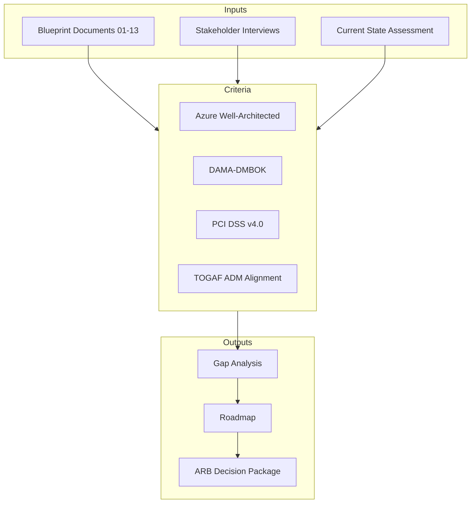
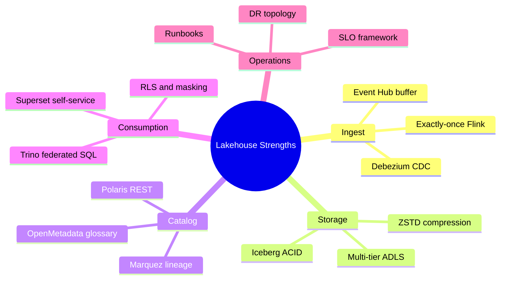
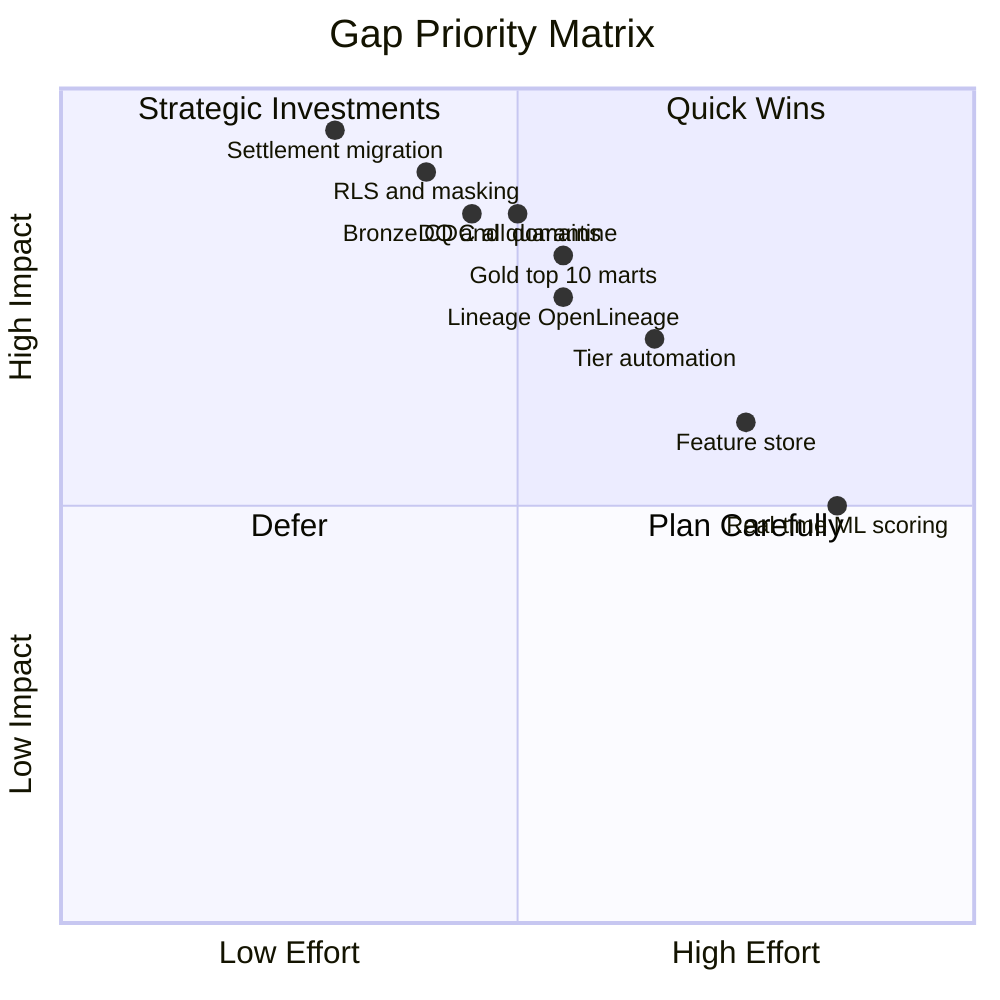
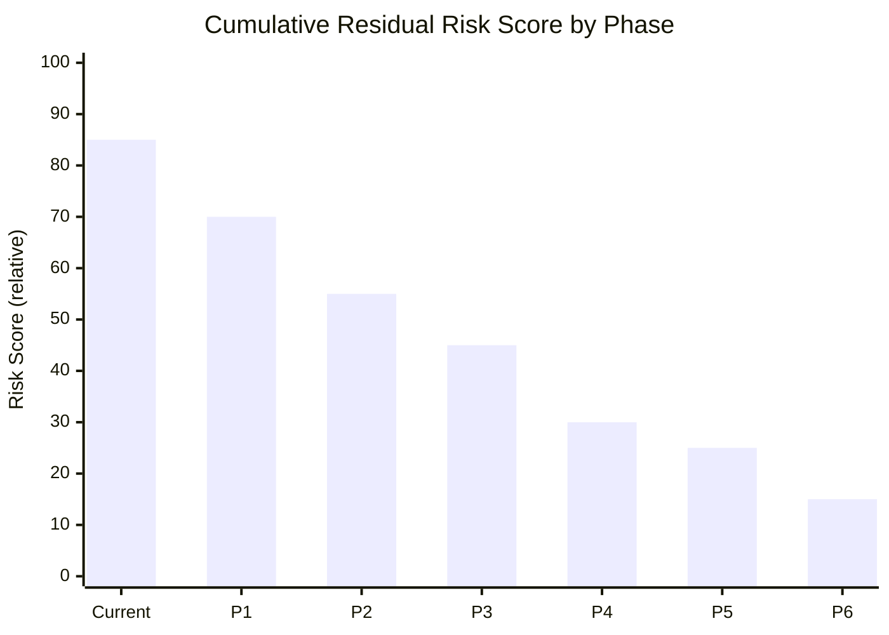
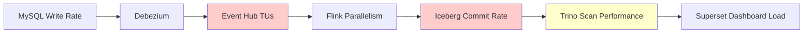
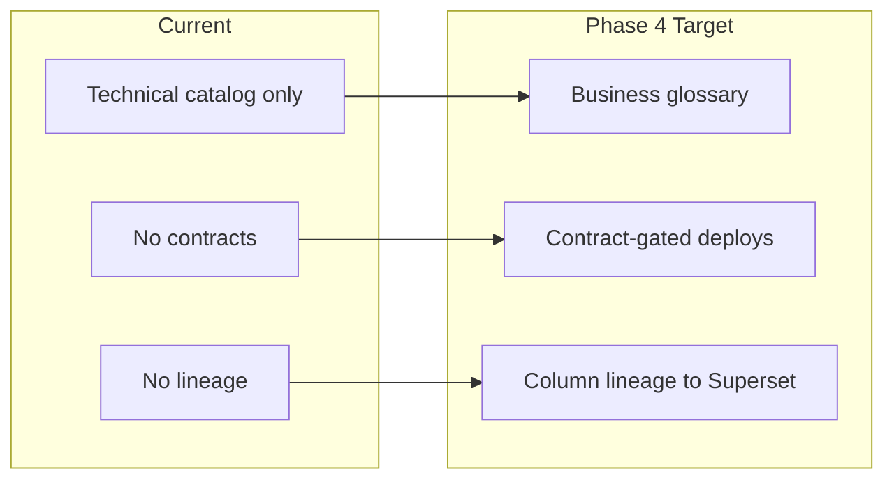
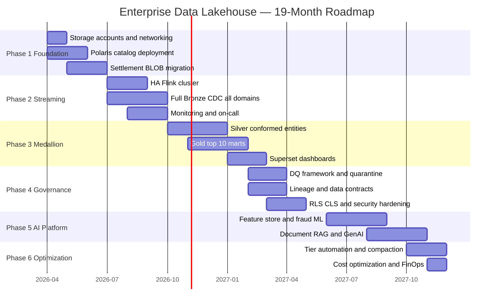
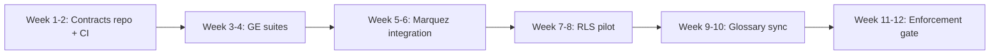
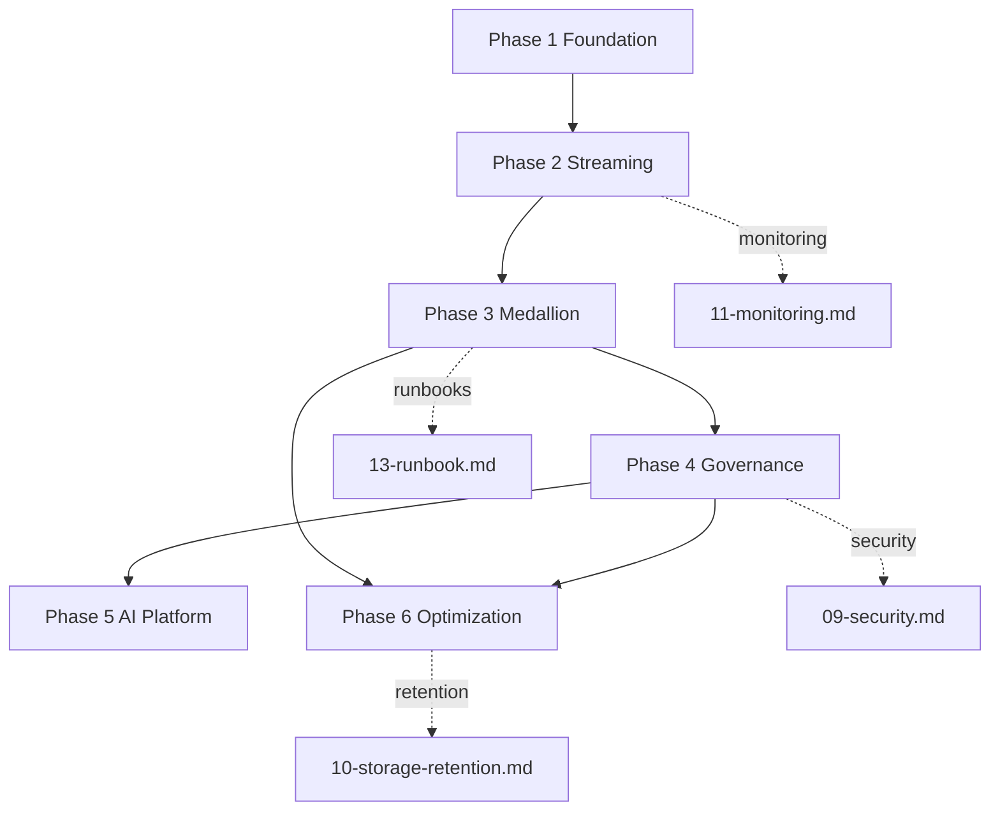

# Parts 21 & 22 — Architecture Review and Implementation Roadmap

**Document ID:** DLH-ARB-2026-001-14  
**Version:** 1.0.0  
**Classification:** Internal — Confidential  
**Status:** Draft — For ARB Review

---

## Table of Contents

### Part 21 — Architecture Review
1. [Overview](#1-overview)
2. [Review Methodology](#2-review-methodology)
3. [Architecture Strengths](#3-architecture-strengths)
4. [Weaknesses and Gaps](#4-weaknesses-and-gaps)
5. [Risk Register](#5-risk-register)
6. [Bottleneck Analysis](#6-bottleneck-analysis)
7. [Domain Review — Scalability](#7-domain-review--scalability)
8. [Domain Review — Cost](#8-domain-review--cost)
9. [Domain Review — Security](#9-domain-review--security)
10. [Domain Review — Governance](#10-domain-review--governance)
11. [Domain Review — Monitoring and Operations](#11-domain-review--monitoring-and-operations)
12. [Recommendations Summary](#12-recommendations-summary)

### Part 22 — Implementation Roadmap
13. [Roadmap Overview](#13-roadmap-overview)
14. [Phase 1 — Foundation](#14-phase-1--foundation)
15. [Phase 2 — Streaming](#15-phase-2--streaming)
16. [Phase 3 — Medallion](#16-phase-3--medallion)
17. [Phase 4 — Governance](#17-phase-4--governance)
18. [Phase 5 — AI Platform](#18-phase-5--ai-platform)
19. [Phase 6 — Optimization](#19-phase-6--optimization)
20. [Cross-Phase Dependencies](#20-cross-phase-dependencies)
21. [Resource and Investment Plan](#21-resource-and-investment-plan)
22. [Success Criteria and KPIs](#22-success-criteria-and-kpis)
23. [ARB Decision Request](#23-arb-decision-request)

---

# PART 21 — ARCHITECTURE REVIEW

## 1. Overview

### 1.1 Purpose

This document provides the **Architecture Review Board (ARB) assessment** of the proposed enterprise Data Lakehouse platform and the **authoritative six-phase implementation roadmap**. It synthesizes findings from all blueprint documents (`01`–`13`) into actionable strengths, gaps, risks, and a sequenced delivery plan.

### 1.2 Review Scope

| In Scope | Out of Scope |
|----------|--------------|
| Platform architecture (CDC → Iceberg → Trino → Superset) | Application team OLTP redesign |
| Medallion, governance, security, operations | Multi-cloud strategy |
| 19-month implementation roadmap | Vendor contract negotiation |
| ARB approval criteria | Detailed project budget sign-off |

### 1.3 Blueprint Document Map

| Phase Focus | Primary Reference Documents |
|-------------|----------------------------|
| Architecture | `02-production-architecture.md`, `03-medallion-architecture.md` |
| Layers | `04-bronze-layer.md`, `05-silver-layer.md`, `06-gold-layer.md` |
| Quality & governance | `07-data-quality.md`, `08-governance.md` |
| Security & retention | `09-security.md`, `10-storage-retention.md` |
| Operations | `11-monitoring.md`, `13-runbook.md` |
| AI / ML | `12-ml-ai-roadmap.md` |
| Business case | `01-executive-summary.md` |

### 1.4 Overall Assessment

| Dimension | Rating (1–5) | Current | Target (Post Phase 6) |
|-----------|--------------|---------|------------------------|
| Architecture soundness | — | 3 | 5 |
| Operational maturity | — | 2 | 4 |
| Governance maturity | — | 2 | 5 |
| Security posture | — | 3 | 5 |
| Cost efficiency | — | 2 | 4 |
| AI readiness | — | 1 | 4 |
| **Composite** | — | **2.2** | **4.5** |

**Recommendation:** **Approve for phased implementation** with conditions listed in §23.

---

## 2. Review Methodology

### 2.1 Evaluation Framework



### 2.2 Review Dimensions

| Dimension | Weight | Key Questions |
|-----------|--------|---------------|
| Scalability | 20% | Can the platform handle 2× annual data growth? |
| Reliability | 20% | What are RPO/RTO; is DR tested? |
| Security | 20% | Is PCI/PII properly isolated and masked? |
| Governance | 15% | Are contracts, lineage, and ownership enforced? |
| Cost | 10% | Is TCO predictable with tiering? |
| Operability | 15% | Can on-call restore service within SLO? |

### 2.3 Maturity Model Reference

| Level | Description | Platform State |
|-------|-------------|----------------|
| L1 Initial | Ad hoc, tribal knowledge | Current (pre-Phase 1) |
| L2 Repeatable | Documented; basic automation | Phase 2–3 target |
| L3 Defined | Standards enforced; SLOs | Phase 4 target |
| L4 Managed | Metrics-driven; DR tested | Phase 5–6 target |
| L5 Optimizing | Continuous improvement | Phase 6+ aspirational |

---

## 3. Architecture Strengths

### 3.1 Strategic Strengths

| ID | Strength | Evidence | Business Value |
|----|----------|----------|----------------|
| STR-01 | **Open lakehouse stack** | Iceberg + Polaris + Trino | No vendor lock-in; portable |
| STR-02 | **Proven CDC path** | Debezium → Event Hub → Flink operational | Low migration risk for ingest |
| STR-03 | **Decoupled compute** | Flink (write) vs Trino (read) | Independent scaling |
| STR-04 | **Medallion clarity** | Bronze/Silver/Gold with ownership | Reduced analyst confusion |
| STR-05 | **Azure-native integration** | Event Hub, ADLS, Entra ID, Private Link | Enterprise security alignment |
| STR-06 | **Time travel and replay** | Iceberg snapshots + Event Hub buffer | Incident recovery; audit |
| STR-07 | **Document storage modernized** | Merchant docs already in Blob | Foundation for RAG (Phase 5) |
| STR-08 | **Comprehensive blueprint** | 14-document ARB package | Single source of truth |

### 3.2 Technical Strengths by Layer



### 3.3 Competitive Position

| Capability | This Platform | Typical Cloud DW | Advantage |
|--------------|---------------|------------------|-----------|
| OLTP replay from CDC | ✅ Native | ❌ Batch ETL | Fresher data; lower lag |
| Open table format | ✅ Iceberg | ⚠ Proprietary | Portability |
| 5-year online query | ✅ Cool tier | ⚠ Expensive | Cost at scale |
| Document + transactional unified | ✅ Phase 3+ | ❌ Separate | Single merchant view |
| ML on same data | ✅ Phase 5 Feast | ⚠ Export required | No data duplication |

---

## 4. Weaknesses and Gaps

### 4.1 Challenge Register (Resolved by Roadmap)

| ID | Challenge | Severity | Resolving Phase | Blueprint Reference |
|----|-----------|----------|-----------------|---------------------|
| CH-01 | Settlement files in MySQL BLOB | **Critical** | Phase 1 | `01-executive-summary.md` §3.2 |
| CH-02 | No formal DQ layer | **High** | Phase 4 | `07-data-quality.md` |
| CH-03 | Incomplete metadata & lineage | **High** | Phase 4 | `08-governance.md` |
| CH-04 | Retention not automated | **High** | Phase 6 | `10-storage-retention.md` |
| CH-05 | Immature access control (RBAC only) | **High** | Phase 4 | `09-security.md` |
| CH-06 | Ad hoc operational runbooks | **Medium** | Phase 2 | `13-runbook.md` |
| CH-07 | Small file proliferation | **Medium** | Phase 6 | `13-runbook.md` §6 |
| CH-08 | Document ↔ analytics gap | **Medium** | Phase 3 | `05-silver-layer.md` |
| CH-09 | No ML feature foundation | **Medium** | Phase 5 | `12-ml-ai-roadmap.md` |
| CH-10 | Single-region DR gap | **Medium** | Phase 2 | `11-monitoring.md` §16 |

### 4.2 Residual Weaknesses (Post-Implementation Awareness)

| ID | Weakness | Why It Persists | Mitigation |
|----|----------|-----------------|------------|
| RW-01 | **Operational complexity** | Self-managed Flink + Iceberg compaction | Automated jobs; managed Prometheus/Grafana |
| RW-02 | **Dual scheduler model** | Airflow + Flink cron | Documented in runbook; consolidate Phase 6+ |
| RW-03 | **Silver maintenance overhead** | Medallion requires ongoing curation | Data contracts; steward ownership |
| RW-04 | **Cool tier cost (years 1–5)** | Business policy for online retention | Compression; summary marts |
| RW-05 | **No active-active multi-region** | Cost vs RTO 8 hr acceptable | Annual DR drill |
| RW-06 | **Polaris maturity** | Newer OSS catalog | PostgreSQL PITR; metadata backup |
| RW-07 | **Skills gap** | Flink + Iceberg expertise scarce | Training plan; hire 1 senior |

### 4.3 Gap Heat Map



---

## 5. Risk Register

### 5.1 Program Risks

| ID | Risk | L | I | Score | Mitigation | Phase |
|----|------|---|---|-------|------------|-------|
| R-01 | Settlement BLOB migration data loss | L | C | **High** | Checksum; parallel run; rollback | 1 |
| R-02 | CDC volume spike overwhelms Flink | M | H | **High** | Autoscale; backpressure alerts | 2 |
| R-03 | Gold scope creep delays Phase 3 | H | M | **High** | Top 10 marts only; defer long-tail | 3 |
| R-04 | Polaris outage blocks queries | L | H | **Medium** | PG backup; DR runbook | 2 |
| R-05 | PCI exposure via Trino | L | C | **High** | PCI namespace; CLS; audits | 4 |
| R-06 | Small files degrade query perf | H | M | **High** | Daily compaction | 3, 6 |
| R-07 | Governance adoption resistance | M | M | **Medium** | Executive sponsor; phased enforcement | 4 |
| R-08 | Iceberg/Polaris version skew | L | M | **Low** | Pin versions; stg validation | All |
| R-09 | Key person dependency (Flink) | M | H | **High** | Cross-training; documentation | 2 |
| R-10 | Azure OpenAI cost overrun | M | M | **Medium** | Token budgets; caching | 5 |
| R-11 | DR drill fails RTO | M | H | **High** | Semi-annual tests; runbook updates | 2, 4 |
| R-12 | MySQL schema change breaks CDC | M | H | **High** | Contract CI; Debezium schema evolution | 3 |

### 5.2 Risk Trend by Phase



### 5.3 Top 5 Risks Requiring ARB Attention

| Rank | Risk | Decision Needed |
|------|------|-----------------|
| 1 | R-01 Settlement migration | Approve maintenance window and rollback plan |
| 2 | R-05 PCI isolation | Approve `pci.*` namespace architecture |
| 3 | R-03 Gold scope | Approve top 10 mart list for Phase 3 |
| 4 | R-11 DR capability | Accept 8 hr RTO for full region outage |
| 5 | R-07 Governance enforcement | Approve contract-gated deploy policy |

---

## 6. Bottleneck Analysis

### 6.1 Current and Projected Bottlenecks

| Bottleneck | Layer | Symptom | Threshold | Remediation | Phase |
|------------|-------|---------|-----------|-------------|-------|
| BN-01 | Event Hub | `ServerBusyErrors` | TU > 80% | Scale TUs; partition count | 2 |
| BN-02 | Flink | Backpressure > 80% | Sustained 10 min | Increase parallelism / TaskManagers | 2 |
| BN-03 | Debezium | Binlog lag > 120 sec | Critical | Connector scale; MySQL read replica | 2 |
| BN-04 | Iceberg commits | Commit duration > 30 sec | Gold MERGE jobs | Reduce commit frequency; bundle writes |
| BN-05 | Trino | Queue depth > 20 | Interactive queries | Add workers; query governance |
| BN-06 | ADLS Hot | Small file ratio > 30% | Query p99 > 30 sec | Compaction; target 512 MB files | 6 |
| BN-07 | Polaris PG | Connection pool > 80% | API latency p99 > 2 sec | Pool tuning; read replica | 4 |
| BN-08 | Gold cascade | `kpi_daily` blocked | Past 06:30 UTC | Dependency-aware scheduler | 3 |

### 6.2 Throughput Projection (2× Annual Growth)

| Component | Year 1 Capacity | Year 3 at 2×/yr | Headroom Action |
|-----------|-----------------|-----------------|-----------------|
| Event Hub | 20 TUs | ~80 TUs needed | Partition plan; autoscale policy |
| Flink (txn) | 8 parallelism | 16–24 parallelism | K8s node pool expansion |
| ADLS Hot | 50 TB | 400 TB cumulative | Aggressive tier migration |
| Trino workers | 8 workers | 16–24 workers | Autoscale policy |
| Iceberg tables | 200 snapshots/table | Compaction critical | Stricter expire policy |

### 6.3 Bottleneck Dependency Chain



**Critical path:** Event Hub throughput → Flink processing → Iceberg file layout → Trino query performance.

---

## 7. Domain Review — Scalability

### 7.1 Scalability Assessment

| Component | Current Scale | 3-Year Target | Scalable? | Gap |
|-----------|---------------|---------------|-----------|-----|
| CDC ingest | ~5K events/sec | ~40K events/sec | ✅ Yes | Event Hub partitions |
| Bronze/Silver | 7 Flink jobs | 20+ jobs | ✅ Yes | K8s cluster sizing |
| Gold streaming | 4 near-real-time marts | 10 marts | ⚠ Partial | Commit contention |
| Trino | 8 workers | 24 workers | ✅ Yes | Coordinator HA exists |
| Storage | 50 TB | 400 TB | ✅ Yes | Tier automation required |
| Catalog | Single Polaris | Same | ⚠ Partial | PG scaling limits |
| ML scoring | Batch daily | Real-time | ❌ Phase 6 | Flink scoring needed |

### 7.2 Scalability Recommendations

| Priority | Recommendation | Phase |
|----------|----------------|-------|
| P0 | Event Hub partition count ≥ max Flink parallelism per topic | 2 |
| P0 | Flink autoscaling on consumer lag | 2 |
| P1 | Trino worker autoscale on queue depth | 3 |
| P1 | Iceberg partition spec review for high-cardinality tables | 3 |
| P2 | Polaris PostgreSQL flexible server scale-up plan | 4 |
| P2 | Gold table commit batching (micro-batch vs pure stream) | 6 |

### 7.3 Scalability Score: **4/5** (post Phase 6)

---

## 8. Domain Review — Cost

### 8.1 Cost Assessment

| Cost Area | Current State | Risk | Optimization (Phase) |
|-----------|---------------|------|----------------------|
| ADLS Hot | All data on Hot | **High** — 40%+ overspend | Tier migration (6) |
| Uncompacted files | Small files prevalent | **Medium** — IO cost | Compaction (3, 6) |
| Event Hub | Fixed TUs | **Medium** — over/under provision | Autoscale (2) |
| AKS | Static node pools | **Medium** | Cluster autoscaler (3) |
| Egress | Cross-service | **Low** | Private Link (1) |
| ML/GenAI | Not yet deployed | **Unknown** | Token budgets (5) |

### 8.2 TCO Model (Illustrative)

| Year | Data Volume | Without Tiering | With Tiering (Phase 6) | Savings |
|------|-------------|-----------------|------------------------|---------|
| Y1 | 50 TB | $125K | $110K | 12% |
| Y2 | 100 TB | $250K | $175K | 30% |
| Y3 | 200 TB | $500K | $280K | 44% |
| Y5 | 400 TB | $1.0M | $450K | 55% |

*Assumes Hot/Cool/Archive split per `10-storage-retention.md`; excludes compute.*

### 8.3 Cost Governance

| Control | Implementation | Phase |
|---------|----------------|-------|
| Storage cost dashboard | Grafana (`11-monitoring.md`) | 3 |
| Budget alerts | Azure Cost Management > 110% 7-day avg | 3 |
| Chargeback tags | `cost_center`, `domain` on all resources | 1 |
| Monthly FinOps review | Platform + Finance | 4 |

### 8.4 Cost Score: **3/5** (current) → **4/5** (post Phase 6)

---

## 9. Domain Review — Security

### 9.1 Security Assessment

| Control Domain | Current | Target | Gap |
|----------------|---------|--------|-----|
| Identity | Entra ID RBAC | RBAC + ABAC + PIM | ABAC policies Phase 4 |
| Data isolation | Namespace separation | + PCI namespace | Phase 4 |
| Encryption | Azure SSE | SSE-KMS per account | Phase 1 |
| Network | Partial Private Link | Full Private Link | Phase 1–2 |
| Masking | None | Trino CLS views | Phase 4 |
| RLS | None | Region-based RLS | Phase 4 |
| Audit | Partial | Full Trino + Sentinel | Phase 2–4 |
| Secret management | Key Vault | Key Vault Premium + rotation | Phase 2 |

### 9.2 PCI Scope Assessment

| Approach | PCI Scope | Recommendation |
|----------|-----------|----------------|
| PAN in lakehouse | **Expanded** — full platform in scope | ❌ Rejected (ADR-S09-007) |
| Token + behavioral only | **Reduced** — analytics out of scope | ✅ Approved |
| Isolated `pci.*` namespace | **Contained** — subset auditable | ✅ For fraud ML adjacent data |

### 9.3 Security Score: **3/5** (current) → **5/5** (post Phase 4)

---

## 10. Domain Review — Governance

### 10.1 Governance Assessment

| Capability | Current | Target | Phase |
|------------|---------|--------|-------|
| Business glossary | None | OpenMetadata glossary | 4 |
| Data contracts | None | Git + CI validation | 4 |
| Lineage | None | Marquez end-to-end | 4 |
| Ownership | Informal | RACI per table | 3 |
| Classification tags | Ad hoc | Contract YAML tags | 4 |
| Retention registry | None | `audit.retention_registry` | 6 |
| Steward workflow | None | PR approval on contracts | 4 |

### 10.2 Governance Maturity Gap



### 10.3 Governance Score: **2/5** (current) → **5/5** (post Phase 4)

---

## 11. Domain Review — Monitoring and Operations

### 11.1 Operations Assessment

| Capability | Current | Target | Phase |
|------------|---------|--------|-------|
| Unified dashboards | Ad hoc Azure Portal | Grafana suite (10 dashboards) | 3 |
| SLO framework | None | 9 platform SLOs | 3 |
| On-call rotation | Informal | PagerDuty 24/7 | 2 |
| Runbooks | Tribal knowledge | `13-runbook.md` linked alerts | 2 |
| DR testing | Never | Monthly–annual drill schedule | 2, 4 |
| Freshness monitoring | Manual | Automated exporter | 3 |
| Cost monitoring | None | FinOps dashboard | 3 |

### 11.2 MTTR Target

| Severity | Current MTTR | Target MTTR | Enabler |
|----------|--------------|-------------|---------|
| SEV-1 | ~4 hours | < 1 hour | Runbooks + on-call + checkpoints |
| SEV-2 | ~8 hours | < 4 hours | Alert routing + SLO dashboards |
| SEV-3 | Next day | < 8 hours | Warning alerts |

### 11.3 Operations Score: **2/5** (current) → **4/5** (post Phase 4)

---

## 12. Recommendations Summary

### 12.1 Must-Do (ARB Conditions for Approval)

| # | Recommendation | Owner | Phase |
|---|----------------|-------|-------|
| REC-01 | Execute settlement BLOB migration with validated rollback | Data Eng | 1 |
| REC-02 | Deploy Private Link for all data plane services | Platform | 1 |
| REC-03 | Implement HA Flink with checkpoint recovery | Data Eng | 2 |
| REC-04 | Limit Phase 3 Gold to **top 10 certified marts** | Analytics Lead | 3 |
| REC-05 | Enforce data contracts before Silver/Gold prod deploy | Governance | 4 |
| REC-06 | Pilot RLS/CLS on fraud and PCI-adjacent datasets | Security | 4 |
| REC-07 | Complete annual DR drill before Phase 4 sign-off | Platform | 4 |
| REC-08 | Automate tier migration before Year 2 data volume | Platform | 6 |

### 12.2 Should-Do (High Value)

| # | Recommendation | Phase |
|---|----------------|-------|
| REC-09 | Event Hub autoscale policy | 2 |
| REC-10 | OpenLineage on all Flink jobs | 3 |
| REC-11 | Daily compaction for Silver transaction table | 3 |
| REC-12 | Superset certified datasets linked to DQ scores | 4 |
| REC-13 | Feature store before fraud ML model | 5 |
| REC-14 | FinOps monthly review cadence | 4 |

### 12.3 Could-Do (Future)

| # | Recommendation | Phase |
|---|----------------|-------|
| REC-15 | Real-time Flink ML scoring | 6+ |
| REC-16 | Apache Ranger for Trino (replace view-based RLS) | 6+ |
| REC-17 | Active-active Trino read replica in DR region | 6+ |
| REC-18 | Data mesh domain ownership per business unit | 7+ |

---

# PART 22 — IMPLEMENTATION ROADMAP

## 13. Roadmap Overview

### 13.1 Phase Summary



### 13.2 Phase at a Glance

| Phase | Name | Duration | FTE | Primary Outcome |
|-------|------|----------|-----|-----------------|
| **1** | Foundation | 3 months | 3–4 | Storage, catalog, settlement migration |
| **2** | Streaming | 3 months | 4 | HA CDC pipeline, Bronze complete |
| **3** | Medallion | 4 months | 5 | Silver/Gold, Superset live |
| **4** | Governance | 3 months | 3 | DQ, lineage, contracts, RLS |
| **5** | AI Platform | 4 months | 4 | Feature store, fraud ML, RAG |
| **6** | Optimization | 2 months | 2 | Tiering, compaction, cost control |
| | **Total** | **~19 months** | **3–5 avg** | **Production-grade lakehouse** |

### 13.3 Capability Maturity by Phase

| Capability | P1 | P2 | P3 | P4 | P5 | P6 |
|------------|----|----|----|----|----|----|
| Bronze CDC | — | ✅ | ✅ | ✅ | ✅ | ✅ |
| Silver conformed | — | — | ✅ | ✅ | ✅ | ✅ |
| Gold marts | — | — | ✅ | ✅ | ✅ | ✅ |
| DQ framework | — | — | ⚠ Basic | ✅ | ✅ | ✅ |
| Lineage | — | — | — | ✅ | ✅ | ✅ |
| RLS/CLS | — | — | — | ✅ | ✅ | ✅ |
| ML/AI | — | — | — | — | ✅ | ✅ |
| Tier automation | — | — | — | — | — | ✅ |
| DR tested | — | ⚠ | ⚠ | ✅ | ✅ | ✅ |

---

## 14. Phase 1 — Foundation

**Duration:** Months 1–3  
**Theme:** *Build the platform substrate; eliminate critical legacy risk*

### 14.1 Objectives

| ID | Objective |
|----|-----------|
| P1-O1 | Provision ADLS storage accounts with encryption and Private Link |
| P1-O2 | Deploy Apache Polaris catalog (prod + stg) |
| P1-O3 | Migrate settlement files from MySQL BLOB to `stdocumentsprod` |
| P1-O4 | Establish Git repos, CI skeleton, and naming standards |
| P1-O5 | Network foundation: VNet, Private DNS, Key Vault |

### 14.2 Deliverables

| # | Deliverable | Acceptance Criteria |
|---|-------------|---------------------|
| D1.1 | 6 storage accounts provisioned | `stlakehotprod`, `stlakecoolprod`, `stlakearchiveprod`, `stlakeopsprod`, `stdocumentsprod`, `stauditprod` |
| D1.2 | Polaris catalog `lakehouse` live | Trino can CREATE TABLE on stg |
| D1.3 | Settlement BLOB migration complete | Zero settlement BLOBs in MySQL; checksum validated |
| D1.4 | `silver_settlement.settlement_files` metadata schema | Contract drafted |
| D1.5 | Private Link on storage + Key Vault | No public blob endpoints |
| D1.6 | `data-platform` Git repo initialized | Branch strategy; gitleaks CI |
| D1.7 | Cost tagging policy applied | All resources tagged |

### 14.3 Key Tasks

| Task | Owner | Weeks |
|------|-------|-------|
| ADLS provisioning + RBAC | Platform | 1–2 |
| Polaris Helm deploy + PostgreSQL | Platform | 2–4 |
| Settlement migration runbook execution | Data Eng + App DBA | 4–8 |
| Trino catalog integration test | Platform | 6–8 |
| Security baseline review | Security | 8–10 |

### 14.4 Dependencies

| Dependency | Type | Status |
|------------|------|--------|
| Azure subscription quota | External | Required |
| MySQL maintenance window for migration | App DBA | Required |
| Entra ID groups provisioned | Security | Required |

### 14.5 Risks

| Risk | Mitigation |
|------|------------|
| R-01 Settlement data loss | Parallel run; checksum; rollback |
| Network misconfiguration | Architecture review before prod |

### 14.6 Effort Estimate

| Role | FTE × Months |
|------|--------------|
| Platform Engineer | 1.5 × 3 |
| Data Engineer | 1.0 × 3 |
| Security Engineer | 0.25 × 3 |
| App DBA | 0.25 × 2 |
| **Total** | **~10 FTE-months** |

### 14.7 Exit Criteria

- [ ] Settlement BLOB count in MySQL = 0
- [ ] Polaris catalog accessible from Trino (stg + prod)
- [ ] All storage accounts on Private Link
- [ ] Phase 1 ARB checkpoint passed

---

## 15. Phase 2 — Streaming

**Duration:** Months 4–6  
**Theme:** *Reliable, observable CDC ingestion for all domains*

### 15.1 Objectives

| ID | Objective |
|----|-----------|
| P2-O1 | Deploy HA Flink cluster with checkpoint recovery |
| P2-O2 | Bronze CDC for all 7 ingest paths operational |
| P2-O3 | DLQ/quarantine foundation for bad records |
| P2-O4 | Monitoring stack live (Prometheus + Grafana) |
| P2-O5 | On-call rotation and DR baseline (Event Hub Geo-DR) |

### 15.2 Deliverables

| # | Deliverable | Acceptance Criteria |
|---|-------------|---------------------|
| D2.1 | 7 Bronze Flink jobs running | All jobs checkpointing < 5 min |
| D2.2 | Debezium HA (2 replicas) | Connector auto-restart verified |
| D2.3 | DLQ → `dq.quarantine_records` | Invalid records captured |
| D2.4 | Grafana Platform Overview dashboard | E2E lag visible |
| D2.5 | PagerDuty on-call integrated | Critical alerts route correctly |
| D2.6 | `13-runbook.md` incident runbooks tested | Flink restore drill passed |
| D2.7 | Event Hub Geo-DR pairing enabled | Failover documented |

### 15.3 Bronze Job Checklist

| Job | Domain | Phase 2 Sprint |
|-----|--------|----------------|
| `flink-bronze-merchant-merchants-prod` | Merchant | S1 |
| `flink-bronze-transaction-transactions-prod` | Transaction | S1 |
| `flink-bronze-settlement-settlements-prod` | Settlement | S2 |
| `flink-bronze-document-events-prod` | Document | S2 |
| Remaining Bronze jobs | All | S3 |

### 15.4 Dependencies

| Dependency | Requires |
|------------|----------|
| Phase 1 complete | Polaris, storage, networking |
| Event Hub namespace provisioned | Platform |
| Debezium connector configs approved | App DBA |

### 15.5 Risks

| Risk | Mitigation |
|------|------------|
| R-02 CDC volume spike | TU autoscale; lag alerts |
| R-09 Key person dependency | Pair programming; docs |

### 15.6 Effort Estimate: **~12 FTE-months**

### 15.7 Exit Criteria

- [ ] All Bronze tables receiving CDC data
- [ ] E2E CDC lag p99 ≤ 5 min (7 consecutive days)
- [ ] On-call rotation live
- [ ] Monthly checkpoint restore drill passed

---

## 16. Phase 3 — Medallion

**Duration:** Months 7–10  
**Theme:** *Business-ready Silver entities and Gold analytics marts*

### 16.1 Objectives

| ID | Objective |
|----|-----------|
| P3-O1 | Silver conformed entities for all core domains |
| P3-O2 | Top 10 Gold marts certified and refreshed per SLA |
| P3-O3 | Superset dashboards for executive and operational use |
| P3-O4 | Document metadata linked to merchant analytics |
| P3-O5 | Basic compaction schedule operational |

### 16.2 Gold Mart Priority List (Phase 3 Scope)

| Priority | Mart | Namespace | Refresh | Consumer |
|----------|------|-----------|---------|----------|
| P0 | `transaction_dashboard` | `gold_ops` | 5 min | Ops |
| P0 | `fraud_summary` | `gold_risk` | 15 min | Fraud |
| P0 | `kpi_daily` | `gold_exec` | Daily 06:00 | Executive |
| P1 | `merchant_daily_summary` | `gold_merchant` | Hourly | Analytics |
| P1 | `settlement_summary` | `gold_settlement` | Hourly | Finance |
| P1 | `revenue_analytics` | `gold_finance` | Daily | Finance |
| P2 | `merchant_analytics` | `gold_merchant` | Daily | Analytics |
| P2 | `executive_dashboard` | `gold_exec` | Daily 06:30 | Executive |
| P2 | `document_compliance_summary` | `gold_compliance` | Daily | Compliance |
| P2 | `customer_analytics` | `gold_customer` | Daily | Product |

**Deferred post-Phase 3:** Long-tail domain marts, experimental aggregates.

### 16.3 Silver Deliverables

| Namespace | Tables | SCD Type |
|-----------|--------|----------|
| `silver_merchant` | `merchants`, `merchant_addresses` | Type 2 |
| `silver_transaction` | `transactions`, `authorizations` | Type 1 |
| `silver_settlement` | `settlements`, `settlement_files` | Type 1 |
| `silver_document` | `document_metadata` | Type 1 |
| `silver_reference` | `ref_*` tables | Type 1 |

### 16.4 Superset Dashboards

| Dashboard | Source Mart | Audience |
|-----------|-------------|----------|
| Executive KPI | `gold_exec.kpi_daily` | C-suite |
| Transaction Monitor | `gold_ops.transaction_dashboard` | Operations |
| Fraud Monitor | `gold_risk.fraud_summary` | Fraud team |
| Merchant Performance | `gold_merchant.merchant_daily_summary` | Analytics |
| Settlement Overview | `gold_settlement.settlement_summary` | Finance |

### 16.5 Dependencies

| Dependency | Requires |
|------------|----------|
| Phase 2 Bronze stable | 7 consecutive days lag SLO |
| Superset cluster deployed | Platform (Phase 2) |
| Analyst requirements signed off | Analytics Lead |

### 16.6 Risks

| Risk | Mitigation |
|------|------------|
| R-03 Gold scope creep | Strict top 10 list; change control |
| R-06 Small files | Compaction job from Week 1 of Phase 3 |

### 16.7 Effort Estimate: **~20 FTE-months**

### 16.8 Exit Criteria

- [ ] All Silver tables populated with DQ inline checks
- [ ] Top 10 Gold marts meeting freshness SLOs (7 days)
- [ ] 5 Superset dashboards in production use
- [ ] CH-08 document-analytics gap closed

---

## 17. Phase 4 — Governance

**Duration:** Months 11–13  
**Theme:** *Trust, compliance, and enforceable data standards*

### 17.1 Objectives

| ID | Objective |
|----|-----------|
| P4-O1 | Great Expectations batch validation on Silver and Gold |
| P4-O2 | Data contracts repo with CI gates |
| P4-O3 | OpenLineage/Marquez end-to-end lineage |
| P4-O4 | RLS and column masking on Trino |
| P4-O5 | OpenMetadata business glossary synced |
| P4-O6 | Full DR drill program operational |

### 17.2 Deliverables

| # | Deliverable | Acceptance Criteria |
|---|-------------|---------------------|
| D4.1 | `data-contracts` Git repo | All Silver + Gold tables contracted |
| D4.2 | GE daily checkpoint job | Suites pass on certified marts |
| D4.3 | DQ score ≥ 95% on Gold (30 days) | `dq.dq_scores` |
| D4.4 | Marquez lineage MySQL → Superset | Demo impact analysis |
| D4.5 | RLS on `gold_risk.*` | Region filter enforced |
| D4.6 | Masked views for PII columns | `09-security.md` compliance |
| D4.7 | Quarantine triage SLA | No P1 records > 72 hr |
| D4.8 | Semi-annual DR drill completed | RTO documented |

### 17.3 Governance Rollout Sequence



### 17.4 Dependencies

| Dependency | Requires |
|------------|----------|
| Phase 3 Gold marts stable | Freshness SLO 7 days |
| Security review for RLS | Security team availability |
| Steward assignments | Governance council |

### 17.5 Risks

| Risk | Mitigation |
|------|------------|
| R-05 PCI exposure | Namespace isolation; penetration test |
| R-07 Governance resistance | Executive memo; phased enforcement |

### 17.6 Effort Estimate: **~9 FTE-months**

### 17.7 Exit Criteria

- [ ] CH-02, CH-03, CH-05 resolved
- [ ] Contract-gated deploys enforced in CI
- [ ] DQ score ≥ 95% Gold for 30 consecutive days
- [ ] DR drill RTO ≤ 8 hr documented

---

## 18. Phase 5 — AI Platform

**Duration:** Months 14–17  
**Theme:** *ML and GenAI on governed lakehouse data*

### 18.1 Objectives

| ID | Objective |
|----|-----------|
| P5-O1 | Feast feature store on Iceberg operational |
| P5-O2 | Fraud ML model in production (batch scoring) |
| P5-O3 | Merchant risk score published daily |
| P5-O4 | Document embedding pipeline + Azure AI Search |
| P5-O5 | RAG MVP for underwriter document Q&A |

### 18.2 Deliverables

| # | Deliverable | Reference |
|---|-------------|-----------|
| D5.1 | 20+ features in Feast registry | `12-ml-ai-roadmap.md` §5 |
| D5.2 | Fraud model AUC ≥ 0.92 | MLflow registry |
| D5.3 | `anomaly_score` in `gold_risk.fraud_summary` | Daily batch |
| D5.4 | `gold_risk.merchant_risk_score` | Daily |
| D5.5 | Azure AI Search index (3 doc types) | KYC, bank statement, agreement |
| D5.6 | RAG eval recall@5 ≥ 0.85 | Eval report |
| D5.7 | GenAI audit logging 100% | `audit.genai_queries` |

### 18.3 Phase 5 Sprint Map

| Sprint | Focus | Key Output |
|--------|-------|------------|
| P5-S1–S2 | Feature store + MLflow | Feast MVP |
| P5-S3–S4 | Fraud model training + scoring | Production model |
| P5-S5 | Merchant risk scorecard | Gold mart |
| P5-S6–S7 | Embeddings + RAG | Underwriter pilot |
| P5-S8–S10 | Underwriting assist + governance | Phase 5 ARB review |

*Detailed sprint plan: `12-ml-ai-roadmap.md` §15.*

### 18.4 Dependencies

| Dependency | Requires |
|------------|----------|
| Phase 4 DQ ≥ 95% | Training data quality |
| Azure OpenAI quota approved | AI Platform |
| Fraud ops label feedback process | Fraud team |

### 18.5 Risks

| Risk | Mitigation |
|------|------------|
| R-10 GenAI cost overrun | Token budgets; caching |
| Model fairness concerns | SHAP; scorecard interpretability |

### 18.6 Effort Estimate: **~16 FTE-months**

### 18.7 Exit Criteria

- [ ] CH-09 resolved
- [ ] ML-01 through ML-06 outcomes met (`12-ml-ai-roadmap.md`)
- [ ] No PCI/PAN in feature store (security audit)

---

## 19. Phase 6 — Optimization

**Duration:** Months 18–19  
**Theme:** *Cost efficiency, performance tuning, long-term sustainability*

### 19.1 Objectives

| ID | Objective |
|----|-----------|
| P6-O1 | Automated tier migration (Hot → Cool → Archive) |
| P6-O2 | Compaction and small-file elimination |
| P6-O3 | Storage cost reduction ≥ 30% on historical data |
| P6-O4 | FinOps dashboard and monthly review cadence |
| P6-O5 | Performance tuning for largest tables |

### 19.2 Deliverables

| # | Deliverable | Acceptance Criteria |
|---|-------------|---------------------|
| D6.1 | `job-tier-migration-daily` operational | LIF-06 zero mismatches 30 days |
| D6.2 | `audit.retention_registry` complete | 100% tables registered |
| D6.3 | Small file ratio < 20% all Silver/Gold | Partition inventory |
| D6.4 | Storage cost dashboard | Grafana live |
| D6.5 | Archive summary rollup marts | Query old data via summaries |
| D6.6 | Z-order compaction on `silver_transaction.transactions` | Query p99 improvement ≥ 20% |

### 19.3 Lifecycle Job Activation

| Job | Schedule | Phase 6 Gate |
|-----|----------|--------------|
| `job-compaction-daily` | 02:00 UTC | Running 30 days clean |
| `job-tier-migration-daily` | 01:00 UTC | First migration verified |
| `job-snapshot-expire` | 03:00 UTC | Per-layer retention enforced |
| `job-retention-audit` | Weekly | First audit report filed |
| `job-archive-summary-rollup` | Monthly | First rollup mart published |

### 19.4 Dependencies

| Dependency | Requires |
|------------|----------|
| Phase 3+ data volume | Sufficient data for tier migration |
| Partition inventory accurate | LIF-05 running 30 days |
| Finance FinOps stakeholder | Monthly review scheduled |

### 19.5 Risks

| Risk | Mitigation |
|------|------------|
| Tier migration data integrity | Pre-migration snapshot; verification job |
| Archive rehydrate friction | Self-service ticket process |

### 19.6 Effort Estimate: **~4 FTE-months**

### 19.7 Exit Criteria

- [ ] CH-04, CH-07 resolved
- [ ] Storage cost ≤ 15% YoY at 2× volume (BG-08)
- [ ] Platform maturity L4 achieved
- [ ] Final ARB sign-off for program closure

---

## 20. Cross-Phase Dependencies

### 20.1 Dependency Graph



### 20.2 Parallel Workstreams

| Workstream | Phases | Can Parallel With |
|------------|--------|-------------------|
| Platform infra | 1, 2, 6 | Data pipeline work |
| Security hardening | 1, 2, 4 | Governance |
| Analytics / Superset | 3, 4 | Gold development |
| ML platform prep | 4, 5 | Governance (contracts for features) |
| FinOps | 3, 6 | Any |

### 20.3 Critical Path

```
Phase 1 (settlement migration)
  → Phase 2 (Bronze CDC stable)
    → Phase 3 (Gold kpi_daily)
      → Phase 4 (DQ certification)
        → Phase 5 (fraud ML)
```

**Critical path duration:** ~17 months. Phase 6 can overlap with Phase 5 final sprints.

---

## 21. Resource and Investment Plan

### 21.1 Team Structure

| Role | Phase 1 | Phase 2 | Phase 3 | Phase 4 | Phase 5 | Phase 6 |
|------|---------|---------|---------|---------|---------|---------|
| Data Engineer | 2 | 3 | 4 | 2 | 2 | 1 |
| Platform Engineer | 1 | 1 | 1 | 1 | 1 | 1 |
| Analytics Engineer | 0 | 0 | 1 | 1 | 0 | 0 |
| ML Engineer | 0 | 0 | 0 | 0 | 2 | 0 |
| Security Engineer | 0.25 | 0.25 | 0 | 0.5 | 0.25 | 0 |
| Data Steward | 0 | 0 | 0.5 | 1 | 0.5 | 0 |
| **Total FTE** | **3.25** | **4.25** | **5.5** | **5.5** | **4.75** | **2** |

### 21.2 Investment Summary

| Category | Phase 1–3 | Phase 4–6 | Total (19 mo) |
|----------|-----------|-----------|---------------|
| People (FTE-months) | ~42 | ~30 | **~72** |
| Azure infra (incremental) | $180K | $120K | **~$300K** |
| Tooling (GE, Marquez, MLflow) | $20K | $30K | **~$50K** |
| Training and enablement | $10K | $15K | **~$25K** |
| **Total estimated** | **~$210K** | **~$165K** | **~$375K** |

*Infrastructure estimates exclude baseline AKS/Event Hub already provisioned. Finance validation required.*

### 21.3 Ongoing Run Cost (Steady State Post Phase 6)

| Component | Monthly (USD) |
|-----------|---------------|
| ADLS (tiered) | $15K–$35K |
| AKS (Flink, Trino, Airflow) | $8K–$15K |
| Event Hub Premium | $3K–$8K |
| Monitoring + SIEM | $2K–$4K |
| ML/GenAI (Phase 5+) | $5K–$10K |
| **Total steady state** | **~$33K–$72K/mo** |

---

## 22. Success Criteria and KPIs

### 22.1 Program-Level KPIs

| KPI ID | Metric | Baseline | Phase 3 | Phase 6 Target |
|--------|--------|----------|---------|----------------|
| KPI-01 | Executive KPIs from Gold layer | 0% | 80% | **95%** |
| KPI-02 | Gold freshness p99 | Unknown | 15 min | **≤ 15 min** |
| KPI-03 | Gold DQ score | N/A | 90% | **≥ 95%** |
| KPI-04 | Self-service query rate | 20% | 60% | **80%** |
| KPI-05 | Pipeline MTTR (SEV-1) | 4 hr | 2 hr | **≤ 1 hr** |
| KPI-06 | Storage cost vs budget | Uncontrolled | +10% | **≤ +15% YoY at 2× vol** |
| KPI-07 | Lineage coverage | 0% | — | **100% certified marts** |
| KPI-08 | Fraud ML AUC | N/A | — | **≥ 0.92** |
| KPI-09 | DR drill RTO | Untested | — | **≤ 8 hr** |
| KPI-10 | Settlement files in MySQL | 100% | **0%** | **0%** |

### 22.2 Business Goal Alignment

| Business Goal (`01-executive-summary.md`) | Roadmap Phase |
|-------------------------------------------|---------------|
| BG-01 Unified analytics | Phase 3 |
| BG-02 Near-real-time insight | Phase 3 |
| BG-03 Regulatory retention | Phase 6 |
| BG-04 Settlement modernization | Phase 1 |
| BG-05 Self-service BI | Phase 3–4 |
| BG-06 Data trust | Phase 4 |
| BG-07 AI readiness | Phase 5 |
| BG-08 Cost predictability | Phase 6 |

### 22.3 Phase Gate Review Process

| Gate | Timing | Review Board | Go/No-Go Criteria |
|------|--------|--------------|-------------------|
| G1 | End Phase 1 | ARB | Exit criteria §14.7 |
| G2 | End Phase 2 | ARB + Ops | Exit criteria §15.7 |
| G3 | End Phase 3 | ARB + Analytics | Exit criteria §16.8 |
| G4 | End Phase 4 | ARB + Security + Governance | Exit criteria §17.7 |
| G5 | End Phase 5 | ARB + Fraud/Risk | Exit criteria §18.7 |
| G6 | End Phase 6 | ARB + Finance | Exit criteria §19.7 |

---

## 23. ARB Decision Request

### 23.1 Decision Sought

The Architecture Review Board is requested to:

1. **Approve** the enterprise Data Lakehouse target architecture as documented in blueprint files `01`–`13`.
2. **Authorize** phased implementation per the 6-phase roadmap (§13–§19).
3. **Endorse** the settlement BLOB migration (Phase 1) including approved maintenance window.
4. **Accept** the 8-hour RTO for full regional DR outage (`11-monitoring.md`).
5. **Mandate** data contract enforcement for Silver/Gold production deploys (Phase 4).
6. **Approve** PCI isolation strategy: no PAN in lakehouse; `pci.*` namespace for restricted analytics.

### 23.2 Conditions of Approval

| # | Condition | Owner | Due |
|---|-----------|-------|-----|
| C-01 | Settlement migration rollback plan reviewed by App DBA | Data Eng | Before Phase 1 start |
| C-02 | Top 10 Gold mart list signed by Analytics Lead | Analytics | Before Phase 3 start |
| C-03 | Security penetration test on Trino RLS before Phase 4 gate | Security | Phase 4 Week 8 |
| C-04 | FinOps stakeholder assigned for Phase 6 | Finance | Before Phase 6 start |
| C-05 | Fraud team commits to ML label feedback loop | Fraud Ops | Before Phase 5 start |

### 23.3 What We Are NOT Asking ARB to Approve Today

| Item | Reason |
|------|--------|
| Detailed Azure spend commitment | Finance budget process separate |
| Headcount hiring plan | HR process separate |
| Azure OpenAI token budget | Phase 5 procurement |
| Active-active multi-region | Deferred; 8 hr RTO accepted |

### 23.4 Architecture Review Scorecard — Final

| Dimension | Score | Verdict |
|-----------|-------|---------|
| Technical soundness | **4.5/5** | Strong open lakehouse design |
| Security and compliance | **4/5** | Achievable with Phase 4 controls |
| Operational readiness | **4/5** | Runbooks and SLOs defined |
| Cost sustainability | **3.5/5** | Depends on Phase 6 tier automation |
| Deliverability | **4/5** | Realistic 19-month plan with clear phases |
| **Overall** | **4/5** | **Recommend approval** |

### 23.5 Post-Approval Next Steps

| # | Action | Owner | Timeline |
|---|--------|-------|----------|
| 1 | ARB sign-off recorded in `README.md` approval table | Governance | ARB meeting |
| 2 | Create Phase 1 Jira epic and sprint backlog | Data Eng Lead | Week 1 |
| 3 | Schedule settlement migration window | App DBA | Week 2–4 |
| 4 | Kickoff communication to stakeholders | Program Manager | Week 1 |
| 5 | Baseline KPI measurements (KPI-01 through KPI-05) | Analytics | Week 1 |

---

## Appendix A — Phase Deliverable Traceability Matrix

| Deliverable | Phase | Document Reference |
|-------------|-------|-------------------|
| Bronze CDC tables | 2 | `04-bronze-layer.md` |
| Silver conformed entities | 3 | `05-silver-layer.md` |
| Gold marts | 3 | `06-gold-layer.md` |
| DQ framework | 4 | `07-data-quality.md` |
| Data contracts + lineage | 4 | `08-governance.md` |
| RLS/CLS/security | 4 | `09-security.md` |
| Tier automation | 6 | `10-storage-retention.md` |
| Monitoring + DR | 2, 4 | `11-monitoring.md` |
| Feature store + RAG | 5 | `12-ml-ai-roadmap.md` |
| Runbooks + standards | 2, 4 | `13-runbook.md` |

---

## Appendix B — Challenge Resolution Tracker

| Challenge ID | Description | Resolution Phase | Status |
|--------------|-------------|------------------|--------|
| CH-01 | Settlement BLOB in MySQL | Phase 1 | ⏳ Planned |
| CH-02 | No DQ framework | Phase 4 | ⏳ Planned |
| CH-03 | Incomplete lineage | Phase 4 | ⏳ Planned |
| CH-04 | Retention not automated | Phase 6 | ⏳ Planned |
| CH-05 | Immature access control | Phase 4 | ⏳ Planned |
| CH-06 | Ad hoc runbooks | Phase 2 | ⏳ Planned |
| CH-07 | Small file proliferation | Phase 6 | ⏳ Planned |
| CH-08 | Document-analytics gap | Phase 3 | ⏳ Planned |
| CH-09 | No ML foundation | Phase 5 | ⏳ Planned |
| CH-10 | DR gap | Phase 2 | ⏳ Planned |

---

## Appendix C — Document Index (Complete Blueprint)

| File | Status | ARB Parts |
|------|--------|-------------|
| `README.md` | ✅ Complete | Index |
| `01-executive-summary.md` | ✅ Complete | Part 1 |
| `02-production-architecture.md` | ✅ Complete | Part 2 |
| `03-medallion-architecture.md` | ✅ Complete | Part 3 |
| `04-bronze-layer.md` | ✅ Complete | Part 4 |
| `05-silver-layer.md` | ✅ Complete | Part 5 |
| `06-gold-layer.md` | ✅ Complete | Part 6 |
| `07-data-quality.md` | ✅ Complete | Part 7 |
| `08-governance.md` | ✅ Complete | Parts 8, 9 |
| `09-security.md` | ✅ Complete | Part 10 |
| `10-storage-retention.md` | ✅ Complete | Parts 11, 12 |
| `11-monitoring.md` | ✅ Complete | Parts 16, 17 |
| `12-ml-ai-roadmap.md` | ✅ Complete | Part 18 |
| `13-runbook.md` | ✅ Complete | Parts 19, 20 |
| `14-roadmap.md` | ✅ Complete | Parts 21, 22 |

**Blueprint package:** 15 files — **100% complete** — ready for ARB submission.

---

## Appendix D — Revision History

| Version | Date | Author | Changes |
|---------|------|--------|---------|
| 1.0.0 | 2026-07-02 | Data Platform Architecture | Initial architecture review and roadmap |
